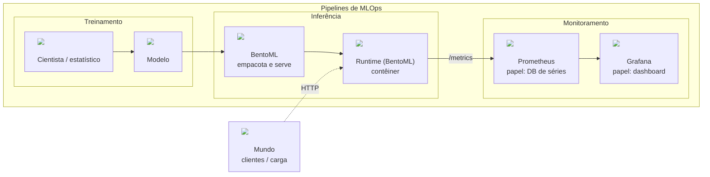

# Aula 000 — Pipelines de MLOps e objetivos de monitoramento

Este repositório (`bentoML-processamento-imagens`) ensina, pasta a pasta, a
observar um serviço BentoML de processamento de imagens: do vocabulário de
histograma e CDF até drift entre corpus e pedidos reais, passando pela saúde
do servidor e pela instrumentação no runtime. A pasta `000` é a abertura dessa
trilha. Ela fixa o mapa treinamento → inferência → monitoramento, nomeia três
**objetivos finais** de monitoramento e propõe uma **ordem de leitura em quatro
atos**. Os números das pastas permanecem estáveis para links e material já
publicado; a ordem em que você *estuda* não precisa coincidir com a ordem
numérica das pastas.

O runtime que atende o “mundo” (clientes e carga HTTP) é o Runtime (BentoML): o
BentoML empacota o modelo, sobe o processo e publica métricas em `GET /metrics`.
Dali o caminho de observabilidade é BentoML → Prometheus → Grafana. O
[tutorial de Prometheus](../docs/prometheus.md) instala o coletor, aponta-o a
esse endpoint e consulta latência (p95) e linhas de base em PromQL. O
[tutorial de Grafana](../docs/grafana.md) consulta esse Prometheus e monta
painéis (volume, p95, anomalia em relação à janela móvel).

## Objetivos finais de monitoramento

Estes três fins atravessam a trilha inteira. **Não** são a mesma coisa que os
quatro atos da ordem de estudo: os atos organizam *como* você aprende; os
objetivos nomeiam *o que* o monitoramento deve vigiar no fim.

1. Saúde do servidor — o serviço responde; taxa de erro e latência em faixa
   aceitável no caminho BentoML → Prometheus → Grafana.
2. Drift de dados — a distribuição dos pedidos (ou das features) se afasta do
   corpus de referência.
3. Detecção de anomalias — uma janela de métrica foge da linha de base (por
   exemplo média ± k desvios-padrão no p95).

Na prática didática, a saúde ganha um ato próprio (leitura de séries e
latência). Drift e anomalia compartilham o teatro final de alertas sobre
distribuições de imagem — com aulas distintas dentro desse ato. A
instrumentação no serviço (corpus, log, rotas de monitor) é um ato de *ponte*:
prepara o caminho dos dados, sem substituir o julgamento do alerta.

## Visão de arquitetura

As figuras em [`illustrations/`](illustrations/) mostram o mesmo mapa em três
batidas: pipelines de MLOps (com Runtime (BentoML) no contêiner), o caminho-alvo
BentoML → Prometheus → Grafana, e o mapa dos objetivos finais para as pastas da
trilha. O diagrama abaixo resume as camadas sem listar as pastas numeradas.



## Portas locais padrão

Neste repositório as portas abaixo são **contrato** para todas as aulas e
tutoriais. Detalhe e auxiliares: [`docs/ports.md`](../docs/ports.md).
Instalação: [Prometheus](../docs/prometheus.md), [Grafana](../docs/grafana.md).

### Trio canônico

| Serviço | Porta | URL local |
| :--- | ---: | :--- |
| **BentoML** (API + `GET /metrics`) | **3000** | <http://127.0.0.1:3000> |
| **Prometheus** (coleta + UI/API) | **9090** | <http://127.0.0.1:9090> |
| **Grafana** (painéis) | **4000** | <http://127.0.0.1:4000> |

```text
cliente → BentoML :3000/metrics ← Prometheus :9090 ← Grafana :4000
```

O Grafana, no padrão de instalação, também usaria a porta 3000; **neste
curso** ele fica em **4000**, para não colidir com o BentoML. Não use 3000
para Grafana nem para a UI do Prometheus.

### Painéis Streamlit das aulas

Cada pasta `NNN_*` com app Streamlit usa **8500 + N** (exemplo: aula `004` →
`8504`; aula `003` → `8503`). Esse painel é didático; não substitui o serviço
em `3000`.

### Demos sintéticas (quando existirem)

Exporter de exemplo: **8000 + N**. Prometheus só-demo em paralelo ao canônico:
**9090 + N** (na aula `004`: `8004` e `9094`). O trio 3000 / 9090 / 4000
permanece a referência do curso.

## Ordem de estudo em quatro atos

Leia na sequência abaixo. Os identificadores `001`, `003`, `004`, `010`… são
nomes de pasta; o **roteiro** é a coluna da esquerda. Assim a pasta
[`004_prometheus_histcdf_streamlit`](../004_prometheus_histcdf_streamlit/README.md)
aparece no Ato I, *antes* da
[`003_ks_drift_alert_streamlit`](../003_ks_drift_alert_streamlit/README.md) no
Ato III: a saúde do servidor não deve cortar, no meio, o arco de drift. Você
volta à `003` — ela não é opcional.

```text
Ato 0    Vocabulário da distribuição     000 → 001 → 002
  ╰─ ponte: empacotar e publicar o runtime (BentoML → imagem OCI; Actions)
Ato I    Saúde do servidor                 004
Ato II   Tijolos no runtime                010 → 020 → 030 → 040
Ato III  Drift e anomalia (teatro)         003 → 005 → 006 → 007 → 008
```

### Ato 0 — Vocabulário da distribuição

Antes de monitorar o que for, cumpre saber o que é um **histograma** e o que é
uma **CDF** (função de distribuição acumulada): massa por faixa, fração
acumulada, o mesmo objeto visto de dois jeitos. Nesta abertura (`000`) você
fixa o mapa e os três objetivos. Em seguida:

1. [`001_histogram_cdf_cli`](../001_histogram_cdf_cli/README.md) — conta e
   curva na linha de comando (JSON, CSV, PNG).
2. [`002_histogram_cdf_streamlit`](../002_histogram_cdf_streamlit/README.md) —
   o mesmo objeto num painel interativo.

**Promessa do ato:** ao sair daqui, você reproduz histograma e CDF e reconhece
os três fins de monitoramento — ainda sem formulário de alerta e sem PromQL.

### Ponte — Entregar o runtime (BentoML, contêiner OCI, automação)

Entre o vocabulário e a saúde do servidor há uma batida que o diagrama já
antecipa e que ainda **não** possui pasta numerada própria nesta trilha: o
Prometheus só raspa o que um *runtime* expõe. Cumpre, pois, haver serviço
empacotado e publicável.

O **BentoML** empacota o modelo e declara a API; a imagem **OCI** (*Open
Container Initiative*) é o artefato que sobe como contêiner — o
«Runtime (BentoML)» da figura — e oferece, entre outras rotas, o endpoint de
métricas. As **GitHub Actions** (ou equivalente) automatizam construir e
publicar essa imagem: nesta abertura registra-se o *porquê* da automação, não o
manual completo de CI.

Nesta trilha, o detalhe operacional vive sobretudo na raiz do repositório (como
subir o serviço) e nos tutoriais de
[Prometheus](../docs/prometheus.md) e [Grafana](../docs/grafana.md). Trate a
ponte assim: ao chegar ao Ato I, você já deve conseguir apontar *o que* precisa
estar no ar e raspável; não confunda isso com «dominar o *workflow* de CI».
Quando existir aula dedicada a *deploy* e Actions, ela encaixará nesta ponte —
entre o Ato 0 e o Ato I — sem roubar a profundidade de consultas da pasta `004`.

### Ato I — Saúde do servidor

Uma API pode responder HTTP 200 enquanto a latência degrada. O objetivo
«Saúde do servidor» pede que você saiba **o que foi medido**, em **qual
período**, e o que a consulta permite (ou não) concluir sobre duração de
requisições.

A aula numerada deste ato é
[`004_prometheus_histcdf_streamlit`](../004_prometheus_histcdf_streamlit/README.md):
séries, labels, taxas, histograma/CDF de latência e leitura cuidadosa de
linhas de base. O handout dessa pasta aprofunda PromQL; use-o como SoT do ato.
Os tutoriais [Prometheus](../docs/prometheus.md) e
[Grafana](../docs/grafana.md) preparam a instalação e os painéis.

**Promessa do ato:** você explica uma consulta de latência com unidade, janela e
limites — e distingue saúde operacional de qualidade do modelo ou drift de
conteúdo.

### Ato II — Tijolos no runtime (instrumentação)

Aqui o serviço deixa de ser só «filtro HTTP» e passa a carregar **corpus**,
**modelo** versionado, **log** de pedidos e rotas de **monitoramento**. A ordem
recomendada:

1. [`010_corpus_histograms_model`](../010_corpus_histograms_model/README.md) —
   corpus de treino, modelo picklable de cinza, relatórios do corpus.
2. [`020_grayscale_request_logging`](../020_grayscale_request_logging/README.md) —
   registro em disco das features de cada pedido a `/inference-grayscale`.
3. [`030_request_log_histograms`](../030_request_log_histograms/README.md) —
   histogramas de *production* ao lado do corpus (olhar o afastamento).
4. [`040_ks_production_vs_corpus`](../040_ks_production_vs_corpus/README.md) —
   estatística KS exposta no serviço (contrato HTTP).

Este ato cumpre a *ponte de dados* até uma API observável. Ele **não** substitui
o teatro de alerta do Ato III: a pasta `040` devolve números; a literacia do
cartão de decisão — quando a evidência basta, quando o lote é inconclusivo,
como narrar o afastamento — está nas aulas Streamlit `003` e seguintes. Ao
terminar o Ato II, continue no Ato III; não encerre a trilha no endpoint.

**Promessa do ato:** você sabe onde corpus, log e comparação production/corpus
vivem no runtime, e sabe que o julgamento pedagógico do alerta vem a seguir.

### Ato III — Drift de dados e detecção de anomalias

Agora a pergunta deixa a latência e volta ao **mundo das imagens**: o HTTP pode
continuar verde enquanto a luminância dos pedidos se afasta do treino. Este ato
serve **dois** dos três objetivos finais — drift e anomalia — no mesmo teatro
de distribuição, com instrumentos e escalas que se aprofundam aula a aula.

Ordem:

1. [`003_ks_drift_alert_streamlit`](../003_ks_drift_alert_streamlit/README.md) —
   referência versus lote; estatística D; alerta com regra explícita de massa
   amostral. Âncora do arco (número e pasta estáveis).
2. [`005_ks_anomaly_detection_streamlit`](../005_ks_anomaly_detection_streamlit/README.md) —
   do lote agregado ao candidato ou à **janela** temporal (objetivo anomalia).
3. [`006_ks_input_output_streamlit`](../006_ks_input_output_streamlit/README.md) —
   dois alertas: luminância na entrada e na saída do serviço.
4. [`007_ks_mixed_landscape_streamlit`](../007_ks_mixed_landscape_streamlit/README.md) —
   tráfego misto (praias e florestas): o alerta ainda dispara? com que força?
5. [`008_psi_drift_alert_streamlit`](../008_psi_drift_alert_streamlit/README.md) —
   a mesma história operacional com outro instrumento (PSI e faixas). Número e
   pasta estáveis; irmã da `003`.

**Promessa do ato:** você distingue disponibilidade de adequação dos dados;
calcula ou lê o afastamento; interpreta o cartão de alerta; e vê que trocar a
métrica (D → PSI) não apaga a parábola.

## Índice das aulas

Tabela de referência rápida (nome de pasta → o que você leva). Para **estudar**,
prefira a ordem dos quatro atos acima.

| Pasta | O que você leva |
| :--- | :--- |
| [`001_histogram_cdf_cli`](../001_histogram_cdf_cli/README.md) | Histograma e CDF de uma lista de números na CLI (JSON/CSV/PNG) |
| [`002_histogram_cdf_streamlit`](../002_histogram_cdf_streamlit/README.md) | O mesmo objeto histograma+CDF num app Streamlit |
| [`003_ks_drift_alert_streamlit`](../003_ks_drift_alert_streamlit/README.md) | Referência vs lote: KS + alerta sobre D no Streamlit |
| [`004_prometheus_histcdf_streamlit`](../004_prometheus_histcdf_streamlit/README.md) | Buckets de latência do Prometheus → histograma/CDF + PromQL |
| [`005_ks_anomaly_detection_streamlit`](../005_ks_anomaly_detection_streamlit/README.md) | Anomalia KS: candidato ou janela temporal vs referência |
| [`006_ks_input_output_streamlit`](../006_ks_input_output_streamlit/README.md) | KS na entrada e na saída do serviço (alerta duplo sobre D) |
| [`007_ks_mixed_landscape_streamlit`](../007_ks_mixed_landscape_streamlit/README.md) | Tráfego misto: praias+florestas no lote vs referência KS |
| [`008_psi_drift_alert_streamlit`](../008_psi_drift_alert_streamlit/README.md) | Alerta PSI (média de L por imagem; espelho L por pixel) |
| [`010_corpus_histograms_model`](../010_corpus_histograms_model/README.md) | Corpus de treino + modelo picklable de cinza no BentoML |
| [`020_grayscale_request_logging`](../020_grayscale_request_logging/README.md) | Log em disco das features de cada pedido a `/inference-grayscale` |
| [`030_request_log_histograms`](../030_request_log_histograms/README.md) | Histogramas de production vs corpus (olhar drift) |
| [`040_ks_production_vs_corpus`](../040_ks_production_vs_corpus/README.md) | Teste KS production contra corpus |

## Figuras e comandos

Instale as dependências desta pasta com `just sync`. Abra as três figuras do
projetor com `just open-diagram` (pipelines), `just open-target` (BentoML →
Prometheus → Grafana) e `just open-goals-map` (objetivos → pastas). Confira os
ativos e o texto do handout com `just test`.

```bash
just sync
just open-diagram
just open-target
just open-goals-map
just test
```

Comece o Ato 0 pela pasta seguinte:
[`001_histogram_cdf_cli`](../001_histogram_cdf_cli/README.md).
