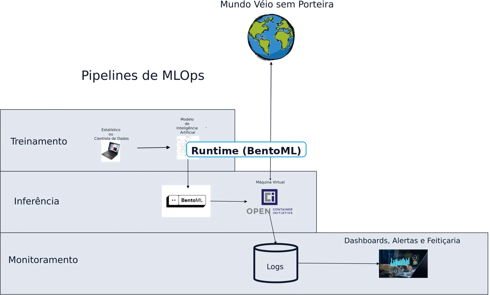
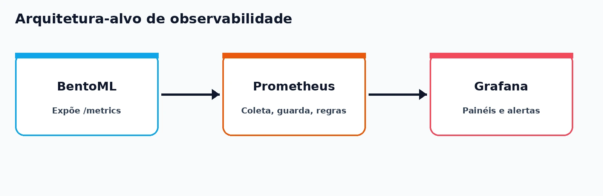
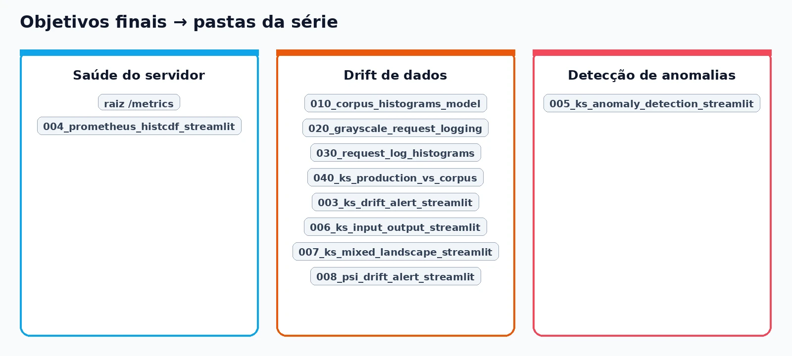

# Aula 000 — Pipelines de MLOps e objetivos de monitoramento

Bem-vindo. Esta pasta abre a trilha: aqui você ganha o mapa — do
treinamento à inferência, e daí ao monitoramento — antes de entrar nos
detalhes de cada etapa.

O fio da história é um serviço de processamento de imagens. O
**Runtime (BentoML)** recebe pedidos do mundo, responde e publica métricas.
Observar esse serviço é o que liga todas as aulas. O caminho de
observabilidade é BentoML → Prometheus → Grafana; a instalação está nos
tutoriais de [Prometheus](../docs/prometheus.md) e
[Grafana](../docs/grafana.md).

## Portas nesta aula

Esta pasta é mapa e leitura: **nenhum** processo precisa estar à escuta no
Host só para cumprir o handout. O contrato de portas das aulas seguintes
está em [`docs/ports.md`](../docs/ports.md) (BentoML **3000**, Prometheus
**9090**, Grafana **4000**, painéis Streamlit **8501 + N**).

## Objetivos finais de monitoramento

Três perguntas atravessam a trilha inteira:

1. Saúde do servidor — o serviço responde; taxa de erro e latência em faixa
   aceitável no caminho BentoML → Prometheus → Grafana.
2. Drift de dados — a distribuição dos pedidos (ou das features) se afasta do
   corpus de referência.
3. Detecção de anomalias — uma janela de métrica foge da linha de base (por
   exemplo média ± k desvios-padrão no p95).

## Visão de arquitetura

Três figuras — o mesmo mapa em batidas diferentes. A primeira é o quadro
de sala: do **Mundo Véio Sem Porteira** ao **Runtime (BentoML)** e daí aos
painéis. A segunda isola o caminho de observabilidade. A terceira amarra
os três fins de monitoramento às pastas da série.

Antes de medir saúde, a ponte `009` deixa o runtime raspável; em seguida
`010`/`016` e os tutoriais em `docs/` fecham a leitura de séries e painéis.

## Ordem de estudo em quatro atos

Estude nesta ordem (atos, não lexicografia das pastas). A `003` e a `008`
mantêm os paths estáveis (links e extratos Cloud).

### Ato 0 — Vocabulário

Sem um léxico comum de distribuição, o restante da trilha vira jargão:
ninguém sabe dizer o que um bucket de latência ou uma luminância «deslocada»
significa em números. Este ato fixa histograma e CDF — as duas leituras que
sustentam saúde, drift e anomalia — primeiro na linha de comando e depois no
painel.

[`001_histogram_cdf_cli`](../001_histogram_cdf_cli/README.md) →
[`002_histogram_cdf_streamlit`](../002_histogram_cdf_streamlit/README.md).

### Ponte — Runtime empacotado

Antes de scrapes e painéis, cumpre existir um processo que responda HTTP e
publique `/metrics`. A ponte motiva o empacote (serve → bento → OCI com
Docker ou Podman), prova a porta **3000** e esboça o mapa BentoCloud, para
que o Ato I não comece a consultar séries de um Host vazio.

[`009_bentoml_oci_runtime`](../009_bentoml_oci_runtime/README.md).

### Ato I — Saúde do servidor

O primeiro fim de monitoramento: o Runtime responde, a latência e o erro
estão em faixa, e o operador lê isso em séries e painéis — não só no
código. Percorre-se PromQL, regras, alertas, Grafana e, em seguida, logs e
um vendor (Datadog exige chave de laboratório).

[`010_prometheus_promql`](../010_prometheus_promql/README.md) →
[`022_prometheus_rules_ui`](../022_prometheus_rules_ui/README.md) →
[`021_prometheus_alerts_ui`](../021_prometheus_alerts_ui/README.md) →
[`015_prometheus_histcdf_streamlit`](../015_prometheus_histcdf_streamlit/README.md)
(opcional) →
[`016_grafana_dashboards`](../016_grafana_dashboards/README.md) →
[`019_loki_grafana_logs`](../019_loki_grafana_logs/README.md) →
[`018_elasticsearch_logs`](../018_elasticsearch_logs/README.md) →
[`017_datadog_apm_metrics`](../017_datadog_apm_metrics/README.md).

### Ato II — Tijolos no serviço

HTTP verde não prova que o *mundo de entrada* permanece o do treino. Este
ato constrói, no próprio serviço, corpus, log de pedidos e rotas que
expõem histogramas e KS — o caminho dos dados — antes do teatro de alerta
do Ato III.

[`011_corpus_histograms_model`](../011_corpus_histograms_model/README.md) →
[`012_grayscale_request_logging`](../012_grayscale_request_logging/README.md) →
[`013_request_log_histograms`](../013_request_log_histograms/README.md) →
[`014_ks_production_vs_corpus`](../014_ks_production_vs_corpus/README.md).

### Ato III — Drift e anomalias

Com os tijolos no ar, o foco muda para o juízo: referência versus lote,
candidato ou janela, entrada versus saída, tráfego misto e, por fim, o
mesmo problema com outro instrumento (PSI). Motivo: saúde do Host pode
permanecer aceitável enquanto a distribuição das imagens já não é a do
corpus.

[`003_ks_drift_alert_streamlit`](../003_ks_drift_alert_streamlit/README.md) →
[`004_ks_anomaly_detection_streamlit`](../004_ks_anomaly_detection_streamlit/README.md) →
[`005_ks_input_output_streamlit`](../005_ks_input_output_streamlit/README.md) →
[`006_ks_mixed_landscape_streamlit`](../006_ks_mixed_landscape_streamlit/README.md) →
[`008_psi_drift_alert_streamlit`](../008_psi_drift_alert_streamlit/README.md).

### Sinal, limiar, ação e dono

Fecha-se a trilha sem inventar ferramenta nova: uma página amarra os três
fins desta aula 000 a sinal, limiar, ação e dono, citando pastas já
praticadas. Motivo: limiar sem responsável vira aviso órfão.

[`020_monitoring_contract`](../020_monitoring_contract/README.md).

## Índice das aulas

Catálogo por pasta. Para **estudar**, use a ordem dos quatro atos acima.

### Ato 0 — Vocabulário

Histograma e CDF são o alfabeto desta trilha. Sem eles, buckets de Prometheus
e luminâncias de imagem ficam nomes sem operação. As duas pastas abaixo
ensinam o mesmo objeto duas vezes: na CLI (controle fino) e no Streamlit
(visão conjunta de tabela e gráfico).

**[`001_histogram_cdf_cli`](../001_histogram_cdf_cli/README.md)** —
Aprende o que é um histograma (contagens por faixa) e uma CDF (fração
acumulada), com um microexemplo na linha de comando. Produz-se JSON, CSV
ou PNG a partir de uma lista de números. É a base matemática de quase tudo
que vem depois — inclusive buckets de latência e luminância de imagens.

**[`002_histogram_cdf_streamlit`](../002_histogram_cdf_streamlit/README.md)** —
O mesmo objeto da `001`, agora num painel: cola-se valores (ou amostra),
ajusta-se bins e intervalo, vê-se tabela e gráfico juntos. Consolida a
intuição antes de falar de alertas ou Prometheus.

### Ponte — Runtime empacotado

O monitoramento de saúde pressupõe um alvo raspável. Esta ponte existe para
o aluno empacotar o serviço, subir o Contêiner e confirmar `/metrics` na
porta **3000** — motivação: a `010` não inventa o Endpoint; ela o consulta.

**[`009_bentoml_oci_runtime`](../009_bentoml_oci_runtime/README.md)** —
Motiva o empacote (serve → bento → OCI), gera imagem com backend Docker ou
Podman, prova `GET /metrics` na porta **3000** e desenha o mapa BentoCloud
(sem conta obrigatória). Critério de saída: nomear o que a `010` irá
consultar. Inclui leitura rasa do workflow de CI — sem editar YAML.

### Ato I — Saúde do servidor

Aqui responde-se à primeira pergunta da trilha: o pipeline está de pé e a
latência é interpretável? Percorre-se a cadeia BentoML → Prometheus →
Grafana e, depois, logs e um vendor. Motivo: sem essa evidência, drift e
anomalia discutem-se no vácuo operacional.

**[`010_prometheus_promql`](../010_prometheus_promql/README.md)** —
Pergunta: o pipeline responde com latência interpretável? Você lê o
formato de `/metrics`, confirma o scrape, usa Table/Graph do Prometheus
(`rate`, buckets, `histogram_quantile`) e estima um p95 **no papel**.
Não mede qualidade de imagem nem drift de conteúdo (Ato III).
Pré-req: ponte `009`, vocabulário `001`–`002` e o
[tutorial Prometheus](../docs/prometheus.md).

**[`022_prometheus_rules_ui`](../022_prometheus_rules_ui/README.md)** —
Página **Rules** (`/rules`): grupo `bentoml-response-time`, recording e
alerting a partir de `monitoring/bentoml.rules.yml`, estado de avaliação
(OK na regra não é o mesmo que firing). Confirme o job `bentoml-imagens`
(ou use a demo 9112).

**[`021_prometheus_alerts_ui`](../021_prometheus_alerts_ui/README.md)** —
Página **Alerts** (`/alerts`): pending e firing, regra
`BentoMLResponseTimeAnomaly` em `monitoring/bentoml.rules.yml`, distinção
face a Graph/Table. Confirme o job `bentoml-imagens` (ou use a demo 9100).

**[`015_prometheus_histcdf_streamlit`](../015_prometheus_histcdf_streamlit/README.md)** —
Painel Streamlit (porta **8516**): histograma, CDF e Python ↔ PromQL sobre
os mesmos buckets. Reforço visual **depois** da 010/022/021; a UI do
Prometheus continua a ser a referência para PromQL ad-hoc.

**[`016_grafana_dashboards`](../016_grafana_dashboards/README.md)** —
Handout numerado sobre [`docs/grafana.md`](../docs/grafana.md): painéis de
taxa, erro, p95 e linha de base na UI **4000**. Entrega com evidência do
gráfico.

**[`019_loki_grafana_logs`](../019_loki_grafana_logs/README.md)** —
Logs OSS: Promtail/push → Loki (**3100**) → Explore no Grafana (**4000**),
correlacionando picos de latência com linhas `phase=slow`.

**[`018_elasticsearch_logs`](../018_elasticsearch_logs/README.md)** —
Logs como documentos: JSONL → `_bulk` → `_search` / agregações no
Elasticsearch (**9200**). Contraste com Loki e Prometheus; lab sem Kibana
(capturas via API + HTML).

**[`017_datadog_apm_metrics`](../017_datadog_apm_metrics/README.md)** —
Vendor SaaS: labels Prometheus ↔ tags Datadog; OpenMetrics contra `:3000`.
Chave só em `.env` local. Sem `DD_API_KEY`, salta-se o lab (DEGRADE-001);
o trio 3000/9090/4000 permanece.

### Ato II — Tijolos no serviço

Para drift e anomalia existirem de fato, o Runtime precisa carregar um
corpus, registrar pedidos e expor números de comparação. Este ato monta
esses tijolos no serviço — motivação: o Ato III alerta sobre evidência que
alguém gravou, não sobre um PDF de teoria.

**[`011_corpus_histograms_model`](../011_corpus_histograms_model/README.md)** —
O serviço deixa de ser só filtro HTTP: entra um corpus de treino, um modelo
picklable de tons de cinza e rotas que reportam histogramas do corpus.
Vê-se onde o «mundo de referência» mora no runtime.

**[`012_grayscale_request_logging`](../012_grayscale_request_logging/README.md)** —
Cada pedido a `/inference-grayscale` grava features em disco **antes** da
conversão para cinza (canais R/G/B ainda existem). Sem esse log, não há
*production* para comparar com o corpus.

**[`013_request_log_histograms`](../013_request_log_histograms/README.md)** —
Agrega o log e expõe histogramas de production ao lado dos do corpus, com
exercitador de carga. Serve para *olhar* o afastamento; o cartão de alerta
didático vem no Ato III.

**[`014_ks_production_vs_corpus`](../014_ks_production_vs_corpus/README.md)** —
Expõe no HTTP a estatística de Kolmogorov–Smirnov entre production e corpus
(D, valor-p, tamanhos efetivos). É o contrato de números no serviço — não
substitui o painel e o semáforo da `003`.

### Ato III — Drift e anomalias

Fecha-se o segundo e o terceiro fins: o lote (ou a janela) afastou-se do
corpus? Uma imagem ou um intervalo é anômalo? Motivo pedagógico: o aluno já
viu Host saudável no Ato I; agora confronta distribuição de entrada — e
aprende que trocar KS por PSI não apaga a pergunta.

**[`003_ks_drift_alert_streamlit`](../003_ks_drift_alert_streamlit/README.md)** —
Âncora do arco: HTTP pode estar verde e a latência aceitável, enquanto as
luminâncias dos pedidos já não parecem o treino. Fluxo L → histograma → CDF
→ D → alerta (com regra de amostra inconclusiva). Volta-se aqui depois dos
tijolos `011`–`014`.

**[`004_ks_anomaly_detection_streamlit`](../004_ks_anomaly_detection_streamlit/README.md)** —
Mesmo aparelho da `003`, outra escala: um candidato (uma imagem) ou uma
**janela** temporal de pedidos versus a referência. É o objetivo «detecção
de anomalias» em cena.

**[`005_ks_input_output_streamlit`](../005_ks_input_output_streamlit/README.md)** —
Dois alertas sobre D: luminância das imagens **submetidas** e das imagens
**devolvidas**. Mostra quando entrada e saída contam a mesma história — ou
quando o filtro as separa.

**[`006_ks_mixed_landscape_streamlit`](../006_ks_mixed_landscape_streamlit/README.md)** —
Tráfego misto (metade ainda «parece» treino, metade de outro mundo visual).
Pergunta: o alerta ainda dispara? Com que intensidade frente a controles
puros?

**[`008_psi_drift_alert_streamlit`](../008_psi_drift_alert_streamlit/README.md)** —
Irmã da `003`: mesma parábola operacional, outro instrumento (PSI e faixas
clássicas de monitoramento). Fecha o Ato III mostrando que trocar a métrica
não apaga a pergunta sobre o mundo dos dados.

### Sinal, limiar, ação e dono

Depois de praticar os três fins, falta o artefato que impede o limiar órfão:
quem age quando o número cruza a linha? Esta seção motiva o contrato como
fecho — uma página, quatro campos, evidência nas pastas já cursadas.

**[`020_monitoring_contract`](../020_monitoring_contract/README.md)** —
Uma página que amarra saúde, drift e anomalia a sinais, limiares e dono,
citando as aulas já cursadas.

---

## Checklist de saída

| Verificação | Sim / Não |
| :--- | :---: |
| Nomeio os três fins de monitoramento desta trilha: saúde do servidor, drift de dados, detecção de anomalias | |
| O roteiro desta pasta aponta **Seguinte** para `001_histogram_cdf_cli` | |
| Abro [`docs/ports.md`](../docs/ports.md) e localizo a tabela de portas do curso | |

## Roteiro da trilha

| | Pasta |
| :--- | :--- |
| **Anterior** | — |
| **Seguinte** | [`001_histogram_cdf_cli`](../001_histogram_cdf_cli/README.md) |
