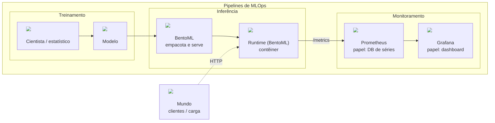

# Aula 000 — Pipelines de MLOps e objetivos de monitoramento

Bem-vindo. Esta pasta abre a trilha: aqui você ganha o mapa — do
treinamento à inferência, e daí ao monitoramento — antes de entrar nos
detalhes de cada etapa.

O fio da história é um serviço de processamento de imagens. O
**Runtime (BentoML)** recebe pedidos do mundo, responde e publica métricas.
Observar esse serviço é o que liga todas as aulas. O caminho de
observabilidade é BentoML → Prometheus → Grafana; a instalação está nos
tutoriais de [Prometheus](../docs/prometheus.md) e
[Grafana](../docs/grafana.md).

## Portas locais padrão

Contrato do curso (detalhe em [`docs/ports.md`](../docs/ports.md)):

| Serviço | Porta |
| :--- | ---: |
| **BentoML** | **3000** |
| **Prometheus** | **9090** |
| **Grafana** | **4000** |

Painéis Streamlit das aulas: **8501 + N** (exemplo: `003` → `8504`;
`015` → `8516`). A **8501** permanece livre.

## Objetivos finais de monitoramento

Três perguntas atravessam a trilha inteira:

1. Saúde do servidor — o serviço responde; taxa de erro e latência em faixa
   aceitável no caminho BentoML → Prometheus → Grafana.
2. Drift de dados — a distribuição dos pedidos (ou das features) se afasta do
   corpus de referência.
3. Detecção de anomalias — uma janela de métrica foge da linha de base (por
   exemplo média ± k desvios-padrão no p95).

## Visão de arquitetura

As figuras em [`illustrations/`](illustrations/) mostram o mesmo mapa em três
batidas. O diagrama resume as camadas:

Antes de medir saúde, a ponte `009` deixa o runtime raspável; em seguida
`010`/`016` e os tutoriais em `docs/` fecham a leitura de séries e painéis.

## Ordem de estudo em quatro atos

Estude nesta ordem (atos, não lexicografia das pastas). `001`–`002`
vocabulário; ponte `009` (BentoML → OCI); `010`–`015` PromQL (+ Streamlit
opcional); `016` Grafana; depois logs/vendors `019` Loki → `018` ES →
`017` Datadog (este último exige chave de laboratório); `011`–`014` tijolos;
`003`–`006` teatro KS; `008` PSI; fecho `020` (contrato). A `003` e a `008`
mantêm os paths estáveis (links e extratos Cloud).

**Ato 0 — Vocabulário.** Histograma e CDF, as duas leituras de distribuição
que sustentam o resto:
[`001_histogram_cdf_cli`](../001_histogram_cdf_cli/README.md) →
[`002_histogram_cdf_streamlit`](../002_histogram_cdf_streamlit/README.md).

**Ponte — Runtime empacotado.** Do código ao contêiner OCI, com `/metrics`
alcançável antes de consultar séries:
[`009_bentoml_oci_runtime`](../009_bentoml_oci_runtime/README.md).

**Ato I — Saúde do servidor.** Latência e séries no caminho BentoML →
Prometheus → Grafana, depois logs/vendors:
[`010_prometheus_promql`](../010_prometheus_promql/README.md) →
[`015_prometheus_histcdf_streamlit`](../015_prometheus_histcdf_streamlit/README.md)
(opcional) →
[`016_grafana_dashboards`](../016_grafana_dashboards/README.md) →
[`019_loki_grafana_logs`](../019_loki_grafana_logs/README.md) →
[`018_elasticsearch_logs`](../018_elasticsearch_logs/README.md) →
[`017_datadog_apm_metrics`](../017_datadog_apm_metrics/README.md).

**Ato II — Tijolos no serviço.** Corpus, log e rotas de monitor — o caminho
dos dados; o juízo do alerta vem depois:
[`011_corpus_histograms_model`](../011_corpus_histograms_model/README.md) →
[`012_grayscale_request_logging`](../012_grayscale_request_logging/README.md) →
[`013_request_log_histograms`](../013_request_log_histograms/README.md) →
[`014_ks_production_vs_corpus`](../014_ks_production_vs_corpus/README.md).

**Ato III — Drift e anomalias.** O teatro das imagens: referência versus
lote, janela, entrada/saída, tráfego misto e, por fim, outro instrumento
(PSI):
[`003_ks_drift_alert_streamlit`](../003_ks_drift_alert_streamlit/README.md) →
[`004_ks_anomaly_detection_streamlit`](../004_ks_anomaly_detection_streamlit/README.md) →
[`005_ks_input_output_streamlit`](../005_ks_input_output_streamlit/README.md) →
[`006_ks_mixed_landscape_streamlit`](../006_ks_mixed_landscape_streamlit/README.md) →
[`008_psi_drift_alert_streamlit`](../008_psi_drift_alert_streamlit/README.md).

**Fecho — Contrato de monitoramento.** Uma página que amarra os três fins
desta aula 000 a sinais e limiares:
[`020_monitoring_contract`](../020_monitoring_contract/README.md).

## Índice das aulas

Catálogo por pasta. Para **estudar**, use a ordem dos quatro atos acima.

### Ato 0 — Vocabulário

**[`001_histogram_cdf_cli`](../001_histogram_cdf_cli/README.md)** —
Aprende o que é um histograma (contagens por faixa) e uma CDF (fração
acumulada), com um microexemplo na linha de comando. Você produz JSON, CSV
ou PNG a partir de uma lista de números. É a base matemática de quase tudo
que vem depois — inclusive buckets de latência e luminância de imagens.

**[`002_histogram_cdf_streamlit`](../002_histogram_cdf_streamlit/README.md)** —
O mesmo objeto da `001`, agora num painel: cola valores (ou amostra), ajusta
bins e intervalo, vê tabela e gráfico juntos. Consolida a intuição antes de
falar de alertas ou Prometheus.

### Ponte — Runtime empacotado

**[`009_bentoml_oci_runtime`](../009_bentoml_oci_runtime/README.md)** —
Empacota o serviço (`just build`), gera imagem OCI e prova
`GET /metrics` na porta **3000**. Critério de saída: nomear o que a `010`
irá consultar. Inclui leitura rasa do workflow de CI — sem editar YAML.

### Ato I — Saúde do servidor

**[`010_prometheus_promql`](../010_prometheus_promql/README.md)** —
Pergunta: o pipeline responde com latência interpretável? Você lê o
formato de `/metrics`, confirma o scrape, usa Table/Graph do Prometheus
(`rate`, buckets, `histogram_quantile`) e estima um p95 **no papel** — sem
Streamlit. Não mede qualidade de imagem nem drift de conteúdo (Ato III).
Pré-req: ponte `009`, vocabulário `001`–`002` e o
[tutorial Prometheus](../docs/prometheus.md).

**[`015_prometheus_histcdf_streamlit`](../015_prometheus_histcdf_streamlit/README.md)** —
Painel Streamlit (porta **8516**): histograma, CDF e Python ↔ PromQL sobre
os mesmos buckets. Reforço visual **depois** da 010; não substitui a UI do
Prometheus.

**[`016_grafana_dashboards`](../016_grafana_dashboards/README.md)** —
Handout numerado sobre [`docs/grafana.md`](../docs/grafana.md): painéis de
taxa, erro, p95 e linha de base na UI **4000**. Entrega com evidência do
gráfico — sem Streamlit.

**[`019_loki_grafana_logs`](../019_loki_grafana_logs/README.md)** —
Logs OSS: Promtail/push → Loki (**3100**) → Explore no Grafana (**4000**),
correlacionando picos de latência com linhas `phase=slow`.

**[`018_elasticsearch_logs`](../018_elasticsearch_logs/README.md)** —
Logs como documentos: JSONL → `_bulk` → `_search` / agregações no
Elasticsearch (**9200**). Contraste com Loki e Prometheus; lab sem Kibana
(capturas via API + HTML).

**[`017_datadog_apm_metrics`](../017_datadog_apm_metrics/README.md)** —
Vendor SaaS: labels Prometheus ↔ tags Datadog; OpenMetrics contra `:3000`.
Chave só em `.env` local. Sem `DD_API_KEY`, salta-se o lab (DEGRADE-001);
o trio 3000/9090/4000 permanece.

### Ato II — Tijolos no serviço

**[`011_corpus_histograms_model`](../011_corpus_histograms_model/README.md)** —
O serviço deixa de ser só filtro HTTP: entra um corpus de treino, um modelo
picklable de tons de cinza e rotas que reportam histogramas do corpus. Você
vê onde o «mundo de referência» mora no runtime.

**[`012_grayscale_request_logging`](../012_grayscale_request_logging/README.md)** —
Cada pedido a `/inference-grayscale` grava features em disco **antes** da
conversão para cinza (canais R/G/B ainda existem). Sem esse log, não há
*production* para comparar com o corpus.

**[`013_request_log_histograms`](../013_request_log_histograms/README.md)** —
Agrega o log e expõe histogramas de production ao lado dos do corpus, com
exercitador de carga. Serve para *olhar* o afastamento; o cartão de alerta
didático vem no Ato III.

**[`014_ks_production_vs_corpus`](../014_ks_production_vs_corpus/README.md)** —
Expõe no HTTP a estatística de Kolmogorov–Smirnov entre production e corpus
(D, valor-p, tamanhos efetivos). É o contrato de números no serviço — não
substitui o painel e o semáforo da `003`.

### Ato III — Drift e anomalias

**[`003_ks_drift_alert_streamlit`](../003_ks_drift_alert_streamlit/README.md)** —
Âncora do arco: HTTP pode estar verde e a latência aceitável, enquanto as
luminâncias dos pedidos já não parecem o treino. Fluxo L → histograma → CDF
→ D → alerta (com regra de amostra inconclusiva). Volta aqui depois dos
tijolos `011`–`014`.

**[`004_ks_anomaly_detection_streamlit`](../004_ks_anomaly_detection_streamlit/README.md)** —
Mesmo aparelho da `003`, outra escala: um candidato (uma imagem) ou uma
**janela** temporal de pedidos versus a referência. É o objetivo «detecção
de anomalias» em cena.

**[`005_ks_input_output_streamlit`](../005_ks_input_output_streamlit/README.md)** —
Dois alertas sobre D: luminância das imagens **submetidas** e das imagens
**devolvidas**. Mostra quando entrada e saída contam a mesma história — ou
quando o filtro as separa.

**[`006_ks_mixed_landscape_streamlit`](../006_ks_mixed_landscape_streamlit/README.md)** —
Tráfego misto (metade ainda «parece» treino, metade de outro mundo visual).
Pergunta: o alerta ainda dispara? Com que intensidade frente a controles
puros?

**[`008_psi_drift_alert_streamlit`](../008_psi_drift_alert_streamlit/README.md)** —
Irmã da `003`: mesma parábola operacional, outro instrumento (PSI e faixas
clássicas de monitoramento). Fecha o Ato III mostrando que trocar a métrica
não apaga a pergunta sobre o mundo dos dados.

### Fecho — Contrato de monitoramento

**[`020_monitoring_contract`](../020_monitoring_contract/README.md)** —
Uma página que amarra saúde, drift e anomalia a sinais, limiares e dono,
citando as aulas já cursadas.

---

## Roteiro da trilha

| | Pasta |
| :--- | :--- |
| **Anterior** | — |
| **Seguinte** | [`001_histogram_cdf_cli`](../001_histogram_cdf_cli/README.md) |
