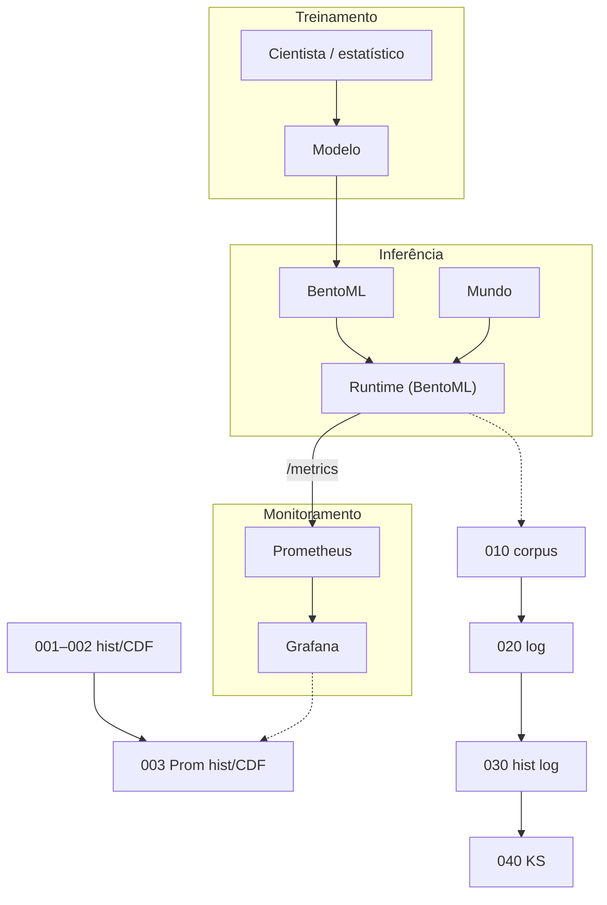

# Lição 000 — Pipelines de MLOps e objetivos de monitoramento

## Por que esta lição existe

A série começa com um **mapa compartilhado**: treinamento → inferência →
monitoramento. Nesta pasta o mapa e três **objetivos finais** de monitoramento
ficam na tela. O runtime que atende o “mundo” é o **Runtime (BentoML)**. As
métricas seguem **BentoML → Prometheus → Grafana**. Cada pasta seguinte
aprofunda um pedaço desse desenho.

## Objetivos finais de monitoramento

1. **Saúde do servidor** — o serviço responde; taxa de erro e latência em faixa
   aceitável no caminho BentoML → Prometheus → Grafana.
2. **Drift de dados** — a distribuição dos pedidos (ou das features) se afasta
   do corpus de referência.
3. **Detecção de anomalias** — uma janela de métrica foge da linha de base (por
   exemplo média ± k desvios-padrão no p95).

## Visão de arquitetura

Três figuras em [`illustrations/`](illustrations/), nesta ordem:

1. Pipelines de MLOps (tiers + **Runtime (BentoML)**)
2. Caminho-alvo BentoML → Prometheus → Grafana
3. Objetivos finais → pastas da série

O BentoML já expõe `GET /metrics`. O [tutorial de Prometheus](../docs/prometheus.md)
instala o coletor, aponta-o a esse endpoint e consulta latência (p95) e linhas
de base em PromQL. O [tutorial de Grafana](../docs/grafana.md) consulta esse
Prometheus e monta painéis (volume, p95, anomalia em relação à janela móvel).



## Índice das lições

| Pasta | O que você leva |
| :--- | :--- |
| `001_histogram_cdf_cli` | Histograma e CDF de uma lista de números na CLI (JSON/CSV/PNG) |
| `002_histogram_cdf_streamlit` | O mesmo objeto histograma+CDF num app Streamlit |
| `003_prometheus_histcdf_streamlit` | Buckets de latência do Prometheus → histograma/CDF + PromQL |
| `010_corpus_histograms_model` | Corpus de treino + modelo picklable de cinza no BentoML |
| `020_grayscale_request_logging` | Log em disco das features de cada pedido a `/inference-grayscale` |
| `030_request_log_histograms` | Histogramas de production vs corpus (olhar drift) |
| `040_ks_production_vs_corpus` | Teste KS production contra corpus |

## Como projetar

Ordem das quatro batidas:

1. **Pipelines** — `just open-diagram`
2. **Caminho-alvo** — `just open-target`
3. **Objetivos → pastas** — `just open-goals-map`
4. **Índice** — a tabela acima; a seguir,
   [`001_histogram_cdf_cli`](../001_histogram_cdf_cli/README.md)

```bash
just sync
just open-diagram
just open-target
just open-goals-map
just test
```
