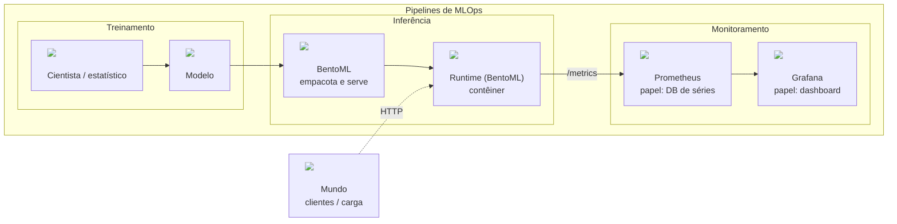

# Aula 000 — Pipelines de MLOps e objetivos de monitoramento

Bem-vindo. Esta pasta abre a trilha: aqui você ganha o mapa — do
treinamento à inferência, e daí ao monitoramento — antes de entrar nos
detalhes de cada etapa.

O fio da história é um serviço de processamento de imagens. O
**Runtime (BentoML)** recebe pedidos do mundo, responde e publica métricas.
Observar esse serviço é o que liga todas as aulas. O caminho de
observabilidade é BentoML → Prometheus → Grafana; a instalação está nos
tutoriais de [Prometheus](../docs/prometheus.md) e
[Grafana](../docs/grafana.md).

## Portas locais padrão

Contrato do curso (detalhe em [`docs/ports.md`](../docs/ports.md)):

| Serviço | Porta |
| :--- | ---: |
| **BentoML** | **3000** |
| **Prometheus** | **9090** |
| **Grafana** | **4000** |

Painéis Streamlit das aulas: **8500 + N** (exemplo: `004` → `8504`).

## Objetivos finais de monitoramento

Três perguntas atravessam a trilha inteira:

1. Saúde do servidor — o serviço responde; taxa de erro e latência em faixa
   aceitável no caminho BentoML → Prometheus → Grafana.
2. Drift de dados — a distribuição dos pedidos (ou das features) se afasta do
   corpus de referência.
3. Detecção de anomalias — uma janela de métrica foge da linha de base (por
   exemplo média ± k desvios-padrão no p95).

Os **atos** abaixo organizam *como* você estuda. Estes **objetivos** nomeiam
*o que* o monitoramento deve vigiar no fim. Não são a mesma lista.

## Visão de arquitetura

As figuras em [`illustrations/`](illustrations/) mostram o mesmo mapa em três
batidas. O diagrama resume as camadas:



Antes de medir saúde, é preciso ter o serviço no ar e expondo métricas. Os
tutoriais de Prometheus e Grafana cuidam disso na hora certa.

## Ordem de estudo em quatro atos

Estude nesta ordem — ela **não** segue a numeração das pastas. A pasta
`004` vem no Ato I; a `003` volta no Ato III.

**Ato 0 — Vocabulário.** Histograma e CDF, as duas leituras de distribuição
que sustentam o resto:
[`001_histogram_cdf_cli`](../001_histogram_cdf_cli/README.md) →
[`002_histogram_cdf_streamlit`](../002_histogram_cdf_streamlit/README.md).

**Ato I — Saúde do servidor.** Latência e séries no caminho BentoML →
Prometheus → Grafana:
[`004_prometheus_histcdf_streamlit`](../004_prometheus_histcdf_streamlit/README.md).

**Ato II — Tijolos no serviço.** Corpus, log e rotas de monitor — o caminho
dos dados; o juízo do alerta vem depois:
[`010_corpus_histograms_model`](../010_corpus_histograms_model/README.md) →
[`020_grayscale_request_logging`](../020_grayscale_request_logging/README.md) →
[`030_request_log_histograms`](../030_request_log_histograms/README.md) →
[`040_ks_production_vs_corpus`](../040_ks_production_vs_corpus/README.md).

**Ato III — Drift e anomalias.** O teatro das imagens: referência versus
lote, janela, entrada/saída, tráfego misto e, por fim, outro instrumento
(PSI):
[`003_ks_drift_alert_streamlit`](../003_ks_drift_alert_streamlit/README.md) →
[`005_ks_anomaly_detection_streamlit`](../005_ks_anomaly_detection_streamlit/README.md) →
[`006_ks_input_output_streamlit`](../006_ks_input_output_streamlit/README.md) →
[`007_ks_mixed_landscape_streamlit`](../007_ks_mixed_landscape_streamlit/README.md) →
[`008_psi_drift_alert_streamlit`](../008_psi_drift_alert_streamlit/README.md).

## Índice das aulas

| Pasta | Em uma frase |
| :--- | :--- |
| [`001_histogram_cdf_cli`](../001_histogram_cdf_cli/README.md) | Histograma e CDF na linha de comando |
| [`002_histogram_cdf_streamlit`](../002_histogram_cdf_streamlit/README.md) | O mesmo objeto num painel |
| [`003_ks_drift_alert_streamlit`](../003_ks_drift_alert_streamlit/README.md) | Drift com KS e cartão de alerta |
| [`004_prometheus_histcdf_streamlit`](../004_prometheus_histcdf_streamlit/README.md) | Saúde: latência e PromQL |
| [`005_ks_anomaly_detection_streamlit`](../005_ks_anomaly_detection_streamlit/README.md) | Anomalia KS em janela ou candidato |
| [`006_ks_input_output_streamlit`](../006_ks_input_output_streamlit/README.md) | KS na entrada e na saída |
| [`007_ks_mixed_landscape_streamlit`](../007_ks_mixed_landscape_streamlit/README.md) | Tráfego misto praia/floresta |
| [`008_psi_drift_alert_streamlit`](../008_psi_drift_alert_streamlit/README.md) | Drift com PSI (irmã da 003) |
| [`010_corpus_histograms_model`](../010_corpus_histograms_model/README.md) | Corpus e modelo no serviço |
| [`020_grayscale_request_logging`](../020_grayscale_request_logging/README.md) | Log das features do pedido |
| [`030_request_log_histograms`](../030_request_log_histograms/README.md) | Histogramas production vs corpus |
| [`040_ks_production_vs_corpus`](../040_ks_production_vs_corpus/README.md) | KS no endpoint do serviço |

## Figuras e comandos

Instale as dependências desta pasta com `just sync`. Abra as três figuras do
projetor com `just open-diagram` (pipelines), `just open-target` (BentoML →
Prometheus → Grafana) e `just open-goals-map` (objetivos → pastas). Confira os
ativos e o texto do handout com `just test`.

```bash
just sync
just open-diagram
just open-target
just open-goals-map
just test
```

Próximo passo:
[`001_histogram_cdf_cli`](../001_histogram_cdf_cli/README.md).
