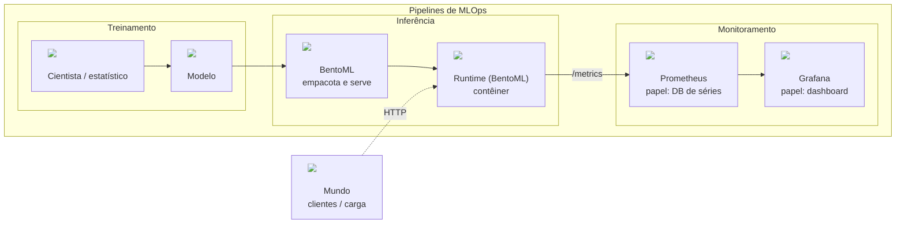

# Lição 000 — Pipelines de MLOps e objetivos de monitoramento

Este repositório (`bentoML-processamento-imagens`) ensina, pasta a pasta, a
observar um serviço BentoML de processamento de imagens: do vocabulário de
histograma e CDF até drift entre corpus e pedidos reais. A pasta `000` é a
abertura dessa trilha. Ela fixa o mapa treinamento → inferência → monitoramento,
nomeia três objetivos finais de monitoramento e aponta onde cada pasta
posterior aprofunda o desenho.

O runtime que atende o “mundo” (clientes e carga HTTP) é o Runtime (BentoML): o
BentoML empacota o modelo, sobe o processo e publica métricas em `GET /metrics`.
Dali o caminho de observabilidade é BentoML → Prometheus → Grafana. O
[tutorial de Prometheus](../docs/prometheus.md) instala o coletor, aponta-o a
esse endpoint e consulta latência (p95) e linhas de base em PromQL. O
[tutorial de Grafana](../docs/grafana.md) consulta esse Prometheus e monta
painéis (volume, p95, anomalia em relação à janela móvel).

## Objetivos finais de monitoramento

1. Saúde do servidor — o serviço responde; taxa de erro e latência em faixa
   aceitável no caminho BentoML → Prometheus → Grafana.
2. Drift de dados — a distribuição dos pedidos (ou das features) se afasta do
   corpus de referência.
3. Detecção de anomalias — uma janela de métrica foge da linha de base (por
   exemplo média ± k desvios-padrão no p95).

## Visão de arquitetura

As figuras em [`illustrations/`](illustrations/) mostram o mesmo mapa em três
batidas: pipelines de MLOps (com Runtime (BentoML) no contêiner), o caminho-alvo
BentoML → Prometheus → Grafana, e o mapa dos objetivos finais para as pastas da
trilha. O diagrama abaixo resume as camadas sem listar as pastas numeradas.



## Índice das lições

| Pasta | O que você leva |
| :--- | :--- |
| `001_histogram_cdf_cli` | Histograma e CDF de uma lista de números na CLI (JSON/CSV/PNG) |
| `002_histogram_cdf_streamlit` | O mesmo objeto histograma+CDF num app Streamlit |
| `003_ks_drift_alert_streamlit` | Corpus vs pedidos: KS + banner de drift no Streamlit |
| `004_prometheus_histcdf_streamlit` | Buckets de latência do Prometheus → histograma/CDF + PromQL |
| `010_corpus_histograms_model` | Corpus de treino + modelo picklable de cinza no BentoML |
| `020_grayscale_request_logging` | Log em disco das features de cada pedido a `/inference-grayscale` |
| `030_request_log_histograms` | Histogramas de production vs corpus (olhar drift) |
| `040_ks_production_vs_corpus` | Teste KS production contra corpus |

## Figuras e comandos

Instale as dependências desta pasta com `just sync`. Abra as três figuras do
projetor com `just open-diagram` (pipelines), `just open-target` (BentoML →
Prometheus → Grafana) e `just open-goals-map` (objetivos → pastas). Confira os
ativos e o texto do handout com `just test`.

```bash
just sync
just open-diagram
just open-target
just open-goals-map
just test
```

[`001_histogram_cdf_cli`](../001_histogram_cdf_cli/README.md)
