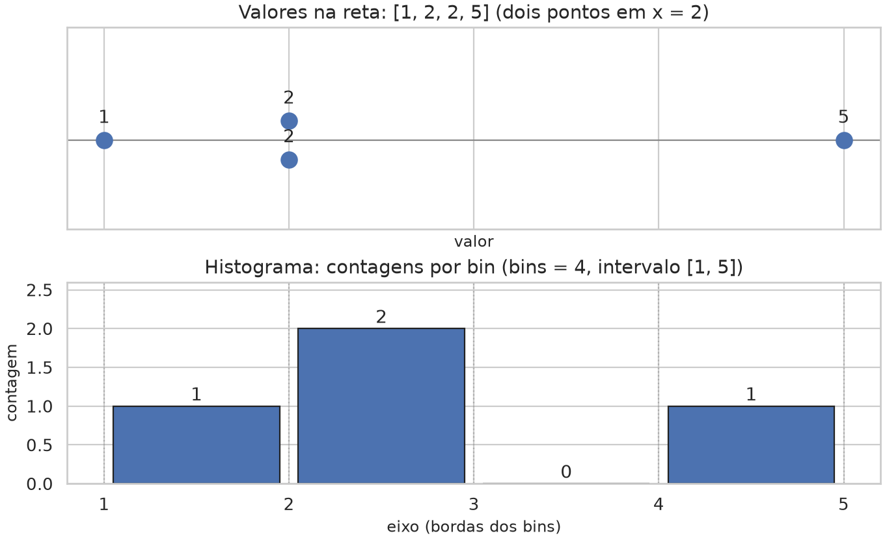
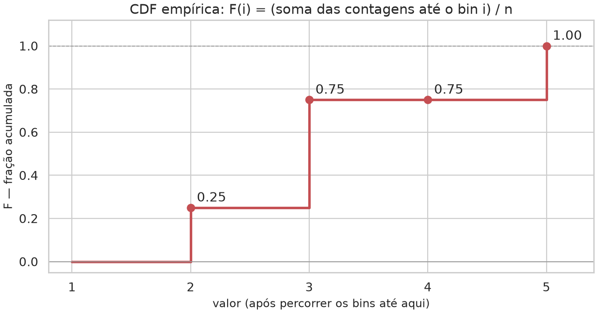
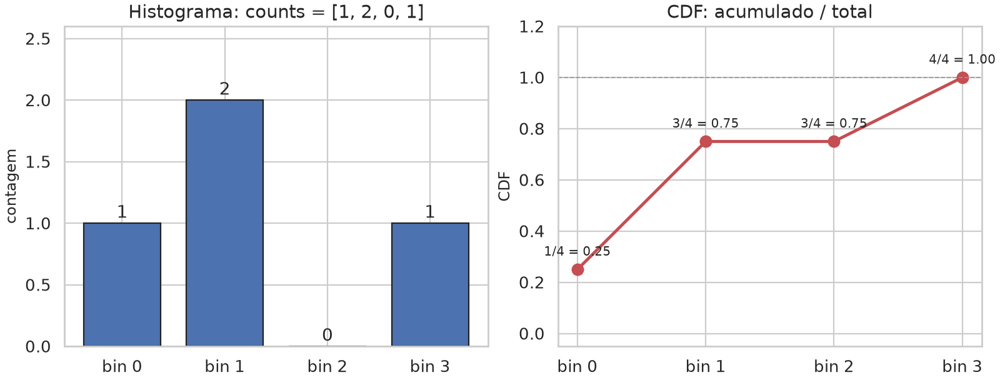
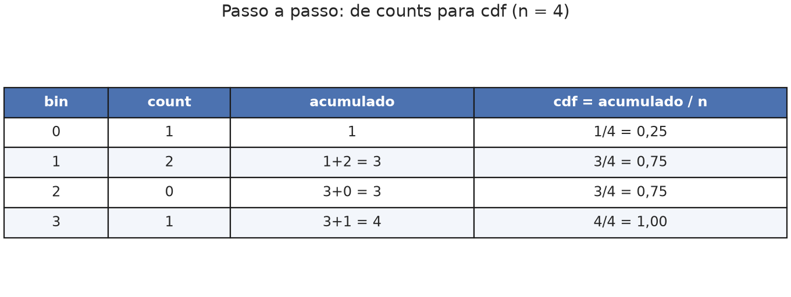
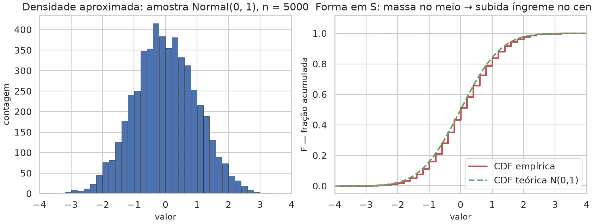

# Lição 001 — Histograma e CDF na linha de comando

## Objetivo

Aprender o que é um **histograma** e o que é uma **CDF** (função de
distribuição acumulada), como passar das **contagens** do histograma para a
CDF, e como obter o mesmo resultado na prática: **JSON**, **CSV** ou um
**PNG** (barras + curva), a partir de uma lista de números no terminal.

## Conceitos

Usamos sempre o mesmo microexemplo: valores `[1, 2, 2, 5]` com **4 bins** no
intervalo `[1, 5]`.

### O que é um histograma

Um histograma **agrupa** valores numéricos em intervalos contíguos (*bins*) e
**conta** quantos caem em cada um. Não guarda a ordem original dos pontos: só a
massa por faixa.

- O eixo horizontal é o domínio (aqui, de 1 a 5).
- Cada barra tem altura igual à **contagem** daquele bin.
- A soma das contagens é o número de observações `n` (aqui, 4).



Neste exemplo as bordas são `1, 2, 3, 4, 5` (largura 1). Os dois valores `2`
caem no mesmo bin; o bin `[3, 4)` fica vazio (`count = 0`).

### O que é uma CDF

A **função de distribuição acumulada empírica** responde: *até este ponto do
eixo, que fração dos dados já foi vista?* O valor está sempre em `[0, 1]`. No
último bin, a fração é `1` (todos os pontos foram contabilizados).



A CDF **não decresce**: ao avançar no eixo, só se pode manter ou subir a
fração acumulada.

### Como obter a CDF a partir do histograma

Dadas as contagens `counts = [c₀, c₁, …, cₖ₋₁]` e `n = c₀ + … + cₖ₋₁`:

```text
F(i) = (c₀ + c₁ + … + cᵢ) / n
```

Ou seja: some as barras da esquerda até o bin `i` e divida pelo total.



Com `counts = [1, 2, 0, 1]` e `n = 4`:



| bin | count | acumulado | cdf |
| ---: | ---: | ---: | ---: |
| 0 | 1 | 1 | 0,25 |
| 1 | 2 | 3 | 0,75 |
| 2 | 0 | 3 | 0,75 |
| 3 | 1 | 4 | 1,00 |

O bin vazio não muda o acumulado: a CDF fica plana (`0,75` → `0,75`) e depois
sobe para `1,00` quando entra o último ponto.

Em pseudocódigo:

```text
# Variáveis:
# counts  — contagens por bin
# total   — soma de counts (= n)
# running — soma parcial
# cdf     — frações acumuladas

total ← soma(counts)
se total = 0: erro
running ← 0
cdf ← []
para cada c em counts:
    running ← running + c
    cdf.acrescentar(running / total)
```

No código desta pasta: `cdf_from_counts` em `histcdf.py` faz
`np.cumsum(counts) / counts.sum()`.

### Em Python (mesmo cálculo)

Com as contagens do microexemplo:

```python
import numpy as np

counts = np.array([1, 2, 0, 1])
cdf = np.cumsum(counts) / counts.sum()
# array([0.25, 0.75, 0.75, 1.0])
```

A partir dos valores brutos, o mesmo pacote que a CLI usa:

```python
from histcdf import histogram_with_cdf

resultado = histogram_with_cdf([1, 2, 2, 5], bins=4)
# resultado["counts"] → [1, 2, 0, 1]
# resultado["cdf"]    → [0.25, 0.75, 0.75, 1.0]
```

### Por que a CDF “ideal” tem forma de S (sigmoid)

A CDF de uma densidade contínua é a integral acumulada dessa densidade. Quando a
densidade é **unimodal e aproximadamente simétrica** (formato de sino, como a
Normal), a maior parte da massa fica no centro: nas caudas a CDF sobe devagar;
perto da moda sobe depressa; depois volta a aplanar. O resultado é a clássica
**curva em S** (sigmoid).

O microexemplo com `n = 4` produz uma CDF em **degraus** — correta para poucos
pontos. Com muitas observações de uma distribuição em sino, a CDF empírica
aproxima a S suave.

```python
import numpy as np
from math import erf, sqrt

rng = np.random.default_rng(0)
amostra = rng.normal(loc=0.0, scale=1.0, size=5000)

counts, edges = np.histogram(amostra, bins=40, range=(-4.0, 4.0))
cdf_empirica = np.cumsum(counts) / counts.sum()

# CDF teórica da Normal(0, 1), para comparar com a empírica:
x = np.linspace(-4.0, 4.0, 400)
cdf_teorica = 0.5 * (1.0 + np.array([erf(v / sqrt(2.0)) for v in x]))
```



Outras densidades geram outras formas (uniforme → rampa; assimétrica → S
deslocada). A S é o caso “ideal” quando a massa se concentra no meio.

## Entrada e saída

### Exemplo principal

**Entrada:**

```bash
just hist --values='[1,2,2,5]' --bins=4
```

**Saída (JSON):**

```json
{
  "n": 4,
  "bins": 4,
  "range": [1.0, 5.0],
  "counts": [1, 2, 0, 1],
  "edges": [1.0, 2.0, 3.0, 4.0, 5.0],
  "cdf": [0.25, 0.75, 0.75, 1.0]
}
```

| Campo | Significado neste exemplo |
| :--- | :--- |
| `edges` | Bordas dos bins: `[1,2)`, `[2,3)`, `[3,4)`, `[4,5]` |
| `counts` | Contagens por bin (mesmo `[1, 2, 0, 1]` das figuras) |
| `cdf` | Frações acumuladas (mesma tabela da seção Conceitos) |

**CSV:**

```bash
just hist --values='[1,2,2,5]' --bins=4 --format=csv
```

```text
bin,left,right,count,cdf
0,1.0,2.0,1,0.25
1,2.0,3.0,2,0.75
2,3.0,4.0,0,0.75
3,4.0,5.0,1,1.0
```

**PNG** (barras + CDF no eixo direito):

```bash
just hist --values='[1,2,2,5]' --bins=4 --format=image --output=histogram.png
```

### Intervalo fixo e rejeição

Com `--lo` e `--hi` o intervalo não é inferido. Valores fora dele geram erro:

```bash
just hist --values='[0,0.5,1,2.5,4]' --bins=4 --lo=0 --hi=4
```

→ `counts` `[2, 1, 1, 1]`.

```bash
just hist --values='[1,9]' --bins=2 --lo=0 --hi=5
```

→ `valor fora do intervalo [0.0, 5.0]: 9.0`

### Parâmetros úteis

| Flag | Função |
| :--- | :--- |
| `--values` | JSON list ou números separados por vírgula |
| `--file` | Mesmo conteúdo lido de um arquivo texto |
| `--bins` | Número de bins (padrão 10) |
| `--lo` / `--hi` | Intervalo fechado opcional (usar os dois juntos) |
| `--format` | `json` (padrão), `csv` ou `image` |
| `--output` | Arquivo de saída (útil para PNG) |

## Como executar

Na pasta desta lição:

```bash
just sync
just hist --values='[1,2,2,5]' --bins=4
just hist --values='[1,2,2,5]' --bins=4 --format=csv
just hist --values='[1,2,2,5]' --bins=4 --format=image --output=histogram.png
just hist --values='[0,0.5,1,2.5,4]' --bins=4 --lo=0 --hi=4
```

(O `just` trata vírgula como separador de argumentos: mantenha o JSON entre
aspas simples.)

Regenerar as figuras da seção Conceitos:

```bash
just generate-illustrations
```

Testes:

```bash
just test
```

## O que acontece por dentro

### Fluxo

```text
--values / --file
        │
        ▼
  lista de float
        │
        ▼
 histogram_from_values   →  counts[], edges[]     (NumPy)
        │
        ▼
 cdf_from_counts         →  cdf[]                 (cumsum / total)
        │
        ├── format=json  →  stdout / arquivo
        ├── format=csv   →  linhas bin,left,right,count,cdf
        └── format=image →  plot_histogram_cdf    (Seaborn) → PNG
```

Funções em `histcdf.py`: `histogram_from_values`, `cdf_from_counts`,
`histogram_with_cdf`. Desenho em `plotting.plot_histogram_cdf`. A CLI está em
`hist_cli.py`.

### Algoritmo (resumo)

1. Escolher `[lo, hi]` (mín/máx dos dados, ou `--lo`/`--hi`) e `bins` bins de
   largura igual.
2. Contar quantos valores caem em cada bin (`numpy.histogram`); o extremo
   `hi` entra no último bin; fora do intervalo → erro.
3. Converter contagens em CDF pela acumulação normalizada da seção Conceitos.

[`002_histogram_cdf_streamlit`](../002_histogram_cdf_streamlit/README.md)
