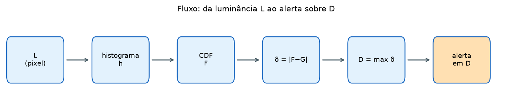
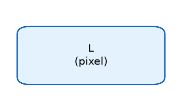
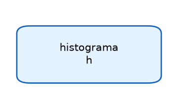
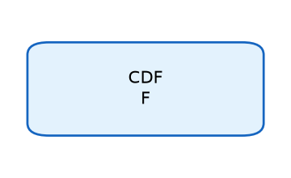
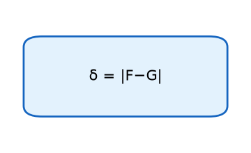
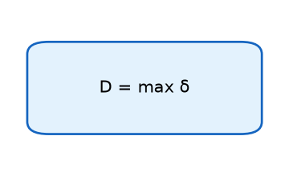
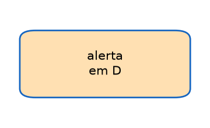
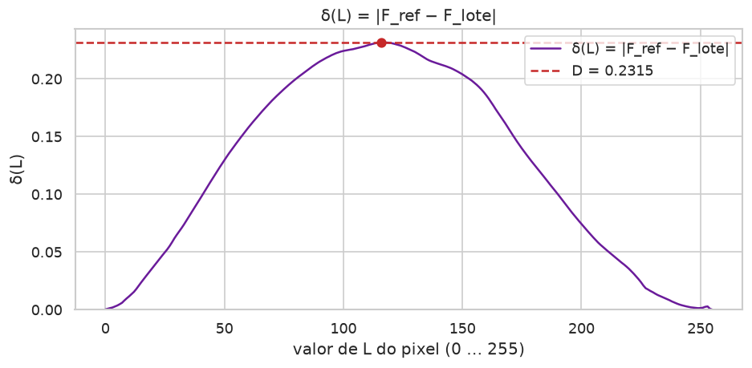
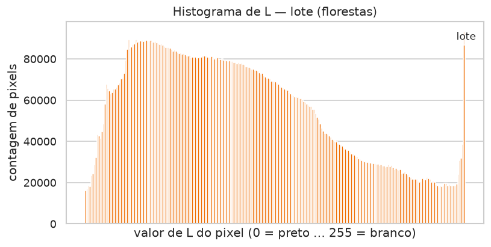

# Aula 003 — Alerta KS de drift (BentoML + Streamlit)

Do serviço em produção ao alerta sobre **D**. O painel vivo está em
[`app.py`](app.py).

## Sumário

1. [Por que estamos aqui](#1-por-que-estamos-aqui)
2. [DevOps: o serviço que responde](#2-devops-o-serviço-que-responde)
3. [MLOps: servir o modelo e observar o mundo](#3-mlops-servir-o-modelo-e-observar-o-mundo)
4. [Saúde HTTP versus adequação dos dados](#4-saúde-http-versus-adequação-dos-dados)
5. [BentoML: colocar a API no ar](#5-bentoml-colocar-a-api-no-ar)
6. [Registro de pedidos](#6-registro-de-pedidos)
7. [Imagens, pixels e luminância L](#7-imagens-pixels-e-luminância-l)
8. [Histograma](#8-histograma)
9. [Cálculo passo a passo — CDF e KS (como no Streamlit)](#9-cálculo-passo-a-passo--cdf-e-ks-como-no-streamlit)
10. [Alerta sobre D](#10-alerta-sobre-d)
11. [Janela temporal no monitoramento](#11-janela-temporal-no-monitoramento)
12. [Limiares de D / KS em outros contextos](#12-limiares-de-d--ks-em-outros-contextos)
13. [O experimento desta aula](#13-o-experimento-desta-aula)
14. [Estrutura da pasta](#14-estrutura-da-pasta)
15. [Como executar](#15-como-executar)
16. [Glossário](#16-glossário)
17. [Testes](#17-testes)
18. [Bibliografia](#18-bibliografia)

---

## 1. Por que estamos aqui

Imagine um serviço de imagens em produção: o cliente envia uma foto, a API
devolve a versão em cinza, o status é **200**, o tempo de resposta está baixo.
Do ponto de vista de disponibilidade, o dia está tranquilo.

Agora mude o *conteúdo* das fotos — de praias para florestas, de estúdio para
rua à noite — e mantenha o mesmo endpoint. O HTTP continua verde. A latência
continua aceitável. O que mudou foi o **mundo** que chega ao modelo.

O caminho completo leva até a pergunta operacional:

> as luminâncias dos pixels que estão chegando ainda se parecem com as do
> treino?

A resposta passa por histograma, CDF, distância vertical δ e a estatística
de Kolmogorov–Smirnov **D**. Quando **D** cruza um limiar, o painel mostra
**ALERTA**.



As subseções abaixo espelham **cada caixa** desse fluxo (a figura
completa acima permanece intacta). Cada caixa tem a sua própria miniatura,
o código comentado e um script que executa **somente** aquele passo:

`scripts/workflow_boxes/box_0N_*.py`.

### 1.1 Caixa — L (pixel)



Converte a fotografia para tons de cinza. Cada pixel vira um inteiro
\(L \in \{0,\ldots,255\}\). Sem L, não há histograma de brilho.

Script: [`scripts/workflow_boxes/box_01_luminancia.py`](scripts/workflow_boxes/box_01_luminancia.py)

```python
def luminancia_L(image):
    """Devolve a grade em modo L (0 = preto … 255 = branco).

    Alternativas: média Rec. 601 manual dos canais RGB; ou um canal
    R/G/B isolado se a pergunta for cor, não luminância.
    """
    return image.convert("L")
```

### 1.2 Caixa — histograma h



Conta quantos pixels caíram em cada faixa de L. Com 256 faixas, cada
nível de cinza é um balde. Com menos faixas, reagrupamos baldes
(resolução mais grossa — o controle “Número de faixas” no Streamlit).

Script: [`scripts/workflow_boxes/box_02_histograma.py`](scripts/workflow_boxes/box_02_histograma.py)

```python
def histograma_h(image, bins=256):
    """Contagens por faixa de L.

    Alternativas: numpy.histogram sobre getdata(); ou densidades
    (frações) no lugar de contagens — a CDF continua sendo a soma
    acumulada, se a normalização for a mesma.
    """
    cinza = image.convert("L")
    counts = list(cinza.histogram())  # 256 baldes nativos
    if bins == 256:
        return counts
    out = [0] * bins
    for i, value in enumerate(counts):
        out[min(bins - 1, (i * bins) // 256)] += int(value)
    return out
```

### 1.3 Caixa — CDF F



Transforma contagens em fração acumulada: “até este tom de cinza, que
parte do total já passou?”. A CDF é não-decrescente e termina em 1 —
geometria que o KS aproveita.

Script: [`scripts/workflow_boxes/box_03_cdf.py`](scripts/workflow_boxes/box_03_cdf.py)

```python
def cdf_F(counts):
    """F_k = (soma das contagens até k) / N.

    Alternativas: numpy.cumsum / N; ECDF ponto a ponto (um salto por
    pixel) sem histogramar antes.
    """
    total = sum(counts)
    acc, out = 0, []
    for c in counts:
        acc += c
        out.append(acc / total)
    return out
```

### 1.4 Caixa — δ = |F − G|



Na mesma grade de faixas, mede a distância **vertical** entre a CDF da
referência (\(F\)) e a do lote (\(G\)).

Script: [`scripts/workflow_boxes/box_04_delta.py`](scripts/workflow_boxes/box_04_delta.py)

```python
def delta_FG(F, G):
    """δ_k = |F_k − G_k|.

    Alternativas: diferença com sinal (quem está acima); norma L2 das
    diferenças; Cramér–von Mises (integral de (F−G)²) — outro teste.
    """
    return [abs(a - b) for a, b in zip(F, G)]
```

### 1.5 Caixa — D = max δ



A estatística de Kolmogorov–Smirnov de duas amostras é o **pior**
afastamento vertical: \(D = \max_k \delta_k\).

Script: [`scripts/workflow_boxes/box_05_d_max.py`](scripts/workflow_boxes/box_05_d_max.py)

```python
def D_max_delta(delta):
    """D = max δ.

    Alternativas: Anderson–Darling (mais peso nas caudas); valor-p
    assintótico a partir de D (nota de rodapé — fora da regra de alerta).
    """
    return max(delta)
```

### 1.6 Caixa — alerta em D



Traduz \(D\) e a massa amostral (\(n\) em cada lado) em estado operacional.
Com \(n < 8\), a aula declara INCONCLUSIVO mesmo que \(D\) seja alto.

Script: [`scripts/workflow_boxes/box_06_alerta.py`](scripts/workflow_boxes/box_06_alerta.py)

```python
def alerta_em_D(D, n_ref, n_lote, limiar=0.10, min_n=8):
    """INCONCLUSIVO / ALERTA / TRANQUILO.

    Alternativas: semáforo FRTB (0,09 / 0,12); regra D+p (WATCH);
    limiar calibrado por quantil histórico de D.
    """
    if n_ref < min_n or n_lote < min_n:
        return "INCONCLUSIVO"
    return "ALERTA" if D >= limiar else "TRANQUILO"
```

---

## 2. DevOps: o serviço que responde

DevOps, neste contexto de aula, é a disciplina de *colocar um processo no
ar e mantê-lo utilizável*: empacotar, servir, receber pedidos, devolver
respostas e saber se a máquina ainda está viva.

Um serviço HTTP típico responde a perguntas como:

| Pergunta | O que se mede |
| :--- | :--- |
| O processo está no ar? | processo, porta, health check |
| O cliente recebe resposta? | código HTTP (200, 4xx, 5xx) |
| A espera é aceitável? | latência (p50, p95, …) |
| Há erros? | taxa de falha, logs de exceção |

Essas métricas descrevem a **saúde da tubulação**: o servidor aceita
conexões, o código não explode, a rede entrega bytes. Elas são
indispensáveis — e insuficientes sozinhas quando o produto é um modelo de
aprendizado de máquina.

Nesta pasta, o serviço BentoML expõe rotas de inferência
(`/inference-grayscale`, entre outras). Mais adiante você sobe e exercita
esse serviço com as receitas `just` desta pasta.

---

## 3. MLOps: servir o modelo e observar o mundo

MLOps estende o ciclo de servir: além de “a API responde?”, aparece “os
dados e o comportamento do modelo ainda fazem sentido?”.

Num fluxo enxuto de *serving* com observação:

```text
# Variáveis:
# imagem — arquivo enviado pelo cliente
# resposta — saída do modelo / filtro
# features — resumo estatístico gravado no log
# referência — distribuição de treino (corpus)
# lote — agregação de pedidos recentes
# D — estatística KS entre referência e lote

imagem chega no endpoint
resposta ← modelo(imagem)
features ← extrair luminância / histograma da imagem
gravar features no log de pedidos
periodicamente:
    lote ← agregar pedidos da janela temporal
    D ← KS(referência, lote)
    se D ≥ limiar → ALERTA
```

Três ideias que esta aula amarra:

1. **Servir** — BentoML (ou equivalente) expõe o modelo como API.
2. **Registrar** — cada pedido relevante deixa um vestígio mensurável
   (aqui: features de imagem em JSON).
3. **Comparar** — um painel (Streamlit) confronta o corpus de treino com o
   lote atual e resume o afastamento em **D**.

O “drift” de que falamos é mudança na **forma da distribuição de entrada**
(luminância **L**), medida entre um conjunto de referência e um lote de
produção.

---

## 4. Saúde HTTP versus adequação dos dados

Separar duas perguntas evita o falso conforto do “tudo verde” no painel
de operações. Uma coisa é o serviço estar **vivo e rápido**. Outra é o
**conteúdo** que passa por ele ainda parecer o mundo com o qual o modelo
foi calibrado.

A primeira pergunta — **saúde do serviço** — olha a tubulação. O processo
está no ar? A porta responde? O cliente recebe o código HTTP esperado
(em geral 200 nas rotas felizes)? A espera (latência) cabe no orçamento
combinado? Exceções estão sob controle, ou há cascata de falhas? Enquanto
essas respostas forem boas, a infraestrutura e o runtime parecem em ordem.

A segunda pergunta — **adequação dos dados** — olha o que viaja *dentro*
dessa tubulação. As fotos que chegam em produção ainda se parecem, na
distribuição de tons claros e escuros, com as fotos de referência do
treino? O afastamento entre a forma da luminância no treino e a forma da
luminância no lote recente ainda está abaixo do limiar que vocês
combinaram alertar? Há imagens suficientes nesse lote para a comparação
fazer sentido, ou a amostra ainda é fina demais para decidir?

As duas respostas são independentes. Um serviço pode devolver status 200
em milissegundos e, ao mesmo tempo, estar processando um domínio visual
que o treino quase não viu — por exemplo, o treino foi feito com praias e
a produção passou a mandar só florestas. A latência mede **quanto se
espera** pela resposta. O monitoramento de dados mede **quão diferente
ficou a distribuição de luminância** entre a referência de treino e o
lote atual. O alerta desta aula dispara sobre esse afastamento de forma,
não sobre o código HTTP.

---

## 5. BentoML: colocar a API no ar

BentoML empacota o código de inferência e sobe um servidor HTTP com rotas
tipadas — o mesmo padrão enxuto que aparece em deployments reais.

Nesta aula, a classe de serviço (`service.py`) registra, entre outras, a
rota `/inference-grayscale`. Em linhas gerais:

1. O cliente envia uma imagem.
2. O serviço **registra** features da imagem (log de pedido).
3. O serviço aplica a conversão a cinza e devolve a imagem processada.

```bash
cd 003_ks_drift_alert_streamlit
just sync
just serve
# terminal dedicado: API na porta 3333
```

Enquanto o servidor está no ar, outro terminal pode enviar um tema de
amostras (`just exercise-theme …`) e depois agregar o log
(`just snapshot-batch …`). O Streamlit (`just streamlit`, porta 8503) lê
o corpus de referência e o lote agregado.

**Servir** e **observar** andam juntos. A resposta HTTP é o produto
imediato; o log é a matéria-prima do monitoramento de dados.

---

## 6. Registro de pedidos

Sem vestígio do que chegou, só resta a saúde HTTP. Com log de features,
dá para reconstruir a distribuição de produção.

Cada chamada a `/inference-grayscale` grava um JSON em `request_features/`
(timestamp + id, histogramas de canais, metadados). Depois, um *snapshot*
agrega esses arquivos em `batch_stats/<nome>.json`.

```text
POST /inference-grayscale
  → log JSON em request_features/
  → resposta = imagem em cinza

snapshot-batch
  → soma histogramas do log
  → batch_stats/<lote>.json
  → limpa (ou prepara) a pasta de log para o próximo exercício
```

O painel em [`app.py`](app.py) compara `corpus_stats.json` (referência de
treino) com o JSON do lote escolhido na barra lateral. Use o seletor
**Lote atual** para trocar controle (praias) / florestas / bolas; use o
controle de **faixas** para reagrupar o histograma de L (256 no freeze).
O lote misto praias+florestas fica na aula opcional
[`007_ks_mixed_landscape_streamlit`](../007_ks_mixed_landscape_streamlit/README.md).

Há também um caminho **offline**: `just build-demo-batches` materializa
lotes de demonstração sem precisar do servidor no ar. Serve para estudar
histograma → CDF → **D** com números estáveis.

---

## 7. Imagens, pixels e luminância L

Uma fotografia digital é uma grade de pontos — os **pixels**. Em cores,
cada pixel costuma carregar três canais (vermelho, verde, azul). Para
falar de “quão claro ou escuro” é o ponto, convertemos a imagem para tons
de cinza: preto num extremo, branco no outro, e uma escada de cinzas no
meio.

Na prática isso é `Image.convert("L")` no Pillow. Cada pixel passa a um
inteiro de **0** (preto) a **255** (branco). Chamamos esse valor de
**luminância** e o denotamos por **L**.

Se $I$ é a imagem e $(u,v)$ um sítio na grade,

$$
L(u,v) \in \{0,1,\ldots,255\}
$$

é a intensidade nesse sítio. Tudo o que esta aula desenha e compara —
histograma, CDF, estatística KS — descreve a **distribuição de L sobre os
pixels** do conjunto de imagens. Não usamos a média de L por foto como
eixo: uma média por imagem comprime demais a forma e, no controle de mesmo
tema, pode disparar alerta à toa (detalhe em
[`docs/notas-experimento-freeze.md`](docs/notas-experimento-freeze.md)).

```python
from PIL import Image

img = Image.open("foto.jpg").convert("L")
contagens = img.histogram()  # 256 faixas: quantos pixels têm cada L
```

---

## 8. Histograma

Com L em mão, a pergunta seguinte é: *em cada degrau de cinza, quantos
pixels caíram?* Essa contagem, faixa a faixa, é o **histograma**.

Imagine 256 baldes alinhados do preto ao branco. Cada pixel do conjunto
(todas as imagens da referência, ou todas do lote) cai num balde. A altura
do balde $k$ é a contagem $h_k$. O total de pixels no conjunto é

$$
N = \sum_{k=0}^{B-1} h_k,
$$

com $B = 256$ no freeze padrão (o Streamlit deixa variar o número de
faixas). Em notação de conjunto,

$$
h_k = \lvert\{\text{pixels com } L \text{ na faixa } k\}\rvert.
$$

Para várias imagens, some os histogramas imagem a imagem: o resultado é o
histograma do **conjunto**. O $h_k$ agregado é a soma dos $h_k$
individuais, e $N$ passa a ser o total de pixels do conjunto.

O Streamlit permite reagrupar faixas (16 a 256) para visualizar a mesma
comparação em resoluções diferentes; a definição de **D** permanece a
mesma na grade escolhida.


---

## 9. Cálculo passo a passo — CDF e KS (como no Streamlit)

Depois das definições, o painel em [`app.py`](app.py) percorre **quatro
estágios numerados**: histograma de cada lado → CDF de cada lado → as duas
CDFs com o segmento **D** → a função $\delta$ e $D = \max \delta$. Abaixo
está a mesma conta, na mesma ordem. No código,
`histogram.cumulative_distribution` faz o passo 2;
`ks_compare.ks_statistic` faz o passo 4.

### Passo 1 — Histograma de L em cada conjunto

Monte o histograma agregado da **referência** (treino) e o do **lote**
atual, na mesma grade de faixas de L (no freeze, $B = 256$; no Streamlit
você pode reagrupar). Cada lado tem a sua lista de contagens
$h^{\mathrm{ref}}_k$ e $h^{\mathrm{lote}}_k$, com totais

$$
N_{\mathrm{ref}} = \sum_k h^{\mathrm{ref}}_k,
\qquad
N_{\mathrm{lote}} = \sum_k h^{\mathrm{lote}}_k.
$$

No app isso aparece como “1. Histograma de L em cada conjunto”, com uma
amostra de imagem acima de cada gráfico.

### Passo 2 — CDF de L em cada conjunto

O histograma ainda fala em “quantos”. A **função de distribuição
acumulada** (CDF) fala em “até aqui, que fração do total?”. Você caminha
dos baldes escuros para os claros, vai somando as contagens e divide pelo
total do **mesmo** lado. A curva começa perto de zero e termina em um:
nunca desce.

Para um histograma genérico com contagens $h_0,\ldots,h_{B-1}$ e
$N = \sum_k h_k$,

$$
F_k = \frac{1}{N}\sum_{i=0}^{k} h_i
\qquad (k = 0,\ldots,B-1).
$$

No Streamlit a legenda diz exatamente isso: aplicamos
$F_k = (1/N)\sum_{i\le k} h_i$ a cada lado — uma CDF $F$ na referência e
uma CDF $G$ no lote.

Propriedades úteis:

- $F_{-1}$ conceitualmente 0; $F_{B-1} = 1$ (se $N > 0$).
- $F$ é não decrescente.
- O que interessa na comparação é a **forma** de $F$ versus $G$, não o
  número absoluto de pixels.

Algoritmo (o mesmo bloco de texto que o app mostra em “CDF”):

```text
# Variáveis:
# contagens — histograma de L
# total — soma(contagens) = número de pixels
# acumulado, cdf, c

total ← soma(contagens)
acumulado ← 0
cdf ← lista vazia
para cada c em contagens:
    acumulado ← acumulado + c
    acrescentar (acumulado / total) em cdf
```

Rode esse laço **duas vezes**: uma com as contagens da referência → $F$;
outra com as do lote → $G$. As duas listas devem ter o mesmo comprimento
(mesma grade de L).

### Passo 3 — As duas CDFs e o segmento D

Sobreponha $F$ e $G$ no mesmo eixo de L. Em cada faixa, a distância
vertical entre as curvas é

$$
\delta_k = \lvert F_k - G_k \rvert.
$$

A estatística de Kolmogorov–Smirnov de duas amostras é o **maior** desses
afastamentos:

$$
D = \max_k \delta_k
= \sup_{x} \lvert F(x) - G(x) \rvert.
$$

No app, o estágio “3. As duas CDFs e o segmento D” desenha as duas curvas
e marca em vermelho o segmento vertical cujo comprimento é **D** — o
máximo de $\lvert F_{\mathrm{ref}} - F_{\mathrm{lote}} \rvert$. Se as
formas de luminância forem parecidas, $D$ fica pequeno. Se o lote trouxer
outro mundo visual, $D$ sobe.


### Passo 4 — Função δ e D = max δ

O estágio “4. Função δ e D = max δ” do Streamlit materializa a lista
completa de $\delta_k$ e destaca o máximo. Algoritmo (o mesmo bloco do
app):

```text
# Variáveis:
# F_ref, F_lote — CDFs na mesma grade de L
# delta, D, i_star

delta ← lista vazia
para i de 0 até comprimento(F_ref) − 1:
    acrescentar |F_ref[i] − F_lote[i]| em delta
D ← máximo(delta)
i_star ← argmáximo(delta)
```



Em `ks_compare.py`, `ks_statistic` é exatamente
$D = \max_i \lvert F_a[i] - F_b[i] \rvert$.

### Exemplo numérico mínimo (os quatro passos em números)

**Passo 1.** Histograma de brinquedo na referência, três faixas:

$$
\mathbf{h}^{\mathrm{ref}} = [2,\ 1,\ 3],
\qquad
N_{\mathrm{ref}} = 6.
$$

No lote:

$$
\mathbf{h}^{\mathrm{lote}} = [1,\ 1,\ 4],
\qquad
N_{\mathrm{lote}} = 6.
$$

**Passo 2.** CDF da referência (mesmo algoritmo do app):

$$
\begin{aligned}
F_0 &= \frac{2}{6} = \frac{1}{3}, \\
F_1 &= \frac{2+1}{6} = \frac{1}{2}, \\
F_2 &= \frac{2+1+3}{6} = 1.
\end{aligned}
$$

CDF do lote:

$$
G = \Bigl[\tfrac{1}{6},\ \tfrac{2}{6},\ 1\Bigr].
$$

**Passos 3 e 4.** Distâncias verticais e máximo:

$$
\begin{aligned}
\delta_0 &= \lvert F_0 - G_0 \rvert = \lvert 2/6 - 1/6 \rvert = 1/6, \\
\delta_1 &= \lvert 3/6 - 2/6 \rvert = 1/6, \\
\delta_2 &= \lvert 1 - 1 \rvert = 0.
\end{aligned}
$$

$$
D = \max_k \delta_k = \frac{1}{6} \approx 0{,}1667.
$$

Com a regra $D \ge 0{,}10$, este brinquedo já cairia em **ALERTA**
(supondo amostras grandes o bastante para sair de INCONCLUSIVO — ver o
capítulo do alerta).

### Nota: valor-p

O software ainda calcula um **valor-p** assintótico clássico do teste KS
de duas amostras, com tamanho efetivo baseado no **número de imagens** de
cada lado (pixels da mesma foto **não** são independentes — há sutileza
de graus de liberdade e dependência espacial). Esse valor-p **não** entra
na regra de alerta: trate-o como nota estatística no rodapé do painel, não
como motor do alarme. O alerta responde a **D**.

---

## 10. Alerta sobre D

Transformar a estatística contínua **D** numa decisão operacional legível
no painel.

| Estado | Condição | O que significa | Ação típica |
| :--- | :--- | :--- | :--- |
| **INCONCLUSIVO** | $n_{\mathrm{ref}} \lt 8$ **ou** $n_{\mathrm{lote}} \lt 8$ | Ainda há poucas imagens na comparação | Esperar mais pedidos **na janela** |
| **ALERTA** | ambos $n \ge 8$ e $D \ge 0{,}10$ | Formas de L divergem além do limiar | Investigar tema ou uso; abrir ticket / rule |
| **TRANQUILO** | ambos $n \ge 8$ e $D \lt 0{,}10$ | Lote compatível com a referência nesta métrica | Seguir monitorando a janela |

O limiar $0{,}10$ é uma escolha de handout: simples de memorizar e
alinhada à ordem de grandeza do experimento praias × florestas
($D \approx 0{,}23$) versus o controle de mesmo tema
($D \approx 0{,}05$). Em produção real, o limiar seria calibrado ao
risco do negócio e à variabilidade histórica. O que importa na prática da
aula: **o alarme dispara sobre D**.

---

## 11. Janela temporal no monitoramento

Em produção, “o lote” quase nunca é “todas as imagens desde o início dos
tempos”. Monitoramento de dados trabalha com **janelas**.

Fixe:

- **Referência** — corpus de treino (ou um baseline estável revisado
  periodicamente).
- **Janela de produção** — por exemplo, os pedidos dos **últimos 30
  dias** (ou 7 dias, ou a última semana calendário — o número é uma
  política).

Compare a CDF agregada da referência com a CDF agregada **somente** dos
pedidos dentro da janela. O **D** passa a responder:

> nos últimos 30 dias, a forma de L ainda combina com o treino?

| Aspecto | Efeito da janela |
| :--- | :--- |
| Relevância | o alerta reflete o presente operacional |
| Volume | evita diluir um desvio recente numa história antiga enorme |
| Operação | times sabem o período sob escrutínio |
| Reprocessamento | snapshots podem ser refeitos por calendário |

No exercício desta aula, a “janela” é o lote que você monta de propósito
(`forests`, `control`, etc.): um conjunto fechado e nomeado. Em um
sistema real com timestamps no log (`logged_at` nos JSON de
`request_features/`), a agregação filtraria

$$
\{\text{pedidos com } t_{\text{agora}} - 30\text{ dias} \le t_{\text{log}} \le t_{\text{agora}}\}.
$$

O cálculo matemático (histograma → CDF → δ → **D**) é o mesmo; muda só
**quais** imagens entram no histograma do lado produção.

**Política mínima sugerida (estudo).** Escolher a duração da janela (ex.:
30 dias); agregar histogramas só dessa fatia; exigir um mínimo de imagens
(nesta aula: 8) antes de sair de INCONCLUSIVO; alertar se
$D \ge \text{limiar}$; revisar a referência quando o negócio mudar de
domínio de propósito (novo produto visual, nova câmera, novo mercado).

---

## 12. Limiares de D / KS em outros contextos

No monitoramento de risco de mercado (FRTB / atribuição de P&L), o próprio
regulador trata **D** como semáforo operacional: abaixo de **0,09** a zona
é verde, acima de **0,12** é vermelha, e o intervalo âmbar fica no meio
([MathWorks](https://www.mathworks.com/help/risk/profit-and-loss-attribution-workflow.html);
[Regulamento Delegado (UE) 2022/2059, art. 8](https://judict.eu/en/sla/32013R0575/32022R2059-X/article-8)).
Essa é a melhor âncora intuitiva para esta aula: o limiar **não** nasce de
um $\alpha$ sagrado — nasce de **política**. O $0{,}10$ do painel Streamlit
sente o mesmo espírito (corte único, legível, decidido a priori), só que
calibrado ao experimento praias × florestas, não ao livro de Basileia.

Não existe um único “D mágico” para o planeta. O que muda de domínio a
domínio é o **papel** do KS (teste de igualdade, tabela crítica, semáforo
regulatório, ou índice de separação) e a **origem** do número que você
compara com $D$.

| Área | Papel do KS | Regra típica | Fonte |
| :--- | :--- | :--- | :--- |
| Estatística (duas amostras) | Teste de igualdade de distribuições | $D > c(\alpha)\sqrt{(n+m)/(nm)}$ | [Wikipédia](https://en.wikipedia.org/wiki/Kolmogorov%E2%80%93Smirnov_test) |
| Tabelas / software | Idem, $n$ pequenos | Valores críticos tabulados | [MetricGate](https://metricgate.com/docs/kolmogorov-smirnov-critical-values/); [Real Statistics](https://real-statistics.com/statistics-tables/two-sample-kolmogorov-smirnov-table/) |
| Astronomia / ciências | Idem via tabela $mnD$ | Cortes por $(m,n),\alpha$ | [NED / Wall](https://ned.ipac.caltech.edu/level5/Wall2/TableA_8.html) |
| FRTB P&L | Semáforo regulatório sobre $D$ | verde &lt; 0,09; vermelho &gt; 0,12 | [MathWorks](https://www.mathworks.com/help/risk/profit-and-loss-attribution-workflow.html); [UE 2022/2059](https://judict.eu/en/sla/32013R0575/32022R2059-X/article-8) |
| Credit scoring | Discriminação default vs non-default | KS alto = melhor separação | [SAS](https://support.sas.com/documentation/cdl/en/mdlmgrug/69919/HTML/default/n194xndt3b3y1pn1ufc0mqbsmht4.htm) |

### 12.1 Estatística clássica (duas amostras) — exemplo trabalhado

Pergunta: as duas amostras podem ter vindo da **mesma** distribuição
contínua? Para amostras grandes, rejeita-se $H_0$ ao nível $\alpha$ quando

$$
D > c(\alpha)\,\sqrt{\frac{n+m}{nm}},
\qquad
c(0{,}05)\approx 1{,}358
$$

([Wikipédia — Kolmogorov–Smirnov](https://en.wikipedia.org/wiki/Kolmogorov%E2%80%93Smirnov_test)).

**Números.** Com $n = m = 50$ (o freeze desta aula):

$$
\sqrt{\frac{50+50}{50\cdot 50}} = \sqrt{\frac{1}{25}} = 0{,}2,
\qquad
1{,}358 \times 0{,}2 \approx 0{,}272.
$$

Ou seja: o teste clássico a $5\%$ pediria $D \gtrsim 0{,}27$ para rejeitar
igualdade. No painel, florestas dão $D \approx 0{,}23$ — **abaixo** desse
corte clássico, porém **acima** do limiar didático $0{,}10$. Duas leituras
coexistem: “ainda não rejeitaria $H_0$ no livro-texto” versus “já
dispararíamos o alarme operacional da aula”.

### 12.2 Tabelas e software ($n$ pequenos) — exemplo trabalhado

Quando $n$ ou $m$ são pequenos, a fórmula assintótica acima é grosseira.
Tabelas publicam o valor crítico de $D$ (ou de uma estatística
equivalente) para cada par $(n,m)$ e cada $\alpha$
([MetricGate](https://metricgate.com/docs/kolmogorov-smirnov-critical-values/),
[Real Statistics](https://real-statistics.com/statistics-tables/two-sample-kolmogorov-smirnov-table/)).

**Números (ilustrativos).** Suponha $n = m = 10$ e $\alpha = 0{,}05$. A
tabela de duas amostras típica coloca o crítico de $D$ na casa de
$\approx 0{,}43$–$0{,}46$ (consulte a linha exata na fonte). Um $D = 0{,}30$
que **alertaria** no Streamlit ($0{,}30 \ge 0{,}10$) **não** rejeitaria
$H_0$ nessa tabela. Moral: o mesmo $D$ muda de veredito conforme a
**regra** — política de aula versus teste formal com $n$ fino.

### 12.3 Astronomia / ciências experimentais — exemplo trabalhado

O espírito continua “$D$ grande demais sob $H_0$”, mas o número sai de uma
grade pré-computada $mnD$ indexada por $(m,n)$ e $\alpha$
([NED / Wall](https://ned.ipac.caltech.edu/level5/Wall2/TableA_8.html)).

**Números.** Se a tabela listar, para $(m,n)=(20,20)$ e $\alpha=0{,}05$,
um crítico $D_{\mathrm{crit}} = 0{,}30$, então:

- $D = 0{,}22$ → não rejeita (ainda “compatível” com a nula naquele $\alpha$);
- $D = 0{,}35$ → rejeita.

O pesquisador **não** escolhe $0{,}10$ por legibilidade pedagógica; ele
lê a célula $(m,n,\alpha)$. Na sala, nós invertemos a prioridade:
escolhemos um corte simples e fixamos $n \ge 8$ via INCONCLUSIVO.

### 12.4 FRTB / atribuição de P&L — exemplo trabalhado

Aqui o KS compara, ao longo de uma janela (tipicamente 250 dias úteis), a
distribuição do P&L **hipotético** com a do P&L **teórico**. O semáforo
incide sobre **D**:

| Zona | Condição sobre $D$ | Leitura |
| :--- | :--- | :--- |
| Verde | $D &lt; 0{,}09$ | Modelagem alinhada o bastante |
| Âmbar | $0{,}09 \le D \le 0{,}12$ | Atenção / investigação |
| Vermelho | $D &gt; 0{,}12$ | Fora do apetite regulatório |

**Números.** Imagine três valores observados na mesa de risco:

| Dia de relatório | $D$ | Zona FRTB | Se fosse o painel da aula ($0{,}10$) |
| :--- | ---: | :--- | :--- |
| t₁ | $0{,}07$ | Verde | TRANQUILO |
| t₂ | $0{,}105$ | Âmbar | ALERTA |
| t₃ | $0{,}15$ | Vermelho | ALERTA |

O âmbar regulatório **não** existe nesta aula: colapsamos política em dois
estados operacionais (mais INCONCLUSIVO por falta de massa). O ponto
didático: **0,09 / 0,12** e **0,10** são primos — ambos cortes de
governança sobre a mesma estatística $D$.

### 12.5 Credit scoring — exemplo trabalhado

No *credit scoring*, o KS troca de pergunta. Em vez de “as distribuições
são iguais?”, pergunta-se “as curvas de score dos que **deram default** e
dos que **não deram** estão bem afastadas?”. Quanto **maior** o KS entre
essas duas curvas empíricas, melhor a discriminação do modelo
([SAS Model Manager](https://support.sas.com/documentation/cdl/en/mdlmgrug/69919/HTML/default/n194xndt3b3y1pn1ufc0mqbsmht4.htm)).

**Números.** Sejam $F_{\mathrm{mau}}$ e $F_{\mathrm{bom}}$ as CDFs do score
nos dois grupos. Se $\max_x \lvert F_{\mathrm{mau}}(x)-F_{\mathrm{bom}}(x)\rvert = 0{,}45$,
o modelo separa melhor do que outro com KS $= 0{,}20$. Aqui **não** se
dispara alarme quando KS é grande — celebra-se. É o inverso semântico do
monitoramento de drift desta pasta.

---


## 13. O experimento desta aula

**Objetivo operacional.**

1. Fixar um tema como referência de treino (sem rede neural).
2. Enviar outro tema (ou o mesmo) por `/inference-grayscale` com log.
3. No Streamlit, construir histograma → CDF → δ → **D** e ler o alerta
   sobre **D**.

**Desenho.** Tema de referência = primeiras 50 praias
(`samples/beaches/`) → `corpus_stats.json`. Lotes offline típicos
(`just build-demo-batches`):

- `batch_stats/control.json` — praias 51–100 (mesmo tema, outro trecho).
- `batch_stats/forests.json` — 50 florestas.

| Comparação | $D$ típico | Alerta ($D \ge 0{,}10$) |
| :--- | :--- | :--- |
| praias[:50] vs florestas[:50] | $\approx 0{,}23$ | ALERTA |
| praias[:50] vs praias[50:100] | $\approx 0{,}05$ | TRANQUILO |

| Histograma (treino) | Histograma (lote) |
| :---: | :---: |
|  |  |


Por que 50 imagens (e não as 110 do tema), e por que L por pixel em vez
da média por imagem: ver
[`docs/notas-experimento-freeze.md`](docs/notas-experimento-freeze.md).

A base só devolve a imagem filtrada. Esta aula grava o pedido (como a
linha `020`) e analisa a distribuição de **L** no Streamlit.

---

## 14. Estrutura da pasta

```text
003_ks_drift_alert_streamlit/
  README.md                 # handout da aula
  app.py                    # Streamlit: defs + gráficos + alerta sobre D
  service.py                # BentoML /inference-grayscale + log
  alert_rule.py             # alert_on_d (D≥0,10) + regra legada D+p
  ks_compare.py             # D, CDFs, contagens entre referência e lote
  histogram.py              # L, histograma, CDF
  corpus_stats.py           # agrega features/ → estatística de treino
  request_stats.py          # agrega request_features/ → lote
  request_log.py            # grava JSON em request_features/
  plotting.py               # histograma, CDF, δ, dual CDF
  corpus_stats.json         # freeze: praias[:50]
  batch_stats/              # control.json, forests.json, …
  request_features/         # log vivo (gitkeep; JSON ignorados)
  features/                 # saídas de extract
  illustrations/            # PNGs do handout (just generate-illustrations)
  scripts/
    extract_image_features.py   # praias[:50] → features/
    build_corpus_stats.py       # features/ → corpus_stats.json
    build_batch_from_theme.py   # tema → batch_stats/<nome>.json (offline)
    exercise_theme.py           # POST tema no serviço → request_features/
    snapshot_batch.py           # request_features/ → batch_stats/
    generate_illustrations.py   # regenera illustrations/
    verify_ks_alert.py          # imprime D/alerta sem UI
  tests/                    # pytest
  docs/
    notas-experimento-freeze.md # por que 50; pixel vs média
  scripts/workflow_boxes/       # um script por caixa do fluxo
  justfile
```

| Artefato | Papel |
| :--- | :--- |
| `service.py` | API BentoML; log em `/inference-grayscale` |
| `request_log.py` | grava JSON em `request_features/` |
| `histogram.py` | histograma e CDF |
| `ks_compare.py` | $D$ (e valor-p assintótico, nota de rodapé) |
| `alert_rule.py` | regra INCONCLUSIVO / ALERTA / TRANQUILO sobre **D** |
| `app.py` | painel Streamlit |
| `corpus_stats.json` | referência agregada de treino |
| `batch_stats/*.json` | lotes agregados |
| `illustrations/` | figuras do handout e do app |

---

## 15. Como executar

### Caminho offline (lotes já materializados, sem servidor)

```bash
cd 003_ks_drift_alert_streamlit
# entra na pasta da aula

just sync
# cria/atualiza .venv e instala dependências do pyproject (uv)

just download-samples
# aponta para samples/{beaches,forests,balls}/ na raiz do repositório
# (não baixa de novo se o corpus temático já estiver lá)

just extract-features
# extrai histograma L (e canais) das primeiras 50 praias → features/*.json

just build-corpus-stats
# agrega features/ → corpus_stats.json (referência de treino)

just build-demo-batches
# grava batch_stats/control.json (praias 51–100) e batch_stats/forests.json
# (50 florestas), sem precisar do BentoML no ar

just generate-illustrations
# opcional: regenera illustrations/*.png usadas neste handout

just streamlit
# sobe o app em http://localhost:8503
```

### Caminho com servidor (log real em `request_features/`)

```bash
just serve
# terminal 1: BentoML com /inference-grayscale na porta 3333

just clear-request-features
# apaga JSON antigos em request_features/ para o próximo exercício

just exercise-theme forests
# POST de imagens de samples/forests/ no serviço; cada pedido vira um JSON
# de features em request_features/

just snapshot-batch forests
# agrega request_features/ → batch_stats/forests.json e limpa a pasta de log

just clear-request-features
# prepara a pasta de log para o lote de controle

just exercise-theme beaches --offset=50 --count=50
# envia praias[50:100] como “produção” de mesmo tema (disjunto do treino[:50])

just snapshot-batch control
# agrega esse log → batch_stats/control.json

just streamlit
# compara corpus_stats.json com o lote escolhido na barra lateral
```

### O que acontece por dentro

```text
imagem → convert("L") → histograma de L (pixels)
beaches[:50] → soma → corpus_stats.json
lote → /inference-grayscale → request_features/ → batch_stats/
app: histograma → CDF → δ → D → alerta se D ≥ 0,10
```

---

## 16. Glossário

| Termo | Significado nesta aula |
| :--- | :--- |
| **L** | luminância do pixel após `convert("L")`, em $\{0,\ldots,255\}$ |
| **Histograma** | contagens $h_k$ por faixa de L |
| **CDF** | $F_k = (1/N)\sum_{i\le k} h_i$ |
| **δ** | $\lvert F_k - G_k \rvert$ |
| **D** | $\max_k \delta_k$ (Kolmogorov–Smirnov) |
| **Referência / corpus** | distribuição de treino agregada |
| **Lote / produção** | agregação de pedidos (ou batch demo) |
| **ALERTA** | $D \ge 0{,}10$ com amostras suficientes |
| **Janela temporal** | fatia de pedidos (ex.: últimos 30 dias) usada no lote |

Notas de freeze (pixel vs média):
[`docs/notas-experimento-freeze.md`](docs/notas-experimento-freeze.md).

---

## 17. Testes

```bash
just test
# inclui tests/test_workflow_box_demos.py (scripts por caixa)

python scripts/workflow_boxes/box_01_luminancia.py
# … até box_06_alerta.py — cada um isolado
```

---

## 18. Bibliografia

1. [Kolmogorov–Smirnov (Wikipédia)](https://en.wikipedia.org/wiki/Kolmogorov%E2%80%93Smirnov_test)
2. Gama et al., *A survey on concept drift adaptation*, ACM CSUR 2014 —
   [doi:10.1145/2523813](https://doi.org/10.1145/2523813)
3. [PSI — KAscore Ongoing Monitoring](https://ketchbrookanalytics.github.io/KAscore/articles/ongoing-monitoring.html)
4. Taplin & Hunt, Risks 2019 — [MDPI](https://www.mdpi.com/2227-9091/7/2/53)
5. [Pillow — Image](https://pillow.readthedocs.io/en/stable/reference/Image.html)
6. Limiares FRTB / crédito: ver links na
   [seção 12](#12-limiares-de-d--ks-em-outros-contextos)

[`004_prometheus_histcdf_streamlit`](../004_prometheus_histcdf_streamlit/README.md)
