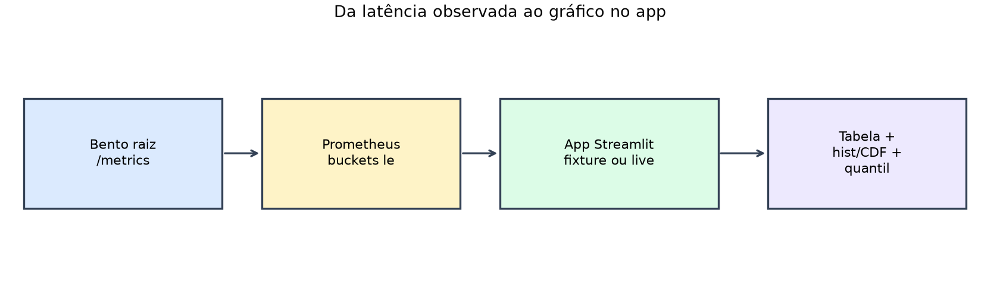
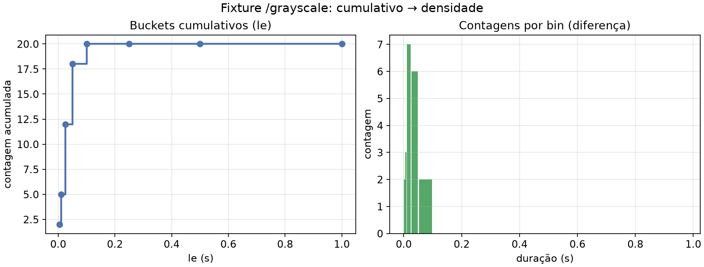
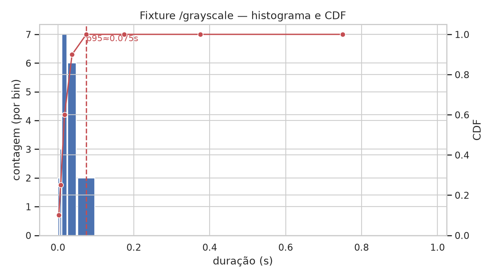

# Aula 004 — Histograma e CDF a partir do Prometheus

## Objetivo

Baixar os **buckets cumulativos** de latência que o Prometheus guarda a partir
do `/metrics` do serviço BentoML na raiz do repositório; montar **tabela**,
**histograma** e **CDF** em Python (NumPy + Seaborn) num app Streamlit; e
colocar o **quantil em Python** ao lado do **`histogram_quantile` em PromQL**
(números e trechos de código) para comparar resultado e complexidade.

A entrada do app é a **série de buckets** já agregada (fixture gravada ou
consulta live). O scrape da raiz (`monitoring/prometheus.yml`,
`docs/prometheus.md`) alimenta o modo live; o modo fixture funciona sem rede.

As figuras abaixo vivem em `illustrations/` (regeneráveis com
`just generate-prom-illustrations`).



## Entrada e saída

### Fixture `/grayscale` (modo offline)

**Entrada** — buckets cumulativos em `fixtures/duration_histogram.json`
(endpoint `/grayscale`), carregados com:

```python
samples = fetch_duration_buckets_from_fixture(endpoint="/grayscale")
payload = payload_from_samples(samples)
```

**Saída — série cumulativa** (`le` → contagem acumulada), total = 20:

| le (s) | cumulativo |
| ---: | ---: |
| 0.005 | 2 |
| 0.01 | 5 |
| 0.025 | 12 |
| 0.05 | 18 |
| 0.1 | 20 |
| 0.25 … +Inf | 20 |

**Saída — contagens por bin** (diferença dos cumulativos, só `le` finitos):
`[2, 3, 7, 6, 2, 0, 0, 0]`.

**Saída — CDF** (sobre essas contagens): `[0.1, 0.25, 0.6, 0.9, 1.0, 1.0, 1.0, 1.0]`.



**Saída — quantil p95 em Python** (interpolação no bin `[0.05, 0.1]`):

```text
value ≈ 0.075 s
bucket_lo = 0.05
bucket_hi = 0.1
bounded = True
```

Espelho PromQL instantâneo (o app mostra o mesmo texto):

```promql
histogram_quantile(0.95, sum by (le) (
  bentoml_service_request_duration_seconds_bucket{endpoint="/grayscale"}
))
```



### Trecho decisivo

```python
samples = fetch_duration_buckets_from_fixture(endpoint="/grayscale")
payload = payload_from_samples(samples)
compare = compare_quantiles(
    payload["les"], payload["cumulative"], q=0.95, endpoint="/grayscale"
)
```

## Como executar

Na pasta desta aula (`cd 004_prometheus_histcdf_streamlit` a partir da raiz
do repositório):

```bash
just sync
just app
```

Abra a URL do Streamlit (porta **8503**). O modo **fixture** funciona sem
Prometheus. Para o modo **live**:

1. Na raiz do repositório, suba o serviço (`just serve`) e o Prometheus como em
   `docs/prometheus.md` (URL típica `http://127.0.0.1:9090`).
2. Gere algum tráfego nos endpoints de inferência.
3. No app, escolha **live**, confirme a URL e clique em **Atualizar**.

A comparação numérica usa a forma **instantânea** (contadores cumulativos no
instante da query), alinhada ao espelho em Python. A recording rule da raiz
usa `rate(...[1m])`; o app também mostra essa variante no painel de código,
sem a usar por omissão.

Testes (só fixture / mocks, sem scrape):

```bash
just test
```

## O que acontece por dentro

### Fluxo

```text
fixture JSON  ou  Prometheus /api/v1/query
        │
        ▼
  buckets (le, cumulativo)
        │
        ▼
 cumulative_to_bins → contagens + edges
        │
        ├── tabela / dataframe
        ├── plot_histogram_cdf
        └── histogram_quantile_from_cumulative  ↔  PromQL
```

### Algoritmo

```text
# Variáveis:
# les, cumulative — bordas superiores e contagens acumuladas Prometheus
# per_bin — diferença entre cumulativos consecutivos
# counts, edges — série finita para plot
# cdf — cumsum(counts) / sum(counts)
# q — quantil pedido (ex.: 0.95)

bins ← cumulative_to_bins(les, cumulative)
cdf ← cdf_from_counts(bins.counts)
python_p95 ← histogram_quantile_from_cumulative(q, les, cumulative)
promql ← histogram_quantile(q, sum by (le) (…_bucket{endpoint=…}))
```

1. Ordenar por `le`; rejeitar série não monótona.
2. Diferenciar cumulativos → massa por bin; o `+Inf` entra na tabela completa.
3. CDF e quantil caminham a massa (interpolação linear no bin que contém o
   rank `q × total`), espelhando a ideia do `histogram_quantile` do Prometheus.

[`010_corpus_histograms_model`](../010_corpus_histograms_model/README.md)
