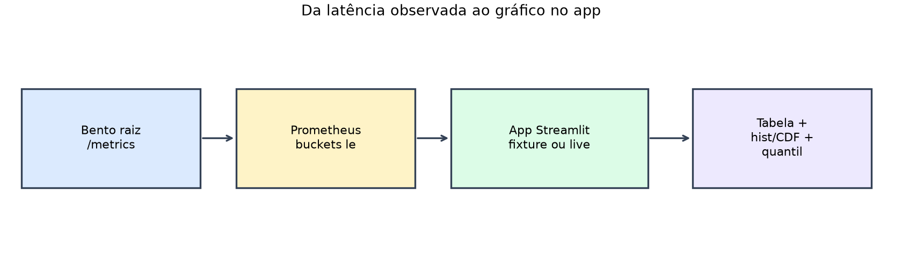
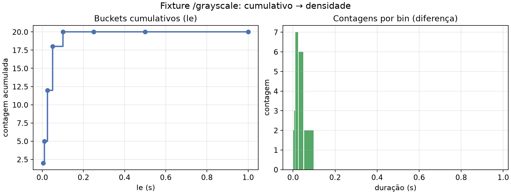
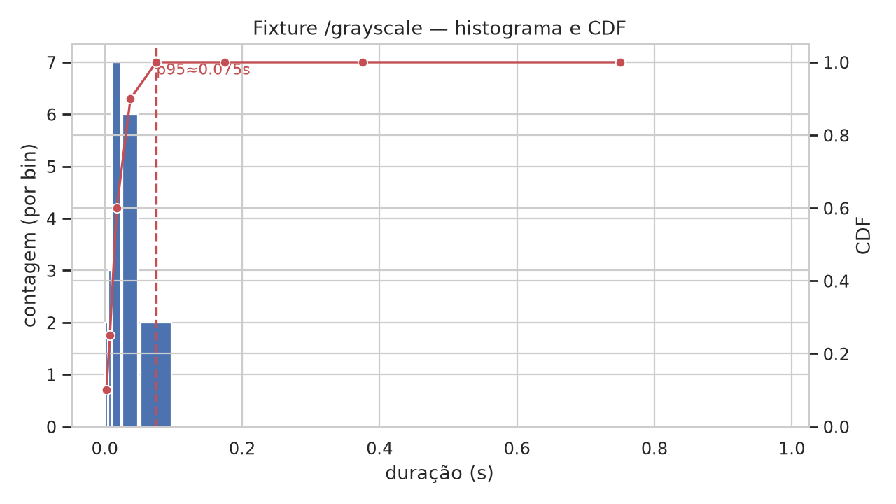

# Aula 004 — Prometheus e PromQL

Uma API pode responder HTTP 200 enquanto seus usuários esperam cada vez mais.
Para investigar essa situação, precisamos saber **o que foi medido, em qual
período e como a consulta transformou as medidas**.

Se ainda não concluiu o [tutorial de instalação e coleta](../docs/prometheus.md),
faça-o antes de continuar. Nesta aula você formula consultas em **PromQL**, a
linguagem de consulta do Prometheus, e explica os números do painel.

## Sumário

1. [Objetivos](#objetivos)
2. [1. Escolha os dados e abra as ferramentas](#1-escolha-os-dados-e-abra-as-ferramentas)
3. [Como usar este painel](#como-usar-este-painel)
4. [2. Da requisição à interpretação](#2-da-requisição-à-interpretação)
5. [3. Métricas, labels e seletores](#3-métricas-labels-e-seletores)
6. [4. Contador, gauge e tipos da consulta](#4-contador-gauge-e-tipos-da-consulta)
7. [5. Da contagem à taxa](#5-da-contagem-à-taxa)
8. [6. Buckets: reconstrua uma distribuição](#6-buckets-reconstrua-uma-distribuição)
9. [7. Traduza a conta para PromQL](#7-traduza-a-conta-para-promql)
10. [8. Laboratório](#8-laboratório-hipótese-consulta-e-evidência)
11. [9. Linha de base e alerta](#9-leia-a-linha-de-base-e-o-alerta)
12. [10. Exercício e entrega](#10-exercício-e-entrega)
13. [11. Código e materiais](#11-código-e-materiais)
14. [Glossário](#glossário)
15. [Referências](#referências-para-consulta)

## Objetivos

Pratique até conseguir:

- identificar uma série por sua métrica e seus labels;
- distinguir contador acumulado, taxa e valor observado no instante;
- calcular uma taxa simples e reconstruir uma CDF a partir de buckets;
- explicar o p95 estimado e comparar Python com PromQL sobre os mesmos dados;
- interpretar uma linha de base móvel e escrever uma conclusão com seus limites;
- usar o painel na ordem certa (fonte → conta → consulta → relato).

## 1. Escolha os dados e abra as ferramentas

Há três fontes para atividades diferentes:

| Fonte | O que contém | O que permite fazer |
|---|---|---|
| **Fixture** em [`fixtures/duration_histogram.json`](fixtures/duration_histogram.json) | Um conjunto didático fixo de buckets, com duas rotas | Reproduzir a conta do quantil sem servidores |
| **Serviço real** do tutorial anterior | Métricas das chamadas que você envia ao BentoML | Investigar seu serviço e sua máquina |
| **Gerador sintético** desta aula | Métricas produzidas por um cenário programado de atividade, lentidão e recuperação | Explorar consultas temporais com resultados controlados |

A fixture é um retrato único: não contém o histórico necessário a `rate`.
Os dados sintéticos permitem estudar consultas; seus valores não medem o
desempenho do BentoML.

**Portas (não confundir).** Mapa do curso: [`docs/ports.md`](../docs/ports.md).
O trio canônico é BentoML **3000**, Prometheus **9090**, Grafana **4000**.
Esta aula acrescenta auxiliares (Streamlit **8504**; demo **8004**/**9094**) —
eles **não** substituem o trio.

| Porta | Processo | Papel |
| ---: | :--- | :--- |
| **3000** | BentoML (`just serve` na raiz) | API + `GET /metrics` (canônico) |
| **9090** | Prometheus do tutorial | UI/API sobre o serviço real (canônico) |
| **4000** | Grafana | Painéis do curso (canônico; nunca 3000) |
| **8504** | Painel desta aula (`just app`) | Streamlit auxiliar |
| **8004** / **9094** | Exporter + Prometheus sintéticos | Demo auxiliar (opcional) |

Na pasta da aula, instale as dependências e abra o painel:

~~~bash
cd 004_prometheus_histcdf_streamlit
just sync
just app
~~~

O painel Streamlit fica em <http://127.0.0.1:8504>. Comece no modo **fixture**.

Para gerar dados e carregá-los continuamente no Prometheus, mantenha três
terminais abertos **nessa mesma pasta**:

| Terminal | Comando | Papel |
|---|---|---|
| 1 | `just demo-exporter` | Publica métricas sintéticas em `127.0.0.1:8004/metrics` |
| 2 | `just demo-prometheus` | Coleta e armazena essas métricas; interface em `127.0.0.1:9094` |
| 3 | `just app` | Abre o painel da aula em `127.0.0.1:8504` |

No painel, escolha **live** e informe `http://127.0.0.1:9094`. As primeiras
coletas levam alguns segundos; deixe completar um minuto para explorar as
consultas com janela de um minuto. O passo a passo completo, a configuração e
as fases do cenário estão em [Gerar e carregar dados de exemplo](SAMPLE_DATA.md).

Para trabalhar com o serviço real já instalado, use a URL
`http://127.0.0.1:9090` no modo live e gere chamadas como no tutorial anterior.
Anote qual fonte usou. As consultas abaixo funcionam nas duas instâncias
isoladas, pois ambas usam o job `bentoml-imagens`.

## Como usar este painel

Siga esta ordem. A barra lateral só escolhe **fonte** e parâmetros; a leitura
fica no corpo da página.

1. **Fonte.** Comece em **fixture** (sem Prometheus). Só depois passe a
   **live** (`http://127.0.0.1:9094` sintético ou `http://127.0.0.1:9090` real).
2. **Controles.** Endpoint, quantil e (no live) URL do Prometheus. Anote o que
   estava selecionado quando leu cada número.
3. **Conta antes do cartão.** Na fixture, reproduza à mão as contagens e o p95
   (0,075 s em grayscale) **antes** de tratar o painel como oráculo.
4. **Escopo do modo fixture.** O painel calcula em Python e *mostra* a
   expressão PromQL; **não** executa essa expressão no servidor. Comparação
   numérica Python ↔ PromQL exige modo live.
5. **Miniaturas / gráficos.** Leia histograma e CDF como a mesma população da
   tabela; mude um controle e regenere a leitura. Não misture um q novo com
   um resultado antigo.

## 2. Da requisição à interpretação

~~~text
requisição → instrumentação → coleta → séries → consulta → interpretação
~~~

**Instrumentar** é registrar grandezas de interesse no serviço. O BentoML
registra contagens e durações e publica essas métricas em `/metrics`.
**Scrape** é a coleta periódica que o Prometheus faz nesse endereço.
Uma **série temporal** guarda amostras de uma grandeza ao longo do tempo.
PromQL seleciona e transforma essas séries.

No serviço real, as observações são durações de requisições HTTP. No gerador,
são durações sintéticas calculadas pelo programa. O Prometheus coleta os
acumuladores nas duas situações: uma coleta pode resumir várias requisições,
e não corresponde necessariamente a uma requisição da API.

As configurações desta aula coletam e avaliam regras a cada cinco segundos.
Esse intervalo de coleta é diferente da **janela de consulta**, como
`[1m]`, e do **passo do gráfico**, que determina em quais instantes a
expressão será avaliada para desenhar a curva.

**Janela e quantil.** A **janela** de consulta (`[1m]`, `[5m]`, …) limita o
histórico que a expressão usa. A janela curta reage mais cedo a uma mudança;
a longa mistura fases. Mudar a janela pode alterar o número lido sem que o
serviço tenha mudado no mesmo instante.

Um **quantil** (ou percentil) responde: «abaixo de que valor está a fração
*q* das observações?» Com *q* = 0,50 (p50 / mediana), metade das observações
fica abaixo do valor; com *q* = 0,95 (p95), cerca de 95% ficam abaixo; com
*q* = 0,99 (p99), cerca de 99%. Em monitoramento de latência, p50 descreve o
caso típico; p95 e p99 descrevem a cauda lenta (a fração que mais incomoda o
usuário). Em comércio eletrônico, um p95 de checkout alto pode coexistir com
média baixa se poucas compras forem lentas. Em APIs de inferência, o p95 por
`endpoint` ajuda a ver se uma rota específica arrasta a experiência.

Exemplo numérico com dez latências já ordenadas (ms):

~~~text
20, 22, 24, 25, 28, 30, 35, 40, 80, 200
~~~

| Quantil | Leitura aproximada nesta amostra | Valor |
| :--- | :--- | ---: |
| p50 | 5.ª e 6.ª posições (metade da amostra) | ≈ 29 ms |
| p95 | perto da 9,5.ª posição (cauda) | entre 80 e 200 ms |
| p99 | ainda mais na cauda | próximo de 200 ms |

A média destas dez medidas é 50,4 ms: fica perto do miolo da amostra, mas
esconde a cauda que o p95/p99 tornam visível. Com histogramas Prometheus não
temos a lista completa; estimamos o quantil a partir dos buckets (seção 6).

Formule primeiro a pergunta («a rota grayscale ficou lenta na última
janela de um minuto?»), depois escolha janela e *q*.

## 3. Métricas, labels e seletores

Abra a interface do Prometheus escolhido: [real](http://127.0.0.1:9090/query)
ou [sintético](http://127.0.0.1:9094/query). Use primeiro a visualização
**Table**.

~~~promql
up{job="bentoml-imagens"}
~~~

`up` indica o sucesso da coleta mais recente do target: `1` para sucesso,
`0` para falha. Ele é produzido pelo próprio Prometheus. Confirme o resultado
também na página `/targets`. A coleta bem-sucedida informa que o endpoint de
métricas foi acessível; a qualidade da inferência exige outras medidas.

Agora consulte:

~~~promql
bentoml_service_request_total{job="bentoml-imagens"}
~~~

**Labels** são pares nome–valor que distinguem séries de uma mesma métrica.
Um **seletor** combina o nome da métrica com condições sobre esses pares.

| Label | Significado nesta aula |
|---|---|
| `job` | Grupo de coleta: `bentoml-imagens` |
| `instance` | Endereço do target coletado |
| `endpoint` | Caminho HTTP, por exemplo `/inference-grayscale` |
| `source` | No cenário de exemplo, `synthetic` identifica a origem |
| `le` | Limite superior de um bucket de histograma |

Os labels presentes podem variar entre métricas. Leia a saída antes de
construir o filtro. As rotas de inferência do
[`service.py`](../service.py) são `/inference-blur`,
`/inference-grayscale` e `/inference-resize`.

Selecione uma delas por igualdade:

~~~promql
bentoml_service_request_total{
  job="bentoml-imagens",
  endpoint="/inference-grayscale"
}
~~~

Selecione as três por expressão regular:

~~~promql
bentoml_service_request_total{
  job="bentoml-imagens",
  endpoint=~"/inference-(blur|grayscale|resize)"
}
~~~

`=` exige igualdade; `=~` usa uma expressão regular, cujo casamento em
PromQL abrange o valor inteiro do label. O filtro de job delimita a fonte;
o filtro de endpoint delimita as operações. Veja a
[referência de seletores](https://prometheus.io/docs/prometheus/latest/querying/basics/#time-series-selectors).

**Verifique:** consultar somente o nome da métrica garante uma única série?
Não. Cada combinação de labels pode produzir outra série.

## 4. Contador, gauge e tipos da consulta

Um **contador** cresce a cada evento e pode reiniciar quando seu processo é
reiniciado. Um **gauge** representa um valor que pode subir e descer.
Um **histograma** organiza observações em faixas; nesta aula usamos o formato
clássico, exposto por várias séries.

| Métrica | Tipo e unidade |
|---|---|
| `bentoml_service_request_total` | Contador de requisições |
| `up` | Gauge com valores 0 ou 1 |
| `bentoml_service_request_duration_seconds_bucket` | Contadores cumulativos por limite, em observações |
| `bentoml_service_request_duration_seconds_count` | Contador do número de durações observadas |
| `bentoml_service_request_duration_seconds_sum` | Soma acumulada das durações, em segundos |

O sufixo `_sum` acumula segundos; `_count` acumula observações. Como as
durações são não negativas, ambos crescem entre reinícios. Consulte os
[tipos de métricas](https://prometheus.io/docs/concepts/metric_types/).

Há também tipos de resultado de **expressões PromQL**:

| Expressão | Resultado |
|---|---|
| `up{job="bentoml-imagens"}` | Vetor instantâneo: um valor por série selecionada no instante avaliado |
| `up{job="bentoml-imagens"}[1m]` | Vetor de intervalo: amostras de cada série na janela |
| `1000` | Escalar: um número |

Uma **consulta instantânea** avalia a expressão em um instante. Uma **consulta
de intervalo** repete a avaliação em vários instantes, como no gráfico.
Isso é diferente do tipo de vetor: uma consulta instantânea pode avaliar
`rate(contador[1m])`, usando uma janela de histórico para produzir seu
resultado. Na interface, use **Table** para inspecionar valores e **Graph**
para observar sua evolução.

## 5. Da contagem à taxa

Imagine um contador que passa de 100 para 160 em 60 segundos, sem reinício:

~~~text
requisições novas = 160 − 100 = 60
taxa média = 60 / 60 s = 1 requisição/s
~~~

Esse exemplo explica a unidade. O contador atual, 160, representa o acumulado
desde seu último reinício; ele sozinho não informa o ritmo recente.

Para estimar a taxa por endpoint:

~~~promql
sum by (endpoint) (
  rate(bentoml_service_request_total{
    job="bentoml-imagens",
    endpoint=~"/inference-(blur|grayscale|resize)"
  }[1m])
)
~~~

Leia de dentro para fora: selecione séries; use um minuto de amostras para
calcular a taxa de cada contador; some as taxas mantendo o label `endpoint`.
A saída está em **requisições por segundo**.

`rate` trata quedas de contador como reinícios e extrapola para as bordas
da janela. Por isso a conta entre duas amostras serve para entender a ideia,
mas não substitui o algoritmo em uma coleta real. A ordem **taxa por série,
depois soma** preserva a identificação dos reinícios de cada contador.
[Semântica de rate](https://prometheus.io/docs/prometheus/latest/querying/functions/#rate).

Para o aumento estimado na janela, use `increase`:

~~~promql
sum by (endpoint) (
  increase(bentoml_service_request_total{
    job="bentoml-imagens",
    endpoint=~"/inference-(blur|grayscale|resize)"
  }[1m])
)
~~~

A saída está em requisições na janela e pode ser fracionária devido à
extrapolação. Compare com `60 * rate(...[1m])`: a conversão usa 60 segundos.

Troque `[1m]` por `[5m]` na consulta de taxa. A janela maior mistura
mais passado e tende a suavizar mudanças recentes. Compare as duas no mesmo
período do gráfico. Uma consulta com poucos pontos disponíveis ainda não
representa uma janela inteira de observação.

**Agregação:** `sum by (endpoint)` mantém uma saída por rota;
`sum(...)` combina todas as séries selecionadas numa única saída.
Uma mudança de agrupamento muda a pergunta respondida.

## 6. Buckets: reconstrua uma distribuição

Um **bucket** conta observações até um limite superior, identificado por
`le`, de *less than or equal*. Os buckets são cumulativos em dois sentidos:
guardam contagens que crescem no tempo e cada limite inclui os limites menores.

O bucket `le="0.05"` informa quantas durações foram de **até 0,05 s**.
`le="+Inf"` inclui todas as observações. Somar buckets de limites diferentes
contaria várias observações repetidamente.

A fixture de `/inference-grayscale` contém 20 observações:

| Limite `le` (s) | Contagem cumulativa | Contagem na faixa | CDF no limite |
|---:|---:|---:|---:|
| 0,005 | 2 | 2 | 0,10 |
| 0,010 | 5 | 3 | 0,25 |
| 0,025 | 12 | 7 | 0,60 |
| 0,050 | 18 | 6 | 0,90 |
| 0,100 | 20 | 2 | 1,00 |
| 0,250 | 20 | 0 | 1,00 |
| 0,500 | 20 | 0 | 1,00 |
| 1,000 | 20 | 0 | 1,00 |
| +Inf | 20 | 0 | 1,00 |

A contagem da faixa `(0,010; 0,025]` é `12 − 5 = 7`.
A **CDF**, função de distribuição acumulada, informa a fração das observações
até cada limite: em 0,025 s, temos `12/20 = 0,60`.

As contagens por faixa finita são `[2, 3, 7, 6, 2, 0, 0, 0]`.
A CDF nos limites finitos é `[0.1, 0.25, 0.6, 0.9, 1, 1, 1, 1]`.
O denominador é sempre o total, incluindo `+Inf`. Se houver observações
além do maior limite finito, a curva exibida termina abaixo de 1; a cauda
continua presente na tabela.

O gráfico usa altura de barra como contagem por faixa. As faixas têm larguras
diferentes; a altura não é uma densidade de probabilidade. Os pontos da CDF
ficam nos limites superiores, onde conhecemos as frações acumuladas.

### Calcule o p95 antes de abrir o cartão

O **percentil 95**, ou **quantil 0,95**, localiza um valor abaixo do qual
fica aproximadamente 95% da distribuição. Com 20 observações, o rank é:

~~~text
rank = 0,95 × 20 = 19
até 0,05 s: 18 observações
até 0,10 s: 20 observações
~~~

A posição 19 está no bucket `(0,05; 0,10]`. Como não guardamos as durações
individuais, interpolamos linearmente dentro dele:

~~~text
fração dentro do bucket = (19 − 18) / (20 − 18) = 0,5
p95 estimado = 0,05 + (0,10 − 0,05) × 0,5
p95 estimado = 0,075 s = 75 ms
~~~

Isso não prova que uma requisição durou exatamente 75 ms. A resolução dos
buckets limita a precisão da estimativa. No formato clássico, a interpolação
linear pressupõe uma distribuição uniforme dentro do bucket que contém o
quantil. Veja [histogramas e quantis](https://prometheus.io/docs/practices/histograms/).

## 7. Traduza a conta para PromQL

Para comparar o retrato acumulado em Python e PromQL:

~~~promql
histogram_quantile(
  0.95,
  sum by (le) (
    bentoml_service_request_duration_seconds_bucket{
      job="bentoml-imagens",
      endpoint="/inference-grayscale"
    }
  )
)
~~~

`sum by (le)` preserva cada limite e combina as séries da rota.
`histogram_quantile` estima o quantil. No modo live, o painel consulta os
buckets e o quantil no **mesmo instante**, com o mesmo filtro.

Essa consulta descreve os contadores acumulados atualmente expostos. Se
processos reiniciaram em momentos diferentes, o acumulado soma históricos
de durações diferentes. Para perguntar pela **janela recente**, calcule as
taxas dos buckets antes de agregar:

~~~promql
histogram_quantile(
  0.95,
  sum by (le, endpoint) (
    rate(bentoml_service_request_duration_seconds_bucket{
      job="bentoml-imagens",
      endpoint=~"/inference-(blur|grayscale|resize)"
    }[1m])
  )
)
~~~

O resultado é um p95 estimado, **em segundos, por endpoint**, na janela.
Multiplique a expressão por 1000 para apresentar milissegundos.
Preserve `le`: ele é necessário para reconstruir o histograma clássico.
Para combinar rotas com o mesmo esquema de buckets, retire `endpoint`
do agrupamento; isso produz um quantil da população combinada. Fazer média
dos quantis separados não reconstrói esse quantil.

### Média, p95 e número de observações

A média das durações na janela usa soma dividida por contagem:

~~~promql
sum by (endpoint) (
  rate(bentoml_service_request_duration_seconds_sum{
    job="bentoml-imagens",
    endpoint=~"/inference-(blur|grayscale|resize)"
  }[1m])
)
/
sum by (endpoint) (
  rate(bentoml_service_request_duration_seconds_count{
    job="bentoml-imagens",
    endpoint=~"/inference-(blur|grayscale|resize)"
  }[1m])
)
~~~

O numerador é segundos acumulados por segundo de tempo; o denominador,
observações por segundo. A razão é **segundos por observação**.
As duas agregações preservam os mesmos labels, permitindo associar cada
numerador ao denominador da mesma rota.

A média resume o centro; o p95 ajuda a observar a parte mais lenta.
Acompanhe também quantas durações sustentam o resultado:

~~~promql
sum by (endpoint) (
  increase(bentoml_service_request_duration_seconds_count{
    job="bentoml-imagens",
    endpoint=~"/inference-(blur|grayscale|resize)"
  }[1m])
)
~~~

Um p95 apoiado em poucas observações é sensível a cada chamada.
Com zero observações na janela, média e quantil podem ser `NaN`,
indicando que aquele cálculo não produziu um valor definido.

| Saída | Leitura |
|---|---|
| Série com valor zero | Há uma série e seu valor calculado é zero; interprete conforme a métrica |
| Vetor vazio | Nenhuma série permaneceu na consulta; confira fonte, labels e período |
| `NaN` | Resultado numérico indefinido, por exemplo um quantil sem observações |
| Nenhuma série `ALERTS` | Não há alerta pendente/disparado correspondente; isso sozinho não demonstra saúde |

## 8. Laboratório: hipótese, consulta e evidência

### Parte A — Resultado congelado

**Hipótese escrita (antes de clicar):** na fixture grayscale, o p95 interpolado
é 0,075 s; o total de observações da rota é 20.

No painel em modo fixture, selecione `/inference-grayscale` e p95.

1. Reproduza as contagens por faixa e explique por que não somamos os
   cumulativos para obter o total.
2. Confira 20 observações e p95 de 0,075 s. Identifique os dois limites usados
   na interpolação.
3. Troque para p99, aplique a seleção e calcule o novo valor à mão.
4. Selecione todas as rotas disponíveis na fixture. Explique por que o total
   é 25 e por que o painel só oferece as rotas presentes nesse arquivo.

No modo fixture, o painel calcula Python e mostra a expressão PromQL, mas não
executa essa expressão no servidor. A comparação numérica com PromQL exige
modo live.

### Parte B — Série temporal controlada

**Hipótese escrita (antes de consultar):** a janela de um minuto deve refletir
a transição de fase **antes** da janela de cinco minutos.

Use o [gerador de exemplo](SAMPLE_DATA.md) e o Prometheus em `:9094`.
O cenário passa dois minutos em atividade estável, dois em lentidão e dois
em recuperação, repetindo o ciclo.

1. Confira `up{job="bentoml-imagens",source="synthetic"}`.
2. No gráfico de taxa, use as janelas de um e cinco minutos. Aguarde um ciclo
   completo para observar transições.
3. No mesmo período, compare p95, média e aumento de `_count` da mesma rota.
4. No painel, conecte ao Prometheus `:9094` e confira o acumulado.
   Explique por que ele pode diferir do p95 calculado com `rate(...[1m])`.
5. Registre o período, a fase, a expressão e o resultado. A fase é parte do
   cenário programado; a consulta é a evidência coletada sobre esse cenário.

A mudança do gerador é controlada. Em tráfego real, mudar a quantidade de
requisições não garante que o p95 aumentará na sua máquina; isso é uma
hipótese a observar.

### Parte C — Transfira a pergunta para o serviço real

**Hipótese escrita:** com cerca de sessenta chamadas sequenciais a
`/inference-resize`, a taxa e o p95 daquele endpoint devem tornar-se legíveis
no job `bentoml-imagens` — sem garantir o mesmo número em todas as máquinas.

Use o Prometheus em `:9090`. Na raiz do repositório, envie a mesma imagem,
para a mesma operação e com os mesmos parâmetros, registrando a janela:

~~~bash
for i in $(seq 1 60); do
  just curl-inference-resize samples/demo/cesar-fachada-1.webp /tmp/aula004-resized.png 256 256
  sleep 1
done
~~~

As chamadas são sequenciais; o intervalo efetivo inclui o tempo da resposta,
portanto não prometa exatamente uma requisição por segundo. Consulte as
métricas do endpoint `/inference-resize` e compare o observado com sua
expectativa. A latência da instrumentação do servidor também pode diferir do
tempo completo percebido pelo cliente.

## 9. Leia a linha de base e o alerta

Uma **recording rule** salva periodicamente o resultado de uma expressão
como outra série. A [regra do repositório](../monitoring/bentoml.rules.yml)
grava o p95 da janela de um minuto como:

~~~promql
bentoml:http_request_duration_seconds:p95_1m
~~~

Essa série resulta da agregação por endpoint; nem todos os labels das
métricas originais permanecem nela. A regra de alerta compara seu valor atual
com a média dos valores de p95 registrados nos últimos 30 minutos,
acrescida de três desvios padrão:

~~~promql
bentoml:http_request_duration_seconds:p95_1m
>
avg_over_time(bentoml:http_request_duration_seconds:p95_1m[30m])
  + 3 * stddev_over_time(bentoml:http_request_duration_seconds:p95_1m[30m])
~~~

`avg_over_time` faz a média das amostras disponíveis dessa série;
`stddev_over_time` mede sua dispersão. As duas operações continuam em
segundos. A comparação `>` mantém as séries que satisfazem a condição.
O `for: 1m` da configuração exige que ela permaneça verdadeira nas
avaliações durante um minuto antes do estado de disparo.

Consulte a página `/alerts` ou:

~~~promql
ALERTS{alertname="BentoMLResponseTimeAnomaly"}
~~~

O label `alertstate` distingue `pending` de `firing`. A transição para
`firing` não implica envio de e-mail: notificações exigem configuração
própria, além da avaliação da regra.
Veja [regras de alerta](https://prometheus.io/docs/prometheus/latest/configuration/alerting_rules/).

**Interprete a grandeza:** média dos p95 de um minuto é diferente de p95
das requisições dos últimos 30 minutos. Para este último, usaríamos
`histogram_quantile` sobre as taxas dos buckets na janela `[30m]`.

A linha de base inclui dados recentes, inclusive o instante atual; ela se
adapta durante a alteração. Janelas de um minuto avaliadas a cada cinco
segundos compartilham observações. Três desvios padrão e `for: 1m` são
escolhas didáticas, cuja utilidade depende do padrão de tráfego.

Uma consulta `[30m]` pode começar a retornar valores antes de completar
30 minutos, utilizando apenas o histórico disponível. Os primeiros pontos
não constituem uma referência de meia hora. O cenário sintético ajuda a ler
as curvas, mas não garante que essa regra adaptativa dispara em todo ciclo.

**Decisão:** um alerta de latência orienta uma investigação. A causa e a
próxima ação (inclusive sobre o modelo) exigem outras evidências.

## 10. Exercício e entrega

Entregue um relatório de até uma página, com uma figura e as expressões usadas:

1. Declare fonte — fixture, sintético ou serviço real —, endpoint, período e
   unidade. No live, registre também a URL do Prometheus.
2. Mostre uma conta manual: taxa do exemplo da seção 5 ou p99 da fixture.
3. No cenário temporal, apresente taxa, p95 e quantidade estimada de
   observações da mesma rota e janela.
4. Compare a consulta acumulada com a consulta de janela recente.
5. Explique uma limitação e proponha a próxima observação ou ação.
6. Responda: `up=1` e ausência de alerta demonstram que o modelo continua
   adequado às imagens recebidas?

Modelo de relato:

> Analisei [fonte e rota] entre [instantes]. A consulta [expressão] resume
> [população e janela], em [unidade]. Observei [resultado], apoiado por
> [quantidade de observações]. A comparação com [outra janela ou cálculo]
> indica [interpretação]. O resultado é limitado por [limitação]. Proponho
> verificar [próxima observação] antes de decidir [ação].

| Critério | O que deve aparecer |
|---|---|
| Fonte e escopo | Dado sintético identificado, rota, período e labels coerentes |
| Cálculo | Denominador, unidade, janela e conta reproduzível |
| Consulta | `rate` antes da soma, `le` preservado no quantil e agrupamento explicado |
| Interpretação | Diferença entre acumulado, janela recente, média e p95 |
| Decisão | Próxima ação sustentada pela evidência e limite declarado |

### Resolução comentada

No exemplo de taxa, `(160 − 100)/60 = 1 requisição/s`, supondo um contador
sem reinícios e o intervalo indicado. Em Prometheus, a estimativa considera
as amostras efetivamente coletadas e as bordas da janela.

Na fixture grayscale, o p99 tem rank `0,99 × 20 = 19,8`. A fração dentro
do bucket é `(19,8 − 18)/(20 − 18) = 0,9`; portanto:

~~~text
p99 ≈ 0,05 + (0,10 − 0,05) × 0,9 = 0,095 s = 95 ms
~~~

Grayscale contribui com 20 observações e blur com 5; o conjunto tem 25.
Com limites de buckets iguais, as contagens podem ser somadas limite a
limite. Somar todos os limites do mesmo histograma duplicaria observações.

Na atividade temporal, a resposta numérica depende do instante. A janela
curta pode refletir uma transição enquanto a longa ainda mistura fases.
O acumulado do painel inclui observações anteriores à janela recente; por
isso seus quantis podem diferir. Uma resposta correta identifica a fase
e descreve o que a consulta efetivamente encontrou, mesmo sem alerta.

`up=1` confirma coleta; a ausência de alerta corresponde ao estado da
regra e aos dados disponíveis. A adequação do modelo às imagens requer
evidências sobre entradas, saídas ou desempenho do modelo. A investigação
de latência oferece outra parte da observabilidade.

## 11. Código e materiais

O núcleo do laboratório pode ser lido nesta ordem:

~~~text
fixture JSON ou Prometheus /api/v1/query
    → (limite le, contagem cumulativa)
    → diferença entre cumulativos
    → tabela e histograma de contagens
    → CDF = cumulativo / total incluindo +Inf
    → localizar rank q × total e interpolar
    → comparar com histogram_quantile no mesmo instante
~~~

Trecho reproduzível em Python, executado na pasta da aula:

~~~python
from prom_client import fetch_duration_buckets_from_fixture
from prom_hist import payload_from_samples
from promql_compare import compare_quantiles

samples = fetch_duration_buckets_from_fixture(endpoint="/inference-grayscale")
payload = payload_from_samples(samples)
comparison = compare_quantiles(
    payload["les"], payload["cumulative"],
    q=0.95, endpoint="/inference-grayscale",
)
print(comparison["python"]["value"])  # aproximadamente 0.075 s
~~~

| Arquivo | Papel |
|---|---|
| [`app.py`](app.py) | Painel e comparação |
| [`prom_client.py`](prom_client.py) | Leitura da fixture e consultas HTTP |
| [`prom_hist.py`](prom_hist.py) | Contagens, CDF e interpolação |
| [`promql_compare.py`](promql_compare.py) | Expressões e comparação Python/PromQL |
| [`plotting.py`](plotting.py) | Gráfico de contagens e CDF |
| [`SAMPLE_DATA.md`](SAMPLE_DATA.md) | Geração, coleta e exploração de dados sintéticos |
| [`fixtures/duration_histogram.json`](fixtures/duration_histogram.json) | Exemplo fixo auditável |
| [`scripts/generate_prom_illustrations.py`](scripts/generate_prom_illustrations.py) | Regeneração das três figuras |

Para conferir os cálculos e regenerar as figuras:

~~~bash
just test
just generate-prom-illustrations
~~~

Outros materiais do repositório: [índice MLOps](../000_mlops_pipelines_goals/README.md)
e [apresentação do repositório](../README.md).

## Glossário

| Termo | Significado nesta aula |
| :--- | :--- |
| **Scrape** | Coleta periódica do Prometheus em `/metrics` |
| **Série** | Amostras de uma grandeza ao longo do tempo, distinguidas por labels |
| **Label** | Par nome–valor que particiona uma métrica (`job`, `endpoint`, `le`, …) |
| **Bucket / `le`** | Faixa de histograma; `le` é o limite superior cumulativo |
| **`rate` / `increase`** | Transformações de contador em taxa ou crescimento na janela |
| **Quantil (p95)** | Valor sob o qual está a fração *q* das observações (estimado) |
| **Recording rule** | Expressão pré-calculada e gravada como nova série |
| **`pending` / `firing`** | Estados da regra de alerta no Prometheus |

## Referências para consulta

- [Seletores, vetores e consultas PromQL](https://prometheus.io/docs/prometheus/latest/querying/basics/).
- [Operadores e agregação](https://prometheus.io/docs/prometheus/latest/querying/operators/).
- [Funções PromQL](https://prometheus.io/docs/prometheus/latest/querying/functions/).
- [Recording rules](https://prometheus.io/docs/prometheus/latest/configuration/recording_rules/).
- [Métricas do BentoML](https://docs.bentoml.org/en/latest/build-with-bentoml/observability/metrics.html).
