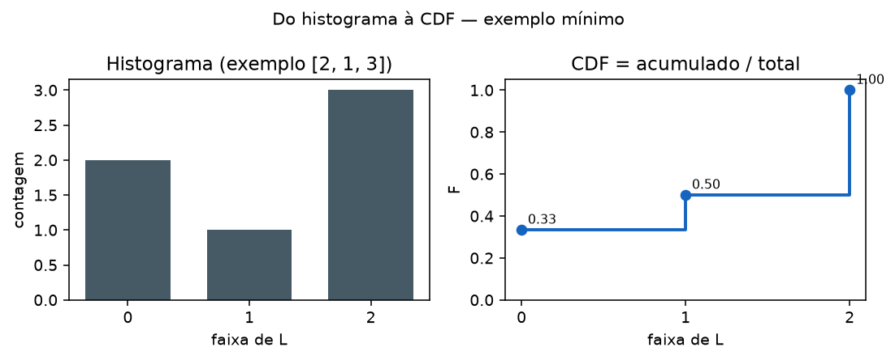
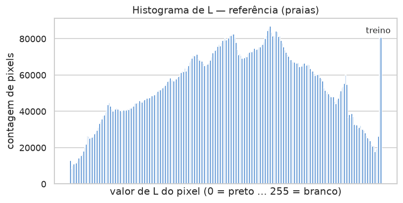
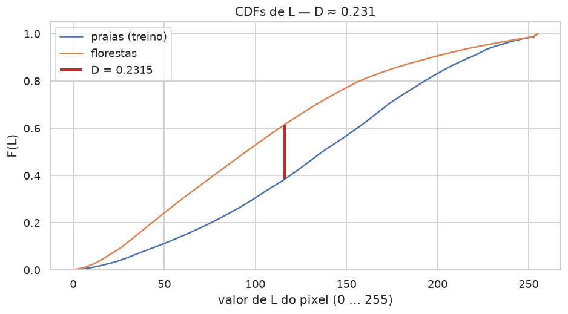

# Aula 007 — KS no tráfego misto de paisagem (BentoML + Streamlit)

## Por que estamos aqui

Tráfego real raramente é um tema puro. Na mesma janela de tempo o serviço
pode receber pedidos que ainda “parecem” o treino e pedidos de outro mundo
visual. A latência mede espera. Ela não mede se a **mistura** de dados ainda
combina com a referência.

Nesta aula a referência de treino continua sendo as primeiras 50 praias.
O lote de produção mistura **25 praias fora do freeze** com **25 florestas**.
A pergunta: o alerta sobre **D** ainda dispara quando metade dos pedidos
ainda parece treino? Em que intensidade, frente a um controle só de praias e
a um lote só de florestas?

Você mede essa combinação na **forma** da distribuição de luminância **L**,
resume o afastamento numa estatística **D** (Kolmogorov–Smirnov) e produz um
**alerta** quando **D** cruza um limiar.


## Luminância L

Uma fotografia digital é uma grade de pontos — os **pixels**. Em cores, cada
pixel costuma carregar três canais (vermelho, verde, azul). Para falar de
“quão claro ou escuro” é o ponto, convertemos a imagem para tons de cinza:
preto num extremo, branco no outro, e uma escada de cinzas no meio.

Na prática isso é `Image.convert("L")` no Pillow. Cada pixel passa a um
inteiro de **0** (preto) a **255** (branco). Chamamos esse valor de
**luminância** e o denotamos por **L**.

Se \(I\) é a imagem e \((u,v)\) um sítio na grade,

\[
L(u,v) \in \{0,1,\ldots,255\}
\]

é a intensidade nesse sítio. Tudo o que esta aula desenha e compara —
histograma, CDF, estatística KS — descreve a **distribuição de L sobre os
pixels** do conjunto de imagens. Não usamos a média de L por foto como eixo:
uma média por imagem comprime demais a forma e, no controle de mesmo tema,
pode disparar alerta à toa (detalhe em
[`docs/notas-experimento-freeze.md`](docs/notas-experimento-freeze.md)).

```python
from PIL import Image

img = Image.open("foto.jpg").convert("L")
contagens = img.histogram()  # 256 faixas: quantos pixels têm cada L
```

## Histograma

Com L em mão, a pergunta seguinte é simples: *em cada degrau de cinza, quantos
pixels caíram?* Essa contagem, faixa a faixa, é o **histograma**.

Imagine 256 baldes alinhados do preto ao branco. Cada pixel do conjunto
(todas as imagens da referência, ou todas do lote) cai num balde. A altura do
balde \(k\) é a contagem \(h_k\). O total de pixels no conjunto é

\[
N = \sum_{k=0}^{B-1} h_k,
\]

com \(B = 256\) no freeze padrão (o Streamlit deixa variar o número de
faixas). Para várias imagens, some os histogramas imagem a imagem: o
resultado é o histograma do **conjunto**.



## CDF — função de distribuição acumulada

O histograma ainda fala em “quantos”. A **função de distribuição acumulada**
(CDF) fala em “até aqui, que fração do total?”. Você caminha dos baldes
escuros para os claros, vai somando as contagens e divide pelo total \(N\).
A curva começa perto de zero e termina em um: nunca desce.

\[
F_k = \frac{1}{N}\sum_{i=0}^{k} h_i
\qquad (k = 0,\ldots,B-1).
\]

**Exemplo mínimo.** Seis pixels, três faixas, contagens \([2, 1, 3]\). O
acumulado é \(2\), depois \(3\), depois \(6\). A CDF fica
\([2/6,\ 3/6,\ 6/6]\) — cerca de \(0{,}33\), \(0{,}50\) e \(1\).

```text
# Variáveis:
# contagens, total, acumulado, cdf, c

total ← soma(contagens)
acumulado ← 0
cdf ← lista vazia
para cada c em contagens:
    acumulado ← acumulado + c
    acrescentar (acumulado / total) em cdf
```

## De duas CDFs à estatística D

Agora você tem duas curvas na mesma grade de L: \(F\) na referência (treino)
e \(G\) no lote atual. Em cada faixa, a distância vertical entre elas é

\[
\delta_k = \lvert F_k - G_k \rvert.
\]

A estatística de Kolmogorov–Smirnov de duas amostras é o **maior** desses
afastamentos:

\[
D = \max_{k} \delta_k
= \sup_{x} \lvert F(x) - G(x) \rvert.
\]

Se as formas de luminância forem parecidas, \(D\) fica pequeno. Se o lote
trouxer outro mundo visual, \(D\) sobe — e é sobre **esse** número que a aula
dispara o alerta. No lote **misto**, a metade praia puxa \(G\) para perto de
\(F\); a metade floresta empurra \(G\) para longe. O \(D\) resultante costuma
ficar **entre** o controle (só praias) e o lote só de florestas.


## Alerta sobre D e janela de tempo

| Estado | Condição | O que significa | Ação típica |
| :--- | :--- | :--- | :--- |
| **INCONCLUSIVO** | \(n_{\mathrm{ref}} &lt; 8\) **ou** \(n_{\mathrm{lote}} &lt; 8\) | Ainda há poucas imagens na comparação | Esperar mais pedidos **na janela** |
| **ALERTA** | ambos \(n \ge 8\) e \(D \ge 0{,}10\) | Formas de L divergem além do limiar | Investigar tema ou uso; abrir ticket / rule |
| **TRANQUILO** | ambos \(n \ge 8\) e \(D &lt; 0{,}10\) | Lote compatível com a referência nesta métrica | Seguir monitorando a janela |

Em produção o “lote” quase nunca é o histórico desde o dia zero. Você **fecha
uma caixa de tempo** — por exemplo pedidos dos **últimos 30 dias**, ou da
última semana, ou do último turno — e compara só o que cai nessa janela com
a referência. Sem esse *time boxing*, misturam-se regimes antigos e novos e
o **D** deixa de responder à pergunta *“o serviço ainda está adequado ao
tráfego recente?”*. Nesta aula, os JSON em `batch_stats/` fazem o papel de
uma janela já agregada.

[^pvalue]

[^pvalue]: O software ainda calcula um **valor-p** assintótico do KS de duas
amostras, com tamanho efetivo baseado no **número de imagens** (não no de
pixels: pixels da mesma foto não são independentes). Esse valor-p **não**
entra na regra de alerta; trate-o como nota estatística, não como motor do
alarme.

## Figuras do freeze e o lote misto

Referência = primeiras 50 praias. Três lotes offline:

| Lote | Conteúdo | Expectativa | Freeze medido |
| :--- | :--- | :--- | :--- |
| `control` | praias 51–100 | **TRANQUILO** (\(D\) baixo) | \(D \approx 0{,}051\) → TRANQUILO |
| `forests` | 50 florestas | **ALERTA** (\(D\) alto) | \(D \approx 0{,}231\) → ALERTA |
| `landscapes` | 25 praias (offset ≥ 50) + 25 florestas | **ALERTA** ou \(D\) intermediário | \(D \approx 0{,}128\) → ALERTA |

As praias do misto **não** reutilizam `beaches[:50]` (evita vazamento da
referência). O Streamlit mostra um callout com os três **D** lado a lado:
o do misto fica entre controle e florestas (\(0{,}051 &lt; 0{,}128 &lt; 0{,}231\)).

| Histograma (treino) | Histograma (florestas) |
| :---: | :---: |
|  |  |



Números do desenho do experimento (por que 50, pixel vs média):
[`docs/notas-experimento-freeze.md`](docs/notas-experimento-freeze.md).

## Objetivo operacional

1. Fixar praias[:50] como referência de treino (sem rede neural).
2. Materializar três lotes: controle, florestas puras, paisagens 25+25.
3. No Streamlit, construir histograma → CDF → δ → **D** e ler o alerta;
   comparar a intensidade do misto com os extremos.

## Entrada e saída

**Referência:** primeiras 50 de `samples/beaches/` → `corpus_stats.json`.

**Lotes offline** (`just build-demo-batches`):

- `batch_stats/control.json` — praias 51–100
- `batch_stats/forests.json` — 50 florestas
- `batch_stats/landscapes.json` — 25 praias (offset 50) + 25 florestas

## Limiares de D / KS em outros contextos

Não existe um único “D mágico” para o planeta. Em estatística clássica, o
teste de duas amostras pergunta se duas amostras podem ter vindo da mesma
distribuição contínua. Para amostras grandes, rejeita-se essa hipótese ao
nível \(\alpha\) quando

\[
D > c(\alpha)\,\sqrt{\frac{n+m}{nm}},
\qquad
c(0{,}05)\approx 1{,}358
\]

([Wikipédia — Kolmogorov–Smirnov](https://en.wikipedia.org/wiki/Kolmogorov%E2%80%93Smirnov_test)).
Com \(n = m = 50\), isso pede \(D\) acima de cerca de \(0{,}27\). Softwares e
tabelas publicam os mesmos cortes para \(n\) pequenos
([MetricGate](https://metricgate.com/docs/kolmogorov-smirnov-critical-values/),
[Real Statistics](https://real-statistics.com/statistics-tables/two-sample-kolmogorov-smirnov-table/)).

Em astronomia e ciências experimentais, muitas vezes se consulta uma tabela
de valores críticos \(mnD\) para pares \((m,n)\) e \(\alpha\) fixos
([NED / Wall](https://ned.ipac.caltech.edu/level5/Wall2/TableA_8.html)): o
espírito é o mesmo (quando \(D\) é “grande demais” sob a hipótese nula), mas
o número sai de uma grade pré-computada.

No risco de mercado (FRTB, atribuição de P&L), o KS compara curvas de
lucro/prejuízo hipotético e teórico ao longo de 250 dias. O regulador
desenhou um semáforo em cima do próprio \(D\): zona verde abaixo de
**0,09**, vermelha acima de **0,12**, âmbar no meio
([MathWorks](https://www.mathworks.com/help/risk/profit-and-loss-attribution-workflow.html);
[Regulamento Delegado (UE) 2022/2059, art. 8](https://judict.eu/en/sla/32013R0575/32022R2059-X/article-8)).
Aqui o limiar é **política**, não um \(\alpha\) de livro-texto.

No *credit scoring*, o KS aparece com outro papel: mede o **poder de
separação** entre clientes que deram default e os que não deram. Quanto
**maior** o KS entre as duas curvas de score, melhor o modelo discrimina
([SAS Model Manager](https://support.sas.com/documentation/cdl/en/mdlmgrug/69919/HTML/default/n194xndt3b3y1pn1ufc0mqbsmht4.htm)).
Não se trata de “as distribuições são iguais?”; trata-se de “as curvas
estão bem afastadas?”.

| Área | Papel do KS | Regra típica | Fonte |
| :--- | :--- | :--- | :--- |
| Estatística (duas amostras) | Teste de igualdade de distribuições | \(D > c(\alpha)\sqrt{(n+m)/(nm)}\) | [Wikipédia](https://en.wikipedia.org/wiki/Kolmogorov%E2%80%93Smirnov_test) |
| Tabelas / software | Idem, \(n\) pequenos | Valores críticos tabulados | [MetricGate](https://metricgate.com/docs/kolmogorov-smirnov-critical-values/); [Real Statistics](https://real-statistics.com/statistics-tables/two-sample-kolmogorov-smirnov-table/) |
| Astronomia / ciências | Idem via tabela \(mnD\) | Cortes por \((m,n),\alpha\) | [NED / Wall](https://ned.ipac.caltech.edu/level5/Wall2/TableA_8.html) |
| FRTB P&L | Semáforo regulatório sobre \(D\) | verde &lt; 0,09; vermelho &gt; 0,12 | [MathWorks](https://www.mathworks.com/help/risk/profit-and-loss-attribution-workflow.html); [UE 2022/2059](https://judict.eu/en/sla/32013R0575/32022R2059-X/article-8) |
| Credit scoring | Discriminação default vs non-default | KS alto = melhor separação | [SAS](https://support.sas.com/documentation/cdl/en/mdlmgrug/69919/HTML/default/n194xndt3b3y1pn1ufc0mqbsmht4.htm) |

## Estrutura da pasta (arquivos principais)

```text
007_ks_mixed_landscape_streamlit/
  README.md                 # este handout
  app.py                    # Streamlit: defs + gráficos + alerta + callout 25+25
  service.py                # BentoML /inference-grayscale + log
  alert_rule.py             # alert_on_d (D≥0,10) + regra legada D+p
  ks_compare.py             # D, CDFs, contagens entre referência e lote
  histogram.py              # L, histograma, CDF
  corpus_stats.py           # agrega features/ → estatística de treino
  request_stats.py          # agrega request_features/ → lote
  plotting.py               # histograma, CDF, δ, dual CDF
  corpus_stats.json         # freeze: praias[:50]
  batch_stats/              # control.json, forests.json, landscapes.json
  request_features/         # log vivo (gitkeep; JSON ignorados)
  features/                 # saídas de extract
  illustrations/            # PNGs do handout (just generate-illustrations)
  scripts/
    extract_image_features.py   # praias[:50] → features/
    build_corpus_stats.py       # features/ → corpus_stats.json
    build_batch_from_theme.py   # tema(s) → batch_stats/<nome>.json (offline)
    exercise_theme.py           # POST tema no serviço → request_features/
    snapshot_batch.py           # request_features/ → batch_stats/
    generate_illustrations.py   # regenera illustrations/
    verify_ks_alert.py          # imprime D/alerta sem UI
  tests/                    # pytest
  docs/
    notas-experimento-freeze.md
  justfile
```

## Como executar

Caminho **offline** (lotes já materializados em JSON, sem servidor):

```bash
cd 007_ks_mixed_landscape_streamlit
# entra na pasta da aula

just sync
# cria/atualiza .venv e instala dependências do pyproject (uv)

just download-samples
# aponta para samples/{beaches,forests,balls}/ na raiz do repositório
# (não baixa de novo se o corpus temático já estiver lá)

just extract-features
# extrai histograma L (e canais) das primeiras 50 praias → features/*.json

just build-corpus-stats
# agrega features/ → corpus_stats.json (referência de treino)

just build-demo-batches
# grava control.json (praias 51–100), forests.json (50 florestas) e
# landscapes.json (25 praias offset 50 + 25 florestas), sem BentoML no ar

just generate-illustrations
# opcional: regenera illustrations/*.png usadas neste README

just streamlit
# sobe o app em http://localhost:8507
```

Caminho **com servidor** (log real em `request_features/`):

```bash
just serve
# terminal 1: BentoML com /inference-grayscale na porta 3337

just clear-request-features
# apaga JSON antigos em request_features/ para o próximo exercício

just exercise-theme forests
# POST de imagens de samples/forests/ no serviço; cada pedido vira um JSON
# de features em request_features/

just snapshot-batch forests
# agrega request_features/ → batch_stats/forests.json e limpa a pasta de log

just clear-request-features
# prepara a pasta de log para o lote de controle

just exercise-theme beaches --offset=50 --count=50
# envia 50 praias fora do freeze como “produção” de mesmo tema

just snapshot-batch control
# agrega esse log → batch_stats/control.json

just streamlit
# compara corpus_stats.json com o lote escolhido na barra lateral
# (incluindo landscapes, gerado offline por build-demo-batches)
```

## O que acontece por dentro

```text
imagem → convert("L") → histograma de L (pixels)
beaches[:50] → soma → corpus_stats.json
lote → /inference-grayscale → request_features/ → batch_stats/
  ou offline: build_batch_from_theme (control / forests / landscapes 25+25)
app: histograma → CDF → δ → D → alerta se D ≥ 0,10
callout: D_control ≤ D_landscapes ≤ D_forests (ordem típica)
```

## Comparação com a base

A base só devolve a imagem filtrada. Esta aula grava o pedido e analisa a
distribuição de **L** no Streamlit, com ênfase no lote **misto** de paisagem.

## Testes

```bash
just test
```

## Bibliografia (auditada)

1. [Kolmogorov–Smirnov (Wikipédia)](https://en.wikipedia.org/wiki/Kolmogorov%E2%80%93Smirnov_test)
2. Gama et al., *A survey on concept drift adaptation*, ACM CSUR 2014 —
   [doi:10.1145/2523813](https://doi.org/10.1145/2523813)
3. [PSI — KAscore Ongoing Monitoring](https://ketchbrookanalytics.github.io/KAscore/articles/ongoing-monitoring.html)
4. Taplin & Hunt, Risks 2019 — [MDPI](https://www.mdpi.com/2227-9091/7/2/53)
5. [Pillow — Image](https://pillow.readthedocs.io/en/stable/reference/Image.html)
