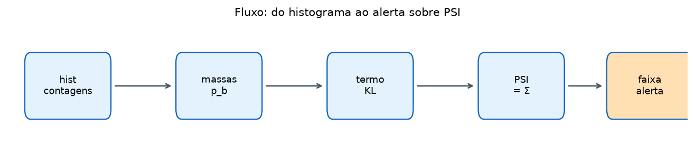
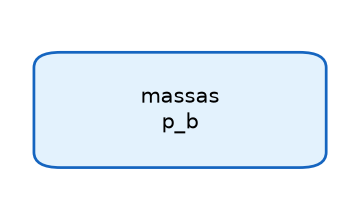
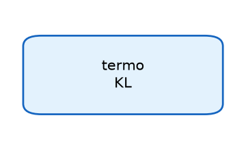
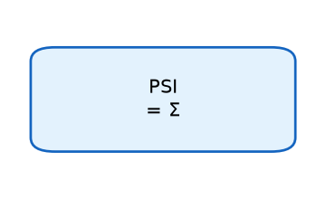
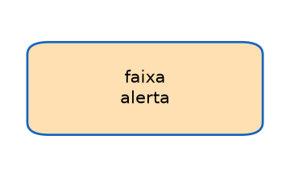
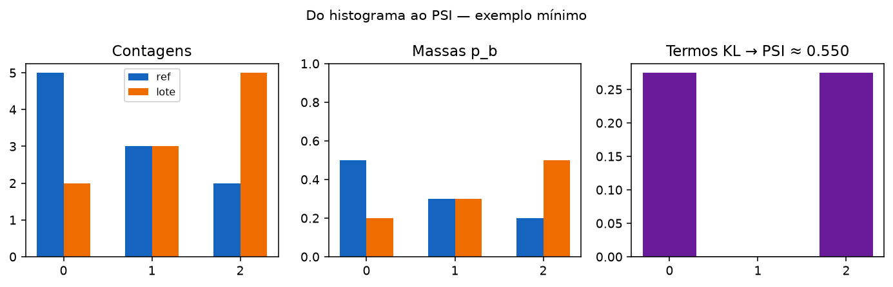
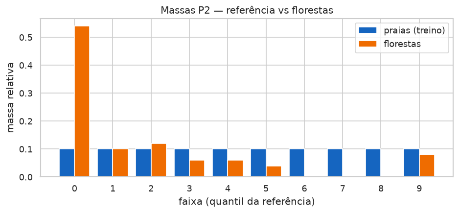
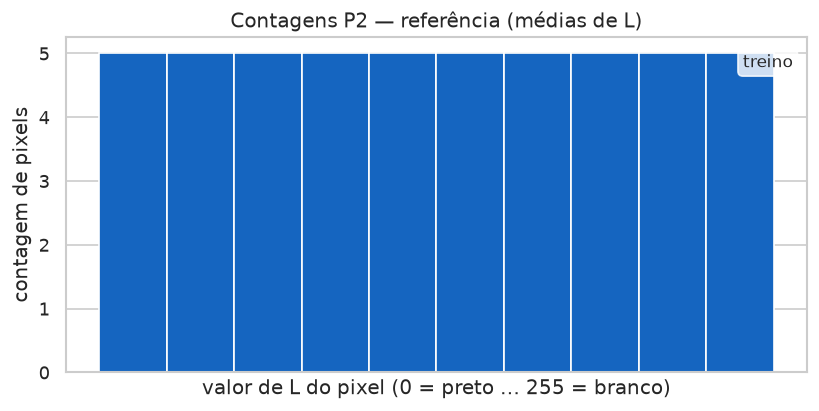
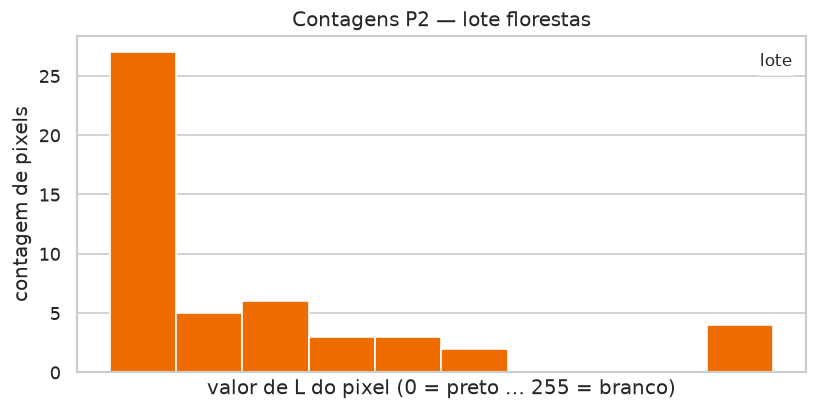

# Aula 008 — Alerta PSI de drift (BentoML + Streamlit)

Do serviço em produção ao alerta sobre **PSI** (irmão da aula KS / **D**).
O painel vivo está em [`app.py`](app.py).

## Sumário

1. [Por que estamos aqui](#1-por-que-estamos-aqui)
2. [DevOps: o serviço que responde](#2-devops-o-serviço-que-responde)
3. [MLOps: servir o modelo e observar o mundo](#3-mlops-servir-o-modelo-e-observar-o-mundo)
4. [Saúde HTTP versus adequação dos dados](#4-saúde-http-versus-adequação-dos-dados)
5. [BentoML: colocar a API no ar](#5-bentoml-colocar-a-api-no-ar)
6. [Registro de pedidos](#6-registro-de-pedidos)
7. [Imagens, pixels e luminância L](#7-imagens-pixels-e-luminância-l)
8. [Histograma (e por que não paramos no KS aqui)](#8-histograma-e-por-que-não-paramos-no-ks-aqui)
9. [Da CDF ao histograma: simetria KL e o PSI](#9-da-cdf-ao-histograma-simetria-kl-e-o-psi)
10. [Cálculo passo a passo — massas e PSI (como no Streamlit)](#10-cálculo-passo-a-passo--massas-e-psi-como-no-streamlit)
11. [Alerta sobre PSI (faixas crédito)](#11-alerta-sobre-psi-faixas-crédito)
12. [Janela temporal](#12-janela-temporal)
13. [Limiares de PSI em outros contextos](#13-limiares-de-psi-em-outros-contextos)
14. [O experimento (números freeze P2/P1)](#14-o-experimento-números-freeze-p2p1)
15. [Estrutura da pasta](#15-estrutura-da-pasta)
16. [Como executar](#16-como-executar)
17. [Glossário](#17-glossário)
18. [Testes](#18-testes)
19. [Bibliografia](#19-bibliografia)

---

## 1. Por que estamos aqui

Imagine um serviço de imagens em produção: o cliente envia uma foto, a API
devolve a versão em cinza, o status é **200**, o tempo de resposta está baixo.
Do ponto de vista de disponibilidade, o dia está tranquilo.

Agora mude o *conteúdo* das fotos — de praias para florestas — e mantenha o
mesmo endpoint. O HTTP continua verde. A latência continua aceitável. O que
mudou foi o **mundo** que chega ao modelo.

Nesta aula você resume o afastamento entre a distribuição de referência e a
do lote atual no **Population Stability Index (PSI)** e produz um **alerta**
quando o índice cruza faixas clássicas de monitoramento de scorecards.



As subseções abaixo espelham **cada caixa** desse fluxo. Cada caixa tem a
sua própria miniatura, o código comentado e um script que executa
**somente** aquele passo: `scripts/workflow_boxes/box_0N_*.py`.

O ritual visual L → histograma da [aula 003](../003_ks_drift_alert_streamlit/)
permanece como irmão; aqui o semáforo operacional é **PSI P2**, não **D**.

### 1.1 Caixa — massas \(p_b\)



Contagens por faixa viram frações que somam 1. Sem massas, não há termo KL.

Script: [`scripts/workflow_boxes/box_01_massas.py`](scripts/workflow_boxes/box_01_massas.py)

```python
def massas_p(counts):
    """p_b = c_b / Σ c. Alternativas: suavizar eps e renormalizar."""
    total = sum(counts)
    return [c / total for c in counts]
```

### 1.2 Caixa — termo KL



Em cada faixa, \((q_b - p_b)\ln(q_b/p_b)\) com \(\varepsilon\) se massa zero.

Script: [`scripts/workflow_boxes/box_02_termo_kl.py`](scripts/workflow_boxes/box_02_termo_kl.py)

```python
def termo_kl(p_ref_b, p_lote_b, eps=1e-6):
    """(q−p)·ln(q/p) com max(·,eps). Alternativas: KL só num sentido."""
    import math
    pr, pl = max(p_ref_b, eps), max(p_lote_b, eps)
    return (pl - pr) * math.log(pl / pr)
```

### 1.3 Caixa — PSI = Σ



Soma dos termos em todas as faixas. Esse número alimenta o semáforo.

Script: [`scripts/workflow_boxes/box_03_psi_soma.py`](scripts/workflow_boxes/box_03_psi_soma.py)

```python
def psi_soma(p_ref, p_lote, eps=1e-6):
    """PSI = Σ_b termo_kl. Alternativas: χ²; JS divergence."""
    return sum(termo_kl(pr, pl, eps=eps) for pr, pl in zip(p_ref, p_lote))
```

### 1.4 Caixa — faixa de alerta



Cortes 0,10 / 0,25 (crédito) + INCONCLUSIVO se \(n < 8\).

Script: [`scripts/workflow_boxes/box_04_faixa.py`](scripts/workflow_boxes/box_04_faixa.py)

```python
def faixa_alerta_psi(psi, n_ref, n_lote, stable=0.10, shift=0.25, min_n=8):
    """INCONCLUSIVO / ESTÁVEL / INVESTIGAR / MUDANÇA FORTE."""
    if n_ref < min_n or n_lote < min_n:
        return "INCONCLUSIVO"
    if psi > shift:
        return "MUDANÇA FORTE"
    if psi >= stable:
        return "INVESTIGAR"
    return "ESTÁVEL"
```

---

## 2. DevOps: o serviço que responde

DevOps, neste handout, é a pergunta da **tubulação**: o processo está no
ar? A porta responde? O cliente recebe o código HTTP esperado? A latência
cabe no orçamento?

| Pergunta operacional | Sinal típico |
| :--- | :--- |
| O cliente recebe resposta? | código HTTP (200, 4xx, 5xx) |
| A espera é aceitável? | latência (p50, p95, …) |
| Há erros? | taxa de falha, logs de exceção |

Essas métricas descrevem a **saúde da tubulação**. São indispensáveis — e
insuficientes sozinhas quando o produto é um modelo. Nesta pasta, o serviço
BentoML expõe `/inference-grayscale` (entre outras). Mais adiante você sobe
e exercita esse serviço com as receitas `just` desta pasta.

---

## 3. MLOps: servir o modelo e observar o mundo

MLOps estende o ciclo de servir: além de “a API responde?”, aparece “os
dados e o comportamento do modelo ainda fazem sentido?”.

```text
# Variáveis:
# imagem — arquivo enviado pelo cliente
# resposta — saída do modelo / filtro
# features — resumo estatístico gravado no log
# referência — distribuição de treino (corpus)
# lote — agregação de pedidos recentes
# PSI — índice entre massas da referência e do lote

imagem chega no endpoint
resposta ← modelo(imagem)
features ← extrair luminância / histograma / média de L
gravar features no log de pedidos
periodicamente:
    lote ← agregar pedidos da janela temporal
    PSI ← população(referência, lote)   # massas → Σ (Δp ln p)
    se PSI cruza faixa → alerta
```

Três ideias que esta aula amarra:

1. **Servir** — BentoML expõe o modelo como API.
2. **Registrar** — cada pedido deixa vestígio mensurável (JSON de features).
3. **Comparar** — o Streamlit confronta o corpus com o lote e resume o
   afastamento em **PSI** (P2 principal; P1 espelho).

---

## 4. Saúde HTTP versus adequação dos dados

Separar duas perguntas evita o falso conforto do “tudo verde”. Uma coisa é
o serviço estar **vivo e rápido**. Outra é o **conteúdo** que passa por
ele ainda parecer o mundo com o qual o modelo foi calibrado.

A latência mede **quanto se espera** pela resposta. O monitoramento de
dados mede **quão diferente ficou a distribuição** entre a referência de
treino e o lote atual. O alerta desta aula dispara sobre o **PSI**, não
sobre o código HTTP.

---

## 5. BentoML: colocar a API no ar

BentoML empacota o código de inferência e sobe um servidor HTTP com rotas
tipadas. Nesta aula, `service.py` registra `/inference-grayscale`:

1. O cliente envia uma imagem.
2. O serviço **registra** features (log de pedido).
3. O serviço aplica a conversão a cinza e devolve a imagem processada.

```bash
cd 008_psi_drift_alert_streamlit
just sync
just serve
# terminal dedicado: API na porta 3338
```

Enquanto o servidor está no ar, outro terminal pode enviar um tema
(`just exercise-theme …`) e agregar o log (`just snapshot-batch …`). O
Streamlit (`just streamlit`, porta 8508) lê o corpus e o lote.

---

## 6. Registro de pedidos

Sem vestígio do que chegou, só resta a saúde HTTP. Com log de features,
dá para reconstruir a distribuição de produção.

Cada chamada a `/inference-grayscale` grava um JSON em `request_features/`.
Depois, um *snapshot* agrega esses arquivos em `batch_stats/<nome>.json`
(incluindo `luminance_means` para o caminho P2).

```text
POST /inference-grayscale
  → log JSON em request_features/
  → resposta = imagem em cinza

snapshot-batch
  → soma histogramas + médias de L do log
  → batch_stats/<lote>.json
```

Há também o caminho **offline**: `just build-demo-batches` materializa
lotes sem o servidor no ar. Serve para estudar massas → PSI com números
estáveis (freeze).

---

## 7. Imagens, pixels e luminância L

Uma fotografia digital é uma grade de **pixels**. Em cores, cada pixel
costuma carregar três canais. Para falar de “quão claro ou escuro” é o
ponto, convertemos a imagem para tons de cinza: preto num extremo, branco
no outro.

Na prática isso é `Image.convert("L")` no Pillow. Cada pixel passa a um
inteiro de **0** (preto) a **255** (branco). Chamamos esse valor de
**luminância** e o denotamos por **L**.

Nesta aula o PSI trabalha em **duas escalas**:

| Caminho | Variável | Unidade | Papel |
| :--- | :--- | :--- | :--- |
| **P2** | média de L por imagem | uma observação por foto | **alerta principal** |
| **P1** | histograma de L por pixel | pixel | espelho da aula KS |

```python
from PIL import Image

img = Image.open("foto.jpg").convert("L")
media_L = sum(img.getdata()) / (img.width * img.height)
contagens = img.histogram()  # 256 faixas (espelho P1)
```

Em **P2**, as faixas vêm dos **quantis da referência** (padrão: 10). Em
**P1**, usamos o histograma agregado de L nos pixels (mesmo espírito da
aula 003) e convertemos contagens em massas.

---

## 8. Histograma (e por que não paramos no KS aqui)

Com L em mão, a pergunta seguinte é: *em cada degrau, quantos caíram?*
Essa contagem, faixa a faixa, é o **histograma**.

A [aula 003](../003_ks_drift_alert_streamlit/README.md) sobe daí para a
**CDF** e resume o afastamento em \(D = \sup_x \lvert F-G\rvert\). Essa
rota é canônica quando a variável vive num eixo **ordenado**.

Aqui **não** paramos no KS como juiz operacional. Permanecemos nas
**massas** do histograma e usamos o PSI. O KS em pixels continua disponível
no painel (seção 4) só como espelho numérico.



---

## 9. Da CDF ao histograma: simetria KL e o PSI

Na aula 003 o afastamento entre treino e lote não se julga olhando
histogramas lado a lado. Histogramas são honestos, porém **sem forma
canônica**: mudam com o número de faixas, com o alinhamento dos cortes,
com a escala do eixo. Derivam-se mal propriedades formais estáveis —
limites, monotonia, leis limite — quando o objeto ainda é só um vetor de
contagens.

Por isso o KS sobe um degrau. A **função de distribuição acumulada** (CDF)
carrega uma geometria que o histograma não oferece de graça: é
**não-decrescente**, parte de valores próximos de zero quando a variável
tende a \(-\infty\) e satura em um quando tende a \(+\infty\). Duas
sigmoides empíricas na mesma grade permitem definir

$$
D = \sup_x \lvert F(x) - G(x) \rvert.
$$

Imagine, porém, que **não** queiramos construir a CDF. Queremos permanecer
no histograma — nas massas relativas \(p_b\) e \(q_b\) de cada faixa \(b\).
A comparação direta de contagens continua com propriedades teóricas pobres.
O que resta, no mínimo respeitável, é uma divergência da família da
informação: a **divergência de Kullback–Leibler** e, para não privilegiar
um dos lados, a sua forma **simétrica**. Somando, faixa a faixa, termos do
tipo \((q_b - p_b)\ln(q_b/p_b)\) (com suavização quando alguma massa some),
obtém-se o índice que o crédito conhece como **Population Stability Index**
(PSI).

Há uma consequência prática decisiva. Para erguer uma CDF a variável
precisa viver num **conjunto ordenado**. O PSI, ao trabalhar só com massas
por categoria, **dispensa essa ordem**. As faixas podem ser níveis de
cinza, faixas de score, ou rótulos nominais sem ranking intrínseco
(produto, canal, UF). Donde: o mesmo aparelho serve a variáveis
**categóricas**, território em que o KS clássico sobre CDF simplesmente não
se define.

Nesta aula o semáforo operacional é o PSI (em especial o **P2**). O KS em
L por pixel permanece como espelho — ponte para a 003 —, não como juiz.

---

## 10. Cálculo passo a passo — massas e PSI (como no Streamlit)

O painel em [`app.py`](app.py) percorre **quatro estágios numerados** após
o cartão de alerta: (1) médias/massas P2 → (2) barras de massas →
(3) espelho P1 → (4) \(D\) opcional. Abaixo está a mesma conta, na mesma
ordem. No código, `psi.counts_to_masses` e `psi.compute_psi` fazem o miolo;
`alert_psi.alert_on_psi` traduz o número em estado.

### Passo 1 — Massas e médias de L (P2)

Para cada imagem, calcule a média de L. Particione o eixo com os
**quantis da referência** (padrão \(K = 10\)). Conte quantas imagens caem
em cada faixa nos dois lados; normalize para massas
\(p_{\mathrm{ref}}[b]\) e \(p_{\mathrm{lote}}[b]\).

No app: “1. Massas e médias de L (P2)”.

### Passo 2 — Barras de massas por faixa

Desenhe as massas lado a lado. O olho vê onde o lote engorda ou emagrece
relativamente à referência. O PSI **não** é a altura de uma barra: é a
**soma** dos termos KL.

No app: “2. Barras de massas por faixa (P2)”.

### Passo 3 — Espelho P1 (pixels)

Repita a ideia com o histograma de L **por pixel** (grade da aula KS). O
número P1 existe para comparar sensibilidade com \(D\); o semáforo
operacional permanece no P2.

### Passo 4 — \(D\) (KS) opcional

Se o checkbox estiver ligado, o app mostra também \(D\) sobre L por pixel.
São histórias diferentes do mesmo histograma de pixels: máximo de
\(\lvert F-G\rvert\) versus soma de contribuições por faixa.

### Fórmula

Com as mesmas \(K\) faixas na referência e no lote,

\[
\mathrm{PSI}
= \sum_{b}
\bigl(p_{\mathrm{lote}}[b] - p_{\mathrm{ref}}[b]\bigr)
\cdot
\ln\frac{p_{\mathrm{lote}}[b]}{p_{\mathrm{ref}}[b]}.
\]

Quando alguma massa é zero, suavizamos com \(\varepsilon\) (padrão
\(10^{-6}\)):

```text
# Variáveis:
# p_ref[b], p_lote[b] — massas relativas na faixa b (soma = 1)
# eps — suavização se massa zero (ex.: 1e-6)
# PSI, b, pr, pl

PSI ← 0
para cada b:
    pr ← max(p_ref[b], eps)
    pl ← max(p_lote[b], eps)
    PSI ← PSI + (pl − pr) · ln(pl / pr)
```

As funções didáticas por caixa estão em
[`workflow_boxes_psi.py`](workflow_boxes_psi.py) (wrappers sobre `psi.py` /
`alert_psi.py`).

---

## 11. Alerta sobre PSI (faixas crédito)

Transformar o PSI contínuo numa decisão operacional legível no painel.

Cortes clássicos de monitoramento contínuo de scorecards (Siddiqi e
materiais de *ongoing monitoring*):

| Estado | Condição | O que significa | Ação típica |
| :--- | :--- | :--- | :--- |
| **INCONCLUSIVO** | \(n_{\mathrm{ref}} &lt; 8\) **ou** \(n_{\mathrm{lote}} &lt; 8\) | Ainda há poucas imagens | Esperar mais pedidos na janela |
| **ESTÁVEL** | ambos \(n \ge 8\) e PSI &lt; 0,10 | Lote compatível com a referência | Seguir monitorando |
| **INVESTIGAR** | ambos \(n \ge 8\) e 0,10 ≤ PSI ≤ 0,25 | Mudança moderada | Abrir ticket / olhar tema |
| **MUDANÇA FORTE** | ambos \(n \ge 8\) e PSI &gt; 0,25 | Afastamento forte | Investigar com prioridade |

No código interno os estados EN são `QUIET` / `WATCH` / `ALERT` /
`INCONCLUSIVE`; a UI e este handout usam os rótulos em português acima.

O que importa na prática da aula: **o alarme operacional dispara sobre
PSI P2**.

---

## 12. Janela temporal

Em produção, “o lote” quase nunca é “todas as imagens desde o início dos
tempos”. Monitoramento de dados trabalha com **janelas**.

Fixe:

- **Referência** — corpus de treino (ou baseline estável revisado).
- **Janela de produção** — por exemplo, pedidos dos **últimos 30 dias**.

Compare as massas da referência com as massas **somente** dos pedidos
dentro da janela. O PSI passa a responder:

> nos últimos 30 dias, a estabilidade populacional ainda combina com o
> treino?

| Aspecto | Efeito da janela |
| :--- | :--- |
| Relevância | o alerta reflete o presente operacional |
| Volume | evita diluir um desvio recente numa história antiga |
| Operação | times sabem o período sob escrutínio |

No exercício desta aula, a “janela” é o lote que você monta de propósito
(`forests`, `control`, …): um conjunto fechado e nomeado. Em um sistema
real com timestamps no log, a agregação filtraria a fatia temporal. O
cálculo (massas → PSI → faixa) é o mesmo; muda só **quais** imagens entram
no lado produção.

**Política mínima sugerida (estudo).** Escolher a duração da janela;
agregar só dessa fatia; exigir \(n \ge 8\) antes de sair de INCONCLUSIVO;
alertar pelas faixas 0,10 / 0,25; revisar a referência quando o negócio
mudar de domínio de propósito.

---

## 13. Limiares de PSI em outros contextos

Não existe um único “PSI mágico” para o planeta. O que muda de domínio a
domínio é o **papel** do índice e a **origem** dos cortes 0,10 / 0,25.

| Área | Papel do PSI | Regra típica | Fonte |
| :--- | :--- | :--- | :--- |
| Credit scoring / scorecards | Estabilidade da população de escores | &lt;0,10 estável; 0,10–0,25 investigar; &gt;0,25 forte | Siddiqi; [KAscore](https://ketchbrookanalytics.github.io/KAscore/articles/ongoing-monitoring.html) |
| Monitoramento de features | Drift de entrada categórica ou binned | mesmos cortes clássicos, por feature | práticas de *ongoing monitoring* |
| Esta aula (imagens) | Drift de luminância (P2/P1) | mesmos 0,10 / 0,25 + INCONCLUSIVO \(n&lt;8\) | freeze praias × florestas |

### 13.1 Scorecards — exemplo trabalhado

No crédito, o PSI compara a distribuição de um score (ou de uma
característica) entre a população de **desenvolvimento** e a de
**produção**. Se o PSI de uma feature sobe acima de 0,25, o time investiga
mudança de mix, sazonalidade ou quebra de definição.

**Números.** Sejam massas de três faixas de score na referência
\([0{,}50,\ 0{,}30,\ 0{,}20]\) e no lote \([0{,}20,\ 0{,}30,\ 0{,}50]\). O
PSI fica da ordem de \(0{,}4\)–\(0{,}5\) (mudança forte). Se o lote for
quase idêntico à referência, o PSI cai perto de zero (estável).

### 13.2 Features categóricas — exemplo trabalhado

Como o PSI não exige ordem no eixo, as “faixas” podem ser categorias
nominais (UF, canal, produto). Conta-se a frequência relativa de cada
rótulo na referência e no lote; aplica-se a mesma soma. O KS clássico
sobre CDF **não** se define nesse eixo.

### 13.3 Por que manter 0,10 / 0,25 nesta aula

O freeze (secção 14) mostra que florestas disparam com clareza no P2 e no
P1, e que o controle de mesmo tema fica **logo acima** de 0,25 no P2 com
\(n=50\) e 10 quantis — lição de sensibilidade, não licença para inventar
corte ad hoc. Mantemos os cortes clássicos do crédito; o handout registra
o número medido em vez de escondê-lo.

---

## 14. O experimento (números freeze P2/P1)

**Objetivo operacional.**

1. Fixar um tema como referência de treino (sem rede neural).
2. Materializar lotes offline (ou enviar por `/inference-grayscale` com log).
3. No Streamlit, ler **PSI P2** (média de L), as faixas de alerta, e o
   espelho **P1** (pixels).

**Desenho.** Referência = primeiras **50** praias (`samples/beaches/`) →
`corpus_stats.json` (inclui `luminance_means` e histogramas de pixel).
P2 usa **10 faixas por quantis** da referência; P1 usa histograma de L
com 256 faixas (pixels).

| Lote | Conteúdo | PSI P2 (média L) | Leitura P2 | PSI P1 (pixel L) | Leitura P1 | KS-D (ref.) |
| :--- | :--- | ---: | :--- | ---: | :--- | ---: |
| `control` | praias 51–100 | **0,259** | MUDANÇA FORTE (limiar) | **0,060** | ESTÁVEL | ≈ 0,051 |
| `forests` | 50 florestas | **4,300** | MUDANÇA FORTE | **0,301** | MUDANÇA FORTE | ≈ 0,231 |

Calibração: com \(n=50\) e 10 quantis, cada faixa da referência tem cerca
de cinco imagens. O segundo bloco de praias desloca um pouco as médias de
L e o **P2** do controle fica **logo acima** do corte clássico 0,25
(0,259). As florestas disparam para ~4,3 — uma ordem de magnitude acima.
O espelho **P1** (pixels) separa limpo: controle estável (0,060), florestas
mudança forte (0,301).

| Massas P2 (florestas) | Contagens P2 (ref.) | Contagens P2 (lote) |
| :---: | :---: | :---: |
|  |  |  |

**Entrada e saída.**

- Referência: `samples/beaches/`[:50] → `corpus_stats.json`
- Lotes offline (`just build-demo-batches`):
  - `batch_stats/control.json` — praias 51–100
  - `batch_stats/forests.json` — 50 florestas

Confirmados com `just verify-psi control` e `just verify-psi forests`
após `just build-demo-batches`.

---

## 15. Estrutura da pasta

```text
008_psi_drift_alert_streamlit/
  README.md                 # este handout
  app.py                    # Streamlit: Meta + Como usar + ritual PSI
  service.py                # BentoML /inference-grayscale + log
  alert_psi.py              # ESTÁVEL / INVESTIGAR / MUDANÇA FORTE
  psi.py                    # PSI, massas, quantis (P2) e pixels (P1)
  workflow_boxes_psi.py     # wrappers didáticos + SNIPPETS
  sample_sets.py            # referência / lotes (fail-loud)
  ks_compare.py             # D opcional (comparação lado a lado)
  histogram.py              # L, histograma, CDF
  corpus_stats.py           # features/ → estatística de treino
  request_stats.py          # request_features/ → lote (+ luminance_means)
  plotting.py               # histogramas, massas, médias
  corpus_stats.json         # freeze: praias[:50]
  batch_stats/              # control.json, forests.json, …
  request_features/         # log vivo (gitkeep; JSON ignorados)
  features/                 # saídas de extract
  illustrations/            # PNGs do handout (just generate-illustrations)
  scripts/
    extract_image_features.py
    build_corpus_stats.py
    build_batch_from_theme.py
    exercise_theme.py
    snapshot_batch.py
    generate_illustrations.py
    verify_psi.py
    workflow_boxes/         # um script por caixa do fluxo
  tests/
  justfile
```

| Artefato | Papel |
| :--- | :--- |
| `service.py` | API BentoML; log em `/inference-grayscale` |
| `psi.py` | massas, PSI P2/P1 |
| `alert_psi.py` | regra INCONCLUSIVO / ESTÁVEL / INVESTIGAR / MUDANÇA FORTE |
| `workflow_boxes_psi.py` | caixas didáticas alinhadas ao fluxo |
| `sample_sets.py` | caminhos de amostra; fail-loud se faltar artefato |
| `app.py` | painel Streamlit |
| `illustrations/` | figuras do handout e do app |

---

## 16. Como executar

### Caminho offline (lotes já materializados, sem servidor)

```bash
cd 008_psi_drift_alert_streamlit
# entra na pasta da aula

just sync
# cria/atualiza .venv e instala dependências do pyproject (uv)

just download-samples
# aponta para samples/{beaches,forests,balls}/ na raiz do repositório

just extract-features
# extrai histograma L e média de L das primeiras 50 praias → features/*.json

just build-corpus-stats
# agrega features/ → corpus_stats.json (com luminance_means)

just build-demo-batches
# grava batch_stats/control.json e batch_stats/forests.json

just generate-illustrations
# opcional: regenera illustrations/*.png usadas neste handout

just verify-psi control
just verify-psi forests
# imprime PSI P2/P1 e a leitura das faixas

just streamlit
# sobe o app em http://localhost:8508
```

### Caminho com servidor (log real em `request_features/`)

```bash
just serve
# terminal 1: BentoML com /inference-grayscale na porta 3338

just clear-request-features
just exercise-theme forests
just snapshot-batch forests

just streamlit
# compara corpus_stats.json com o lote escolhido na barra lateral
```

### O que acontece por dentro

```text
imagem → convert("L") → média de L (P2) + histograma de pixels (P1)
beaches[:50] → soma → corpus_stats.json (luminance_means + histograms)
lote → batch_stats/ (offline) ou /inference-grayscale → request_features/
app: massas → PSI → faixas ESTÁVEL / INVESTIGAR / MUDANÇA FORTE
```

---

## 17. Glossário

| Termo | Significado nesta aula |
| :--- | :--- |
| **L** | luminância do pixel após `convert("L")`, em \(\{0,\ldots,255\}\) |
| **Massa \(p_b\)** | fração de observações na faixa \(b\) (soma = 1) |
| **PSI** | \(\sum_b (p_{\mathrm{lote}}-p_{\mathrm{ref}})\ln(p_{\mathrm{lote}}/p_{\mathrm{ref}})\) |
| **P2** | PSI sobre média de L por imagem (alerta principal) |
| **P1** | PSI sobre histograma de L por pixel (espelho) |
| **D** | estatística KS (espelho opcional; juiz na aula 003) |
| **Referência / corpus** | distribuição de treino agregada |
| **Lote / produção** | agregação de pedidos (ou batch demo) |
| **ESTÁVEL** | PSI &lt; 0,10 com \(n \ge 8\) |
| **INVESTIGAR** | 0,10 ≤ PSI ≤ 0,25 |
| **MUDANÇA FORTE** | PSI &gt; 0,25 |
| **Janela temporal** | fatia de pedidos (ex.: últimos 30 dias) usada no lote |

---

## 18. Testes

```bash
just test
# inclui tests/test_workflow_box_demos.py e tests/test_sample_sets.py

python scripts/workflow_boxes/box_01_massas.py
# … até box_04_faixa.py — cada um isolado
```

---

## 19. Bibliografia

1. [PSI — KAscore Ongoing Monitoring](https://ketchbrookanalytics.github.io/KAscore/articles/ongoing-monitoring.html)
2. Siddiqi, *Credit Risk Scorecards* (faixas clássicas 0,10 / 0,25)
3. Taplin & Hunt, Risks 2019 — [MDPI](https://www.mdpi.com/2227-9091/7/2/53)
4. Gama et al., *A survey on concept drift adaptation*, ACM CSUR 2014 —
   [doi:10.1145/2523813](https://doi.org/10.1145/2523813)
5. [Pillow — Image](https://pillow.readthedocs.io/en/stable/reference/Image.html)
6. Kolmogorov–Smirnov (comparação opcional com \(D\)) —
   [Wikipédia](https://en.wikipedia.org/wiki/Kolmogorov%E2%80%93Smirnov_test)
7. Aula irmã KS: [`003_ks_drift_alert_streamlit`](../003_ks_drift_alert_streamlit/README.md)
