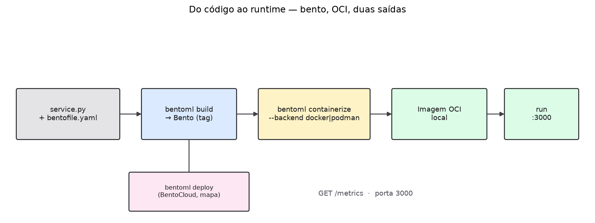
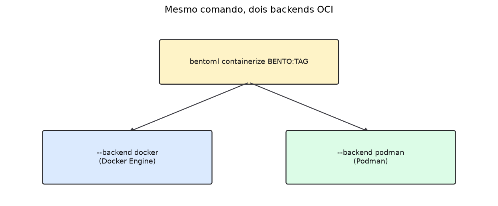
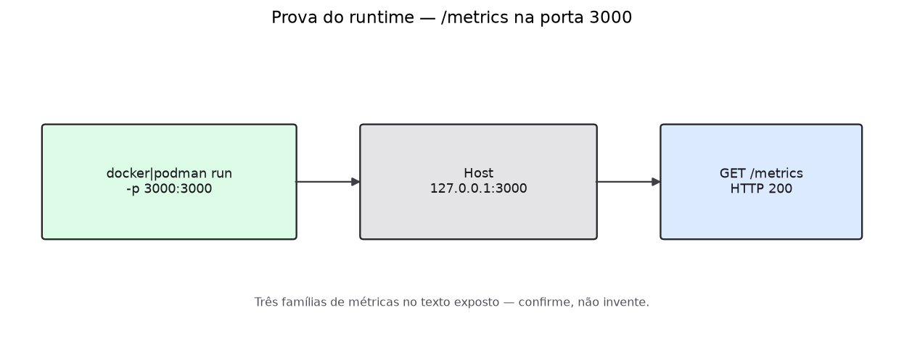
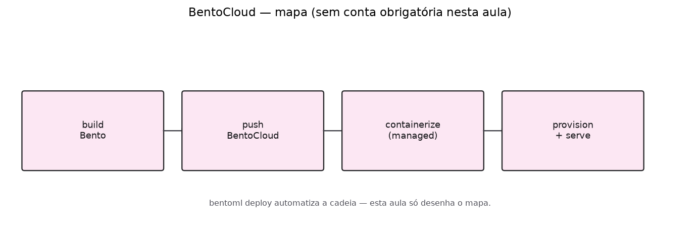

# Aula 009 — Runtime BentoML em imagem OCI

**Conceito desta aula:** o serviço BentoML como **artefacto reproduzível** —
bento empacotado → imagem **OCI** → runtime com `GET /metrics` na porta
**3000** — e as **duas vias** de execução: **self-host** (Docker ou Podman)
versus **BentoCloud** (só o mapa nesta aula; conta não é pré-requisito).

Não ensina PromQL, scrape Prometheus, drift nem orquestração Kubernetes.

## Objetivos

1. Explicar, em quatro passos, por que o curso empacota o serviço (serve →
   bento → OCI → duas saídas).
2. Empacotar o serviço com `bentoml build` (receita `just build` na raiz).
3. Produzir uma imagem OCI com `bentoml containerize` / `just containerize`,
   escolhendo backend **docker** ou **podman** (`OCI_RUNTIME`).
4. Subir o runtime no Host e confirmar `http://127.0.0.1:3000/metrics`.
5. Nomear três famílias de métricas no texto de `/metrics`.
6. Ler o mapa de `bentoml deploy` (BentoCloud) e o workflow de CI — **sem**
   editar YAML e **sem** exigir login na nuvem.

## Porquê empacotar

1. **Serviço solto.** `just serve` (ou `bentoml serve`) itera bem no Host.
   A versão que outra máquina corre, porém, não fica endereçada como um
   pacote com etiqueta estável.
2. **Bento.** `bentoml build`, guiado por [`bentofile.yaml`](../bentofile.yaml),
   congela código e dependências num artefacto `nome:versão`. `just list`
   mostra o que já existe nesta máquina.
3. **OCI.** Imagens no formato OCI tornaram-se o contrato de runtime entre
   laptops, CI e orquestradores. `bentoml containerize` gera essa imagem e
   aceita backends (`docker`, `podman`, entre outros).
4. **Duas saídas.** Self-host: `docker` ou `podman` corre a imagem local na
   porta **3000**. Managed: `bentoml deploy` envia o bento ao BentoCloud e
   a plataforma trata do resto — nesta aula você só lê o mapa.



## Pré-requisitos

- `uv` e dependências da raiz (`just sync`).
- **Docker Engine** *ou* **Podman** no Host (um basta; anote qual usou).
- Arquivos da raiz: [`bentofile.yaml`](../bentofile.yaml),
  [`service.py`](../service.py), [`justfile`](../justfile).
- Conta BentoCloud **não** é pré-requisito.

## Portas que esta aula espera no Host

Mapa completo: [`docs/ports.md`](../docs/ports.md).

| Processo | Porta | O que abrir |
| :--- | ---: | :--- |
| **BentoML** (imagem OCI via `just oci-smoke`) | **3000** | <http://127.0.0.1:3000/metrics> |

Grafana **não** usa a porta 3000 neste curso.

## 1. Empacote o bento

Na raiz do repositório:

```bash
just sync
just build
just list
```

Anote a etiqueta (tag) do bento listada por `just list`.

## 2. Gere a imagem OCI

Backend por omissão: **docker**. Para Podman:

```bash
OCI_RUNTIME=podman just containerize
```

Com Docker (ou com `OCI_RUNTIME` omitido / em branco — mesmo comportamento):

```bash
just containerize
```

A receita chama `bentoml containerize … --backend <docker|podman>` sobre o
bento mais recente (ou o `tag` que passar como argumento).



## 3. Suba o runtime e prove `/metrics`

Com a etiqueta da imagem impressa no passo anterior:

```bash
# Docker (padrão)
just oci-smoke "$IMAGE"

# Podman
OCI_RUNTIME=podman just oci-smoke "$IMAGE"
```

Ou, manualmente:

```bash
docker run --rm -p 3000:3000 "$IMAGE"
# ou: podman run --rm -p 3000:3000 "$IMAGE"
curl --fail --silent --show-error http://127.0.0.1:3000/metrics | head
```



Contrato: BentoML permanece em **3000**. Falhas típicas (porta ocupada,
backend ausente): [`SAMPLE_DATA.md`](SAMPLE_DATA.md).

## 4. Três famílias em `/metrics`

No texto devolvido pelo `curl`, identifique três famílias (ou nomes) de
métricas. Exemplos típicos neste serviço: contadores de pedido, histogramas
de duração, séries auxiliares de processo — confirme no texto, não invente.
A aula [`010`](../010_prometheus_promql/README.md) consultará essas séries;
aqui o critério é **nomear o que o runtime expõe**.

## 5. BentoCloud — só o mapa

`bentoml deploy` (BentoCloud) automatiza, do lado managed: build do bento,
push, containerize e provisionamento. O mesmo bento que você acabou de
tratar no Host pode seguir esse caminho — **operador diferente**, artefacto
semelhante.



Nesta aula **não** há login obrigatório, nem criação de Deployment, nem
envio de segredos ao Git. A documentação oficial descreve o fluxo managed;
use-a como leitura se quiser aprofundar fora do laboratório do Host.

## 6. CI raso (só leitura)

Abra [`.github/workflows/bentoml-oci.yml`](../.github/workflows/bentoml-oci.yml).
Identifique o passo que executa o equivalente a `bentoml build`. O workflow
**para no build**: não corre `containerize` nem publica imagem em registry.
Não é preciso alterar o fluxo nesta aula.

## Checklist de saída

| Verificação | Sim / Não |
| :--- | :---: |
| Sei dizer a diferença entre `just serve` e um bento etiquetado | |
| `just build` + `just list` mostraram uma tag de bento | |
| `just containerize` (docker ou `OCI_RUNTIME=podman`) produziu imagem OCI | |
| Anotei se usei Docker ou Podman | |
| `curl` a `:3000/metrics` devolveu HTTP 200 | |
| Nomeei três famílias (ou nomes) de métricas no texto | |
| Li o mapa Cloud sem precisar de conta | |
| No workflow, localizei o passo de *build* (e notei a ausência de *containerize*) | |

Formulário livre (tags, nomes de métricas): [`CHECKLIST.md`](CHECKLIST.md).

## Materiais

| Arquivo | Papel |
| :--- | :--- |
| [`illustrations/`](illustrations/) | Mapas bento → OCI → run / Cloud |
| [`SAMPLE_DATA.md`](SAMPLE_DATA.md) | Falhas típicas do laboratório |
| [`CHECKLIST.md`](CHECKLIST.md) | Campos livres (tags, famílias) |
| [`bentofile.yaml`](../bentofile.yaml) | Receita do bento |
| [`.github/workflows/bentoml-oci.yml`](../.github/workflows/bentoml-oci.yml) | CI raso (só leitura) |

```bash
cd 009_bentoml_oci_runtime
just test
```

## Roteiro da trilha

| | Pasta |
| :--- | :--- |
| **Anterior** | [`002_histogram_cdf_streamlit`](../002_histogram_cdf_streamlit/README.md) |
| **Seguinte** | [`010_prometheus_promql`](../010_prometheus_promql/README.md) |
