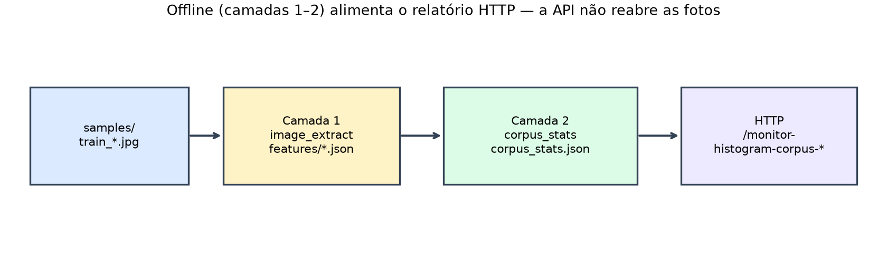
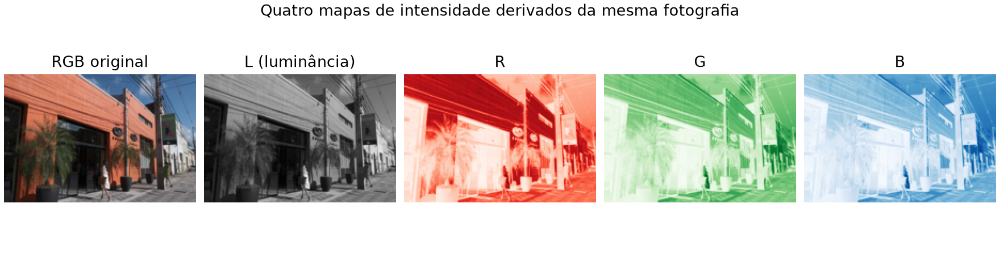
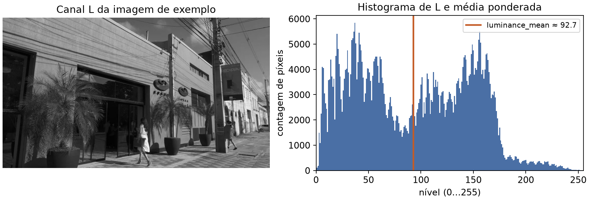
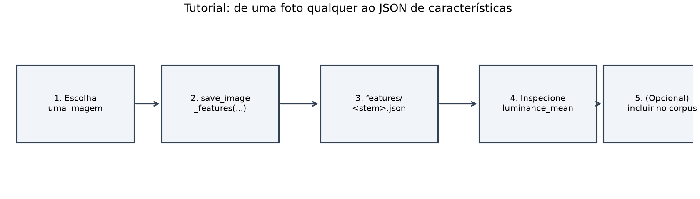

# Lição 010 — Corpus, histogramas e modelo de tons de cinza

## Objetivo

- Relembrar o que o **programa base** (raiz do repositório) já faz com BentoML.
- Acrescentar um **corpus de treino** offline e rotas de monitoramento do corpus.
- Trocar o cinza «inline» por um **modelo BentoML picklable** (ainda Pillow
  `convert("L")` — **sem pesos neurais**).
- Árvore **autocontida**: cópia independente do serviço base.

## Comparação com a base

### O que o programa base faz (antes de abrir esta pasta)

Na **raiz** do repositório há um serviço mínimo de processamento de imagens. A
ideia pedagógica da base é: você escreve métodos Python com *anotações de tipo*;
o BentoML lê essas anotações e monta HTTP, validação e OpenAPI **sem** você
escrever rotas Flask/FastAPI à mão.

Comportamento da base:

1. Sobe com `just serve` (BentoML serve a classe `ImageProcessor`).
2. Aceita `POST` multipart com uma imagem.
3. Devolve outra imagem (PNG) após um filtro Pillow.
4. Três operações apenas: desfoque, tons de cinza, redimensionamento.

Não há corpus, não há estatísticas em disco, não há modelo salvo no armazém
BentoML: o cinza é uma linha `image.convert("L")` dentro do handler.

### Recursos BentoML — antes (base) versus depois (esta lição)

| Recurso BentoML | Base (raiz) | Esta lição |
| :--- | :--- | :--- |
| `@bentoml.service` | Sim — declara `ImageProcessor` | Sim — igual |
| `@bentoml.api` + tipos (`ImageInput`, `Positive`) | Sim — gera `POST` a partir das assinaturas | Sim — iguais + rotas novas |
| Rotas `/inference-{blur,grayscale,resize}` | Sim | Sim |
| `bentoml serve service:ImageProcessor` | Sim | Sim |
| OpenAPI / Swagger automático | Sim | Sim |
| `bentoml.picklable_model` (salvar / carregar artefato) | **Não** | **Sim** — cinza vira modelo versionado |
| Rotas `/monitor-*` (relatórios) | **Não** | **Sim** — só corpus |
| Pipeline offline de features / stats | **Não** | **Sim** — fora do HTTP |

Em uma frase: a base ensina **API por anotações**; esta lição acrescenta
**modelo empacotado** e **monitoramento do corpus**, sem abandonar os três
filtros de inferência.

### Trecho decisivo no `service.py`

**AS-IS (base)** — cinza direto, sem modelo:

```python
@bentoml.api(route="/inference-grayscale")
def inference_grayscale(self, image: ImageInput) -> PILImage:
    return image.convert("L")
```

**TO-BE (esta lição)** — carrega o modelo no arranque; acrescenta relatórios:

```python
def __init__(self) -> None:
    self._grayscale_model = load_grayscale_model()  # picklable_model:latest

@bentoml.api(route="/inference-grayscale")
def inference_grayscale(self, image: ImageInput) -> PILImage:
    return self._grayscale_model(image)

@bentoml.api(route="/monitor-histogram-corpus-json")
def monitor_histogram_corpus_json(self, channel: str = "L", bins: Positive = 256) -> dict:
    return report_histogram_json(channel=channel, bins=bins)
# + /monitor-histogram-corpus-csv  e  /monitor-histogram-corpus-image
```

| Rotas | Base | Esta lição |
| :--- | :---: | :---: |
| `/inference-blur` | sim | sim |
| `/inference-grayscale` | sim (inline) | sim (modelo) |
| `/inference-resize` | sim | sim |
| `/monitor-histogram-corpus-{json,csv,image}` | não | sim |

## Utilização

### 1. Mapa do percurso (offline → HTTP)

Antes de servir imagens pela API, precisamos de uma **distribuição de referência**:
como costumam ser os brilhos e as cores do nosso conjunto de treino. Sem isso,
«monitorar o corpus» não tem com o que comparar.

O trabalho divide-se em **duas camadas offline** (só disco e scripts) e numa
**camada HTTP** que apenas *lê* o resultado agregado:

1. **Camada 1** — por cada `samples/train_*`, `image_extract.py` (receita
   `just extract-features`) grava `features/<stem>.json`.
2. **Camada 2** — `corpus_stats.py` (receita `just build-corpus-stats`) lê esses
   JSON (≥ 50) e produz `corpus_stats.json`.
3. **HTTP** — as rotas `/monitor-histogram-corpus-*` **não** reabrem imagens nem
   recalculam features; só reportam o que está em `corpus_stats.json`.

À parte, o cinza de inferência usa um **modelo BentoML picklable**
(`just save-grayscale-model`): é independente do pipeline de histogramas.



```text
  samples/train_*          (imagens de treino)
           |
           v
  [Camada 1] image_extract.py / just extract-features
           |
           v
  features/<stem>.json     (um arquivo por imagem)
           |
           v
  [Camada 2] corpus_stats.py / just build-corpus-stats
           |
           v
  corpus_stats.json        (agregado; CDF só aqui)
           |
           v
  [HTTP :3333] /monitor-histogram-corpus-{json,csv,image}

  [paralelo] grayscale picklable → /inference-grayscale
```

Regenerar figuras: `just generate-feature-illustrations`.

### 2. O que medimos em cada imagem de treino

Uma foto colorida é uma grade de pixels. Em cada pixel, o Pillow pode entregar:

- **L** (luminância) — tons de cinza: *quão claro ou escuro* é o pixel,
  independentemente da cor. É o canal natural para falar de brilho.
- **R**, **G**, **B** — quanto vermelho, verde e azul há naquele ponto. Úteis
  quando a pergunta é «esta foto puxa para o azul?» ou «há muito vermelho?».

Para cada canal, o histograma conta **quantos pixels** caem em cada faixa de
intensidade (por padrão, 256 faixas, de 0 = escuro a 255 = claro). A soma das
contagens de um canal é o número de pixels da imagem.



| Campo | Tipo | Significado |
| :--- | :--- | :--- |
| `bins` | inteiro | Resolução dos histogramas; padrão **256** (`DEFAULT_BINS`). |
| `luminance_mean` | flutuante | Média ponderada dos níveis do canal **L**, a partir das *contagens* do histograma L. |
| `histograms` | objeto | Listas de contagens `"L"`, `"R"`, `"G"`, `"B"`. |
| `source` | cadeia | Caminho da imagem de origem (com `/`). |

```text
luminance_mean = (Σ i · counts[i]) / (Σ counts[i])
```



**O que não gravamos** por imagem: largura, altura, EXIF, hashes, embeddings
neurais nem a **CDF**. O objeto didático é a **distribuição de intensidade**
por canal; a CDF aparece apenas no agregado (`corpus_stats.json`).

Esqueleto típico de `features/<stem>.json`:

```json
{
  "bins": 256,
  "luminance_mean": 112.18537109375,
  "histograms": {
    "L": [ /* 256 inteiros; soma = nº de pixels */ ],
    "R": [ /* idem */ ],
    "G": [ /* idem */ ],
    "B": [ /* idem */ ]
  },
  "source": "…/samples/train_001.jpg"
}
```

### 3. Do JSON por imagem ao `corpus_stats.json`

A agregação **não reabre** as imagens: só lê `features/*.json`.

1. Exige pelo menos **50** arquivos em `features/` (`just build-corpus-stats`).
2. Soma as contagens **bin a bin** em cada canal.
3. Sobre a lista de `luminance_mean` calcula o brilho do corpus
   (`brightness.mean`, `p50`, `p95`).
4. Para cada histograma agregado, acrescenta a **CDF** (último valor = **1,0**).

| Campo em `corpus_stats.json` | Origem |
| :--- | :--- |
| `n_images` | Número de JSON em `features/`. |
| `brightness.mean` / `p50` / `p95` | Média e percentis dos `luminance_mean`. |
| `histograms.luminance` / `r` / `g` / `b` | Contagens somadas + `cdf`. |

É esse arquivo — e só ele — que as rotas `/monitor-histogram-corpus-*` usam.

### 4. Onde ler o código (nesta pasta)

Ordem sugerida (caminhos relativos a esta lição):

1. `image_extract.py` — comece por `save_image_features` e `extract_image_features`.
2. `histogram.py` — `compute_histogram`, `rebin_counts`, `cumulative_distribution`.
3. `scripts/extract_image_features.py` — CLI de `just extract-features` (só `train_*`).
4. `corpus_stats.py` — agregação e limiar de 50 imagens.
5. `scripts/build_corpus_stats.py` — CLI de `just build-corpus-stats`.
6. `corpus_report.py` — formata as respostas `/monitor-histogram-corpus-*`.
7. `grayscale_model.py` — modelo picklable (cinza), separado do corpus.
8. `service.py` — HTTP BentoML (inferência + monitoramento).

### 5. Tutorial: extrair dados de uma imagem sua

Neste tutorial você vê **uma** imagem virar JSON — o mesmo formato dos `train_*`,
ainda sem passar pelo HTTP.



#### Passo 1 — Pré-requisitos

```bash
cd /home/lugatj/code/research/bentoML-processamento-imagens/010_corpus_histograms_model
just sync
```

Se ainda não tiver as fotos de treino: `just download-samples`.

#### Passo 2 — Escolher a imagem

Use o exemplo da pasta ou substitua pelo seu arquivo:

```bash
ls -la samples/cesar-fachada-1.webp
# opcional: cp ~/minha-foto.jpg samples/minha-foto.jpg
```

#### Passo 3 — Extrair e gravar features

```bash
uv run --no-active python -c "
from pathlib import Path
from image_extract import save_image_features

caminho = Path('samples/cesar-fachada-1.webp')  # troque pela sua imagem
print('gravado:', save_image_features(caminho))
"
```

O retorno aponta para `features/cesar-fachada-1.json` (o nome segue o *stem*
do arquivo).

#### Passo 4 — Inspecionar o JSON com significado

```bash
uv run --no-active python -c "
import json
from pathlib import Path

d = json.loads(Path('features/cesar-fachada-1.json').read_text())
print('bins:', d['bins'])
print('luminance_mean:', d['luminance_mean'])
print('canais:', list(d['histograms']))
print('pixels (soma L):', sum(d['histograms']['L']))
print('source:', d['source'])
"
```

| Saída | Interpretação |
| :--- | :--- |
| `bins` | Quantas faixas cada histograma tem (quase sempre 256). |
| `luminance_mean` | Brilho médio no canal L (0–255). Baixo → cena escura; alto → clara. |
| `canais` | Deve listar `L`, `R`, `G`, `B`. |
| `pixels (soma L)` | Número de pixels; deve coincidir com largura × altura. |
| `source` | De onde veio o arquivo original. |

#### Passo 5 — Checagem visual

Abra a foto e compare com `luminance_mean`: uma fachada ensolarada tende a média
alta; um interior escuro, baixa. Se o céu domina, as contagens em
`histograms["B"]` costumam contar essa história.

#### Passo 6 — Relação com o HTTP

Um JSON avulso em `features/` **não** é servido pela API. As rotas
`/monitor-histogram-corpus-*` leem **apenas** `corpus_stats.json`.

Para incorporar a foto no corpus de referência:

1. Coloque-a como `samples/train_NNN.*` (mesmo padrão dos demais treinos).
2. Rode de novo `just extract-features` e `just build-corpus-stats`.
3. Só então o monitoramento HTTP refletirá o agregado atualizado.

### 6. Subir o serviço e consultar o corpus

**Preparação** (uma vez, ou após mudar o treino):

```bash
cd /home/lugatj/code/research/bentoML-processamento-imagens/010_corpus_histograms_model
just sync
just download-samples
just extract-features
just build-corpus-stats
just save-grayscale-model
```

**Terminal 1** — servidor na porta **3333**:

```bash
just serve
```

**Terminal 2** — cliente:

```bash
just curl-monitor-histogram-corpus-json
just curl-monitor-histogram-corpus-csv
just curl-monitor-histogram-corpus-image
just curl-inference-grayscale samples/cesar-fachada-1.webp
just curl-inference-blur samples/cesar-fachada-1.webp
just curl-inference-resize samples/cesar-fachada-1.webp
```

Swagger: `just swagger`. Testes: `just test`.

### Por que o PNG do histograma usa Pillow

As rotas `/monitor-…-image` devolvem um `PIL.Image` — o mesmo tipo que a
inferência já usa para abrir e filtrar fotos. O desenho em
`histogram.draw_histogram` usa `ImageDraw`: retângulos para as barras e uma
polilinha para a CDF, a partir de contagens já calculadas. O endpoint HTTP
permanece no ecossistema Pillow do serviço: não carrega Matplotlib nem Seaborn
só para montar essa figura estática. Bibliotecas de gráfico estatístico
encaixam melhor em notebooks, CLIs ou apps interativos; aqui o contrato é
«receber/devolver imagem» de ponta a ponta.

### 7. Atividade assíncrona

Escolha **três** fotografias suas (ou capturas do celular). Para cada uma:

1. Extraia features com `save_image_features` (como no tutorial) e anote o
   `luminance_mean`.
2. **Não** inclua essas fotos no corpus. Suba o serviço (`just serve`) e consulte
   o corpus Picsum com `just curl-monitor-histogram-corpus-json`. Compare o
   brilho agregado (`brightness` / histograma L) com os três valores que anotou.
3. Entregue um parágrafo: as suas fotos estão mais claras, mais escuras ou
   semelhantes ao corpus? Em que canal (L versus R/G/B) a diferença aparece com
   mais clareza?
