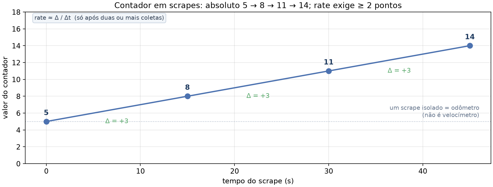
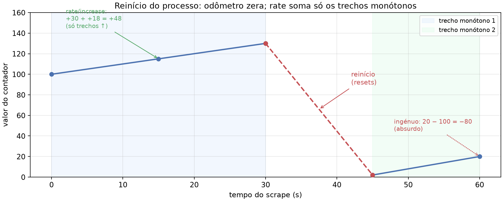
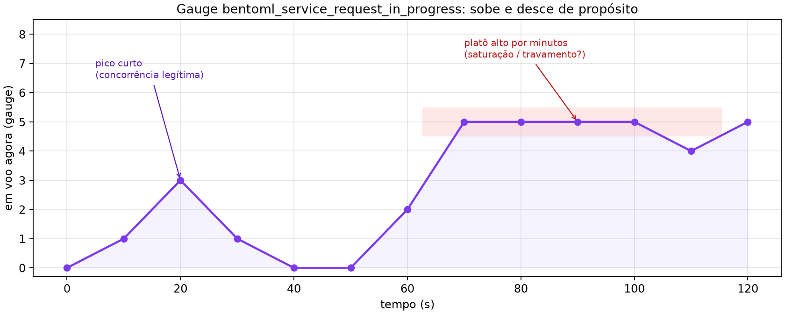
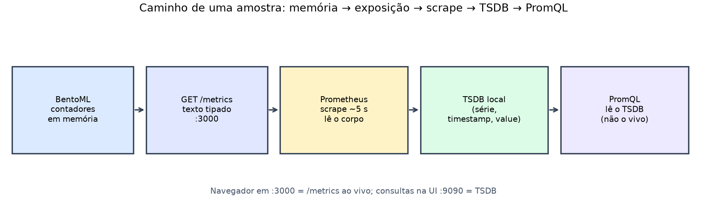
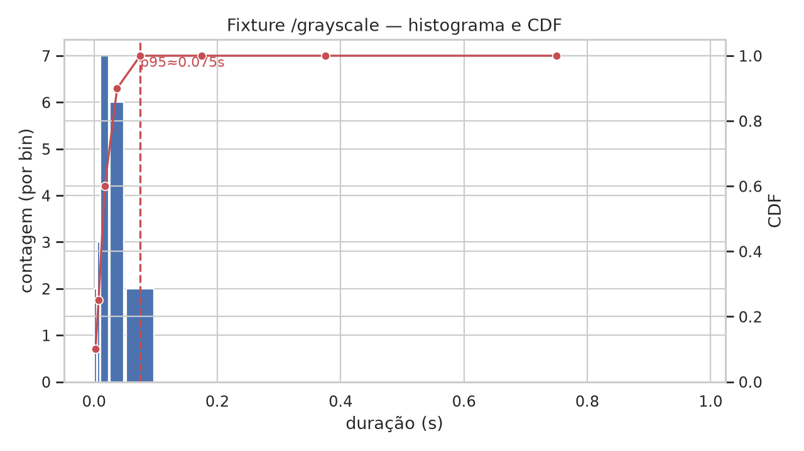
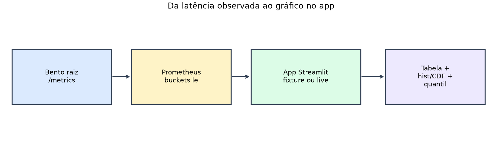

# Aula 010 — Prometheus e PromQL

Uma API pode responder HTTP 200 enquanto a latência sobe. O cliente recebe a
imagem convertida; o status parece saudável; o painel de “sucesso” permanece
verde. Ainda assim, a fila interna cresce, o tempo por requisição deixa de
caber no orçamento do produto e o usuário percebe atraso sem jamais ver um
código de erro. Para investigar esse cenário, é preciso ler **o que `/metrics`
expõe**, como o Prometheus **coleta** isso e como o **PromQL** transforma as
séries em taxas, quantis e sinais de alerta.

O texto de `/metrics` é a fonte canônica do que o serviço declara sobre si
mesmo. Cada linha tipada (contador, gauge, histograma) vira, após o scrape,
uma série temporal endereçável por nome e labels. Sem compreender esse
contrato, a consulta na UI do Prometheus permanece um exercício de tentativa
e erro. Com o contrato claro, a mesma linha de PromQL passa a ser
reproduzível, auditável e utilizável em regras de gravação e de alerta.

Se ainda não concluiu o [tutorial de instalação e coleta](../docs/prometheus.md),
faça-o antes de continuar. Ali estão a instalação do binário, a validação com
`promtool`, a subida do BentoML e a primeira confirmação de `up`. Esta aula
parte desse chão e aprofunda a leitura do formato, a seleção por labels, o
cálculo de `rate`, a reconstrução manual de CDF e p95 a partir de buckets, a
expressão `histogram_quantile` e a interpretação de regras de linha de base.

**Conceito desta aula:** ler o contrato de `/metrics`, confirmar o scrape e
usar PromQL (taxa, buckets, `histogram_quantile`, linha de base) na UI do
Prometheus.

## Portas que esta aula espera no Host

Este documento espera os seguintes processos no Host (mapa completo em
[`docs/ports.md`](../docs/ports.md)):

| Papel | Onde escuta | URL típica |
| :--- | ---: | :--- |
| **BentoML** (serviço real do curso) | **3000** | <http://127.0.0.1:3000/metrics> |
| **Prometheus** (scrape + UI do curso) | **9090** | <http://127.0.0.1:9090> |

Se o serviço real ou o Prometheus do curso não estiverem no ar, use a **demo
local** desta pasta: um gerador de métricas em **8010** e um Prometheus só
dessa demo em **9100**. Os valores inventados passam por três fases (tráfego
normal, depois lento, depois de volta ao normal) para você treinar as mesmas
consultas. Passo a passo: [SAMPLE_DATA.md](SAMPLE_DATA.md). A demo **não**
substitui BentoML@3000 nem Prometheus@9090 quando o ambiente canônico estiver
disponível.

| Papel (demo) | Onde escuta | URL típica |
| :--- | ---: | :--- |
| Exporter sintético (`just demo-exporter`) | **8010** | <http://127.0.0.1:8010/metrics> |
| Prometheus da demo (`just demo-prometheus`) | **9100** | <http://127.0.0.1:9100> |

Os endpoints de inferência de imagem deste repositório servem de fio
condutor nas seções seguintes.

## Objetivos

- reconhecer no `/metrics` contadores, gauges, histogramas e labels, e
  explicar o papel de `# HELP` e `# TYPE`;
- confirmar o scrape (`up`, página `/targets`) e distinguir a instância da
  aula de outro Prometheus que eventualmente ocupe a porta **9090**;
- selecionar séries e calcular `rate` / `increase` na UI, justificando a
  escolha da janela (`[1m]`, `[5m]`);
- reconstruir à mão uma CDF e um p95 a partir de buckets cumulativos, com
  interpolação linear no intervalo que contém o rank;
- escrever `histogram_quantile` (instantâneo e com `rate` dos buckets) e ler
  uma regra de alerta no Prometheus, incluindo estados `pending` e `firing`;
- articular por que uma linha de base de três desvios-padrão sobre janela
  curta é frágil no início da operação e sob tráfego sazonal ou multimodal.

## 1. Olhe o formato de `/metrics`

Com o BentoML no ar (`just serve` na raiz), abra no navegador
<http://127.0.0.1:3000/metrics> ou salve o texto:

~~~bash
curl -sS http://127.0.0.1:3000/metrics -o /tmp/metrics.txt
head -n 80 /tmp/metrics.txt
~~~

Abaixo, uma captura **real** do `ImageProcessor` deste repositório (depois de
algumas chamadas a `/inference-grayscale`): o navegador mostra o mesmo corpo
que o `curl` grava.

O texto completo dessa captura está em
[`fixtures/metrics_bentoml_sample.txt`](fixtures/metrics_bentoml_sample.txt)
(mesmo conteúdo da figura). Use-o offline se o serviço ainda não estiver no ar;
quando puder, repita o `curl` na porta **3000** e compare. Diferenças de
valores absolutos são esperadas (mais tráfego, reinícios); o que deve
permanecer estável é a **forma**: nomes, tipos e labels principais.

### 1.1 Como ler o texto de `/metrics`

O corpo da resposta é texto linha a linha. Linhas que começam com `#` descrevem
a métrica; as outras são **amostras** (nome, labels entre `{…}`, valor).

Trecho da mesma captura
([`fixtures/metrics_bentoml_sample.txt`](fixtures/metrics_bentoml_sample.txt)):

~~~text
# HELP bentoml_service_request_total Total number of runner RPC
# TYPE bentoml_service_request_total counter
bentoml_service_request_total{endpoint="/inference-grayscale",http_response_code="200",runner_name="ImageProcessor",service_name="ImageProcessor",service_version="not available"} 5.0
~~~

| Elemento | Função |
| :--- | :--- |
| `# HELP nome …` | Descrição humana da métrica `nome` |
| `# TYPE nome tipo` | Declara `counter`, `gauge`, `histogram`, `summary` ou `untyped` |
| `nome{labels} valor` | Amostra no instante do GET (aqui: 5 pedidos 200 em `/inference-grayscale`) |

O Prometheus **puxa** esse texto no scrape e grava o valor com o timestamp da
coleta. Se o processo estiver parado ou `/metrics` falhar, a série `up` desse
target cai para `0` e as demais séries deixam de receber amostras novas.

### 1.2 Contadores, gauges e o contrato de monotonia

Um **contador** representa uma quantidade acumulada que, em operação normal,
só cresce (ou permanece constante). Exemplos: total de requisições, total de
bytes enviados, total de erros. Quando o processo reinicia, o contador volta
a um valor baixo (em geral zero). No exemplo da captura,
`bentoml_service_request_total` para `/inference-grayscale` com código HTTP
200 vale **5**. Isso significa cinco requisições bem-sucedidas contadas desde
o início do processo (ou desde o último reset da série), e não “cinco por
segundo”. A taxa (`rate`) só aparece depois de duas ou mais coletas espaçadas
no tempo.

*Cada ponto é uma fotografia do odômetro; a taxa só nasce da diferença entre
fotografias sucessivas.*

Há de se tratar o número isolado na página `/metrics` como fotografia de um
odômetro, não como velocímetro. Cinco é o acumulado até aquele scrape; o que
interessa à operação — pedidos por segundo, erro relativo, volume na janela —
só se reconstitui pela diferença entre fotografias sucessivas. Cumpre
observar, outrossim, que um reinício do processo “zera o odômetro”: a série
desce de golpe e uma subtração ingênua entre amostras vizinhas produziria
taxa negativa, absurda. O PromQL oferece precisamente `rate`, `increase` e
`resets` porque o valor absoluto isolado não conta a história: importa a
derivada ao longo do tempo, corrigida para reinícios. Na prática, você há de
verificar a si mesmo: se só há um ponto na série, ainda não há taxa
legítima; se houve queda abrupta do contador, procure `resets` antes de
confiar no gráfico.

*A linha tracejada vermelha marca o reinício; `rate`/`increase` somam apenas
os trechos monótonos (azul e verde).*

Um **gauge** representa um nível que sobe e desce: requisições em andamento,
temperatura, uso de memória, último timestamp de evento.
`bentoml_service_request_in_progress` é gauge; zero na captura indica que,
naquele instante, nenhuma RPC daquele endpoint estava em voo. Um gauge
travado em valor alto por minutos sugere saturação ou travamento; um pico
curto pode ser apenas concorrência legítima.

*O eixo vertical é “em voo agora”: sobe e desce de propósito; um platô alto
prolongado é o sinal que merece investigação.*

Não se aplica `rate` da mesma forma que a um contador. O `rate` do PromQL
pressupõe monotonia (acúmulo que só cresce, com correção de reinício); um
nível que oscila sobe e desce de propósito, e tratar essa oscilação como
“taxa de eventos” costuma distorcer o sinal — picos legítimos viram artefato,
e o valor médio da “taxa” deixa de corresponder a throughput. Faz-se sentido,
conforme o caso, falar em valor atual (quantos estão em voo agora?), em média
temporal (`avg_over_time`) quando se deseja suavizar ruído de amostragem ao
longo de uma janela, ou em variação (`delta`) quando a pergunta é “quanto o
nível mudou entre o início e o fim do intervalo”. Cumpre observar o
autoexame: se a métrica sobe e desce no texto de `/metrics` entre scrapes sem
reinício do processo, trate-a como gauge; reserve `rate`/`increase` aos
counters (e aos `_bucket`/`_count` do histograma, que também são contadores
cumulativos).

### 1.3 Histogramas: sum, count e buckets com `le`

O tipo `histogram` no formato de exposição **não** é uma única série. O
instrumentador emite uma família coerente:

- `nome_bucket{le="…"}` — contadores cumulativos por limite superior;
- `nome_sum` — soma das observações (durações, tamanhos, …);
- `nome_count` — número de observações.

O label `le` (*less than or equal*) é o limite superior cumulativo do bucket:
a amostra em `le="0.05"` conta todas as observações cujo valor foi ≤ 0,05 s
(e assim por diante). Na captura real, `…_duration_seconds_bucket` usa `le`
de `0.005` até `+Inf`. Uma observação de 0,04 s incrementa **todos** os
buckets cujo `le` é ≥ 0,04 s — tipicamente `0.05`, `0.075`, …, `+Inf` —, e
**não** incrementa os de `le` estritamente menor (por exemplo `0.005`,
`0.01`, `0.025`). Por isso a sequência de valores ao longo de `le` crescente
é **não decrescente**. Se você encontrar um `le` maior com contagem menor
que um `le` menor (mesmo conjunto de labels restantes), há inconsistência de
exposição ou de agregação — sinal de que a leitura ou a soma por labels
quebrou o contrato cumulativo.

**Exemplo didático (números inventados).** Escada curta
`le ∈ {0,01; 0,05; 0,10; +Inf}` e três durações `{0,008; 0,040; 0,090}` s.
Antes de qualquer observação, todos os buckets estão em zero. Depois das
três observações:

| `le` | Antes | Depois | Porquê |
| :--- | ---: | ---: | :--- |
| `0,01` | 0 | 1 | só 0,008 ≤ 0,01 |
| `0,05` | 0 | 2 | 0,008 e 0,040 ≤ 0,05 |
| `0,10` | 0 | 3 | as três ≤ 0,10 |
| `+Inf` | 0 | 3 | toda duração finita ≤ ∞ |

A observação de 0,040 s incrementa apenas os buckets com `le ≥ 0,05` (aqui
`0,05`, `0,10`, `+Inf`) e **não** o `le="0,01"`. A sequência 1 → 2 → 3 → 3
é não decrescente. Estaria **incorreto** se, sob os mesmos labels restantes,
`le="0,10"` mostrasse 1 enquanto `le="0,05"` mostrasse 2: monotonia
quebrada = exposição ou agregação inconsistente.

`nome_sum` e `nome_count` fecham o quadro: a média aritmética das observações
é `sum / count` (quando `count > 0`). Em exposição correta, `nome_count`
coincide, em geral, com o bucket `le="+Inf"`, pois todo valor finito é ≤
infinito. Há de se checar isso na fixture: se `_count` e o bucket `+Inf`
divergirem sob os mesmos labels, a família do histograma está corrompida ou
mal agregada.

**Mesmo exemplo.** Com as três durações acima:

~~~text
sum   = 0,008 + 0,040 + 0,090 = 0,138 s
count = 3
média = sum / count = 0,046 s
bucket le="+Inf" = 3  (= count)
~~~

Se `_count` valesse 3 e o bucket `+Inf` valesse 2 sob os mesmos labels, a
família estaria inconsistente: falta uma observação no infinito cumulativo
(ou sobrou uma no `count`).

O label `le` responde *quantas observações ficaram neste limiar ou abaixo
dele*; o contador HTTP `…_request_total` responde *quantas requisições
ocorreram*. São métricas distintas. A família do histograma é `_bucket` +
`_sum` + `_count`, com monotonia em `le`.

Os nomes típicos desta aula (counter, gauge, buckets, `count`, `sum`, `up`)
aparecem na tabela abaixo.

| Métrica típica | Tipo |
| :--- | :--- |
| `bentoml_service_request_total` | contador |
| `bentoml_service_request_in_progress` | gauge |
| `bentoml_service_request_duration_seconds_bucket` | contadores por `le` |
| `…_count` / `…_sum` | observações e soma das durações |
| `up` | gauge (produzido pelo Prometheus na coleta, não por este `/metrics`) |

Gere algumas chamadas (como no [tutorial](../docs/prometheus.md)) e volte a
inspecionar `/metrics`: os contadores só fazem sentido **depois** de tráfego.
Com zero requisições, muitos buckets permanecem em zero e qualquer quantil
derivado será `NaN` ou indefinido — o que não é “latência zero”, e sim
“ausência de evidência”.

### 1.4 Leitura guiada da fixture de captura

Abra [`fixtures/metrics_bentoml_sample.txt`](fixtures/metrics_bentoml_sample.txt)
e localize, nesta ordem:

1. O bloco `# TYPE bentoml_service_request_total counter` e a linha com
   `endpoint="/inference-grayscale"` e `http_response_code="200"`.
2. O gauge `bentoml_service_request_in_progress` para o mesmo endpoint.
3. O histograma: `_sum`, depois a sequência de `_bucket` ordenada mentalmente
   por `le`, e por fim `_count`.

Na captura de exemplo, quatro das cinco observações caem no bucket `le="0.05"`
(já acumuladas também em todos os `le` maiores), e a quinta só aparece de
forma plena a partir de `le="2.5"`. Isso já antecipa uma cauda: a média
(`sum/count`) pode ser puxada por um outlier, enquanto o p50 permaneceria em
outra região da distribuição. O contraste média versus cauda reaparece no
cálculo do p95 (seção 5).

### 1.5 Escopo Negativo

| Fora do `/metrics` | O que isso evita misturar |
| :--- | :--- |
| Log de auditoria ou corpo das imagens | Tratar scrape como registro forense do pedido |
| Tracing distribuído ponta a ponta | Confundir duração agregada com caminho de uma requisição |
| Prova de corretude do modelo (acerto, viés, regressão de acurácia) | Alertar “modelo errou a classe” com sinal só de operação |
| Tudo que não seja custo operacional observável | Julgar qualidade semântica da predição só pela latência |

| Dentro do `/metrics` (nesta aula) | Exemplos |
| :--- | :--- |
| Volume, concorrência e duração | Contadores, gauges e histogramas de requisição |

Assim, “o serviço ficou lento” e “o modelo errou a classe” permanecem
perguntas diferentes, com instrumentos diferentes.

## 2. Confirme a coleta

- O BentoML **não** inicia sozinho.
- Na raiz do repositório: `just serve` (porta **3000**).
- O Prometheus da aula sobe com `monitoring/prometheus.yml`.
- Job único: `bentoml-imagens` → `127.0.0.1:3000`.
- Passo a passo de instalação e primeira coleta:
  [tutorial](../docs/prometheus.md).

Abra <http://127.0.0.1:9090/targets> **só se** for essa instância. O job
`bentoml-imagens` deve estar `UP`. Se a página mostrar muitos targets
(cadvisor, flower, backends de outros projetos…) e **não** listar
`bentoml-imagens`, a porta 9090 pertence a **outro** Prometheus — não ao da
aula. Suba o da aula com o `prometheus.yml` deste repo (outra porta, se
preciso) ou use a demo em **9100** (`just demo-prometheus` nesta pasta).

~~~promql
up{job="bentoml-imagens"}
~~~

Na visualização **Table**, o valor `1` indica scrape bem-sucedido. Isso não
mede qualidade do modelo; só acessibilidade do endpoint de métricas.

### 2.1 O caminho completo de uma amostra

*A UI do Prometheus consulta o TSDB; o navegador em **3000** é o único
caminho “ao vivo” para o texto de `/metrics`.*

1. O processo BentoML mantém contadores em memória e os serializa quando
   alguém faz `GET /metrics`.
2. O Prometheus, no intervalo configurado (neste curso, tipicamente 5 s),
   conecta-se ao target `127.0.0.1:3000`, lê o corpo e interpreta as linhas.
3. Cada combinação (nome + labels + labels extras do job/instance) torna-se
   uma série; o valor lido vira um ponto `(timestamp, value)` no TSDB local.
4. Consultas PromQL leem esse TSDB — nunca o `/metrics` “ao vivo”, salvo
   quando você mesmo abre o navegador na porta **3000**.

Consequência prática: se você gera tráfego agora e consulta `rate(...[1m])`
imediatamente, a janela ainda pode conter poucos pontos. Espere pelo menos
duas coletas bem-sucedidas; para uma janela de um minuto cheia, espere cerca
de um minuto de operação estável após o início do tráfego.

### 2.2 Página `/targets` e estados comuns

Na UI, cada target exibe o último scrape, a duração e o erro, se houver.
Estados típicos:

| Observação em `/targets` | Interpretação usual |
| :--- | :--- |
| `UP`, último scrape recente | Coleta ok; `up` deve ser 1 |
| `DOWN`, connection refused | Processo na porta 3000 ausente ou porta errada |
| `DOWN`, context deadline exceeded | Serviço lento demais para responder a tempo |
| `DOWN`, HTTP 404/5xx em `/metrics` | Rota ausente ou falha interna na exposição |
| Target ausente da lista | Você não está no Prometheus configurado com este job |

Valide a configuração antes de depurar “métricas vazias”:

~~~bash
promtool check config monitoring/prometheus.yml
promtool check rules monitoring/bentoml.rules.yml
~~~

Os dois comandos devem terminar com sucesso. Um YAML inválido impede o
servidor de aplicar o job; um target errado produz `DOWN` mesmo com BentoML
saudável na porta correta.

### 2.3 `up` versus saúde da aplicação

`up == 1` significa: o Prometheus conseguiu completar um scrape HTTP do
endpoint de métricas conforme a configuração. Não implica:

- ausência de erros 500 nas rotas de inferência;
- latência dentro do orçamento;
- modelo carregado corretamente;
- disco ou GPU em condições adequadas.

Use `up` como pré-condição (“há dados?”). Use contadores de erro, gauges de
fila e quantis de duração para a pergunta seguinte (“os dados são aceitáveis?”).

### 2.4 Confirmação pela API HTTP do Prometheus

Além da UI, a API de consulta imediata permite automação e cópia para o
relato:

~~~bash
curl --get --silent --show-error --fail \
  --data-urlencode 'query=up{job="bentoml-imagens"}' \
  http://127.0.0.1:9090/api/v1/query
~~~

Espere `"status":"success"` e um resultado com valor `"1"`. Na demo
sintética, troque a porta para **9100** e acrescente o label
`source="synthetic"` conforme [SAMPLE_DATA.md](SAMPLE_DATA.md).

## 3. Labels e seletores

Toda série no Prometheus é identificada pelo **nome** da métrica e pelo
conjunto de **labels**. Um label é uma **variável qualitativa** (categoria):
o valor é um texto de um conjunto discreto — por exemplo `endpoint` vale
`/inference-grayscale` ou `/inference-blur`, não um número contínuo. Dois
pontos com o mesmo nome e labels distintos são séries distintas. Agregar
sem `sum by (...)` (ou equivalente) mistura categorias que a pergunta
operacional talvez quisesse manter separadas — por exemplo, fundir códigos
HTTP 200 e 500 pode esconder erro sob volume total estável.

Neste serviço, labels típicos na instrumentação são `endpoint` e
`http_response_code`. Exemplo na Table:

~~~promql
bentoml_service_request_total{endpoint="/inference-grayscale"}
~~~

`=` exige igualdade exata do valor do label. `=~` exige que o valor
**inteiro** case com uma expressão regular; `!=` e `!~` negam. Referência:
[seletores PromQL](https://prometheus.io/docs/prometheus/latest/querying/basics/#time-series-selectors).

### 3.1 Cardinalidade dos labels

A **cardinalidade** de um label é o tamanho do conjunto de valores possíveis
dessa variável qualitativa. Se `endpoint` só admite três caminhos de
inferência, a cardinalidade de `endpoint` é 3. Cada combinação de valores
de labels (mais o nome da métrica) vira **uma série** no TSDB.

| Label (exemplo) | Conjunto de valores | Cardinalidade |
| :--- | :--- | ---: |
| `endpoint` neste curso | `/inference-blur`, `/inference-grayscale`, `/inference-resize` | 3 |
| `http_response_code` (só 200 no lab estável) | `200` | 1 |
| `user_id` (se alguém o expusesse) | um valor por usuário | milhares ou milhões |

Cardinalidade alta multiplica séries: memória, scrape e consultas ficam
caras. Por isso esta aula usa `endpoint` (conjunto pequeno e fechado), não
identificadores únicos por pedido.

### 3.2 Seleção por igualdade e por expressão regular

Os três endpoints de inferência existem como valores completos do label
`endpoint`. Com igualdade, a Table devolve **uma** série por valor
escolhido:

~~~promql
bentoml_service_request_total{endpoint="/inference-grayscale"}
~~~

Com expressão regular, um único seletor cobre os três valores **por inteiro**:

~~~promql
bentoml_service_request_total{
  endpoint=~"/inference-(blur|grayscale|resize)"
}
~~~

Exemplo trabalhado na Table (lab com os três endpoints e só `200`):

| Consulta | O que a Table lista |
| :--- | :--- |
| `endpoint="/inference-grayscale"` | 1 série (grayscale + 200) |
| `endpoint=~"/inference-(blur\|grayscale\|resize)"` | 3 séries (uma por endpoint) |
| `endpoint=~"grayscale"` | 0 séries: o valor do label é `/inference-grayscale`, não a palavra `grayscale` sozinha |

O `=~` do Prometheus compara a expressão regular com o **string completo**
do label (como se houvesse âncoras de início e fim). Por isso o padrão
inclui a barra e o prefixo `/inference-…`, e não um “contém grayscale”
solto. Só depois dessa seleção faz sentido embrulhar o resultado em `rate`
ou `histogram_quantile`.

### 3.3 Vetor instantâneo e vetor de intervalo

Sem `[…]`, o seletor devolve um **vetor instantâneo**: o valor mais recente
de cada série no instante da consulta.

Com `[1m]`, devolve um **vetor de intervalo**: as amostras daquela série
nos últimos 60 segundos — entrada típica de `rate`, `increase`,
`avg_over_time`.

Exemplo trabalhado (mesmo contador, mesmo endpoint):

~~~promql
bentoml_service_request_total{endpoint="/inference-grayscale"}
~~~

Na Table: uma linha, um número (ex.: `420`) — o contador **agora**.

~~~promql
bentoml_service_request_total{endpoint="/inference-grayscale"}[1m]
~~~

Na Table (modo de intervalo): vários pares tempo→valor na janela de 1
minuto (ex.: `390 @ t−45s`, `405 @ t−30s`, `420 @ t−0s`) — a **história
recente**, não um único escalar.

`rate` exige o segundo formato:

~~~promql
rate(bentoml_service_request_total{endpoint="/inference-grayscale"}[1m])
~~~

`rate(bentoml_service_request_total{endpoint="/inference-grayscale"})`
sem `[…]` é inválido: a função não recebe intervalo.

## 4. Da contagem à taxa

Contador de 100 → 160 em 60 s (sem reinício):

~~~text
requisições novas = 60
taxa média = 1 requisição/s
~~~

Essa aritmética de caderno é a intuição de `rate`: estimar incrementos por
segundo ao longo de uma janela, lidando com amostras que não caem em
instantes perfeitos e com reinícios que zerariam a conta `último − primeiro`.

Forma mínima — um contador, uma janela de 1 minuto:

~~~promql
rate(bentoml_service_request_total{endpoint="/inference-grayscale"}[1m])
~~~

Na Table: um número em **requisições por segundo** (não o valor absoluto do
contador). Em seguida, a mesma ideia por rota, agregando depois do `rate`:

~~~promql
sum by (endpoint) (
  rate(bentoml_service_request_total{endpoint="/inference-grayscale"}[1m])
)
~~~

No Graph, a mesma expressão com `[1m]` e com `[5m]` no mesmo período conta
histórias diferentes. Exemplo: entre 12:00 e 12:01 entram 60 pedidos (pico
de 1 s⁻¹); depois o tráfego volta a 0,1 s⁻¹. Com `[1m]` no instante 12:01, a
taxa ainda reflete sobretudo aquele minuto cheio. Com `[5m]` no mesmo
instante, os quatro minutos calmos anteriores diluem o pico — a curva fica
mais baixa e mais lisa. Janela curta responde rápido; janela longa suaviza.
Não há duração universalmente “certa”: é o compromisso entre
responsividade e estabilidade. No Graph, o eixo vertical é taxa (req/s); um
scrape falho aparece como buraco na série (e em geral `up` cai a 0 no mesmo
intervalo — ver seção 2).

### 4.1 `rate` e `increase`

| Função | Unidade típica do resultado | Uso |
| :--- | :--- | :--- |
| `rate(x[w])` | por segundo (para contadores de eventos) | Throughput, entrada de `histogram_quantile` sobre buckets |
| `increase(x[w])` | eventos na janela `w` (aproximado) | “Quantas requisições na última hora?” |

`increase` é, em essência, coerente com `rate * duração_da_janela`, com
nuances de extrapolação nas bordas. Para alertas de “erros por minuto”,
muitos times preferem `sum(rate(...[5m])) * 60` de forma explícita, para
deixar a unidade visível na expressão.

### 4.2 Exemplo numérico passo a passo

Suponha amostras de um contador (mesmo conjunto de labels), scrape a cada 15 s:

| Tempo (s) | Valor do contador |
| ---: | ---: |
| 0 | 100 |
| 15 | 115 |
| 30 | 130 |
| 45 | 160 |
| 60 | 160 |

Na janela dos 60 s, o incremento bruto é 60. A taxa média é 1 evento/s.
Entre 45 s e 60 s o contador ficou plano: a taxa local é zero. Uma janela
`[30s]` avaliada perto de t=60 cobre sobretudo o platô (incremento ≈ 0 na
segunda metade da subida já consumida); uma janela `[1m]` ainda “lembra” a
subida de 100 → 160. É o mesmo efeito de memória da história `[1m]` versus
`[5m]` no início desta seção.

### 4.3 Reinício do processo

Cenário: em t=0 o contador vale 100; sobe a 130 em t=30; reinicia para 2; em
t=60 vale 20.

| Trecho | Incremento monótono |
| :--- | ---: |
| 100 → 130 (antes do reinício) | 30 |
| 2 → 20 (depois do reinício) | 18 |
| Soma que `increase` aproxima na janela | ≈ 48 |

A conta ingênua `20 − 100 = −80` é absurda. `rate` / `increase` tratam o
reinício como descontinuidade e somam só os trechos monótonos. Janelas que
cobrem o instante do restart ainda podem mostrar um artefato breve; por isso
alertas sensíveis usam `for:` (duração mínima do predicado verdadeiro) antes
de notificar.

### 4.4 Agregação e preservação de labels

`sum by (endpoint) (rate(...))` calcula a taxa por série e depois soma as
séries que compartilham o mesmo `endpoint` (por exemplo, códigos HTTP
diferentes). `sum without (http_response_code) (rate(...))` é a formulação
dual: remove uma dimensão e agrega o restante.

Ordem: agregue **depois** de `rate` sobre contadores quando cada série é um
contador independente. Agregar contadores antes de `rate` pode produzir
monotonia quebrada artificialmente se as séries não estiverem alinhadas. A
documentação de histogramas e contadores do Prometheus segue `rate` (ou
`increase`) por série, depois `sum` / `sum by`.

## 5. Buckets, CDF e p95 (no papel)

Antes do PromQL, a conta manual fixa o significado dos símbolos. A fixture
[`fixtures/duration_histogram.json`](fixtures/duration_histogram.json)
traz 20 observações de `/inference-grayscale`.

### 5.1 Definição de p95

O **percentil 95** (p95) de uma distribuição de durações é o menor valor *t*
tal que pelo menos 95 % das observações são ≤ *t*. Em termos de função de
distribuição acumulada F, busca-se t com F(t) ≥ 0,95 (com convenções de
desempate e de interpolação quando F só é conhecida em pontos). Em serviços
online, o p95 responde: “desprezando a cauda extrema de 5 %, qual latência
ainda cobre a experiência da vasta maioria das requisições?”

Aplicações típicas:

| Contexto | Por que o p95 aparece |
| :--- | :--- |
| Orçamento de latência de API | SLOs costumam fixar “p95 < X ms” em vez de só a média |
| Capacidade e filas | A média esconde saturação; o p95 sobe cedo quando a fila cresce |
| Comparação de versões | Um deploy que mantém a média mas estica o p95 piora a cauda |
| Alertas de degradação | Cruzar um limiar de p95 por alguns minutos precede incidentes visíveis |
| Dimensionamento de timeout | Timeout no p99 pode ser folgado; no p50, agressivo demais |

O p95 **não** é “95 % da média”, nem “média das 95 % melhores amostras” em
sentido ingênuo, nem o máximo. Também não coincide automaticamente com a
média mais dois desvios-padrão: essa equivalência só vale sob hipóteses
fortes (normalidade), raramente verdadeiras para latências.

### 5.2 Por que não bastar a média

Na captura real de `/metrics`, `sum ≈ 2,20` s e `count = 5`, logo a média é
cerca de 0,44 s. Quatro observações cabem em ≤ 0,05 s; uma observação longa
puxa a média. O p50 estaria na região das quatro rápidas; o p95/p99
aproximar-se-ia da cauda. Decidir só pela média classificaria o serviço como
“lento no conjunto”, quando o padrão operacional é “geralmente rápido, com
outlier”. O histograma preserva essa forma; a média sozinha a destrói.

### 5.3 Interpolação linear no bucket do quantil

Com buckets, não conhecemos cada observação individual — só quantas caíram
em cada faixa. Para estimar o quantil q:

1. Calcule o rank alvo R = q × N.
2. Encontre o menor cumulativo C_hi ≥ R; seja C_lo o cumulativo do limite
   inferior da faixa; L_lo e L_hi os limites em segundos.
3. Dentro da faixa, a fração percorrida é (R − C_lo) / (C_hi − C_lo).
4. Interpole: t ≈ L_lo + (L_hi − L_lo) × fração.

### 5.4 Conta trabalhada (N = 20)

Contagens cumulativas e CDF da fixture:

| Limite `le` (s) | Cumulativo | Faixa | CDF |
| --- | ---: | ---: | ---: |
| 0,005 | 2 | 2 | 0,10 |
| 0,010 | 5 | 3 | 0,25 |
| 0,025 | 12 | 7 | 0,60 |
| 0,050 | 18 | 6 | 0,90 |
| 0,100 | 20 | 2 | 1,00 |

- **Cumulativo** em `le = L` = número de observações com duração ≤ L.
- **Faixa** = diferença entre cumulativos consecutivos = observações no
  intervalo semiaberto (L_anterior, L].
- **CDF** = cumulativo / N, com N = 20 (aqui o cumulativo em `le = 0,100`
  já cobre todas as observações).

Rank do p95: R = 0,95 × 20 = 19 → faixa (0,05; 0,10], com C_lo = 18 e
C_hi = 20:

~~~text
p95 ≈ 0,05 + (0,10 − 0,05) × (19 − 18) / (20 − 18)
    = 0,05 + 0,05 × 0,5
    = 0,075 s = 75 ms
~~~

Com q = 0,99, R = 19,8 na mesma faixa:

~~~text
p99 ≈ 0,05 + 0,05 × (19,8 − 18) / (20 − 18) = 0,095 s = 95 ms
~~~

Esses (0,075 s e ≈ 0,095 s) são os números de referência desta aula.

A CDF empírica sobe de 0 a 1: na tabela, cada `le` finito é um ponto; nas
figuras, o p95 é a abscissa em que a curva atinge 0,95 (ou a interpolação
entre degraus vizinhos). A densidade por faixa não é uma PDF paramétrica —
é o histograma de diferenças. O cálculo em Python
([`prom_hist.py`](prom_hist.py)) alinha-se a essa interpolação.

### 5.5 Segundo exemplo numérico (N = 10)

Cumulativos fictícios, outra forma:

| `le` (s) | Cumulativo | CDF |
| ---: | ---: | ---: |
| 0,010 | 1 | 0,10 |
| 0,020 | 4 | 0,40 |
| 0,040 | 7 | 0,70 |
| 0,080 | 9 | 0,90 |
| 0,160 | 10 | 1,00 |

Para o p95: R = 9,5. Cumulativos 9 em 0,080 e 10 em 0,160; fração =
(9,5 − 9) / (10 − 9) = 0,5; p95 ≈ 0,080 + 0,080 × 0,5 = 0,120 s.

Para o p50: R = 5 na faixa (0,020; 0,040]; fração = (5 − 4) / (7 − 4) = 1/3;
p50 ≈ 0,020 + 0,020 × 1/3 ≈ 0,0267 s.

Aqui p95 / p50 ≈ 4,5: cauda longa em relação ao centro. Em produção, razões
p95/p50 elevadas merecem investigação (locks, cold start, GC, imagens
grandes, dependências externas).

### 5.6 Limitações do papel que o PromQL herda

- Poucas observações (N = 20) tornam o p95 um estimador ruidoso: uma única
  amostra muda o rank.
- Buckets largos na cauda (por exemplo, saltar de 0,1 s para 1 s) deixam a
  interpolação linear grosseira.
- Misturar endpoints ou códigos HTTP antes de montar a CDF produz um quantil
  de uma mistura, não do endpoint medido.
- Contagens acumuladas desde o boot incluem passado irrelevante para “agora”;
  por isso a prática operacional usa `rate` dos buckets (como na seção 6).

## 6. A mesma conta em PromQL

Na UI do Prometheus desta aula (curso ou demo):

### 6.1 Anatomia da expressão

`histogram_quantile` espera uma família de séries indexadas por `le`. Leia de
dentro para fora a forma com janela:

1. Seletor dos buckets (`…_bucket`) com filtro de `endpoint`.
2. `rate(...[1m])` — transforma contadores cumulativos em taxas na janela.
3. `sum by (le)` ou `sum by (le, endpoint)` — agrega dimensões indesejadas
   (por exemplo `http_response_code`), **preservando** `le` (obrigatório).
4. `histogram_quantile(0.95, …)` — interpola o quantil 0,95.

Se omitir `le` no `sum by`, a função não monta a CDF. Labels de altíssima
cardinalidade encarecem a consulta e ilegibilizam o gráfico.

Buckets são contadores (ou taxas de contadores). Somam-se contribuições com
`sum`; a média de cumulativos não redefine uma CDF válida.

### 6.2 Quantil sobre contagens absolutas

Quando as contagens coincidem com a tabela da seção 5 (fixture estática):

~~~promql
histogram_quantile(
  0.95,
  sum by (le) (
    bentoml_service_request_duration_seconds_bucket{
      endpoint="/inference-grayscale"
    }
  )
)
~~~

Essa forma usa os **valores absolutos atuais** dos buckets: aproxima o
quantil da distribuição acumulada desde o início do processo (ou desde o
último reset). Com as contagens da fixture, o resultado na Table aproxima
**0,075** (mesmo 0,075 s da conta de papel).

### 6.3 Quantil sobre taxas na janela

Janela recente — o que alertas e SLOs costumam querer:

~~~promql
histogram_quantile(
  0.95,
  sum by (le) (
    rate(bentoml_service_request_duration_seconds_bucket{
      endpoint="/inference-grayscale"
    }[1m])
  )
)
~~~

Cada bucket entra como taxa (incrementos/s). O `histogram_quantile` trata
essas taxas como massa relativa por `le` e interpola o p95 das observações
**na janela**.

Para várias rotas de uma vez (o `=~` casa o valor **inteiro** do label, como
em §3.2: `/inference-grayscale` entra; um valor `grayscale` sozinho não):

~~~promql
histogram_quantile(
  0.95,
  sum by (le, endpoint) (
    rate(bentoml_service_request_duration_seconds_bucket{
      endpoint=~"/inference-(blur|grayscale|resize)"
    }[1m])
  )
)
~~~

### 6.4 p50, p95 e p99 na mesma família

Mesma janela e mesmos filtros; só muda o quantil:

~~~promql
histogram_quantile(
  0.50,
  sum by (le, endpoint) (
    rate(bentoml_service_request_duration_seconds_bucket{
      endpoint=~"/inference-(blur|grayscale|resize)"
    }[1m])
  )
)
~~~

~~~promql
histogram_quantile(
  0.95,
  sum by (le, endpoint) (
    rate(bentoml_service_request_duration_seconds_bucket{
      endpoint=~"/inference-(blur|grayscale|resize)"
    }[1m])
  )
)
~~~

~~~promql
histogram_quantile(
  0.99,
  sum by (le, endpoint) (
    rate(bentoml_service_request_duration_seconds_bucket{
      endpoint=~"/inference-(blur|grayscale|resize)"
    }[1m])
  )
)
~~~

Um p99 que dispara enquanto o p95 permanece estável aponta problema
concentrado na cauda extrema (poucas requisições muito lentas).

### 6.5 `NaN`, buracos e ausência de dados

`histogram_quantile` devolve `NaN` quando não há massa suficiente, quando
faltam buckets, ou quando a agregação não deixa uma sequência utilizável de
`le`. Na UI, `NaN` não é zero. Causas típicas já vistas nesta aula: scrape
ausente (`up` = 0), seletor sem a família completa de `_bucket`, ou ausência
de tráfego na janela (`rate` do `_count` perto de zero).

## 7. Demo sintética (opcional)

Para séries com fases estável → lenta → recuperação, sem depender da
velocidade da máquina:

~~~bash
cd 010_prometheus_promql
just sync
just demo-exporter    # :8010/metrics
just demo-prometheus  # UI :9100
~~~

Passo a passo: [SAMPLE_DATA.md](SAMPLE_DATA.md).

### 7.1 O que a demo isola

O gerador em **8010** produz contadores e histogramas com o mesmo vocabulário
de nomes do serviço real, com o rótulo `source="synthetic"` e um relógio
interno de fases. A taxa de requisições permanece constante; só a duração
muda na fase lenta (fator 10). O p95 sobe e desce no Graph sem saturar a CPU
com imagens grandes.

O Prometheus em **9100** usa `prometheus-demo.yml`, TSDB próprio e as regras
de `../monitoring/bentoml.rules.yml`, sem misturar o histórico do experimento
com o Prometheus canônico em **9090**. O filtro `source="synthetic"` separa
essas séries; o `job` da demo reutiliza o nome `bentoml-imagens` só como
rótulo de agrupamento já presente no YAML da demo.

### 7.2 Consultas mínimas na demo

**Alvo raspável.** Com a demo no ar, a Table devolve `1`:

~~~promql
up{source="synthetic"}
~~~

**Taxa por endpoint.** Em regime estável, a soma das taxas por endpoint
aproxima a ordem de grandeza documentada em SAMPLE_DATA (cerca de 20 + 10 + 5
req/s); desvios de alinhamento de relógio e bordas de janela são esperados:

~~~promql
sum by (endpoint) (
  rate(bentoml_service_request_total{source="synthetic"}[1m])
)
~~~

**p95 por endpoint.** O ciclo completo dura cerca de seis minutos (estável →
lenta → recuperação). Na fase lenta o p95 sobe; na recuperação desce. A
janela de `rate` mistura amostras das duas fases na transição: a curva sobe
e desce de forma gradual, não como degrau perfeito — o mesmo efeito de média
temporal visto na seção 4.

~~~promql
histogram_quantile(
  0.95,
  sum by (le, endpoint) (
    rate(bentoml_service_request_duration_seconds_bucket{
      source="synthetic"
    }[1m])
  )
)
~~~

### 7.3 Relação com o serviço real

| Aspecto | Real (`:3000` / `:9090`) | Demo (`:8010` / `:9100`) |
| :--- | :--- | :--- |
| Origem das durações | Inferência e I/O verdadeiros | Gerador determinístico por fase |
| Objetivo | Operar o stack do curso | PromQL e alertas com sinal limpo |
| Portas | Canônicas do curso | Auxiliares, documentadas em SAMPLE_DATA |
| Evidência de desempenho do modelo | Não (só custo HTTP) | Tampouco (dados sintéticos) |

## 8. Linha de base e alerta

Esta seção monta o aparato das [regras do repositório](../monitoring/bentoml.rules.yml):
recording rule, alerta, estados, e o limiar de três desvios-padrão sobre o
p95 recente.

### 8.1 Recording rules

Uma recording rule avalia periodicamente uma expressão PromQL e grava o
resultado como uma nova série temporal. No arquivo do repositório (trecho
didático; o `=~` no YAML real casa o valor inteiro do `endpoint`, no mesmo
espírito da seção 3.2):

~~~yaml
- record: bentoml:http_request_duration_seconds:p95_1m
  expr: |
    histogram_quantile(
      0.95,
      sum by (le, endpoint) (
        rate(bentoml_service_request_duration_seconds_bucket{
          endpoint=~"/inference-(blur|grayscale|resize)"
        }[1m])
      )
    )
~~~

Motivos para materializar:

| Motivo | Detalhe |
| :--- | :--- |
| Custo | evita recomputar `histogram_quantile` + `rate` em dezenas de painéis |
| Estabilidade de nome | alertas e dashboards referem um identificador estável |
| Base para janelas | `avg_over_time` / `stddev_over_time` sobre o p95 já gravado |
| Auditoria | a série resultante inspeciona-se como qualquer outra métrica |

Convenção usada aqui: prefixo de aplicação, medida, agregação e janela
(`p95_1m`).

Com as regras carregadas e tráfego suficiente, a Table lista uma série por
`endpoint` (ou fica vazia/`NaN` se ainda não há massa):

~~~promql
bentoml:http_request_duration_seconds:p95_1m
~~~

### 8.2 A regra de alerta do repositório

~~~yaml
- alert: BentoMLResponseTimeAnomaly
  expr: |
    bentoml:http_request_duration_seconds:p95_1m
      >
    avg_over_time(bentoml:http_request_duration_seconds:p95_1m[30m])
      + 3 * stddev_over_time(bentoml:http_request_duration_seconds:p95_1m[30m])
  for: 1m
  labels:
    severity: warning
  annotations:
    summary: Tempo de resposta anômalo no endpoint {{ $labels.endpoint }}
    description: O p95 atual ultrapassou a média móvel de 30 min em três desvios-padrão.
~~~

O alerta torna-se candidato quando o p95 **atual** (série gravada) excede a
média dos últimos 30 minutos dessa mesma série mais três desvios-padrão
amostrais na mesma janela. O `for: 1m` exige que a desigualdade permaneça
verdadeira por um minuto contínuo de avaliações antes de `firing`.

### 8.3 Estados do alerta

O Prometheus mantém estado por série de alerta (por combinação de labels):

| Estado | Significado |
| :--- | :--- |
| inactive (ou ausente em `ALERTS`) | A expressão é falsa, ou ainda não houve avaliação positiva |
| pending | A expressão é verdadeira, mas o `for:` ainda não foi cumprido |
| firing | A expressão permanece verdadeira pelo intervalo `for:` |

~~~promql
ALERTS{alertname="BentoMLResponseTimeAnomaly"}
~~~

O rótulo `alertstate` distingue `pending` de `firing`. Integrações
(Alertmanager) tipicamente agem sobre `firing`; `pending` amortece um pico
de uma única avaliação.

**Exibição na demo (seção 7).** Na fase lenta o p95 sobe; a desigualdade pode
tornar-se verdadeira; a série em `ALERTS` passa a `pending` e, se a fase
lenta durar o `for: 1m`, a `firing`. Na recuperação o p95 cai, a expressão
fica falsa e o estado volta a inactive. Não há “memória de culpa” além do que
anotações e o Alertmanager registrarem fora do Prometheus.

### 8.4 Limiar 3σ — um caminho numérico

Seja X(t) a série `bentoml:http_request_duration_seconds:p95_1m` para um
`endpoint`, e W = 30 m. O limiar é

~~~text
limiar(t) = avg_over_time(X[W]) + 3 * stddev_over_time(X[W])
~~~

O alerta candidata-se quando X(t) > limiar(t). Latências e quantis **não**
são normais i.i.d.; a regra 3σ, neste curso, é um **detector de desvio
relativo à história recente**, não um teste com p-valor calibrado.

Amostras do p95 gravado (segundos), uma por minuto, em regime estável:

~~~text
0,040 0,042 0,039 0,041 0,040 0,043 0,041 0,040 0,042 0,039
~~~

Média ≈ 0,0407; desvio-padrão amostral (aproximado) ≈ 0,0013; limiar 3σ ≈
0,0446. Um p95 atual de 0,045 já candidata o alerta; 0,080 o candidata com
folga. Com só três pontos iguais a 0,04, σ̂ ≈ 0 e 0,041 já bastaria —
caricatura do aquecimento.

Na fase lenta da demo o p95 sobe para ~0,40 s. Enquanto a janela de 30
minutos ainda for majoritariamente “rápida”, μ̂ permanece baixa e o alerta
dispara com razão. Depois de 30 minutos inteiros de regime lento, μ̂
acompanha ~0,40 e σ̂ cai; o mesmo 0,40 deixa de ser anômalo em relação à
história recente — o alerta esfria mesmo com o serviço ainda lento em termos
absolutos de SLO. Essa é a diferença entre **detector de mudança** e
**guardião de orçamento absoluto**.

### 8.5 Por que 3σ é frágil no início

Nos primeiros minutos após subir o stack:

1. A janela `[30m]` ainda não contém 30 minutos de amostras reais do p95
   gravado; a variância estimada é instável.
2. Com pouquíssimos pontos, σ̂ pode ser ~0; então μ̂ + 3σ̂ ≈ μ̂ e qualquer
   micro-subida cruza o limiar — falso positivo.
3. Um único outlier inicial infla σ̂ e o limiar fica alto demais — falso
   negativo cedo.
4. Reinícios do alvo zeram histogramas; o p95 pode saltar de `NaN` para um
   valor finito enquanto a janela se enche.

| Mitigação | Efeito |
| :--- | :--- |
| Aquecimento antes de confiar no alerta | suporte mínimo para μ̂ e σ̂ |
| `for:` não nulo (já 1m) | filtra verdades efêmeras |
| Limiar absoluto adicional (ex.: X > 0,5 s) | evita ruído de escala minúscula |
| Janelas maiores para a linha de base | suaviza, atrasa adaptação a novo regime |

### 8.6 Sazonalidade

Tráfego escolar, batch noturno e abertura de expediente criam
**sazonalidade**: o p95 “normal” às 10 h não coincide com o das 3 h. Uma
linha de base de 30 minutos captura só o regime local recente. Abordagens
gerais (além do arquivo atual de regras): comparar com a mesma hora em dias
anteriores; manter limiar absoluto de SLO; segmentar por faixa horária. O
arquivo deste repositório permanece simples de propósito: 30 minutos + 3σ +
`for: 1m`. A lição é o viés, não fingir calendário completo.

### 8.7 Multimodalidade e misturas

Distribuição **multimodal**: cache quente versus frio; imagens pequenas
versus grandes; endpoints misturados na mesma agregação. O p95 de uma
mistura é um número só. Sintomas: platôs alternados, σ̂ alto o tempo todo,
alertas na mudança de proporção de modos. Remédio alinhado a esta aula: não
misturar endpoints no `sum by` se o alerta for por rota; olhar massa por
`le` (`rate` dos buckets), não só o quantil único.

### 8.8 Limitações explícitas para o relatório

Formulações precisas úteis no relato da seção 9:

- “O alerta detecta desvio do p95 em relação à média móvel recente, não
  violação de SLO absoluto.”
- “Com histórico curto, σ̂ é instável; falsos positivos e negativos são
  esperáveis.”
- “Sazonalidade e misturas de carga violam a hipótese de um único centro.”
- “`for: 1m` reduz ruído de uma avaliação, mas atrasa a sinalização em um
  minuto.”

## 9. Exercício

Relato curto (até uma página). Percurso sugerido para montar a evidência:

1. Confirme a fonte (Prometheus do curso ou demo `:9100`) e anote endpoint e
   janela.
2. Guarde um trecho de `/metrics` ou o resultado Table de um seletor.
3. Inclua uma expressão `rate` e uma `histogram_quantile`, com unidade.
4. Calcule o p95 da fixture à mão (0,075 s) **ou** o p99 (≈ 0,095 s).
5. Se usar a demo na fase lenta, anote se `ALERTS` mostrou `pending`,
   `firing`, ou nenhum dos dois, e por quê (janela, aquecimento, ausência de
   massa).
6. Feche com **uma** limitação (poucas observações, reinício, janela curta,
   aquecimento 3σ, sazonalidade ou multimodalidade), ligada a um número ou
   tela, e diga o que mudaria na próxima medição.

Não é necessário cobrir todas as seções do handout; é necessário mostrar que
a cadeia `/metrics` → scrape → PromQL → quantil foi percorrida com evidência.

Critérios de autoavaliação:

| Critério | Atende |
| :--- | :--- |
| Porta e fonte identificáveis | Sim / Não |
| Expressões coláveis na UI | Sim / Não |
| Unidades explícitas (req/s, s, ms) | Sim / Não |
| Conta manual coerente com a tabela da seção 5 | Sim / Não |
| Limitação concreta, não genérica | Sim / Não |

## 10. Materiais

| Arquivo | Papel |
| :--- | :--- |
| [`fixtures/metrics_bentoml_sample.txt`](fixtures/metrics_bentoml_sample.txt) | Captura real de `/metrics` (mesmo da figura) |
| [`illustrations/04_metrics_endpoint_browser.png`](illustrations/04_metrics_endpoint_browser.png) | Screenshot do `/metrics` no navegador |
| [`fixtures/duration_histogram.json`](fixtures/duration_histogram.json) | Conta manual de CDF/p95 |
| [`SAMPLE_DATA.md`](SAMPLE_DATA.md) | Demo 8010 / 9100 |
| [`prom_hist.py`](prom_hist.py) | Cálculo de CDF/quantil em Python (CLI/testes) |
| [`prom_client.py`](prom_client.py) | Leitura da fixture / HTTP Prometheus |
| [`illustrations/01_scrape_to_buckets.png`](illustrations/01_scrape_to_buckets.png) | Fluxo do scrape aos buckets |
| [`illustrations/02_cumulative_to_density.png`](illustrations/02_cumulative_to_density.png) | Cumulativos e diferenças por faixa |
| [`illustrations/03_python_vs_promql_quantile.png`](illustrations/03_python_vs_promql_quantile.png) | Histograma, CDF e quantil |
| [`illustrations/05_counter_scrapes_odometer.png`](illustrations/05_counter_scrapes_odometer.png) | Contador em scrapes (odômetro ≠ taxa) |
| [`illustrations/06_counter_reset_rate.png`](illustrations/06_counter_reset_rate.png) | Reinício do contador e `rate`/`increase` |
| [`illustrations/07_gauge_in_progress.png`](illustrations/07_gauge_in_progress.png) | Gauge em voo: pico curto vs platô |
| [`illustrations/08_sample_path_memory_to_promql.png`](illustrations/08_sample_path_memory_to_promql.png) | Caminho memória → `/metrics` → scrape → TSDB → PromQL |

~~~bash
just test
~~~

Os testes desta pasta exercitam o cálculo de histograma/quantil e aspectos do
gerador sintético. Falha em `just test` indica divergência entre a conta
documentada e o código auxiliar — investigue antes de confiar num número do
relatório que dependa de `prom_hist.py`.

### 10.1 Comandos recorrentes (mapa rápido)

| Objetivo | Onde | Comando ou URL |
| :--- | :--- | :--- |
| Subir BentoML | raiz do repo | `just serve` → **3000** |
| Ver métricas cruas | navegador / curl | <http://127.0.0.1:3000/metrics> |
| Prometheus do curso | conforme tutorial | UI **9090** |
| Targets | UI | <http://127.0.0.1:9090/targets> |
| Demo exporter | esta pasta | `just demo-exporter` → **8010** |
| Demo Prometheus | esta pasta | `just demo-prometheus` → **9100** |
| Testes da aula | esta pasta | `just test` |
| Sync de deps da aula | esta pasta | `just sync` |

## Glossário

| Termo | Significado nesta aula |
| :--- | :--- |
| **Scrape** | Coleta periódica do Prometheus em `/metrics` |
| **Série** | Amostras no tempo, distinguidas por labels |
| **`le`** | Limite superior cumulativo do bucket |
| **Quantil (p95)** | Valor sob o qual está a fração *q* das observações (estimado; para q = 0,95, o p95) |
| **Contador** | Métrica acumulada monótona (salvo reinício) |
| **Gauge** | Métrica de nível, sobe e desce |
| **Histograma (exposição)** | Família `_bucket` + `_sum` + `_count` |
| **CDF** | Função de distribuição acumulada empírica F(t) = fração ≤ t |
| **`rate`** | Estimativa de incremento por segundo em uma janela |
| **`increase`** | Estimativa de incremento total na janela |
| **Recording rule** | Expressão pré-computada gravada como nova série |
| **`pending` / `firing`** | Estados do alerta antes e depois de cumprir `for:` |
| **Linha de base** | Referência recente (aqui, média ± k·σ do p95) |
| **Cardinalidade** | Tamanho do conjunto de valores de um label (variável qualitativa); combina-se entre labels para contar séries |
| **TSDB** | Banco de séries temporais local do Prometheus |
| **SLO de latência** | Objetivo de serviço expresso em quantis/janelas, distinto do detector 3σ |
| **Multimodalidade** | Dois ou mais regimes de latência coexistindo na mesma agregação |
| **Sazonalidade** | Variação recorrente por hora/dia que desloca a “normalidade” |

## Referências

- [Seletores PromQL](https://prometheus.io/docs/prometheus/latest/querying/basics/)
- [Funções PromQL](https://prometheus.io/docs/prometheus/latest/querying/functions/)
- [Histogramas e quantis](https://prometheus.io/docs/practices/histograms/)
- [Tutorial Prometheus deste repo](../docs/prometheus.md)
- [Mapa de portas do curso](../docs/ports.md)
- [Regras de gravação e alerta do repositório](../monitoring/bentoml.rules.yml)
- [Dados e roteiro da demo sintética](SAMPLE_DATA.md)
- [Documentação de alerting rules](https://prometheus.io/docs/prometheus/latest/configuration/alerting_rules/)
- [Documentação de recording rules](https://prometheus.io/docs/prometheus/latest/configuration/recording_rules/)

---

Fim do handout da aula 010. O domínio dos buckets no papel e do
`histogram_quantile` na UI é o pré-requisito conceitual para painéis
(aulas 015 e 016) e para discutir SLOs com números que o time consiga
recalcular.

## Checklist de saída

| Verificação | Sim / Não |
| :--- | :---: |
| `up{job="bentoml-imagens"}` (ou o job da demo) devolve `1` na UI Prometheus desta aula | |
| Uma consulta `rate(...)` por `endpoint` devolve série(s) | |
| `histogram_quantile` (p95) devolve valor numérico ou NaN explicável | |
| Consigo ver `pending` ou `firing` (ou ausência) para o alerta documentado | |

## Roteiro da trilha

| | Pasta |
| :--- | :--- |
| **Anterior** | [`009_bentoml_oci_runtime`](../009_bentoml_oci_runtime/README.md) |
| **Seguinte** | [`022_prometheus_rules_ui`](../022_prometheus_rules_ui/README.md) |
