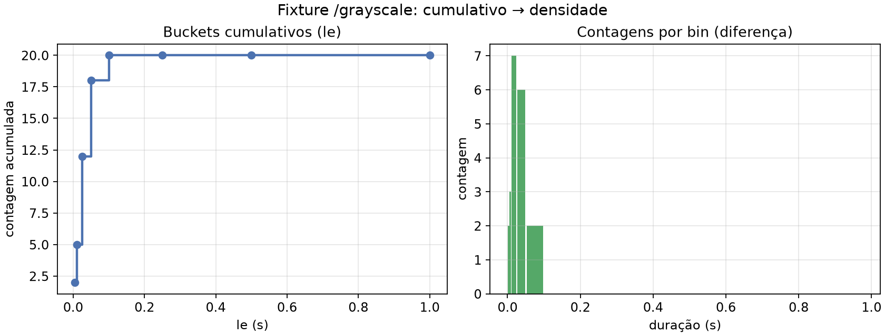

# Aula 010 — Prometheus e PromQL

Uma API pode responder HTTP 200 enquanto a latência sobe. Para investigar,
é preciso ler **o que `/metrics` expõe**, como o Prometheus **coleta** isso e
como o **PromQL** transforma as séries.

Se ainda não concluiu o [tutorial de instalação e coleta](../docs/prometheus.md),
faça-o antes de continuar. Esta aula **não** usa Streamlit: o trabalho é no
texto de `/metrics` e na interface do Prometheus (Table / Graph). O painel
visual (histograma/CDF) fica na
[aula 015](../015_prometheus_histcdf_streamlit/README.md).

Portas do curso: [`docs/ports.md`](../docs/ports.md) (BentoML **3000**,
Prometheus **9090**, Grafana **4000**). Demo opcional desta pasta: **8010** /
**9100**.

## Objetivos

Pratique até conseguir:

- reconhecer no `/metrics` contadores, gauges, histogramas e labels;
- confirmar o scrape (`up`, página `/targets`);
- selecionar séries e calcular `rate` / `increase` na UI;
- reconstruir à mão uma CDF e um p95 a partir de buckets;
- escrever `histogram_quantile` e ler uma regra de alerta no Prometheus.

## 1. Olhe o formato de `/metrics`

Com o BentoML no ar (`just serve` na raiz):

~~~bash
curl -s http://127.0.0.1:3000/metrics | head -n 80
~~~

Observe linhas `# HELP`, `# TYPE` e amostras com labels entre chaves. Nos
histogramas de duração, o label `le` (*less than or equal*) é o limite
superior cumulativo do bucket.

| Métrica típica | Tipo |
| :--- | :--- |
| `bentoml_service_request_total` | contador |
| `up` | gauge (produzido pelo Prometheus na coleta) |
| `bentoml_service_request_duration_seconds_bucket` | contadores por `le` |
| `…_count` / `…_sum` | observações e soma das durações |

Gere algumas chamadas (como no [tutorial](../docs/prometheus.md)) e volte a
inspecionar `/metrics`: os contadores só fazem sentido **depois** de tráfego.

## 2. Confirme a coleta

Prometheus canônico: <http://127.0.0.1:9090/targets> — o job
`bentoml-imagens` deve estar `UP`.

~~~promql
up{job="bentoml-imagens"}
~~~

Na visualização **Table**, o valor `1` indica scrape bem-sucedido. Isso não
mede qualidade do modelo; só acessibilidade do endpoint de métricas.

## 3. Labels e seletores

~~~promql
bentoml_service_request_total{job="bentoml-imagens"}
~~~

~~~promql
bentoml_service_request_total{
  job="bentoml-imagens",
  endpoint="/inference-grayscale"
}
~~~

`=` exige igualdade; `=~` usa expressão regular no valor inteiro do label.
Consulte a
[referência de seletores](https://prometheus.io/docs/prometheus/latest/querying/basics/#time-series-selectors).

## 4. Da contagem à taxa

Contador de 100 → 160 em 60 s (sem reinício):

~~~text
requisições novas = 60
taxa média = 1 requisição/s
~~~

~~~promql
sum by (endpoint) (
  rate(bentoml_service_request_total{
    job="bentoml-imagens",
    endpoint=~"/inference-(blur|grayscale|resize)"
  }[1m])
)
~~~

Use **Graph**. Troque `[1m]` por `[5m]` e compare no mesmo período: a janela
longa mistura mais passado.

## 5. Buckets, CDF e p95 (no papel)

A fixture [`fixtures/duration_histogram.json`](fixtures/duration_histogram.json)
traz 20 observações de `/inference-grayscale`. Contagens cumulativas e CDF:

| Limite `le` (s) | Cumulativo | Faixa | CDF |
| --- | ---: | ---: | ---: |
| 0,005 | 2 | 2 | 0,10 |
| 0,010 | 5 | 3 | 0,25 |
| 0,025 | 12 | 7 | 0,60 |
| 0,050 | 18 | 6 | 0,90 |
| 0,100 | 20 | 2 | 1,00 |

Rank do p95: `0,95 × 20 = 19` → bucket `(0,05; 0,10]`:

~~~text
p95 ≈ 0,05 + (0,10 − 0,05) × 0,5 = 0,075 s = 75 ms
~~~

## 6. A mesma conta em PromQL

Na UI do Prometheus (serviço real `:9090` ou demo `:9100`):

~~~promql
histogram_quantile(
  0.95,
  sum by (le) (
    bentoml_service_request_duration_seconds_bucket{
      job="bentoml-imagens",
      endpoint="/inference-grayscale"
    }
  )
)
~~~

Janela recente (taxas dos buckets):

~~~promql
histogram_quantile(
  0.95,
  sum by (le, endpoint) (
    rate(bentoml_service_request_duration_seconds_bucket{
      job="bentoml-imagens",
      endpoint=~"/inference-(blur|grayscale|resize)"
    }[1m])
  )
)
~~~

## 7. Demo sintética (opcional)

Para séries com fases estável → lenta → recuperação, sem depender da
velocidade da sua máquina:

~~~bash
cd 010_prometheus_promql
just sync
just demo-exporter    # :8010/metrics
just demo-prometheus  # UI :9100
~~~

Passo a passo: [SAMPLE_DATA.md](SAMPLE_DATA.md).

## 8. Linha de base e alerta

Com as [regras do repositório](../monitoring/bentoml.rules.yml), consulte
`bentoml:http_request_duration_seconds:p95_1m` e
`ALERTS{alertname="BentoMLResponseTimeAnomaly"}` em `:9090` (ou `:9100` na
demo). Estados `pending` / `firing` são do Prometheus.

## 9. Exercício

Relato curto (até uma página), **sem** painel Streamlit:

1. Fonte (real `:9090` ou demo `:9100`), endpoint, janela.
2. Trecho relevante de `/metrics` ou resultado Table de um seletor.
3. Uma expressão `rate` e uma `histogram_quantile`, com unidade.
4. p95 da fixture calculado à mão (0,075 s) **ou** p99 (`≈ 0,095 s`).
5. Uma limitação (poucas observações, reinício de contador, janela curta).

## 10. Materiais

| Arquivo | Papel |
| :--- | :--- |
| [`fixtures/duration_histogram.json`](fixtures/duration_histogram.json) | Conta manual de CDF/p95 |
| [`SAMPLE_DATA.md`](SAMPLE_DATA.md) | Demo 8010 / 9100 |
| [`prom_hist.py`](prom_hist.py) | Cálculo de CDF/quantil em Python (CLI/testes) |
| [`prom_client.py`](prom_client.py) | Leitura da fixture / HTTP Prometheus |

~~~bash
just test
~~~

**Anterior:** ponte OCI —
[aula 009](../009_bentoml_oci_runtime/README.md).

**Seguinte (opcional):** painel Streamlit histograma/CDF —
[aula 015](../015_prometheus_histcdf_streamlit/README.md); quem já domina
buckets pode ir à [aula 016](../016_grafana_dashboards/README.md).

## Glossário

| Termo | Significado nesta aula |
| :--- | :--- |
| **Scrape** | Coleta periódica do Prometheus em `/metrics` |
| **Série** | Amostras no tempo, distinguidas por labels |
| **`le`** | Limite superior cumulativo do bucket |
| **Quantil (p95)** | Valor sob o qual está a fração *q* (estimado) |

## Referências

- [Seletores PromQL](https://prometheus.io/docs/prometheus/latest/querying/basics/)
- [Funções PromQL](https://prometheus.io/docs/prometheus/latest/querying/functions/)
- [Histogramas e quantis](https://prometheus.io/docs/practices/histograms/)
- [Tutorial Prometheus deste repo](../docs/prometheus.md)
