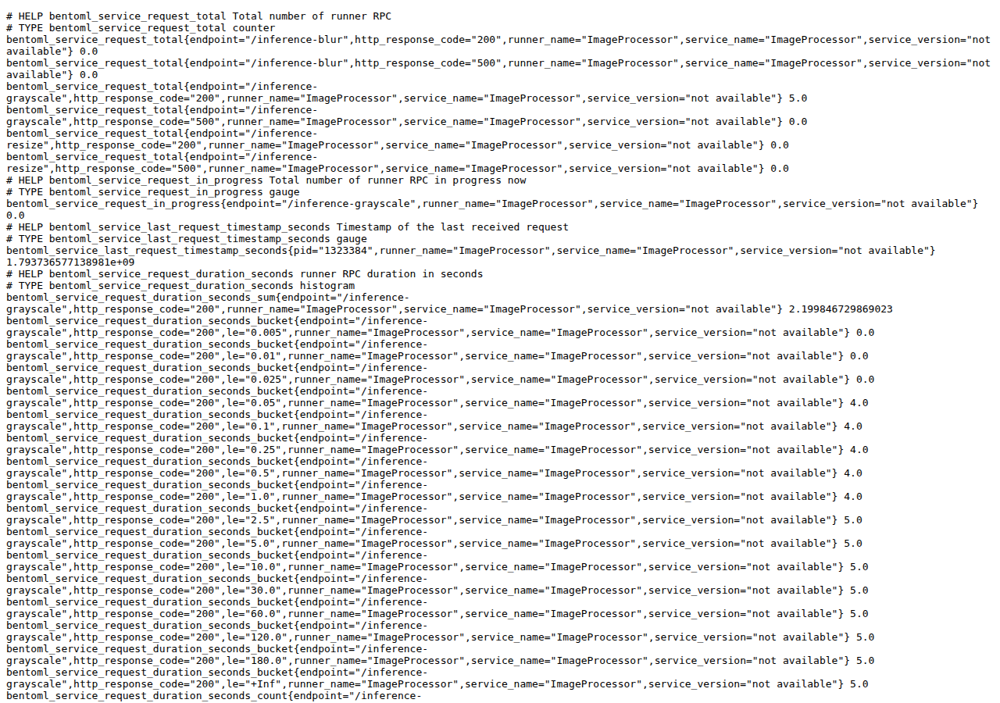

# Aula 010 — Prometheus e PromQL

Uma API pode responder HTTP 200 enquanto a latência sobe. O cliente recebe a
imagem convertida; o status parece saudável; o painel de “sucesso” permanece
verde. Ainda assim, a fila interna cresce, o tempo por requisição deixa de
caber no orçamento do produto e o usuário percebe atraso sem jamais ver um
código de erro. Para investigar esse cenário, é preciso ler **o que `/metrics`
expõe**, como o Prometheus **coleta** isso e como o **PromQL** transforma as
séries em taxas, quantis e sinais de alerta.

O texto de `/metrics` é a fonte canônica do que o serviço declara sobre si
mesmo. Cada linha tipada (contador, gauge, histograma) vira, após o scrape,
uma série temporal endereçável por nome e labels. Sem compreender esse
contrato, a consulta na UI do Prometheus permanece um exercício de tentativa
e erro. Com o contrato claro, a mesma linha de PromQL passa a ser
reproduzível, auditável e utilizável em regras de gravação e de alerta.

Se ainda não concluiu o [tutorial de instalação e coleta](../docs/prometheus.md),
faça-o antes de continuar. Ali estão a instalação do binário, a validação com
`promtool`, a subida do BentoML e a primeira confirmação de `up`. Esta aula
parte desse chão e aprofunda a leitura do formato, a seleção por labels, o
cálculo de `rate`, a reconstrução manual de CDF e p95 a partir de buckets, a
expressão `histogram_quantile` e a interpretação de regras de linha de base.

**Conceito desta aula:** ler o contrato de `/metrics`, confirmar o scrape e
usar PromQL (taxa, buckets, `histogram_quantile`, linha de base) na UI do
Prometheus.

Este documento espera os seguintes processos no host (mapa completo em
[`docs/ports.md`](../docs/ports.md)):

| Papel | Onde escuta | URL típica |
| :--- | ---: | :--- |
| **BentoML** (serviço real do curso) | **3000** | <http://127.0.0.1:3000/metrics> |
| **Prometheus** (scrape + UI do curso) | **9090** | <http://127.0.0.1:9090> |

Se o serviço real ou o Prometheus do curso não estiverem no ar, use a **demo
local** desta pasta: um gerador de métricas em **8010** e um Prometheus só
dessa demo em **9100**. Os valores inventados passam por três fases (tráfego
normal, depois lento, depois de volta ao normal) para você treinar as mesmas
consultas. Passo a passo: [SAMPLE_DATA.md](SAMPLE_DATA.md). A demo **não**
substitui BentoML@3000 nem Prometheus@9090 quando o ambiente canónico estiver
disponível.

| Papel (demo) | Onde escuta | URL típica |
| :--- | ---: | :--- |
| Exporter sintético (`just demo-exporter`) | **8010** | <http://127.0.0.1:8010/metrics> |
| Prometheus da demo (`just demo-prometheus`) | **9100** | <http://127.0.0.1:9100> |

Os endpoints de inferência de imagem deste repositório servem de fio
condutor nas seções seguintes.

## Objetivos

- reconhecer no `/metrics` contadores, gauges, histogramas e labels, e
  explicar o papel de `# HELP` e `# TYPE`;
- confirmar o scrape (`up`, página `/targets`) e distinguir a instância da
  aula de outro Prometheus que eventualmente ocupe a porta **9090**;
- selecionar séries e calcular `rate` / `increase` na UI, justificando a
  escolha da janela (`[1m]`, `[5m]`);
- reconstruir à mão uma CDF e um p95 a partir de buckets cumulativos, com
  interpolação linear no intervalo que contém o rank;
- escrever `histogram_quantile` (instantâneo e com `rate` dos buckets) e ler
  uma regra de alerta no Prometheus, incluindo estados `pending` e `firing`;
- articular por que uma linha de base de três desvios-padrão sobre janela
  curta é frágil no início da operação e sob tráfego sazonal ou multimodal.

## 1. Olhe o formato de `/metrics`

Com o BentoML no ar (`just serve` na raiz), abra no navegador
<http://127.0.0.1:3000/metrics> ou salve o texto:

~~~bash
curl -sS http://127.0.0.1:3000/metrics -o /tmp/metrics.txt
head -n 80 /tmp/metrics.txt
~~~

Abaixo, uma captura **real** do `ImageProcessor` deste repositório (depois de
algumas chamadas a `/inference-grayscale`): o navegador mostra o mesmo corpo
que o `curl` grava.

O texto completo dessa captura está em
[`fixtures/metrics_bentoml_sample.txt`](fixtures/metrics_bentoml_sample.txt)
(mesmo conteúdo da figura). Use-o offline se o serviço ainda não estiver no ar;
quando puder, repita o `curl` na porta **3000** e compare. Diferenças de
valores absolutos são esperadas (mais tráfego, reinícios); o que deve
permanecer estável é a **forma**: nomes, tipos e labels principais.

### 1.1 O que o cliente HTTP realmente recebe

O endpoint responde com `Content-Type` tipicamente
`text/plain; version=0.0.4` (ou variante compatível com a exposição Prometheus
em texto). O corpo é uma sequência de linhas UTF-8. Linhas em branco separam
grupos lógicos; linhas que começam com `#` são comentários estruturados
(`HELP`, `TYPE`) ou comentários livres. Linhas sem `#` são **amostras**: nome
da métrica, labels opcionais entre chaves, valor numérico e, em alguns
exporters, um timestamp Unix em milissegundos.

Exemplo esquemático (não precisa coincidir com a captura):

~~~text
# HELP bentoml_service_request_total Total number of runner RPC
# TYPE bentoml_service_request_total counter
bentoml_service_request_total{endpoint="/inference-grayscale",http_response_code="200",...} 5.0
~~~

Três papéis distintos:

| Elemento | Função |
| :--- | :--- |
| `# HELP nome …` | Descrição humana da métrica `nome` |
| `# TYPE nome tipo` | Declara `counter`, `gauge`, `histogram`, `summary` ou `untyped` |
| `nome{labels} valor` | Amostra observável no instante do GET |

O Prometheus, ao fazer scrape, interpreta esse texto e grava o valor com o
timestamp da coleta (salvo quando a linha traz timestamp próprio). O serviço
não “empurra” métricas: o coletor **puxa**. Se o processo estiver parado ou a
rota `/metrics` falhar, a série `up` cai para `0` e as demais séries daquele
target deixam de receber amostras novas.

### 1.2 Contadores, gauges e o contrato de monotonia

Um **contador** representa uma quantidade acumulada que, em operação normal,
só cresce (ou permanece constante). Exemplos: total de requisições, total de
bytes enviados, total de erros. Quando o processo reinicia, o contador volta
a um valor baixo (em geral zero). O PromQL oferece `rate`, `increase` e
`resets` precisamente porque o valor absoluto isolado não conta a história:
importa a **derivada** ao longo do tempo, corrigida para reinícios.

Um **gauge** representa um nível que sobe e desce: requisições em andamento,
temperatura, uso de memória, último timestamp de evento. Não se aplica `rate`
da mesma forma que a um contador; faz-se sentido falar em valor atual,
média temporal (`avg_over_time`) ou variação (`delta`) conforme o caso.

No exemplo da captura, `bentoml_service_request_total` para
`/inference-grayscale` com código 200 vale **5**. Isso significa “cinco
requisições bem-sucedidas contadas desde o início do processo (ou desde o
último reset da série)”, não “cinco requisições por segundo”. A taxa só
aparece depois de duas ou mais coletas espaçadas no tempo.

`bentoml_service_request_in_progress` é gauge: zero na captura indica que,
naquele instante, nenhuma RPC daquele endpoint estava em voo. Um gauge
travado em valor alto por minutos sugere saturação ou travamento; um pico
curto pode ser apenas concorrência legítima.

### 1.3 Histogramas: sum, count e buckets com `le`

O tipo `histogram` no formato de exposição não é uma única série. O
instrumentador emite:

- `nome_bucket{le="…"}` — contadores cumulativos por limite superior;
- `nome_sum` — soma das observações (durações, tamanhos, …);
- `nome_count` — número de observações (equivalente, em geral, ao bucket
  `le="+Inf"`).

O label `le` (*less than or equal*) é o limite superior cumulativo do bucket.
Na captura real, `…_duration_seconds_bucket` usa `le` de `0.005` até `+Inf`.
Uma observação de 0,04 s incrementa todos os buckets cujo `le` é ≥ 0,04 s.
Por isso a sequência de valores ao longo de `le` crescente é **não
decrescente**. Se você encontrar um `le` maior com contagem menor que um `le`
menor (mesmo conjunto de labels restantes), há inconsistência de exposição ou
de agregação.

Nos histogramas de duração, o label `le` (*less than or equal*) é o limite
superior cumulativo do bucket. No exemplo, `bentoml_service_request_total`
para `/inference-grayscale` com código 200 vale **5**; os buckets
`…_duration_seconds_bucket` usam `le` de `0.005` até `+Inf`.

| Métrica típica | Tipo |
| :--- | :--- |
| `bentoml_service_request_total` | contador |
| `bentoml_service_request_in_progress` | gauge |
| `bentoml_service_request_duration_seconds_bucket` | contadores por `le` |
| `…_count` / `…_sum` | observações e soma das durações |
| `up` | gauge (produzido pelo Prometheus na coleta, não por este `/metrics`) |

Gere algumas chamadas (como no [tutorial](../docs/prometheus.md)) e volte a
inspecionar `/metrics`: os contadores só fazem sentido **depois** de tráfego.
Com zero requisições, muitos buckets permanecem em zero e qualquer quantil
derivado será `NaN` ou indefinido — o que não é “latência zero”, e sim
“ausência de evidência”.

### 1.4 Leitura guiada da fixture de captura

Abra [`fixtures/metrics_bentoml_sample.txt`](fixtures/metrics_bentoml_sample.txt)
e localize, nesta ordem:

1. O bloco `# TYPE bentoml_service_request_total counter` e a linha com
   `endpoint="/inference-grayscale"` e `http_response_code="200"`.
2. O gauge `bentoml_service_request_in_progress` para o mesmo endpoint.
3. O histograma: `_sum`, depois a sequência de `_bucket` ordenada mentalmente
   por `le`, e por fim `_count`.

Na captura de exemplo, quatro das cinco observações caem no bucket `le="0.05"`
(já acumuladas também em todos os `le` maiores), e a quinta só aparece de
forma plena a partir de `le="2.5"`. Isso já antecipa uma cauda: a média
(`sum/count`) pode ser puxada por um outlier, enquanto o p50 permaneceria em
outra região da distribuição. Voltaremos a esse contraste na seção do p95.

### 1.5 O que `/metrics` não é

`/metrics` não é um log de auditoria, não guarda o corpo das imagens, não
substitui tracing distribuído e não prova corretude do modelo. Ele resume
custos operacionais observáveis (volume, concorrência, duração). Qualidade
semântica da predição (acerto, vieses, regressão de acurácia) exige outros
instrumentos. Manter essa fronteira evita alertas que misturam “o serviço
ficou lento” com “o modelo errou a classe”.

## 2. Confirme a coleta

O BentoML **não** inicia sozinho: na raiz do repo, `just serve` (porta
**3000**). O Prometheus da aula sobe com
`monitoring/prometheus.yml` (job único `bentoml-imagens` → `127.0.0.1:3000`);
veja o [tutorial](../docs/prometheus.md).

Abra <http://127.0.0.1:9090/targets> **só se** for essa instância. O job
`bentoml-imagens` deve estar `UP`. Se a página mostrar muitos targets
(cadvisor, flower, backends de outros projetos…) e **não** listar
`bentoml-imagens`, a porta 9090 pertence a **outro** Prometheus — não ao da
aula. Suba o da aula com o `prometheus.yml` deste repo (outra porta, se
preciso) ou use a demo em **9100** (`just demo-prometheus` nesta pasta).

~~~promql
up{job="bentoml-imagens"}
~~~

Na visualização **Table**, o valor `1` indica scrape bem-sucedido. Isso não
mede qualidade do modelo; só acessibilidade do endpoint de métricas.

### 2.1 O caminho completo de uma amostra

1. O processo BentoML mantém contadores em memória e os serializa quando
   alguém faz `GET /metrics`.
2. O Prometheus, no intervalo configurado (neste curso, tipicamente 5 s),
   conecta-se ao target `127.0.0.1:3000`, lê o corpo e interpreta as linhas.
3. Cada combinação (nome + labels + labels extras do job/instance) torna-se
   uma série; o valor lido vira um ponto `(timestamp, value)` no TSDB local.
4. Consultas PromQL leem esse TSDB — nunca o `/metrics` “ao vivo”, salvo
   quando você mesmo abre o navegador na porta **3000**.

Consequência prática: se você gera tráfego agora e consulta `rate(...[1m])`
imediatamente, a janela ainda pode conter poucos pontos. Espere pelo menos
duas coletas bem-sucedidas; para uma janela de um minuto cheia, espere cerca
de um minuto de operação estável após o início do tráfego.

### 2.2 Página `/targets` e estados comuns

Na UI, cada target exibe o último scrape, a duração e o erro, se houver.
Estados típicos:

| Observação em `/targets` | Interpretação usual |
| :--- | :--- |
| `UP`, último scrape recente | Coleta ok; `up` deve ser 1 |
| `DOWN`, connection refused | Processo na porta 3000 ausente ou porta errada |
| `DOWN`, context deadline exceeded | Serviço lento demais para responder a tempo |
| `DOWN`, HTTP 404/5xx em `/metrics` | Rota ausente ou falha interna na exposição |
| Target ausente da lista | Você não está no Prometheus configurado com este job |

Valide a configuração antes de depurar “métricas vazias”:

~~~bash
promtool check config monitoring/prometheus.yml
promtool check rules monitoring/bentoml.rules.yml
~~~

Os dois comandos devem terminar com sucesso. Um YAML inválido impede o
servidor de aplicar o job; um target errado produz `DOWN` mesmo com BentoML
saudável na porta correta.

### 2.3 `up` versus saúde da aplicação

`up == 1` significa: o Prometheus conseguiu completar um scrape HTTP do
endpoint de métricas conforme a configuração. Não implica:

- ausência de erros 500 nas rotas de inferência;
- latência dentro do orçamento;
- modelo carregado corretamente;
- disco ou GPU em condições adequadas.

Use `up` como pré-condição (“há dados?”). Use contadores de erro, gauges de
fila e quantis de duração para a pergunta seguinte (“os dados são aceitáveis?”).

### 2.4 Confirmação pela API HTTP do Prometheus

Além da UI, a API de consulta imediata permite automação e cópia para o
relato:

~~~bash
curl --get --silent --show-error --fail \
  --data-urlencode 'query=up{job="bentoml-imagens"}' \
  http://127.0.0.1:9090/api/v1/query
~~~

Espere `"status":"success"` e um resultado com valor `"1"`. Na demo
sintética, troque a porta para **9100** e acrescente o label
`source="synthetic"` conforme [SAMPLE_DATA.md](SAMPLE_DATA.md).

## 3. Labels e seletores

Toda série no Prometheus é identificada pelo nome da métrica e pelo conjunto
de labels. Dois pontos com o mesmo nome e labels distintos são séries
distintas. Agregar sem `sum by (...)` (ou equivalente) mistura dimensões que
talvez você quisesse preservar — por exemplo, fundir códigos HTTP 200 e 500
pode esconder uma taxa de erro crescente sob um volume total estável.

~~~promql
bentoml_service_request_total{job="bentoml-imagens"}
~~~

Essa consulta retorna todas as séries do contador cujo label `job` (anexado
na configuração de scrape) vale `bentoml-imagens`. Ainda assim podem existir
várias linhas: um endpoint por série, um código HTTP por série, etc.

~~~promql
bentoml_service_request_total{
  job="bentoml-imagens",
  endpoint="/inference-grayscale"
}
~~~

Aqui o filtro exige igualdade exata no valor do label `endpoint`. `=` exige
igualdade; `=~` usa expressão regular no valor inteiro do label; `!=` e
`!~` negam. Consulte a
[referência de seletores](https://prometheus.io/docs/prometheus/latest/querying/basics/#time-series-selectors).

### 3.1 Labels do instrumentador e labels do scrape

Há duas origens comuns de labels:

| Origem | Exemplos neste curso | Quem define |
| :--- | :--- | :--- |
| Instrumentação do serviço | `endpoint`, `http_response_code`, `runner_name` | Código / framework (BentoML) |
| Configuração do Prometheus | `job`, `instance`, e labels extras em `static_configs` | `prometheus.yml` / demo |

Na demo sintética, `source="synthetic"` distingue as séries do gerador das
séries do serviço real, mesmo quando o `job` se chama `bentoml-imagens` nos
dois casos. Sem esse cuidado, um único Prometheus que raspasse ambos
misturaria mundos incompatíveis na mesma agregação.

### 3.2 Cardinalidade: o inimigo silencioso

Cada combinação única de labels cria uma série. Labels de alta cardinalidade
(user id, request id, caminho completo com parâmetros únicos) explodem a
memória e o custo de consulta. Nos exemplos desta aula, `endpoint` tem
cardinalidade baixa e controlada. Não acrescente labels “por precaução”;
acrescente quando a pergunta operacional exigir aquela dimensão.

Exemplo de seletor com expressão regular alinhada aos três endpoints de
inferência do curso:

~~~promql
bentoml_service_request_total{
  job="bentoml-imagens",
  endpoint=~"/inference-(blur|grayscale|resize)"
}
~~~

A âncora implícita do match é sobre o valor completo do label: a expressão
deve cobrir o string inteiro, não um “contém” solto sem âncoras adequadas.
Teste na Table e confira quantas séries voltam antes de embrulhar a expressão
em `rate` ou `histogram_quantile`.

### 3.3 Instant vector versus range vector

Um seletor sem `[janela]` produz um **vetor instantâneo**: o valor mais
recente de cada série no instante de avaliação. Um seletor com `[1m]` produz
um **vetor de intervalo**: a sequência de amostras na janela, entrada típica
de funções como `rate`, `increase`, `avg_over_time`.

Confundir os dois gera erros de tipo na UI. `rate(metric)` sem intervalo é
inválido; `rate(metric[1m])` é a forma canônica para contadores.

## 4. Da contagem à taxa

Contador de 100 → 160 em 60 s (sem reinício):

~~~text
requisições novas = 60
taxa média = 1 requisição/s
~~~

Essa aritmética de caderno é exatamente a intuição de `rate`: estimar
incrementos por segundo ao longo de uma janela, lidando com o fato de que as
amostras do TSDB não caem em instantes perfeitos e de que reinícios zerariam
a conta ingênua `último − primeiro`.

~~~promql
sum by (endpoint) (
  rate(bentoml_service_request_total{
    job="bentoml-imagens",
    endpoint=~"/inference-(blur|grayscale|resize)"
  }[1m])
)
~~~

Use **Graph**. Troque `[1m]` por `[5m]` e compare no mesmo período: a janela
longa mistura mais passado. Uma rajada de dez segundos dilui-se em cinco
minutos; uma tendência lenta fica mais estável. Não existe janela
universalmente “certa”: a escolha é um compromisso entre responsividade e
suavização.

### 4.1 `rate` e `increase`

| Função | Unidade típica do resultado | Uso |
| :--- | :--- | :--- |
| `rate(x[w])` | por segundo (para contadores de eventos) | Throughput, entrada de `histogram_quantile` sobre buckets |
| `increase(x[w])` | eventos na janela `w` (aproximado) | “Quantas requisições na última hora?” |

`increase` é, em essência, coerente com `rate * duração_da_janela`, com
nuances de extrapolação nas bordas. Para alertas de “erros por minuto”,
muitos times preferem `sum(rate(...[5m])) * 60` de forma explícita, para
deixar a unidade visível na expressão.

### 4.2 Exemplo numérico passo a passo

Suponha amostras de um contador (mesmo conjunto de labels), scrape a cada 15 s:

| Tempo (s) | Valor do contador |
| ---: | ---: |
| 0 | 100 |
| 15 | 115 |
| 30 | 130 |
| 45 | 160 |
| 60 | 160 |

Na janela `[0, 60]`, o incremento bruto é 60. A taxa média é 1 evento/s.
Entre 45 s e 60 s o contador ficou plano: a taxa local é zero. Uma janela
`[15s]` avaliada perto de t=60 enxergaria sobretudo a platô; uma janela
`[1m]` ainda “lembra” a subida anterior. Esse efeito de memória é o que você
observa ao alternar `[1m]` e `[5m]` no Graph.

### 4.3 Reinício do processo

Se em t=30 o valor cai de 130 para 2 (reinício) e sobe a 20 em t=60, a conta
ingênua `20 − 100` seria negativa e absurda. `rate`/`increase` tratam o
reinício como descontinuidade e somam apenas os trechos monótonos. Ainda
assim, janelas que cobrem o instante do restart podem mostrar artefatos
breves; por isso alertas sensíveis costumam exigir `for:` (duração mínima do
predicado verdadeiro) antes de disparar notificação.

### 4.4 Agregação e preservação de labels

`sum by (endpoint) (rate(...))` calcula a taxa por série e depois soma as
séries que compartilham o mesmo `endpoint` (por exemplo, códigos HTTP
diferentes). `sum without (http_response_code) (rate(...))` é a formulação
dual: remove uma dimensão e agrega o restante.

Ordem importa pedagogicamente: agregue **depois** de `rate` sobre contadores
quando cada série é um contador independente. Agregar contadores antes de
`rate` pode produzir monotonia quebrada artificialmente se as séries não
estiverem alinhadas. A prática recomendada na documentação de histogramas e
contadores do Prometheus segue `rate` (ou `increase`) por série, depois
`sum`/`sum by`.

### 4.5 O que olhar no Graph

Configure o intervalo de tempo da UI para cobrir o experimento (por exemplo,
últimos 15 minutos). Verifique:

- se a unidade vertical faz sentido (req/s, não contagem absoluta);
- se há buracos (scrapes falhos → `up` também sofrerá);
- se a mudança de janela `[1m]`→`[5m]` suaviza picos como esperado.

Na demo sintética (seção 7), as taxas nominais rondam 20, 10 e 5 req/s por
endpoint; a soma aproxima 35 req/s. Desvios pequenos vêm do alinhamento do
relógio e das bordas da janela — não trate a terceira casa decimal como
verdade física.

## 5. Buckets, CDF e p95 (no papel)

Antes do PromQL, a conta manual fixa o significado dos símbolos. A fixture
[`fixtures/duration_histogram.json`](fixtures/duration_histogram.json)
traz 20 observações de `/inference-grayscale`. Contagens cumulativas e CDF:

| Limite `le` (s) | Cumulativo | Faixa | CDF |
| --- | ---: | ---: | ---: |
| 0,005 | 2 | 2 | 0,10 |
| 0,010 | 5 | 3 | 0,25 |
| 0,025 | 12 | 7 | 0,60 |
| 0,050 | 18 | 6 | 0,90 |
| 0,100 | 20 | 2 | 1,00 |

Leitura da tabela:

- **Cumulativo** em `le = L` = número de observações com duração ≤ L.
- **Faixa** = diferença entre cumulativos consecutivos = observações no
  intervalo semiaberto (L_anterior, L].
- **CDF** = cumulativo / N, com N = 20 (= cumulativo em `+Inf` / último
  finito que já saturáveis).

Rank do p95: `0,95 × 20 = 19` → bucket `(0,05; 0,10]`:

~~~text
p95 ≈ 0,05 + (0,10 − 0,05) × 0,5 = 0,075 s = 75 ms
~~~

### 5.1 Definição de p95

O **percentil 95** (p95) de uma distribuição de durações é o menor valor *t*
tal que pelo menos 95 % das observações são ≤ *t*. Em termos de função de
distribuição acumulada F, busca-se t com F(t) ≥ 0,95 (com convenções de
desempate e de interpolação quando F só é conhecida em pontos). Em serviços
online, o p95 responde à pergunta: “desprezando a cauda extrema de 5 %, qual
latência ainda cobre a experiência da vasta maioria das requisições?”

Aplicações típicas:

| Contexto | Por que o p95 aparece |
| :--- | :--- |
| Orçamento de latência de API | SLOs costumam fixar “p95 < X ms” em vez de só a média |
| Capacidade e filas | A média esconde saturação; o p95 sobe cedo quando a fila cresce |
| Comparação de versões | Um deploy que mantém a média mas estica o p95 piora a cauda |
| Alertas de degradação | Cruzar um limiar de p95 por alguns minutos precede incidentes visíveis |
| Dimensionamento de timeout | Timeout no p99 pode ser folgado; no p50, agressivo demais |

O p95 **não** é “95 % da média”, nem “média das 95 % melhores amostras” em
sentido ingênuo, nem o máximo. Também não coincide automaticamente com a
média mais dois desvios-padrão: essa equivalência só vale sob hipóteses
fortes (normalidade), raramente verdadeiras para latências (assimétricas,
com cauda pesada).

### 5.2 Por que não bastar a média

Na captura real de `/metrics`, `sum ≈ 2,20` s e `count = 5`, logo a média é
cerca de 0,44 s. Quatro observações cabem em ≤ 0,05 s; uma observação longa
puxa a média. O p50 estaria na região das quatro rápidas; o p95/p99
aproximar-se-ia da cauda. Decidir só pela média classificaria o serviço como
“lento no conjunto”, quando o padrão operacional é “geralmente rápido, com
outlier”. O histograma preserva essa forma; a média sozinha a destrói.

### 5.3 Interpolação linear no bucket do quantil

Com buckets, não conhecemos cada observação individual — só quantas caíram
em cada faixa. Para estimar o quantil q:

1. Calcule o rank alvo R = q × N (aqui 0,95 × 20 = 19).
2. Encontre o menor cumulativo C_hi ≥ R; seja C_lo o cumulativo do limite
   inferior da faixa; L_lo e L_hi os limites em segundos.
3. Dentro da faixa, a fração percorrida é (R − C_lo) / (C_hi − C_lo).
4. Interpole: t ≈ L_lo + (L_hi − L_lo) × fração.

No exemplo: C_lo = 18 em 0,05 s; C_hi = 20 em 0,10 s; R = 19; fração = 0,5;
t ≈ 0,075 s. A mesma lógica, com q = 0,99, dá R = 19,8 e

~~~text
p99 ≈ 0,05 + (0,10 − 0,05) × (19,8 − 18) / (20 − 18)
    = 0,05 + 0,05 × 0,9
    = 0,095 s = 95 ms
~~~

Esses são os números de referência do exercício (0,075 s e ≈ 0,095 s).

### 5.4 Segundo exemplo numérico (N = 10, distribuição diferente)

Considere cumulativos fictícios para treinar a mão:

| `le` (s) | Cumulativo | CDF |
| ---: | ---: | ---: |
| 0,010 | 1 | 0,10 |
| 0,020 | 4 | 0,40 |
| 0,040 | 7 | 0,70 |
| 0,080 | 9 | 0,90 |
| 0,160 | 10 | 1,00 |

Para o p95: R = 9,5. O cumulativo 9 ocorre em 0,080; o 10 em 0,160. Fração =
(9,5 − 9) / (10 − 9) = 0,5. Logo p95 ≈ 0,080 + 0,080 × 0,5 = 0,120 s.

Para o p50: R = 5. Cai na faixa (0,020; 0,040] (cumulativos 4 → 7). Fração =
(5 − 4) / (7 − 4) = 1/3. p50 ≈ 0,020 + 0,020 × 1/3 ≈ 0,0267 s.

Observe que p95 / p50 ≈ 4,5 neste exemplo artificial: a cauda é longa em
relação ao centro. Em produção, razões p95/p50 elevadas merecem investigação
(locks, cold start, GC, imagens grandes, dependências externas).

### 5.5 CDF como curva e como tabela

A CDF empírica sobe de 0 a 1. Em forma de tabela (acima), cada `le` finito é
um ponto conhecido. Em forma de curva (figura desta seção), o eixo horizontal
é a duração e o vertical a fração acumulada. O p95 é a abscissa onde a curva
atinge 0,95 — ou a interpolação entre os dois `le` vizinhos quando só há
degraus.

A densidade por faixa (coluna “Faixa”) não é uma PDF paramétrica; é um
histograma de diferenças. A figura
[`illustrations/02_cumulative_to_density.png`](illustrations/02_cumulative_to_density.png)
liga visualmente cumulativo → diferença. A figura
[`illustrations/03_python_vs_promql_quantile.png`](illustrations/03_python_vs_promql_quantile.png)
situa o quantil sobre histograma e CDF, alinhando a intuição do cálculo em
Python ([`prom_hist.py`](prom_hist.py)) ao que o PromQL fará na seção
seguinte.

### 5.6 Limitações do papel que o PromQL herda

- Poucas observações (N = 20) tornam o p95 um estimador ruidoso: uma única
  amostra muda o rank.
- Buckets largos na cauda (por exemplo, saltar de 0,1 s para 1 s) deixam a
  interpolação linear grosseira.
- Misturar endpoints ou códigos HTTP antes de montar a CDF produz um quantil
  de uma mistura, não do endpoint que você achava estar medindo.
- Contagens acumuladas desde o boot incluem passado irrelevante para “agora”;
  por isso a prática operacional usa `rate` dos buckets (seção 6).

## 6. A mesma conta em PromQL

Na UI do Prometheus (serviço real `:9090` ou demo `:9100`):

~~~promql
histogram_quantile(
  0.95,
  sum by (le) (
    bentoml_service_request_duration_seconds_bucket{
      job="bentoml-imagens",
      endpoint="/inference-grayscale"
    }
  )
)
~~~

Essa forma usa os **valores absolutos atuais** dos contadores de bucket. Ela
aproxima o quantil da distribuição acumulada desde o início do processo (ou
desde o último reset), não necessariamente da janela recente. Serve para
bater com a fixture estática e com a conta de papel quando as contagens são
exatamente as da tabela.

Janela recente (taxas dos buckets):

~~~promql
histogram_quantile(
  0.95,
  sum by (le, endpoint) (
    rate(bentoml_service_request_duration_seconds_bucket{
      job="bentoml-imagens",
      endpoint=~"/inference-(blur|grayscale|resize)"
    }[1m])
  )
)
~~~

Aqui cada bucket entra como taxa (incrementos/s). O `histogram_quantile`
trata essas taxas como “massa” relativa por `le` e interpola. O resultado
aproxima o p95 das observações **na janela**, o que é o que alertas e SLOs
costumam querer.

### 6.1 Anatomia da expressão

Leia de dentro para fora:

1. Seletor dos buckets com filtros de `job` e `endpoint`.
2. `rate(...[1m])` — transforma contadores cumulativos em taxas na janela.
3. `sum by (le, endpoint)` — agrega dimensões indesejadas (por exemplo,
   `http_response_code`), **preservando** `le` (obrigatório) e `endpoint`
   (se quiser um quantil por rota).
4. `histogram_quantile(0.95, …)` — interpola o quantil 0,95 sobre a família
   de séries indexadas por `le`.

Se omitir `le` no `sum by`, a função não consegue montar a CDF e o resultado
degrada. Se incluir labels espúrios de altíssima cardinalidade, o custo
explode e o gráfico fica ilegível.

### 6.2 Por que `sum by (le)` e não `avg`

Buckets são contadores (ou taxas de contadores). Somam-se contribuições de
séries paralelas (pods, códigos HTTP) para reconstruir a massa total por
limite. A média de cumulativos não redefine uma CDF válida. A regra prática:
agregue buckets com `sum`; calcule o quantil depois.

### 6.3 Comparação com a conta manual

Na fixture JSON, os valores já são cumulativos absolutos. A expressão
instantânea (sem `rate`) com `sum by (le)` sobre `/inference-grayscale` deve
aproximar 0,075 quando as contagens coincidem com a tabela da seção 5. A
figura `03_python_vs_promql_quantile` ilustra esse alinhamento. Desvios
aparecem se:

- o Prometheus ainda não raspou as mesmas contagens;
- há labels adicionais não agregados;
- você consultou outro `endpoint` ou misturou `source`.

### 6.4 p50, p95 e p99 na mesma família

Basta trocar o primeiro argumento:

~~~promql
histogram_quantile(0.50, sum by (le, endpoint) (rate(...[5m])))
histogram_quantile(0.95, sum by (le, endpoint) (rate(...[5m])))
histogram_quantile(0.99, sum by (le, endpoint) (rate(...[5m])))
~~~

Manter a mesma janela e os mesmos filtros torna a comparação justa. Um p99
que dispara enquanto o p95 permanece estável aponta problema concentrado na
cauda extrema (poucas requisições muito lentas).

### 6.5 `NaN`, buracos e ausência de dados

`histogram_quantile` devolve `NaN` quando não há massa suficiente, quando
faltam buckets, ou quando a agregação não deixa uma sequência utilizável de
`le`. Na UI, `NaN` não é zero. Antes de alertar sobre “latência infinita”,
confirme `up`, confirme tráfego (`rate` do `_count` ou do contador de
requisições) e confirme que o seletor retorna a família completa de buckets.

### 6.6 Caminho visual do scrape ao quantil

A ilustração
[`illustrations/01_scrape_to_buckets.png`](illustrations/01_scrape_to_buckets.png)
resume o fluxo: exposição em `/metrics` → scrape → séries `_bucket` →
agregação por `le` → quantil. Use-a como mapa mental ao montar a expressão
na UI: cada etapa corresponde a um pedaço do PromQL acima.

## 7. Demo sintética (opcional)

Para séries com fases estável → lenta → recuperação, sem depender da
velocidade da sua máquina:

~~~bash
cd 010_prometheus_promql
just sync
just demo-exporter    # :8010/metrics
just demo-prometheus  # UI :9100
~~~

Passo a passo: [SAMPLE_DATA.md](SAMPLE_DATA.md).

### 7.1 O que a demo isola

O gerador em **8010** produz contadores e histogramas com o mesmo vocabulário
de nomes usado no serviço real, porém com rótulo `source="synthetic"` e com
um relógio interno de fases. A taxa de requisições permanece constante; só a
duração muda na fase lenta (fator 10). Isso permite ver o p95 subir e descer
no Graph sem precisar saturar a CPU com imagens grandes.

O Prometheus em **9100** usa `prometheus-demo.yml`, diretório TSDB próprio e
as mesmas regras de `../monitoring/bentoml.rules.yml`. Assim você exercita
recording rules e alertas sem misturar o histórico do experimento com o
Prometheus canônico em **9090**.

### 7.2 Consultas mínimas na demo

~~~promql
up{job="bentoml-imagens", source="synthetic"}
~~~

~~~promql
sum by (endpoint) (
  rate(bentoml_service_request_total{
    job="bentoml-imagens", source="synthetic"
  }[1m])
)
~~~

~~~promql
histogram_quantile(
  0.95,
  sum by (le, endpoint) (
    rate(bentoml_service_request_duration_seconds_bucket{
      job="bentoml-imagens", source="synthetic"
    }[1m])
  )
)
~~~

Espere um ciclo completo (cerca de seis minutos) para ver as três fases. Na
transição, a janela de `rate` mistura amostras das duas fases: o p95 sobe e
desce de forma gradual, não como degrau perfeito. Isso é comportamento
esperado da média temporal na janela — o mesmo efeito que você verá em
incidentes reais quando a degradação começa no meio de uma janela de alerta.

### 7.3 Relação com o serviço real

| Aspecto | Real (`:3000` / `:9090`) | Demo (`:8010` / `:9100`) |
| :--- | :--- | :--- |
| Origem das durações | Inferência e I/O verdadeiros | Gerador determinístico por fase |
| Objetivo | Operar o stack do curso | Treinar PromQL e alertas com sinal limpo |
| Portas | Canônicas do curso | Auxiliares, documentadas em SAMPLE_DATA |
| Evidência de desempenho do modelo | Não (só custo HTTP) | Tampouco (dados sintéticos) |

## 8. Linha de base e alerta

Com as [regras do repositório](../monitoring/bentoml.rules.yml), consulte
`bentoml:http_request_duration_seconds:p95_1m` e
`ALERTS{alertname="BentoMLResponseTimeAnomaly"}` em `:9090` (ou `:9100` na
demo). Estados `pending` / `firing` são do Prometheus.

Esta seção desenvolve o aparato por trás dessas duas consultas: o que é uma
**recording rule**, como um alerta caminha de inativo a `pending` e a
`firing`, por que a regra de três desvios-padrão é didática porém frágil no
início da vida do serviço, e como sazonalidade e multimodalidade quebram a
hipótese implícita de “um único regime estacionário”.

### 8.1 Recording rules: materializar expressões caras

Uma recording rule avalia periodicamente uma expressão PromQL e grava o
resultado como uma nova série temporal. No arquivo do repositório:

~~~yaml
- record: bentoml:http_request_duration_seconds:p95_1m
  expr: |
    histogram_quantile(
      0.95,
      sum by (le, endpoint) (
        rate(bentoml_service_request_duration_seconds_bucket{
          endpoint=~"/(blur|grayscale|resize)"
        }[1m])
      )
    )
~~~

Motivos para materializar:

| Motivo | Detalhe |
| :--- | :--- |
| Custo | `histogram_quantile` + `rate` + `sum by` em todo scrape de regra evita recomputar a mesma árvore em dezenas de dashboards |
| Estabilidade de nome | Painéis e alertas referem um identificador estável, não uma expressão colada em cinco lugares |
| Base para funções de janela | `avg_over_time` e `stddev_over_time` sobre o p95 já gravado são legíveis e baratos |
| Auditoria | Você inspeciona a série resultante como qualquer outra métrica |

Convenção de nomenclatura usada aqui: prefixo de aplicação, descrição da
medida, agregação e janela (`p95_1m`). Não é obrigatória pelo Prometheus, mas
facilita a leitura humana e a busca na UI.

Após carregar as regras, a série aparece como qualquer outra. Consulte-a na
Table:

~~~promql
bentoml:http_request_duration_seconds:p95_1m
~~~

Se nada retornar, verifique se o arquivo de regras está referenciado na
configuração, se `promtool check rules` passou, e se há tráfego suficiente
para o quantil existir (sem massa, a gravação pode produzir ausência/`NaN`).

### 8.2 A regra de alerta do repositório

~~~yaml
- alert: BentoMLResponseTimeAnomaly
  expr: |
    bentoml:http_request_duration_seconds:p95_1m
      >
    avg_over_time(bentoml:http_request_duration_seconds:p95_1m[30m])
      + 3 * stddev_over_time(bentoml:http_request_duration_seconds:p95_1m[30m])
  for: 1m
  labels:
    severity: warning
  annotations:
    summary: Tempo de resposta anômalo no endpoint {{ $labels.endpoint }}
    description: O p95 atual ultrapassou a média móvel de 30 min em três desvios-padrão.
~~~

Em português operacional: o alerta torna-se candidato quando o p95 **atual**
(série gravada) excede a média dos últimos 30 minutos dessa mesma série mais
três desvios-padrão amostrais na mesma janela. O `for: 1m` exige que essa
desigualdade permaneça verdadeira por um minuto contínuo de avaliações antes
da transição para `firing`.

### 8.3 Estados: inactive, pending, firing

O Prometheus mantém estado por série de alerta (por combinação de labels):

| Estado | Significado |
| :--- | :--- |
| inactive (ou ausente em `ALERTS`) | A expressão é falsa, ou ainda não houve avaliação positiva |
| pending | A expressão é verdadeira, mas o `for:` ainda não foi cumprido |
| firing | A expressão permanece verdadeira pelo intervalo `for:` |

Consultas úteis:

~~~promql
ALERTS{alertname="BentoMLResponseTimeAnomaly"}
~~~

~~~promql
ALERTS{alertname="BentoMLResponseTimeAnomaly", alertstate="pending"}
~~~

~~~promql
ALERTS{alertname="BentoMLResponseTimeAnomaly", alertstate="firing"}
~~~

O rótulo `alertstate` distingue pending de firing. Integrações de notificação
(Alertmanager) tipicamente agem sobre `firing`, enquanto `pending` serve como
amortecedor contra picos de uma única avaliação. No exercício de laboratório,
observe a demo na fase lenta: o p95 sobe, a desigualdade pode tornar-se
verdadeira, `pending` aparece e, se a fase lenta durar o suficiente,
`firing` sucede.

Quando a fase de recuperação reduz o p95, a expressão deixa de ser
verdadeira e o alerta retorna a inactive. Não há “memória de culpa” além do
que as anotações e o Alertmanager registrarem externamente.

### 8.4 Leitura algébrica do limiar 3σ

Seja X(t) a série `bentoml:http_request_duration_seconds:p95_1m` para um
`endpoint`. Na janela W = 30 m:

- μ̂ = `avg_over_time(X[W])`
- σ̂ = `stddev_over_time(X[W])`
- limiar(t) = μ̂ + 3 σ̂

O alerta candidata-se quando X(t) > limiar(t). Sob a hipótese (forte) de que
os valores de X na janela são aproximadamente i.i.d. normais, a probabilidade
de ultrapassar μ + 3σ por acaso é pequena. Latências e quantis de latência
**não** são normais i.i.d.: há autocorrelação, mudanças de regime, zeros de
tráfego e efeito de janela do próprio `rate`. A regra 3σ, neste curso, é um
**detector de desvio relativo à história recente**, não um teste estatístico
formal com p-valor calibrado.

### 8.5 Por que 3σ é frágil no início

Nos primeiros minutos (ou na primeira meia hora) após subir o stack:

1. A janela `[30m]` ainda não contém 30 minutos de amostras reais do p95
   gravado; o Prometheus trabalha com o que existe, e a variância estimada é
   instável.
2. Com pouquíssimos pontos, σ̂ pode ser ~0 (quase constante). Então μ̂ + 3σ̂
   ≈ μ̂, e qualquer micro-subida cruza o limiar — falso positivo.
3. Alternativamente, um único outlier inicial infla σ̂ de tal forma que o
   limiar fica alto demais — falso negativo durante uma degradação real logo
   em seguida.
4. Reinícios do alvo zeramm histogramas; o p95 pode saltar de `NaN` para um
   valor finito, depois oscilar enquanto a janela se enche.

Mitigações pedagógicas e operacionais:

| Mitigação | Efeito |
| :--- | :--- |
| Esperar aquecimento antes de confiar no alerta | Deixa μ̂ e σ̂ com suporte mínimo |
| `for:` não nulo (já presente: 1m) | Filtra verdades efêmeras |
| Limiar absoluto adicional (`X > 0.5` s, por exemplo) | Evita alarmar em ruído de escala minúscula |
| Janelas maiores para a linha de base | Suaviza, mas atrasa a adaptação a novo regime |
| Gráficos de μ̂ e limiar ao lado de X | Tornam visível a instabilidade precoce |

No laboratório, documente no relato se o alerta disparou durante o
aquecimento: isso é achado legítimo, não “falha pessoal”.

### 8.6 Sazonalidade

Tráfego escolar, batch noturno, abertura de expediente e janelas de
integração criam **sazonalidade**: o p95 “normal” às 10 h não coincide com o
das 3 h. Uma linha de base de 30 minutos captura só o regime local recente.
Se às 10 h o sistema é estruturalmente mais lento (mais usuários
concorrentes), a média móvel sobe com o dia — e um incidente às 10:05 pode
ser parcialmente absorvido pela média que já incorpora a manhã. O inverso
também ocorre: uma queda saudável de carga reduz μ̂ e σ̂; um retorno ao
padrão diurno parece anomalia.

Abordagens (conhecimento geral, além do arquivo atual de regras):

- comparar com a mesma hora em dias anteriores (requer métricas de longo
  prazo ou sistemas externos);
- manter limiares absolutos de SLO (“p95 < 200 ms”) independentes da média;
- segmentar alertas por faixa horária com regras distintas;
- usar detectores mais ricos fora do Prometheus puro.

O arquivo deste repositório permanece deliberadamente simples: 30 minutos +
3σ + `for: 1m`. A lição é compreender o viés, não fingir que a regra captura
calendário acadêmico.

### 8.7 Multimodalidade e misturas

Uma distribuição **multimodal** de latências aparece quando convivem dois ou
mais mecanismos: cache quente versus frio; imagens minúsculas versus
arquivos grandes; CPU local versus chamada remota; endpoint rápido misturado
com endpoint lento na mesma agregação. O p95 de uma mistura é um número só;
a linha de base de um único X(t) assume, na prática, um regime dominante.

Sintomas de multimodalidade mal tratada:

- p95 oscila entre dois platôs sem “incidente” claro;
- σ̂ permanece alto o tempo todo, engessando o limiar 3σ;
- alertas disparam na transição diária de mistura (proporção de imagens
  grandes muda), não em falha.

Remédios alinhados a esta aula: **não misture endpoints** no `sum by` se
quiser alertar por rota; filtre labels que separem modos (quando existirem);
olhe histogramas brutos (frações por bucket), não só o quantil único. A aula
015 oferece visualização; aqui, a Table com `rate` por `le` já revela se a
massa migrou de buckets baixos para altos.

### 8.8 Exemplo numérico de limiar

Suponha amostras do p95 gravado (segundos), uma por minuto, em regime estável:

~~~text
0,040 0,042 0,039 0,041 0,040 0,043 0,041 0,040 0,042 0,039
~~~

Média ≈ 0,0407; desvio-padrão amostral (aproximado) ≈ 0,0013; limiar 3σ ≈
0,0407 + 0,0039 ≈ 0,0446. Um p95 atual de 0,045 já candidata o alerta; 0,080
o candidata com folga. Se a série tiver apenas três pontos iguais a 0,04,
σ̂ ≈ 0 e 0,041 já bastaria — caricatura do aquecimento.

Agora injete um regime lento (fase 1 da demo): p95 sobe para ~0,40 s. Enquanto
a janela de 30 minutos ainda for majoritariamente “rápida”, μ̂ permanece
baixa e o alerta dispara com razão. Depois de 30 minutos inteiros de regime
lento, μ̂ acompanha ~0,40 e σ̂ cai; o mesmo 0,40 deixa de ser anômalo em
relação à história recente — o alerta esfria mesmo com o serviço ainda lento
em termos absolutos de SLO. Essa é a diferença crucial entre **detector de
mudança** e **guardião de orçamento absoluto**.

### 8.9 Como inspecionar na prática

1. Confirme `up` do target correto (9090 real ou 9100 demo).
2. Gere tráfego (real) ou aguarde fases (demo).
3. Consulte a recording rule e anote o valor por `endpoint`.
4. Consulte `avg_over_time(...[30m])` e `stddev_over_time(...[30m])` à mão na
   UI para ver o limiar implícito.
5. Acompanhe `ALERTS{alertname="BentoMLResponseTimeAnomaly"}` ao cruzar a
   fase lenta.
6. Registre no exercício se viu `pending`, `firing`, ou nenhum dos dois, e
   por quê (janela, aquecimento, ausência de massa).

### 8.10 Limitações explícitas para o relatório

Ao discutir a regra, prefira formulações precisas:

- “O alerta detecta desvio do p95 em relação à média móvel recente, não
  violação de SLO absoluto.”
- “Com histórico curto, σ̂ é instável; falsos positivos e negativos são
  esperáveis.”
- “Sazonalidade e misturas de carga violam a hipótese de um único centro.”
- “`for: 1m` reduz ruído de uma avaliação, mas atrasa a sinalização em um
  minuto.”

## 9. Exercício

Relato curto (até uma página):

1. Fonte (real `:9090` ou demo `:9100`), endpoint, janela.
2. Trecho relevante de `/metrics` ou resultado Table de um seletor.
3. Uma expressão `rate` e uma `histogram_quantile`, com unidade.
4. p95 da fixture calculado à mão (0,075 s) **ou** p99 (`≈ 0,095 s`).
5. Uma limitação (poucas observações, reinício de contador, janela curta,
   aquecimento da regra 3σ, sazonalidade, ou multimodalidade).

Sugestão de estrutura do parágrafo final: declare a limitação, ligue-a a um
número ou tela que você viu, e diga o que mudaria na próxima medição
(mais tempo de aquecimento, janela diferente, filtro por endpoint, limiar
absoluto). Não é necessário cobrir todas as seções do handout; é necessário
mostrar que a cadeia `/metrics` → scrape → PromQL → quantil foi percorrida
com evidência.

Critérios de autoavaliação:

| Critério | Atende |
| :--- | :--- |
| Porta e job/fonte identificáveis | Sim / Não |
| Expressões coláveis na UI | Sim / Não |
| Unidades explícitas (req/s, s, ms) | Sim / Não |
| Conta manual coerente com a tabela da seção 5 | Sim / Não |
| Limitação concreta, não genérica | Sim / Não |

## 10. Materiais

| Arquivo | Papel |
| :--- | :--- |
| [`fixtures/metrics_bentoml_sample.txt`](fixtures/metrics_bentoml_sample.txt) | Captura real de `/metrics` (mesmo da figura) |
| [`illustrations/04_metrics_endpoint_browser.png`](illustrations/04_metrics_endpoint_browser.png) | Screenshot do `/metrics` no navegador |
| [`fixtures/duration_histogram.json`](fixtures/duration_histogram.json) | Conta manual de CDF/p95 |
| [`SAMPLE_DATA.md`](SAMPLE_DATA.md) | Demo 8010 / 9100 |
| [`prom_hist.py`](prom_hist.py) | Cálculo de CDF/quantil em Python (CLI/testes) |
| [`prom_client.py`](prom_client.py) | Leitura da fixture / HTTP Prometheus |
| [`illustrations/01_scrape_to_buckets.png`](illustrations/01_scrape_to_buckets.png) | Fluxo do scrape aos buckets |
| [`illustrations/02_cumulative_to_density.png`](illustrations/02_cumulative_to_density.png) | Cumulativos e diferenças por faixa |
| [`illustrations/03_python_vs_promql_quantile.png`](illustrations/03_python_vs_promql_quantile.png) | Histograma, CDF e quantil |

~~~bash
just test
~~~

Os testes desta pasta exercitam o cálculo de histograma/quantil e aspectos do
gerador sintético. Falha em `just test` indica divergência entre a conta
documentada e o código auxiliar — investigue antes de confiar num número do
relatório que dependa de `prom_hist.py`.

### 10.1 Comandos recorrentes (mapa rápido)

| Objetivo | Onde | Comando ou URL |
| :--- | :--- | :--- |
| Subir BentoML | raiz do repo | `just serve` → **3000** |
| Ver métricas cruas | navegador / curl | <http://127.0.0.1:3000/metrics> |
| Prometheus do curso | conforme tutorial | UI **9090** |
| Targets | UI | <http://127.0.0.1:9090/targets> |
| Demo exporter | esta pasta | `just demo-exporter` → **8010** |
| Demo Prometheus | esta pasta | `just demo-prometheus` → **9100** |
| Testes da aula | esta pasta | `just test` |
| Sync de deps da aula | esta pasta | `just sync` |

## Glossário

| Termo | Significado nesta aula |
| :--- | :--- |
| **Scrape** | Coleta periódica do Prometheus em `/metrics` |
| **Série** | Amostras no tempo, distinguidas por labels |
| **`le`** | Limite superior cumulativo do bucket |
| **Quantil (p95)** | Valor sob o qual está a fração *q* das observações (estimado; para q = 0,95, o p95) |
| **Contador** | Métrica acumulada monótona (salvo reinício) |
| **Gauge** | Métrica de nível, sobe e desce |
| **Histograma (exposição)** | Família `_bucket` + `_sum` + `_count` |
| **CDF** | Função de distribuição acumulada empírica F(t) = fração ≤ t |
| **`rate`** | Estimativa de incremento por segundo em uma janela |
| **`increase`** | Estimativa de incremento total na janela |
| **Recording rule** | Expressão pré-computada gravada como nova série |
| **`pending` / `firing`** | Estados do alerta antes e depois de cumprir `for:` |
| **Linha de base** | Referência recente (aqui, média ± k·σ do p95) |
| **Cardinalidade** | Número de séries distintas geradas por combinações de labels |
| **TSDB** | Banco de séries temporais local do Prometheus |
| **SLO de latência** | Objetivo de serviço expresso em quantis/janelas, distinto do detector 3σ |
| **Multimodalidade** | Dois ou mais regimes de latência coexistindo na mesma agregação |
| **Sazonalidade** | Variação recorrente por hora/dia que desloca a “normalidade” |

## Referências

- [Seletores PromQL](https://prometheus.io/docs/prometheus/latest/querying/basics/)
- [Funções PromQL](https://prometheus.io/docs/prometheus/latest/querying/functions/)
- [Histogramas e quantis](https://prometheus.io/docs/practices/histograms/)
- [Tutorial Prometheus deste repo](../docs/prometheus.md)
- [Mapa de portas do curso](../docs/ports.md)
- [Regras de gravação e alerta do repositório](../monitoring/bentoml.rules.yml)
- [Dados e roteiro da demo sintética](SAMPLE_DATA.md)
- [Documentação de alerting rules](https://prometheus.io/docs/prometheus/latest/configuration/alerting_rules/)
- [Documentação de recording rules](https://prometheus.io/docs/prometheus/latest/configuration/recording_rules/)

---

Fim do handout da aula 010. O domínio dos buckets no papel e do
`histogram_quantile` na UI é o pré-requisito conceitual para painéis
(aulas 015 e 016) e para discutir SLOs com números que o time consiga
recalcular.

## Roteiro da trilha

| | Pasta |
| :--- | :--- |
| **Anterior** | [`009_bentoml_oci_runtime`](../009_bentoml_oci_runtime/README.md) |
| **Seguinte** | [`015_prometheus_histcdf_streamlit`](../015_prometheus_histcdf_streamlit/README.md) |
