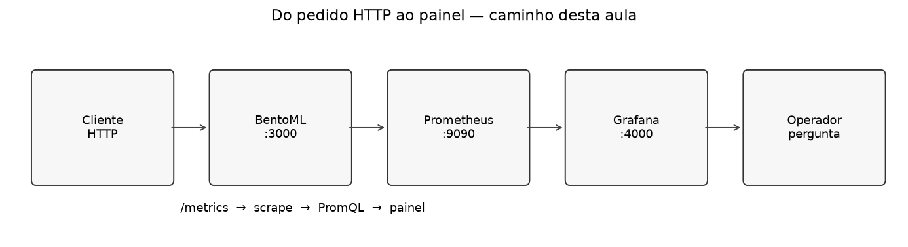
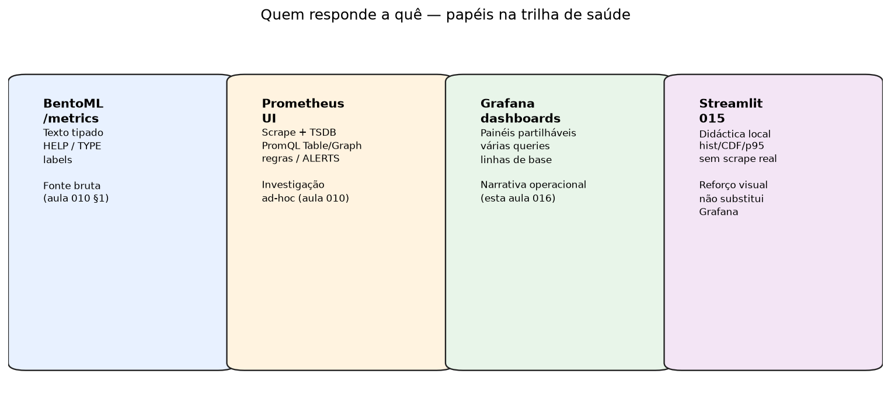
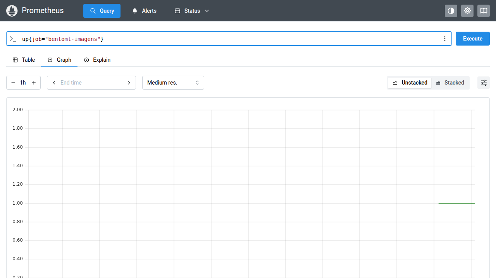
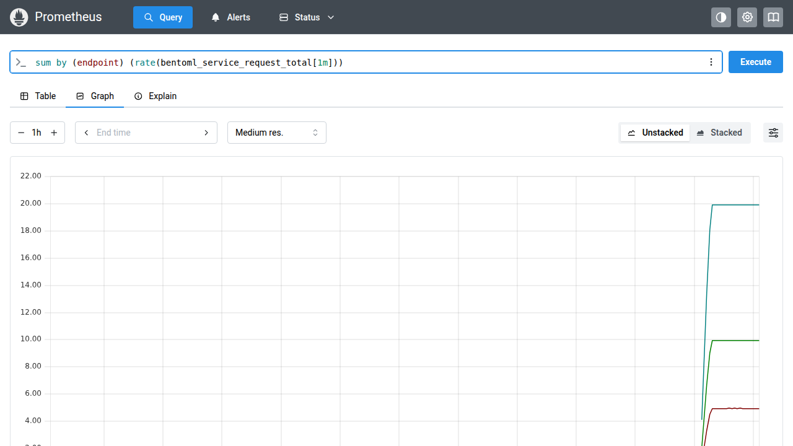
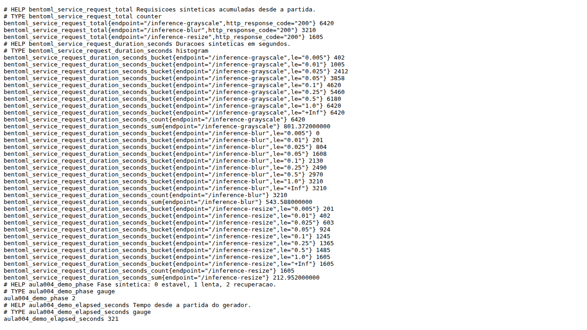
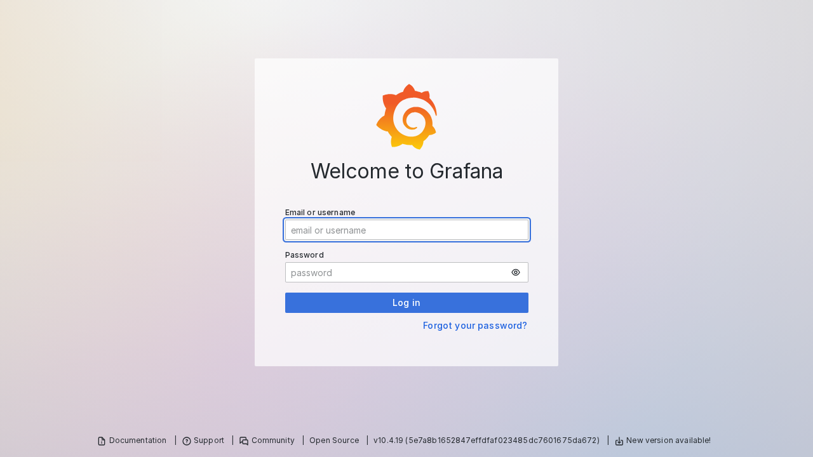
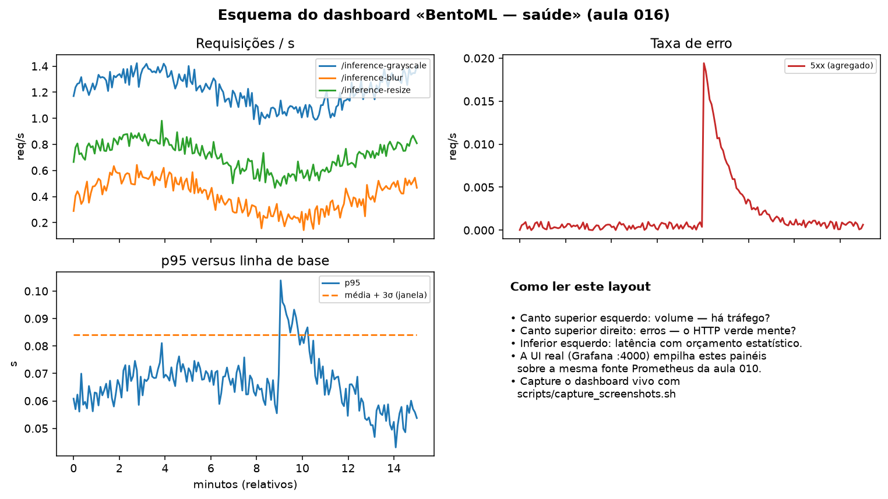
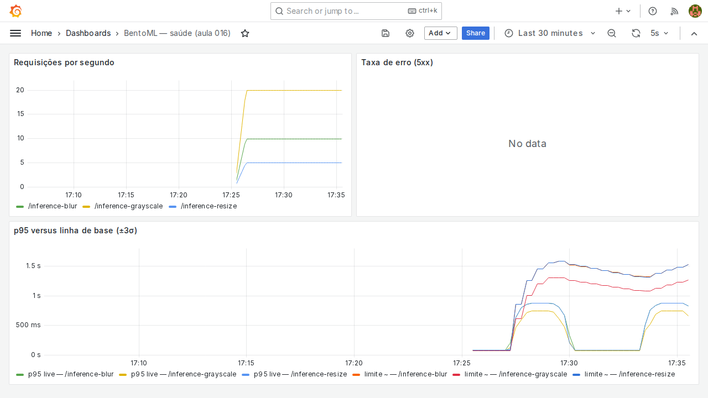
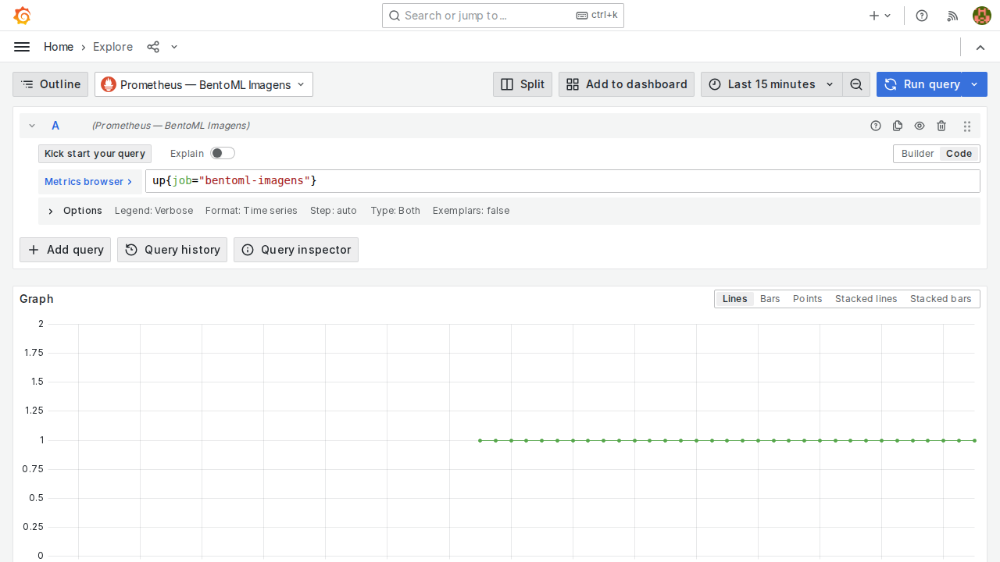

# Aula 016 — Dashboards Grafana sobre Prometheus

**Conceito desta aula:** um *dashboard* operacional é um caderno de bordo
partilhável — painéis versionáveis que respondem «há tráfego? erro? latência
na cauda?» sem cada pessoa reabrir a UI do Prometheus e colar PromQL.

O Grafana (**porta 4000**, nunca 3000 — essa fica do BentoML) **consulta** o
Prometheus; não armazena séries e não substitui o texto cru de
`GET /metrics`. Um painel Streamlit local sobre buckets é outra ferramenta
(didáctica); um vendor SaaS é outra ainda. Aqui o objecto é só o dashboard
OSS sobre a fonte Prometheus do curso.

Instalação e provisionamento passo a passo:
[`docs/grafana.md`](../docs/grafana.md). Portas:
[`docs/ports.md`](../docs/ports.md).

## Objectivos

Pratique até conseguir:

- ter Grafana em <http://127.0.0.1:4000> com a fonte Prometheus
  `127.0.0.1:9090` (YAML versionado em `monitoring/grafana/`);
- distinguir Grafana de `/metrics` cru, da UI ad-hoc do Prometheus e de um
  vendor SaaS;
- montar ou importar um dashboard com taxa por `endpoint`, **taxa de erro**,
  p95 e linha de base (média ± k·σ);
- responder uma pergunta operacional **só** com o gráfico — sem colar
  PromQL no relatório de entrega.

## Pré-requisitos

1. Trio canónico a correr ou compreendido: BentoML **3000** (com
   `/metrics`), Prometheus a raspar em **9090**, Grafana em **4000**.
2. Noção mínima de PromQL (`up`, `rate`, labels) — basta o necessário para
   ler as expressões dos painéis; o tutorial Prometheus do repo ajuda se
   faltar base.
3. Tutorial [`docs/grafana.md`](../docs/grafana.md) (secções 1–3) feito ou em
   paralelo com a secção 3 abaixo.
4. Algum tráfego de exemplo (tutorial §4) — senão os painéis ficam planos.

Se no seu anfitrião a porta 4000 (ou 9090) já pertencer a **outro** serviço,
suba o Grafana/Prometheus da aula noutro endereço **só** para laboratório e
documente o desvio; o contrato do curso permanece 4000/9090. O harness de
capturas desta pasta (`scripts/capture_screenshots.sh`) usa portas efémeras
precisamente por esse motivo.

## 1. A mesma pergunta, quatro instrumentos

Imagine que a latência do `/inference-grayscale` «parece» lenta. Onde olha?

| Instrumento | O que vê | O que **não** faz |
| :--- | :--- | :--- |
| `GET /metrics` (BentoML) | Texto HELP/TYPE, contadores crus | Histórico longo; narrativa partilhada |
| UI Prometheus | PromQL ad-hoc, Table/Graph, regras | Layout estável para a equipa toda manhã |
| **Grafana (esta aula)** | Painéis versionáveis, várias queries, Explore | Armazenar séries (continua a ser o Prom) |
| Painel Streamlit local | Histograma/CDF/p95 didáctico | Scrape operacional partilhado |
| Vendor SaaS (ex.: Datadog) | APM/tags numa conta | Substituir o trio local 3000/9090/4000 |

Regra de ouro:

> O Grafana **consulta o Prometheus**. Não abre `http://127.0.0.1:3000/metrics`
> directamente. Se o scrape falhar, o dashboard fica bonito e mentiroso.

## 2. Confirme a fonte antes do painel

Na UI do Prometheus (`:9090`):

~~~promql
up{job="bentoml-imagens"}
~~~

Valor `1` na vista Graph — o alvo está UP:

Taxa por endpoint (a mesma família que o painel de volume no Grafana):

O texto bruto que o scrape lê (BentoML em `:3000`, ou o exporter do harness
desta pasta):

Fixture correspondente:
[`fixtures/metrics_sample_head.txt`](fixtures/metrics_sample_head.txt).

Só depois disso abra o Grafana.

## 3. Instale, provisione, entre

Siga [`docs/grafana.md`](../docs/grafana.md):

1. `http_port = 4000` (o default upstream 3000 colide com o BentoML).
2. Datasource versionado:
   [`monitoring/grafana/datasources/bentoml-prometheus.yml`](../monitoring/grafana/datasources/bentoml-prometheus.yml)
   → `http://127.0.0.1:9090`.
3. Primeiro acesso: utilizador `admin` (senha pedida na instalação).

## 4. Quatro painéis — a narrativa mínima de saúde

Importe
[`monitoring/grafana/dashboards/bentoml-health.json`](../monitoring/grafana/dashboards/bentoml-health.json)
ou monte à mão (tutorial §5). Layout de referência:

| Painel | PromQL de partida | Pergunta que responde |
| :--- | :--- | :--- |
| Requisições / s | `sum by (endpoint) (rate(bentoml_service_request_total[1m]))` | Há tráfego? Em que rota? |
| Taxa de erro | `sum by (endpoint) (rate(bentoml_service_request_total{http_response_code=~"5.."}[1m]))` | O HTTP «verde» esconde 5xx? |
| p95 | `bentoml:http_request_duration_seconds:p95_1m` (recording rule) | Quão lenta é a cauda? |
| Linha de base | `avg_over_time(...[30m]) + 3 * stddev_over_time(...[30m])` | A cauda saiu do orçamento? |

Se o label de código HTTP no seu `/metrics` diferir de `http_response_code`,
ajuste — a fonte da verdade é o texto em `/metrics`, não esta tabela.

Detalhe de construção: [`docs/grafana.md`](../docs/grafana.md) §5–6 (inclui o
painel de alertas geridos pelo Prometheus).

## 5. Explore versus Graph do Prometheus

O **Explore** do Grafana é o primo do Graph do Prometheus: uma query, uma
janela, sem compromisso de layout. Use-o para **provar** uma expressão antes
de a cravar no dashboard.

Diferença prática:

| | Prometheus Graph | Grafana Explore | Grafana Dashboard |
| :--- | :--- | :--- | :--- |
| Público | Quem investiga agora | Idem | Quem olha de manhã |
| Persistência | URL / favoritos locais | Pouca | JSON versionado no repo |
| Várias queries compostas | Limitado | Sim | Sim, com layout |

## 6. História curta: o semáforo e o romanceiro

O alerta `BentoMLResponseTimeAnomaly` (quando existir) vive no Prometheus. No
Grafana você **vê** a mesma curva de p95 e o limite de três desvios-padrão
lado a lado — o romanceiro (dashboard) e o semáforo (regra) deixam de ser
mundos separados.

Quando o p95 cruza o limite e permanece um minuto, a regra dispara; o painel
só ilustra. Não peça ao Grafana para «ser» o Alertmanager nesta aula.

## 7. Exercício e entrega

Relato curto (até uma página), **sem** Streamlit:

1. Fonte: Prometheus real `:9090` (ou a demo documentada) e Grafana `:4000`.
2. Captura (ou export JSON) do dashboard com os quatro painéis.
3. Resposta **citando só o gráfico**:
   «Neste intervalo, o p95 está / não está dentro do limite de três
   desvios-padrão? Em que `endpoint`?»
4. Uma frase de comparação: o que a UI ad-hoc do Prometheus faria melhor /
   pior para a mesma pergunta.
5. Uma limitação (janela curta, pouco tráfego, label de erro ausente, scrape
   noutro Prometheus).

## 8. Materiais e harness de capturas

| Arquivo | Papel |
| :--- | :--- |
| [`docs/grafana.md`](../docs/grafana.md) | Instalação e painéis manuais |
| [`monitoring/grafana/dashboards/bentoml-health.json`](../monitoring/grafana/dashboards/bentoml-health.json) | Dashboard versionado |
| [`fixtures/metrics_sample_head.txt`](fixtures/metrics_sample_head.txt) | Trecho de `/metrics` alinhado às figuras |
| [`scripts/capture_screenshots.sh`](scripts/capture_screenshots.sh) | Sobe exporter+Prom+Grafana Docker efémeros e grava PNGs |
| [`scripts/generate_comparison_figures.py`](scripts/generate_comparison_figures.py) | Figuras de papéis / pipeline |
| [`scripts/generate_dashboard_schematic.py`](scripts/generate_dashboard_schematic.py) | Esquema dos quatro painéis |

~~~bash
# figuras didácticas (matplotlib)
cd 016_grafana_dashboards
uv run --no-active --with matplotlib python scripts/generate_comparison_figures.py
uv run --no-active --with matplotlib python scripts/generate_dashboard_schematic.py

# capturas de UI (Docker + gstack browse; portas efémeras 8010/9100/14000)
bash scripts/capture_screenshots.sh
~~~

O harness **não** altera o contrato 3000/9090/4000 do aluno; só contorna
anfitriões onde essas portas já estão ocupadas.

## 9. Critério de conclusão

- [ ] `up{job="bentoml-imagens"} == 1` antes de confiar no Grafana.
- [ ] Quatro painéis visíveis em `:4000`.
- [ ] Pergunta do §7 respondida com evidência do gráfico.
- [ ] Nenhuma URL de curso aponta Grafana em `:3000`.

## Glossário

| Termo | Significado nesta aula |
| :--- | :--- |
| **Datasource** | Ponte Grafana → Prometheus (`:9090`) |
| **Dashboard** | Conjunto versionável de painéis |
| **Explore** | Query ad-hoc no Grafana (irmão do Graph do Prometheus) |
| **Recording rule** | Série pré-computada no Prometheus (ex. p95) |
| **Linha de base** | Aqui: média ± k·σ sobre o p95 numa janela |

## Roteiro da trilha

| | Pasta |
| :--- | :--- |
| **Anterior** | [`015_prometheus_histcdf_streamlit`](../015_prometheus_histcdf_streamlit/README.md) |
| **Seguinte** | [`019_loki_grafana_logs`](../019_loki_grafana_logs/README.md) |
