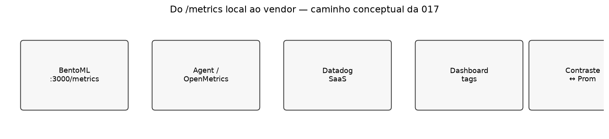
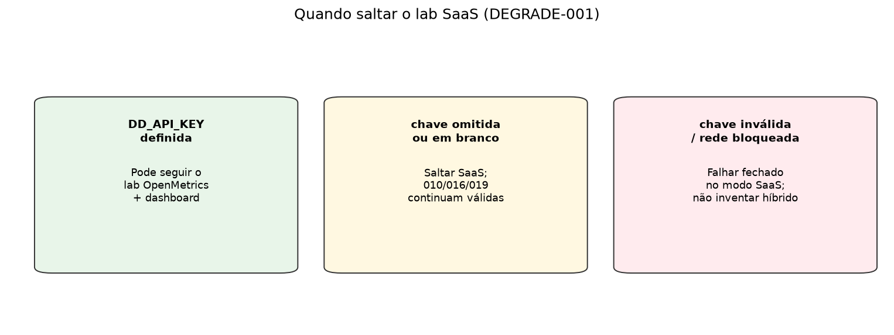
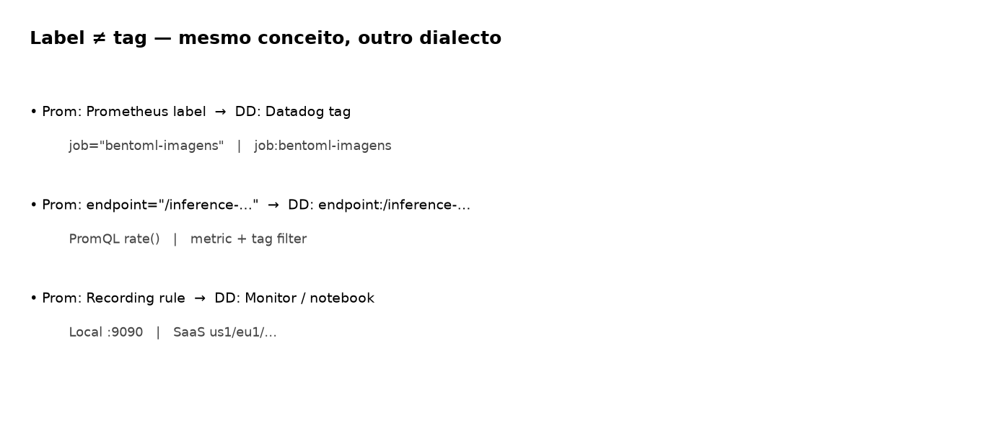
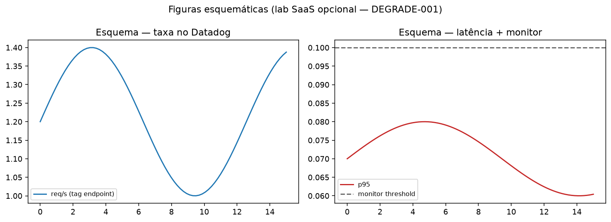

# Aula 017 — Datadog: o mesmo serviço, outro dialecto

**Conceito desta aula:** o mesmo endpoint BentoML pode ser observado por um
*vendor* SaaS. Labels Prometheus e **tags** Datadog são a mesma ideia de
dimensão com outro dialecto; o lab OpenMetrics é **opcional** e obedece a
DEGRADE-001 (sem chave, salta-se o SaaS sem partir o resto do curso).

O trio canónico **3000 / 9090 / 4000** não é substituído: o Agent (quando
houver chave) raspa `http://127.0.0.1:3000/metrics` em paralelo.

Esta aula é deliberadamente **dual**:

1. **Pedagogia sempre disponível** — labels vs tags, contraste com stack
   local, esquema de dashboard.
2. **Lab SaaS opcional** — só corre se existir `DD_API_KEY` no ambiente local
   (**nunca** no Git). Sem chave, **salta-se** o lab (DEGRADE-001).

Portas auxiliares do agent (quando o lab correr): **8125** (DogStatsD),
**8126** (APM) — [`docs/ports.md`](../docs/ports.md).

## Objectivos

- Explicar **label** (Prometheus / OpenMetrics) ↔ **tag** (Datadog).
- Descrever (e, se houver chave, executar) um caminho OpenMetrics contra
  `http://127.0.0.1:3000/metrics`.
- Redigir o contraste: o que um Prometheus local ainda faz melhor no
  laboratório.
- Aplicar DEGRADE-001 sem inventar híbridos partidos.

## Pré-requisitos

1. BentoML (ou outro processo) a expor texto OpenMetrics / Prometheus em
   `http://127.0.0.1:3000/metrics`.
2. Noção de que uma série tem **nome + dimensões** (chame-lhes labels ou
   tags — a aula fixa o vocabulário).
3. Para o lab SaaS: conta trial + `DD_API_KEY` só em `.env` local / shell
   (ficheiros `.env` **não** entram no commit).

## 1. O portão DEGRADE-001

~~~bash
cd 017_datadog_apm_metrics
# sem exportar chave:
python3 scripts/check_datadog_gate.py
# → DATADOG_LAB=SKIP

export DD_API_KEY='…'   # só no seu shell; nunca no README
python3 scripts/check_datadog_gate.py
# → DATADOG_LAB=RUN
~~~

| Estado da chave | Comportamento |
| :--- | :--- |
| omitida / `""` / só espaços | **SKIP** lab SaaS; ler §§2–4 e fazer o exercício textual |
| presente | **RUN** — agent/OpenMetrics + dashboard na UI Datadog |
| presente mas inválida / rede bloqueada | Falhar **fechado** no modo SaaS; não fingir que o Prom «é» o DD |

## 2. Label versus tag

No dialecto Prometheus / OpenMetrics escreve-se tipicamente:

~~~promql
sum by (endpoint) (rate(bentoml_service_request_total{job="bentoml-imagens"}[1m]))
~~~

No Datadog o dialecto típico usa **tags** (`endpoint:/inference-grayscale`)
sobre uma métrica namespaced pelo check OpenMetrics. A *ideia* (dimensão de
corte) é a mesma; a sintaxe e o armazenamento não.

## 3. Caminho OpenMetrics (lab RUN)

O Agent raspa o **mesmo** texto que um scrape Prometheus leria em
`:3000/metrics`.

1. Instale o [Datadog Agent](https://docs.datadoghq.com/agent/) no lab.
2. Configure um check OpenMetrics apontando a
   `http://127.0.0.1:3000/metrics` — esqueleto em
   [`monitoring/openmetrics.example.yaml`](monitoring/openmetrics.example.yaml)
   (copie para a conf. do agent **fora** do Git).
3. Confirme no site Datadog (região da sua conta) que as métricas `bentoml.*`
   aparecem com tags `endpoint`, `job`, etc.
4. Monte um dashboard mínimo: **taxa** e **latência/p95** (ou distribuição)
   + um **monitor** com limiar.

> As figuras `06`/`03`/`08` são **esquemáticas** de propósito: sem chave de
> lab não há UI SaaS para capturar. Com `DATADOG_LAB=RUN`, substitua no
> relatório por screenshots reais da sua conta (não as versione com dados
> sensíveis).

APM (`ddtrace`) e DogStatsD (**8125**/**8126**) ficam como extensão — não
bloqueiam o critério mínimo OpenMetrics.

## 4. O que o Prometheus local ainda faz melhor

Traga para o relatório **pelo menos duas** vantagens do stack local, por
exemplo:

- contrato de portas e scrape **reproduzível** sem conta;
- recording rules + alertas versionados em
  [`monitoring/bentoml.rules.yml`](../monitoring/bentoml.rules.yml);
- correlação métricas↔logs num Grafana local sem sair do laboratório;
- custo zero de vendor na disciplina.

O Datadog brilha quando a organização já padronizou tags, monitors e APM num
único SaaS — contexto industrial, não substituição silenciosa do Prometheus
local.

## 5. Exercício e entrega

### Sempre (SKIP ou RUN)

1. Tabela com 3 pares label→tag (inventados a partir do `/metrics` real).
2. Parágrafo «o que o Prometheus local ainda faz melhor» (≥2 argumentos).
3. Saída de `python3 scripts/check_datadog_gate.py` (só a linha
   `DATADOG_LAB=…`).

### Só se RUN

4. Screenshot do dashboard Datadog (taxa + latência) e do monitor.
5. Confirmação de que o trio 3000/9090/4000 **continua** a funcionar em
   paralelo (não desligue o Prometheus «porque o DD chegou»).

## 6. Materiais

| Arquivo | Papel |
| :--- | :--- |
| [`scripts/check_datadog_gate.py`](scripts/check_datadog_gate.py) | Portão DEGRADE-001 |
| [`monitoring/openmetrics.example.yaml`](monitoring/openmetrics.example.yaml) | Esqueleto do check |
| [`scripts/generate_comparison_figures.py`](scripts/generate_comparison_figures.py) | Figuras |

~~~bash
uv run --no-active --with matplotlib python scripts/generate_comparison_figures.py
python3 scripts/check_datadog_gate.py
~~~

## Critério de conclusão

- [ ] Gate DEGRADE-001 compreendido (SKIP sem chave).
- [ ] Contraste labels/tags + parágrafo Prom local.
- [ ] Se RUN: dashboard+monitor Datadog **e** trio local intacto.
- [ ] Nenhuma chave no Git; Grafana do curso nunca em `:3000`.

## Roteiro

| | Pasta |
| :--- | :--- |
| **Anterior** | [`018_elasticsearch_logs`](../018_elasticsearch_logs/README.md) |
| **Seguinte** | [`011_corpus_histograms_model`](../011_corpus_histograms_model/README.md) |
