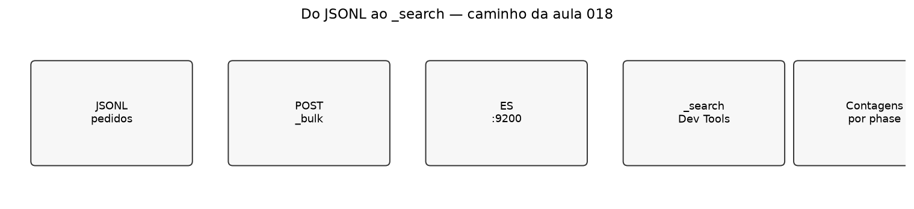
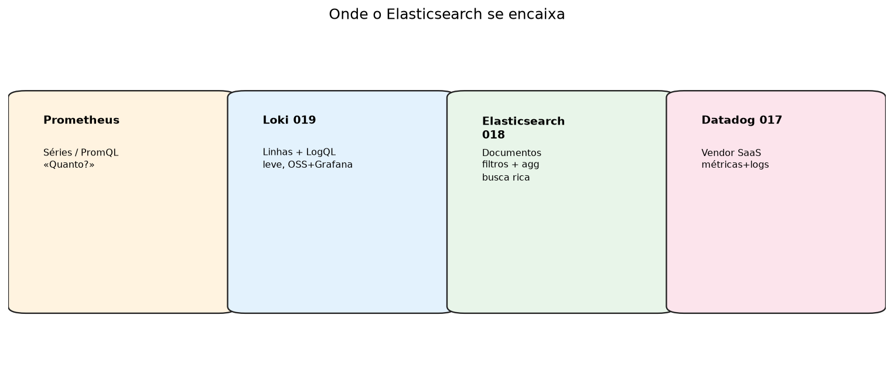
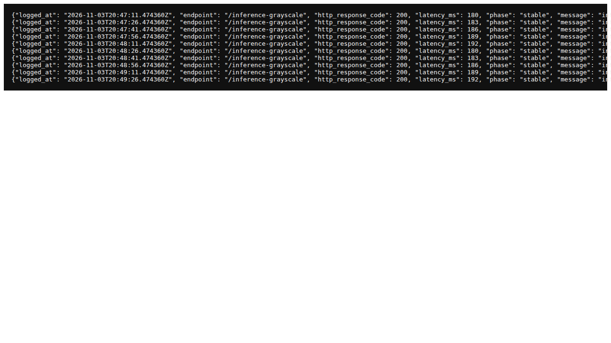
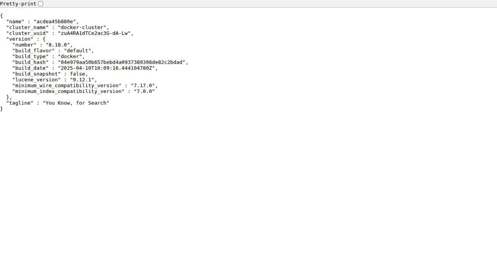
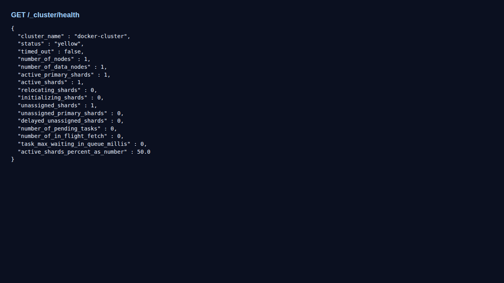
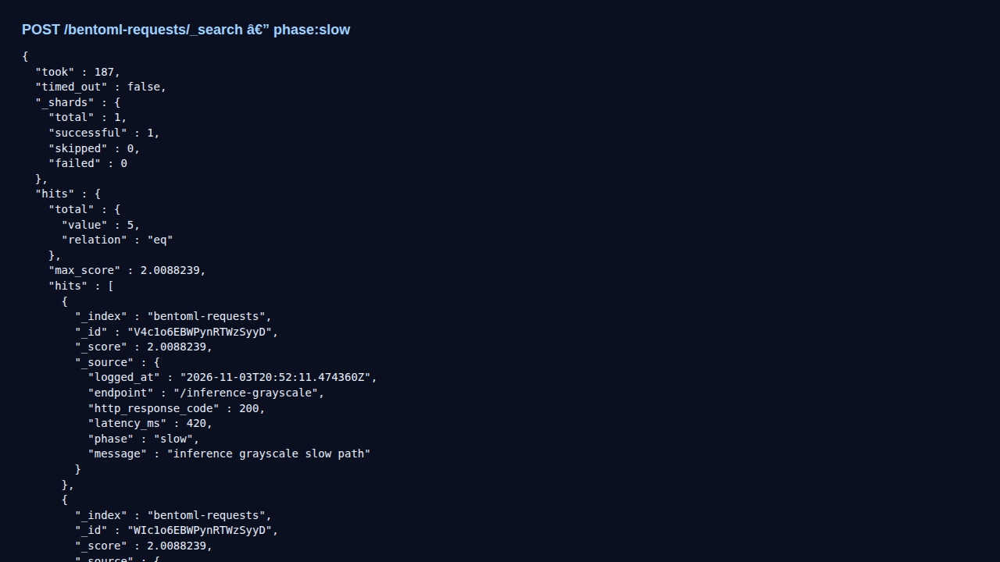
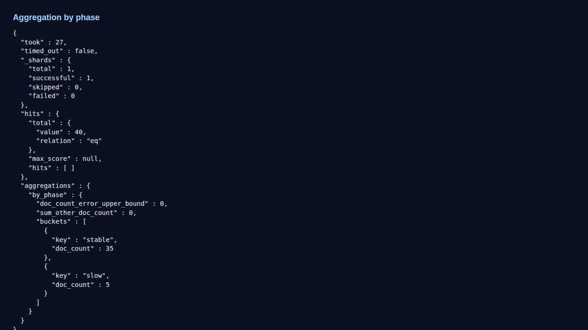

# Aula 018 — Elasticsearch: logs de pedido como documentos

Na [aula 019](../019_loki_grafana_logs/README.md) o Loki responde «quais
**linhas** caíram na janela do pico?». O Elasticsearch responde a uma
pergunta vizinha com outro aparelho: «quais **documentos** batem neste
filtro — e como se agregam?»

Aqui o eixo continua a ser **logs**, não métricas Prometheus. Indexamos o
mesmo género de JSONL da `012` / fixture da `019`, consultamos com `_search`
(estilo Dev Tools) e contrastamos com Loki e com o futuro vendor Datadog
(`017`).

Portas: Elasticsearch auxiliar **9200** — [`docs/ports.md`](../docs/ports.md).
Esta aula **não** exige Kibana (o harness evita a imagem por espaço em disco);
a UI oficial Dev Tools / Discover segue a mesma DSL.

## Objectivos

- Indexar N documentos via `_bulk` a partir de um JSONL.
- Filtrar por `phase` / `endpoint` e agregar contagens.
- Explicar ES ≠ Prometheus (eventos vs séries) e ES ≠ Loki (documento vs linha).
- Entregar três queries interpretadas — **sem** misturar APM Datadog.

## Pré-requisitos

1. Noção de log de pedido ([`012`](../012_grayscale_request_logging/README.md)).
2. Preferível: [`019`](../019_loki_grafana_logs/README.md) (mesmo fixture mental).
3. Docker com `elasticsearch:8.x` **ou** cluster local em `:9200`.

## 1. Onde o ES se senta na trilha

| Instrumento | Unidade | Força |
| :--- | :--- | :--- |
| Prometheus | Séries | Taxa, p95, alertas |
| Loki | Linhas + labels | Barato junto ao Grafana |
| **Elasticsearch** | Documentos + mapping | Filtros, full-text, aggs |
| Datadog | SaaS misto | Um painel vendor |

> Não reimplemente `histogram_quantile` no ES nesta aula. Se a pergunta é
> «quanto?», volte à `010`/`016`.

## 2. Fixture JSONL

~~~bash
cd 018_elasticsearch_logs
python3 fixtures/generate_sample_log.py
~~~

O bloco `phase=slow` (índices 20–24) é o mesmo pico didáctico da 019.

## 3. Suba o Elasticsearch e faça o bulk

~~~bash
docker run --rm -d --name aula018-es -p 9200:9200 \
  -e discovery.type=single-node \
  -e xpack.security.enabled=false \
  -e 'ES_JAVA_OPTS=-Xms512m -Xmx512m' \
  elasticsearch:8.18.0

curl -fsS http://127.0.0.1:9200
python3 scripts/bulk_index_fixture.py --url http://127.0.0.1:9200
~~~

O script cria o índice `bentoml-requests` com mapping (`logged_at` date,
`phase`/`endpoint` keyword, `latency_ms` integer) e envia o NDJSON via `_bulk`.

## 4. Três consultas mínimas

### 4.1 Filtrar o pico

~~~http
POST /bentoml-requests/_search
{"query":{"term":{"phase":"slow"}},"size":5}
~~~

### 4.2 Agregar por fase

~~~http
POST /bentoml-requests/_search
{"size":0,"aggs":{"by_phase":{"terms":{"field":"phase"}}}}
~~~

### 4.3 Intervalo de latência (opcional)

~~~http
POST /bentoml-requests/_search
{
  "query":{"range":{"latency_ms":{"gte":400}}},
  "size":3,
  "sort":[{"latency_ms":"desc"}]
}
~~~

Fixtures gravadas pelo harness:
[`fixtures/search_phase_slow.json`](fixtures/search_phase_slow.json),
[`fixtures/agg_by_phase.json`](fixtures/agg_by_phase.json).

## 5. Comparações honestas

| Versus | ES ganha | ES perde / custa |
| :--- | :--- | :--- |
| `grep` no disco (`012`) | Filtro + agg sem varrer à mão | Precisa de processo ES |
| Loki (`019`) | Mapping tipado, aggs ricas | Mais RAM; fora do Grafana por omissão |
| Prometheus | Eventos textuais/estruturados | Não substitui p95 |
| Datadog (`017`) | Local, sem conta | Sem APM vendor |

## 6. Exercício e entrega

Relato curto:

1. `GET /_cluster/health` (status) + número de docs no índice.
2. Resultado de `phase=slow` (quantos hits?).
3. Aggregation `by_phase` interpretada numa frase.
4. Uma limitação (heap, disco, security desligada só no lab, sem Kibana).

## 7. Materiais e harness

| Arquivo | Papel |
| :--- | :--- |
| [`fixtures/generate_sample_log.py`](fixtures/generate_sample_log.py) | JSONL |
| [`scripts/bulk_index_fixture.py`](scripts/bulk_index_fixture.py) | `_bulk` |
| [`scripts/capture_screenshots.sh`](scripts/capture_screenshots.sh) | ES + capturas |
| [`scripts/generate_comparison_figures.py`](scripts/generate_comparison_figures.py) | Figuras |
| [`monitoring/search_examples.http`](monitoring/search_examples.http) | Queries prontas |

~~~bash
bash scripts/capture_screenshots.sh
~~~

## Critério de conclusão

- [ ] Índice populado; health verde/amarelo aceitável no lab.
- [ ] Três queries no relato.
- [ ] Contraste explícito com Prometheus e com Loki.
- [ ] Sem misturar lab Datadog nesta pasta.

## Roteiro

| | Pasta |
| :--- | :--- |
| **Anterior** | [`019_loki_grafana_logs`](../019_loki_grafana_logs/README.md) |
| **Seguinte** | [`017_datadog_apm_metrics`](../017_datadog_apm_metrics/README.md) |
