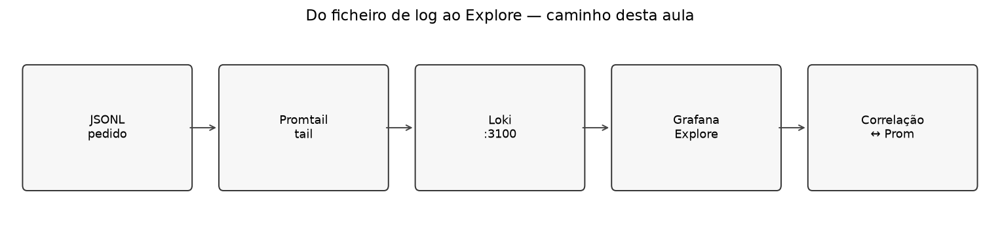
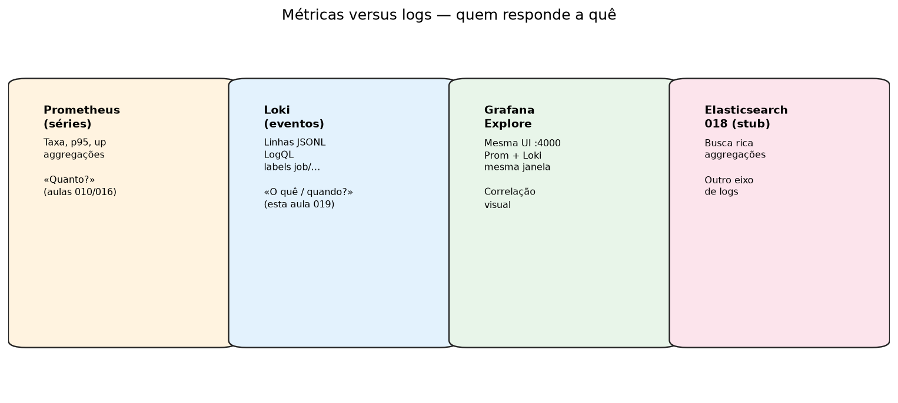
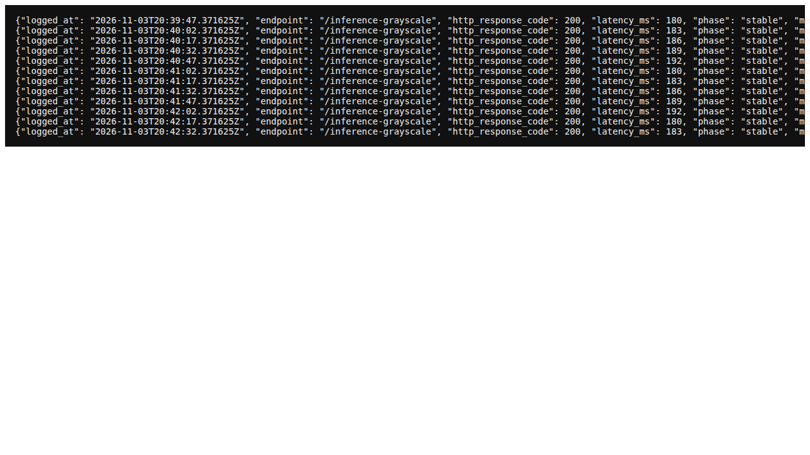
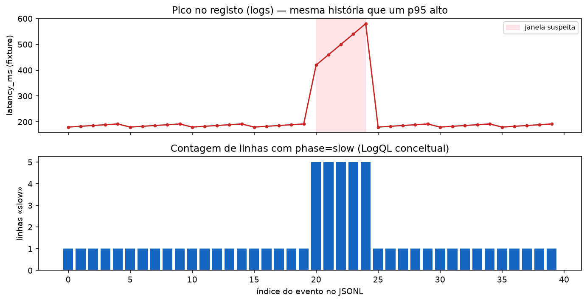
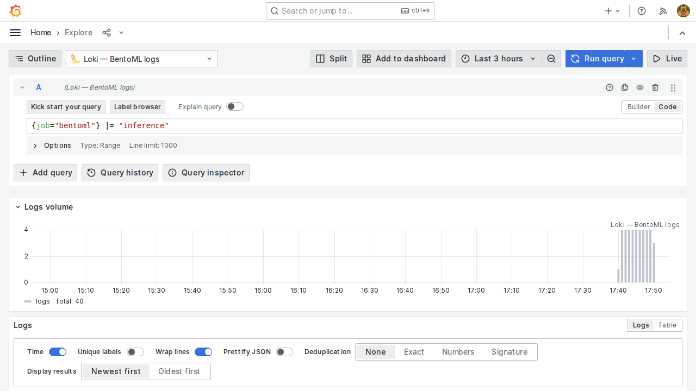
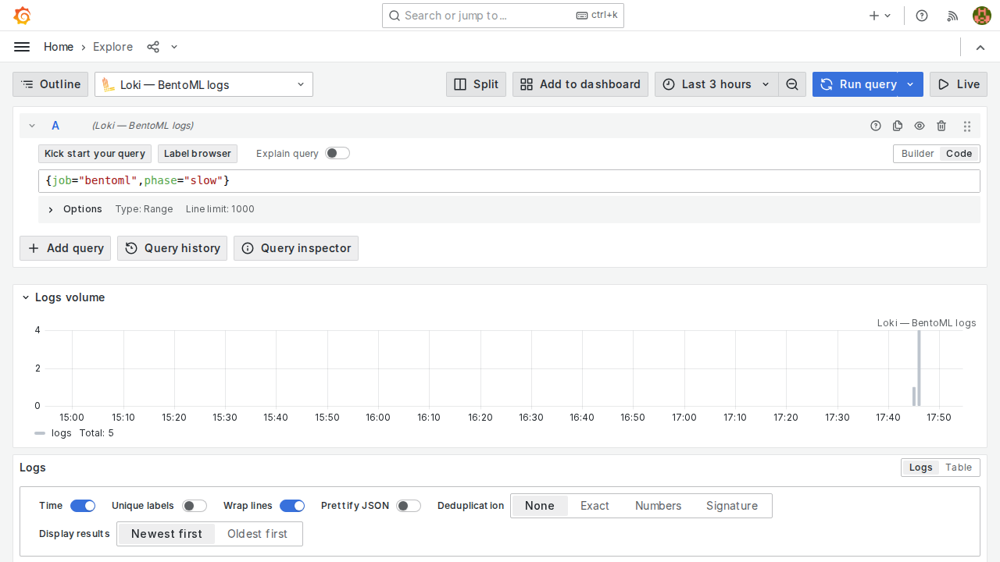
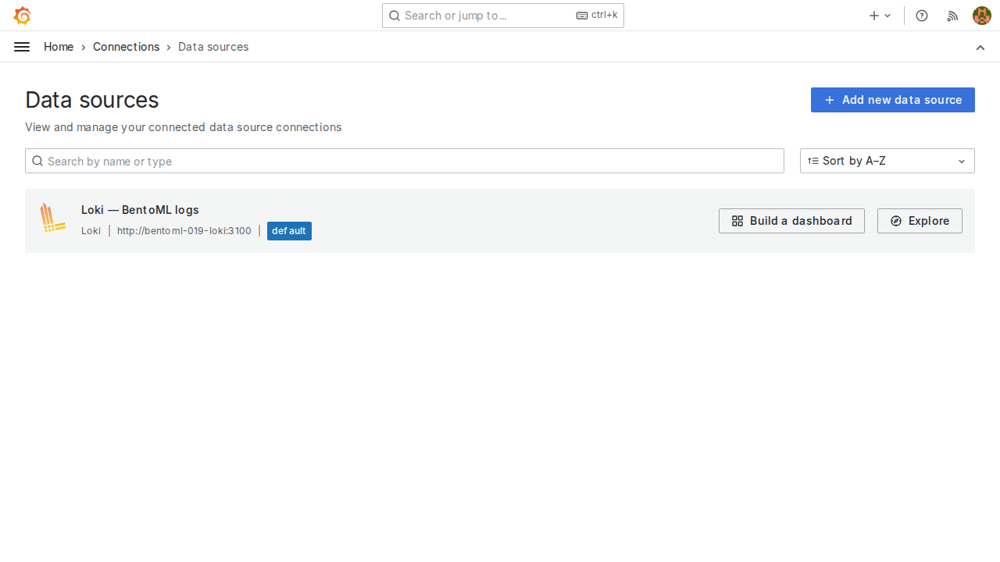

# Aula 019 — Loki + Grafana: logs OSS ao lado das métricas

Na [aula 016](../016_grafana_dashboards/README.md) o Grafana já conta a
história das **séries**: taxa, erro, p95. Falta a outra metade da frase —
as **linhas** que o serviço escreveu enquanto a latência subia.

Esta aula fecha o caminho open-source de observabilidade: um ficheiro de
log (no espírito da aula [`012`](../012_grayscale_request_logging/README.md))
é lido pelo **Promtail**, indexado no **Loki** (porta auxiliar **3100**) e
consultado no **Explore** do Grafana (**4000**), na mesma janela em que o
Prometheus mostra o pico.

Portas: [`docs/ports.md`](../docs/ports.md). Instalação Grafana:
[`docs/grafana.md`](../docs/grafana.md) / handout `016`.

## Objectivos

Pratique até conseguir:

- distinguir **métricas** (Prometheus) de **logs** (Loki) sem misturar os
  papéis;
- subir (ou usar o harness) Loki + Promtail e confirmar labels em
  `/loki/api/v1/labels`;
- escrever LogQL básico (`{job="bentoml"} |= "inference"`, filtro por
  `phase`);
- no Grafana Explore, correlacionar um pico de latência (Prom / fixture)
  com linhas «slow» na **mesma** janela temporal;
- explicar porque Elasticsearch (`018`) e Datadog (`017`) são caminhos
  diferentes — não substitutos silenciosos desta aula.

## Pré-requisitos

1. Aula `016` (Grafana no ar em **4000**) — ou, no mínimo,
   [`docs/grafana.md`](../docs/grafana.md).
2. Noção de log de pedido da `012` (features em disco). Aqui usamos um
   JSONL didáctico em [`fixtures/bentoml_requests.jsonl`](fixtures/bentoml_requests.jsonl).
3. Docker disponível se for seguir o harness local
   (`scripts/capture_screenshots.sh`).

> No anfitrião de desenvolvimento, a porta **3100** pode já estar ocupada
> (outro serviço). O contrato do curso continua 3100; o harness usa
> **13100** efémero e documenta o desvio — o mesmo padrão da 016 com
> Grafana em 14000.

## 1. A pergunta que a métrica não responde sozinha

O painel de p95 da 016 diz: «a cauda ficou lenta». Não diz *qual* mensagem
o runtime emitiu, nem se foi o endpoint grayscale ou um filtro a jusante.

| Instrumento | Pergunta natural | Unidade |
| :--- | :--- | :--- |
| Prometheus / Grafana 016 | Quanto? Quão lento? Com que taxa? | Séries numéricas |
| **Loki / Explore (esta aula)** | O que foi escrito? Em que fase? | Linhas / eventos |
| Elasticsearch 018 (stub) | Busca rica, agregações ad-hoc | Documentos |
| Datadog 017 (stub) | Vendor único (métricas+logs+APM) | SaaS |

Regra de ouro:

> Loki **não** substitui o Prometheus. Grafana **consulta** ambos. Se o
> Promtail parar, o Explore de logs fica vazio — o dashboard de p95 pode
> continuar verde.

## 2. O artefacto: JSONL de pedidos

Gere (ou regenere) o fixture:

~~~bash
cd 019_loki_grafana_logs
python3 fixtures/generate_sample_log.py
~~~

Trecho típico (também em figura):

Cada linha carrega `logged_at`, `endpoint`, `latency_ms`, `phase`
(`stable` / `slow`) e `message`. Entre os índices 20–24 o fixture **força**
um pico — a mesma parábola que um p95 a saltar na 016.

## 3. Pipeline: Promtail → Loki

Configurações versionadas:

| Ficheiro | Papel |
| :--- | :--- |
| [`monitoring/loki-config.yaml`](monitoring/loki-config.yaml) | Loki monólito (aula; não é produção) |
| [`monitoring/promtail-config.yaml`](monitoring/promtail-config.yaml) | Tail do JSONL, labels `job=bentoml`, `phase`, `endpoint` |

Subida didáctica (Docker):

~~~bash
# Loki na porta canónica 3100 — se estiver livre
docker run --rm -d --name aula019-loki -p 3100:3100 \
  -v "$PWD/monitoring/loki-config.yaml:/etc/loki/local-config.yaml:ro" \
  grafana/loki:3.3.2 -config.file=/etc/loki/local-config.yaml

curl -fsS http://127.0.0.1:3100/ready
~~~

Duas formas de alimentar o Loki (escolha uma):

1. **HTTP push** (o que o harness usa — estável para capturas):

~~~bash
python3 scripts/push_fixture_to_loki.py --url http://127.0.0.1:3100/loki/api/v1/push
~~~

2. **Promtail** (caminho operacional): configure
   [`monitoring/promtail-config.yaml`](monitoring/promtail-config.yaml) com
   o JSONL em `__path__` e o cliente apontando a
   `http://127.0.0.1:3100/loki/api/v1/push`.

Confirme labels:

~~~bash
curl -fsS http://127.0.0.1:3100/loki/api/v1/labels
~~~

Deve listar, entre outras, `job`, `phase`, `endpoint`.

## 4. LogQL — as duas consultas mínimas

No Grafana: **Explore** → datasource **Loki** (provisionar URL
`http://127.0.0.1:3100`, análogo ao Prometheus em `docs/grafana.md`).

~~~logql
{job="bentoml"} |= "inference"
~~~

Filtrar só o pico forçado:

~~~logql
{job="bentoml", phase="slow"}
~~~

`|=` é filtro de linha; labels entre `{}` são índices baratos. Não tente
reimplementar `histogram_quantile` em LogQL — isso continua no Prometheus.

## 5. Correlação na mesma janela

1. No Explore, escolha a janela que cobre o pico (no fixture: o bloco
   `phase=slow`).
2. Abra outro painel Explore (ou split) com Prometheus:
   `bentoml:http_request_duration_seconds:p95_1m` ou o `rate` da 016.
3. Responda: as linhas «slow» caem **dentro** do mesmo intervalo em que o
   p95 sobe?

Se só tiver o fixture (sem Prometheus no ar), use a figura
`07_correlation_story.png` como mapa mental e a query Loki como evidência
das linhas.

Datasource Loki no Grafana (harness):

## 6. Comparações honestas

| Versus | O que Loki ganha | O que perde |
| :--- | :--- | :--- |
| Só ficheiro em disco (`012`) | Busca por tempo/label sem `grep` manual | Precisa Promtail+Loki no ar |
| Prometheus | Eventos textuais | Não agrega p95 |
| Elasticsearch (`018`) | Operação mais leve na trilha OSS+Grafana | Busca/agregações menos ricas |
| Datadog (`017`) | Sem conta SaaS; tudo local | Sem APM vendor único |

## 7. Exercício e entrega

Relato curto (até uma página):

1. Mostre `curl` a `/ready` (ou captura) e uma query LogQL com resultado
   não vazio.
2. Indique a janela temporal do pico e quantas linhas `phase=slow`
   encontrou.
3. Uma frase de correlação com métricas (Prometheus real **ou** a figura
   07 se o Prom estiver offline).
4. Uma limitação (porta 3100 ocupada, timestamp mal parseado, Promtail
   parado, janela Explore errada).

## 8. Materiais e harness

| Arquivo | Papel |
| :--- | :--- |
| [`fixtures/bentoml_requests.jsonl`](fixtures/bentoml_requests.jsonl) | Log didáctico |
| [`fixtures/generate_sample_log.py`](fixtures/generate_sample_log.py) | Regenera o JSONL |
| [`fixtures/loki_query_slow.json`](fixtures/loki_query_slow.json) | Resposta API (harness) |
| [`monitoring/loki-config.yaml`](monitoring/loki-config.yaml) | Loki aula |
| [`monitoring/promtail-config.yaml`](monitoring/promtail-config.yaml) | Promtail aula |
| [`scripts/push_fixture_to_loki.py`](scripts/push_fixture_to_loki.py) | Push HTTP do JSONL |
| [`scripts/capture_screenshots.sh`](scripts/capture_screenshots.sh) | Docker efémero + capturas |
| [`scripts/generate_comparison_figures.py`](scripts/generate_comparison_figures.py) | Figuras didácticas |

~~~bash
cd 019_loki_grafana_logs
just generate-figures          # se houver justfile
bash scripts/capture_screenshots.sh
~~~

O harness sobe Loki em **13100** e Grafana em **14000** quando as portas
canónicas estão ocupadas; as figuras documentam a UI, não o número efémero.

## 9. Critério de conclusão

- [ ] Loki `/ready` OK; labels visíveis.
- [ ] LogQL devolve linhas `inference` e `phase=slow`.
- [ ] Relato com janela + correlação (métrica ou figura 07).
- [ ] Nenhuma URL de curso coloca Grafana em `:3000`.

## Glossário

| Termo | Significado nesta aula |
| :--- | :--- |
| **LogQL** | Linguagem de consulta do Loki |
| **Promtail** | Agente que faz *tail* e envia linhas |
| **Label** | Índice (`job`, `phase`, …) — barato de filtrar |
| **Explore** | UI ad-hoc do Grafana (Prom ou Loki) |
| **Correlação** | Mesma janela temporal, duas fontes |

## Roteiro da trilha

| | Pasta |
| :--- | :--- |
| **Anterior** | [`016_grafana_dashboards`](../016_grafana_dashboards/README.md) |
| **Seguinte** | [`018_elasticsearch_logs`](../018_elasticsearch_logs/README.md) (stub) ou Ato II [`011`](../011_corpus_histograms_model/README.md) |

Ordem completa: [`000_mlops_pipelines_goals`](../000_mlops_pipelines_goals/README.md).
