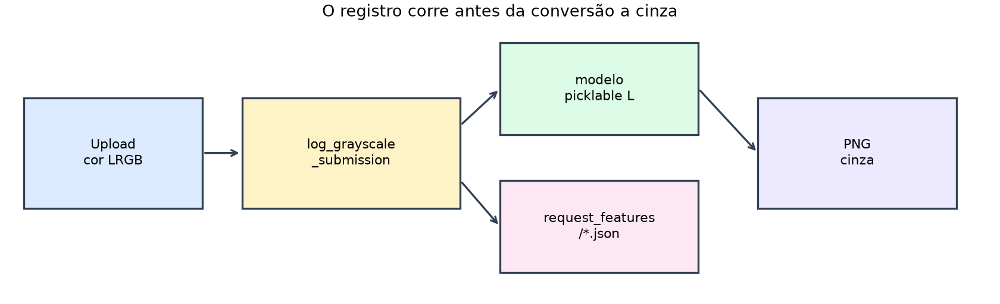
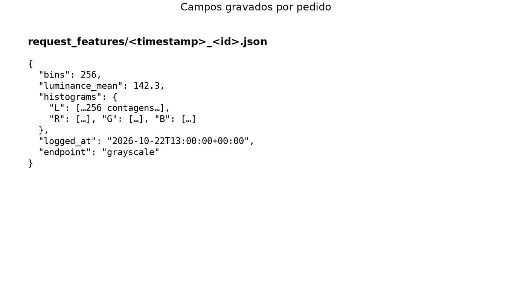
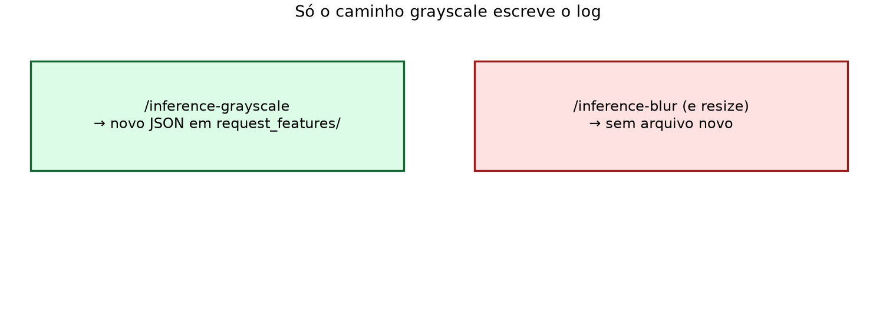

# Lição 020 — Registro de estatísticas em `/inference-grayscale`

## Objetivo

- Manter corpus e relatórios `/monitor-histogram-corpus-*` e o modelo picklable.
- **Registrar em disco** as features de cada imagem submetida a `/inference-grayscale`
  (antes da conversão a cinza), em `request_features/`.
- Compreender por que o log ocorre **antes** do cinza (canais R/G/B ainda existem).
- Árvore **autocontida**: cópia independente do serviço base (raiz); **sem pesos neurais**.

As figuras abaixo vivem em `illustrations/` (regeneráveis com
`just generate-request-log-illustrations`).



## Comparação com a base

O serviço base só devolve a imagem filtrada; **não** grava features de pedidos.

**AS-IS (base)** — cinza sem efeitos laterais:

```python
@bentoml.api(route="/inference-grayscale")
def inference_grayscale(self, image: ImageInput) -> PILImage:
    return image.convert("L")
```

**TO-BE (esta lição)** — log offline, depois modelo:

```python
@bentoml.api(route="/inference-grayscale")
def inference_grayscale(self, image: ImageInput) -> PILImage:
    log_grayscale_submission(image)   # → request_features/*.json
    return self._grayscale_model(image)
```

O módulo `request_log` escreve JSON com a mesma forma do corpus (`luminance_mean`,
histogramas L/R/G/B), mais `logged_at`. Nesta lição o log **não** tem API de
relatório de production.

| Rotas | Base | Esta lição |
| :--- | :---: | :---: |
| `/inference-{blur,grayscale,resize}` | sim | sim (grayscale com log) |
| `/monitor-histogram-corpus-{json,csv,image}` | não | sim |
| Relatórios do log de pedidos | não | não (só arquivos) |

## Entrada e saída

**Entrada:** `POST /inference-grayscale` com multipart `image=@arquivo`.

**Saída HTTP:** PNG em tons de cinza (igual à inferência).

**Saída em disco** (efeito lateral): um JSON novo em `request_features/`, por
exemplo:

```json
{
  "bins": 256,
  "luminance_mean": 142.3,
  "histograms": { "L": [/* 256 ints */], "R": [], "G": [], "B": [] },
  "logged_at": "2026-10-22T13:00:00+00:00",
  "endpoint": "grayscale"
}
```



O JSON de pedido tem a **mesma forma** que `features/*.json` do corpus
(`bins`, `luminance_mean`, `histograms`), mais `logged_at` e `endpoint`.
Não há rota HTTP que devolva esse JSON avulso nesta lição — só o efeito em
disco.

**Blur / resize:** a mesma imagem em `/inference-blur` (ou resize) **não** cria
arquivo novo em `request_features/`.



Canais **L** / **R** / **G** / **B**; padrão dos relatórios de corpus:
`channel="L"`, `bins=256`. Porta: **3333**.

## Como executar

A partir da raiz do repositório:

```bash
cd 020_grayscale_request_logging
just sync
just download-samples
just extract-features
just build-corpus-stats
just save-grayscale-model
```

**Terminal 1 — servidor**

```bash
just serve
```

**Terminal 2 — cliente**

```bash
just curl-inference-grayscale samples/cesar-fachada-1.webp
# confira novos arquivos em request_features/
just curl-monitor-histogram-corpus-json
just curl-inference-blur samples/cesar-fachada-1.webp
just curl-inference-resize samples/cesar-fachada-1.webp
```

Swagger: `just swagger`. Testes: `just test`.

### Atividade assíncrona

Com o servidor no ar, envie **cinco** imagens diferentes a
`/inference-grayscale` (receita `just curl-inference-grayscale` ou Swagger).
Liste os cinco JSON novos em `request_features/`, abra um deles e verifique se
existem `logged_at`, `endpoint`, `luminance_mean` e as quatro chaves de
`histograms`. Em seguida envie a **mesma** imagem a `/inference-blur` e confirme
que **não** nasceu JSON novo (o log só existe no caminho de grayscale). Entregue
o comando usado e o nome de um arquivo de log.

## O que acontece por dentro

### Fluxo

```text
imagem a cores  →  log_grayscale_submission  →  modelo grayscale  →  PNG
                      ↓
               request_features/*.json
```

Dois locais nesta pasta (procure pelo nome do símbolo):

| Local | O que procurar |
| :--- | :--- |
| `service.py` | método `inference_grayscale` — a **chamada** ao registro. |
| `request_log.py` | função `log_grayscale_submission` — a **implementação** do registro. |

### Algoritmo

**Gancho no serviço** (efeito lateral antes do modelo):

```python
@bentoml.api(route="/inference-grayscale")
def inference_grayscale(self, image: ImageInput) -> PILImage:
    # 1) Ainda há cor: extrai L/R/G/B e grava JSON em request_features/
    log_grayscale_submission(image)
    # 2) Só depois converte a cinza via modelo picklable
    return self._grayscale_model(image)
```

**Implementação do registro** (`request_log.py`):

```python
def log_grayscale_submission(
    image: PILImage,
    features_dir: Path = REQUEST_FEATURES_DIR,  # padrão: request_features/
) -> Path:
    payload = extract_image_features(image)
    payload["logged_at"] = datetime.now(timezone.utc).isoformat()
    payload["endpoint"] = "grayscale"
    features_dir.mkdir(parents=True, exist_ok=True)
    name = f"{datetime.now(timezone.utc).strftime('%Y%m%dT%H%M%S%fZ')}_{uuid4().hex[:8]}.json"
    out = features_dir / name
    out.write_text(json.dumps(payload) + "\n", encoding="utf-8")
    return out
```

### Por que o PNG do histograma usa Pillow

As rotas `/monitor-…-image` devolvem um `PIL.Image` — o mesmo tipo que a
inferência já usa para abrir e filtrar fotos. O desenho em
`histogram.draw_histogram` usa `ImageDraw`: retângulos para as barras e uma
polilinha para a CDF, a partir de contagens já calculadas. O endpoint HTTP
permanece no ecossistema Pillow do serviço: não carrega Matplotlib nem Seaborn
só para montar essa figura estática. Bibliotecas de gráfico estatístico
encaixam melhor em notebooks, CLIs ou apps interativos; aqui o contrato é
«receber/devolver imagem» de ponta a ponta.

[`030_request_log_histograms`](../030_request_log_histograms/README.md)
