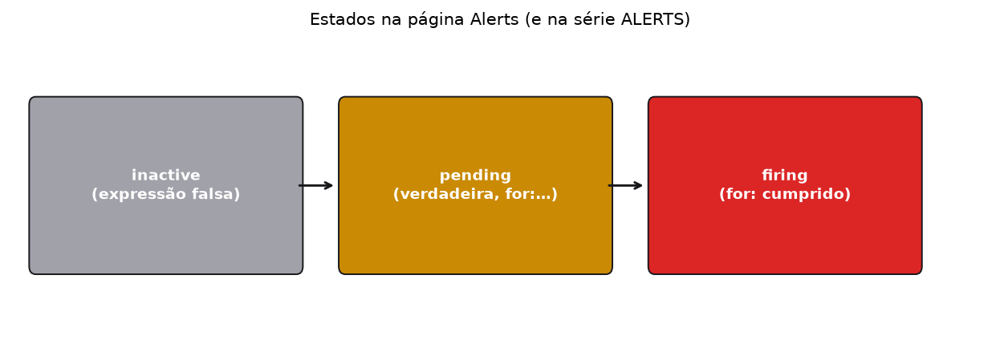
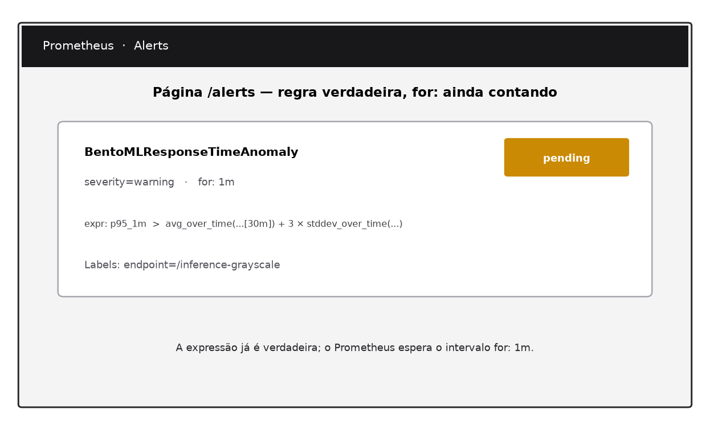
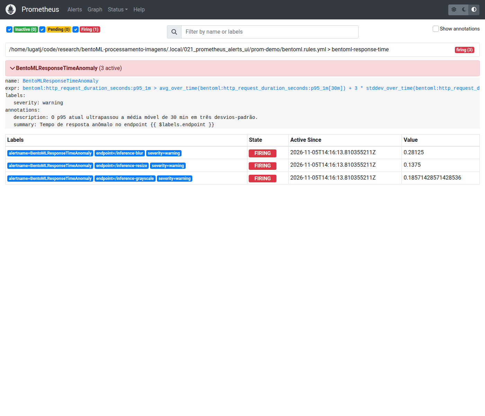

# Aula 021 — Página Alerts do Prometheus

**Conceito desta aula:** ler e interpretar a página **Alerts** do Prometheus
do curso (`http://127.0.0.1:9090/alerts`): estados inactive, pending e firing;
ligação entre a regra em
[`monitoring/bentoml.rules.yml`](../monitoring/bentoml.rules.yml) e a série
`ALERTS`; diferença face a apenas colar PromQL em Graph/Table.

Se ainda não concluiu o [tutorial Prometheus](../docs/prometheus.md) e a
aula [`010_prometheus_promql`](../010_prometheus_promql/README.md), faça-o
antes de continuar — esta pasta assume scrape, job `bentoml-imagens` e a
existência da regra `BentoMLResponseTimeAnomaly`.

## Objetivos

1. Abrir `/alerts` na instância **certa** do Prometheus (curso ou demo).
2. Localizar o alerta nomeado `BentoMLResponseTimeAnomaly` e ler severity /
   `for:`.
3. Relacionar o YAML da regra com o cartão na UI e com
   `ALERTS{alertname="…"}`.
4. Distinguir pending de firing (o papel do `for: 1m`).
5. Explicar por que Graph/Table com a expressão do alerta **não** substitui a
   página Alerts.

## Portas que esta aula espera no Host

| Processo | Porta | O que abrir |
| :--- | ---: | :--- |
| **Prometheus do curso** | **9090** | <http://127.0.0.1:9090/alerts> e `/targets` |
| **BentoML** (tráfego opcional) | **3000** | <http://127.0.0.1:3000/metrics> |

Demo auxiliar (mesma receita da 010), se `:9090` não for o Prometheus do
curso:

| Processo | Porta | O que abrir |
| :--- | ---: | :--- |
| Exporter sintético | **8010** | `/metrics` |
| Prometheus da demo | **9100** | <http://127.0.0.1:9100/alerts> |

Detalhe da demo: [`SAMPLE_DATA.md`](SAMPLE_DATA.md). Mapa do curso:
[`docs/ports.md`](../docs/ports.md).

## Pré-requisitos

1. Prometheus e `promtool` instalados ([`docs/prometheus.md`](../docs/prometheus.md)).
2. Arquivo de regras do repositório carregado:
   [`monitoring/bentoml.rules.yml`](../monitoring/bentoml.rules.yml).
3. Job `bentoml-imagens` **UP** em `/targets` (curso ou demo).

## Escopo negativo

| Isto | Não é isto |
| :--- | :--- |
| Página **Alerts** (`/alerts`) | Graph/Table com a mesma expressão PromQL |
| Estados pending / firing do motor de regras | Envio de e-mail ou pager (Alertmanager) |
| Regra versionada em `bentoml.rules.yml` | Inventar limiar só na UI sem arquivo |
| Job `bentoml-imagens` | Qualquer Prometheus que ocupe `:9090` |

## 1. Confirme a instância certa

Abra `/targets`. Deve existir o job **`bentoml-imagens`** em estado UP.

Se `:9090` listar outros jobs (cadvisor, flower, autonomia, …) e **não**
listar `bentoml-imagens`, essa porta pertence a **outro** Prometheus. Suba o
da aula (config `monitoring/prometheus.yml` na raiz) noutra porta, ou use a
demo em **9100** ([`SAMPLE_DATA.md`](SAMPLE_DATA.md)).

## 2. A regra no repositório

Trecho essencial de
[`monitoring/bentoml.rules.yml`](../monitoring/bentoml.rules.yml):

```yaml
- alert: BentoMLResponseTimeAnomaly
  expr: |
    bentoml:http_request_duration_seconds:p95_1m
      >
    avg_over_time(bentoml:http_request_duration_seconds:p95_1m[30m])
      + 3 * stddev_over_time(bentoml:http_request_duration_seconds:p95_1m[30m])
  for: 1m
  labels:
    severity: warning
```

Em prosa: o alerta candidata-se quando o p95 gravado ultrapassa a média dos
últimos 30 minutos mais três desvios-padrão na mesma janela. O `for: 1m`
exige que essa desigualdade **permaneça verdadeira** por um minuto de
avaliações antes de passar a firing.

A recording rule `bentoml:http_request_duration_seconds:p95_1m` (no mesmo
arquivo) materializa o p95 que a expressão do alerta consulta.

## 3. Ritual na página Alerts

1. Abra <http://127.0.0.1:9090/alerts> (ou `:9100/alerts` na demo).
2. Localize o cartão **BentoMLResponseTimeAnomaly**.
3. Leia severity, `for:`, labels (`endpoint`, …) e o estado atual.



| Estado na UI / em `ALERTS` | Significado |
| :--- | :--- |
| inactive (ou ausente) | Expressão falsa, ou ainda sem avaliação positiva |
| pending | Expressão verdadeira; `for:` ainda a contar |
| firing | Expressão verdadeira pelo intervalo `for:` |





As figuras acima são esquemas regeneráveis (`just generate-schematics`).
Quando a demo ou o curso dispararem de verdade, compare com a UI viva e com
os JSON em [`fixtures/`](fixtures/).

## 4. Série `ALERTS` (Table) versus página Alerts

Na Table:

```promql
ALERTS{alertname="BentoMLResponseTimeAnomaly"}
```

```promql
ALERTS{alertname="BentoMLResponseTimeAnomaly", alertstate="pending"}
```

```promql
ALERTS{alertname="BentoMLResponseTimeAnomaly", alertstate="firing"}
```

| Superfície | O que mostra bem |
| :--- | :--- |
| **Alerts** (`/alerts`) | Cartão da regra, estado, anotações, agrupamento por regra |
| **Table/Graph** com `ALERTS{…}` | Séries e labels no tempo; útil para confirmar `alertstate` |
| **Graph** com a `expr:` do YAML | Se a desigualdade é verdadeira *agora* — **não** conta o `for:` sozinha |

Colar a `expr:` do alerta no Graph responde «a condição matemática é
verdadeira neste instante?». A página Alerts responde «o motor de regras já
promoveu esta série a pending ou firing?». São perguntas diferentes.

Exemplos de payload: [`fixtures/alerts_pending_example.json`](fixtures/alerts_pending_example.json),
[`fixtures/alerts_firing_example.json`](fixtures/alerts_firing_example.json).

## 5. Provocar pending e firing (opcional)

Com a [demo sintética](SAMPLE_DATA.md) (fases estável → lenta → recuperação),
aguarde a fase lenta o suficiente para o p95 cruzar o limiar e permanecer
acima durante o `for: 1m`. Observe a transição na página Alerts.

Com o serviço real em `:3000`, gere carga lenta o bastante para o mesmo
efeito — o limiar de três desvios-padrão pode ser frágil no início da vida
do TSDB (pouca história); a 010 discute essa fragilidade.

Firing na UI **não** envia notificação sozinho: falta Alertmanager (fora do
escopo desta aula).

## Conclusão (autoavaliação)

Marque **Sim** ou **Não** sozinho.

| Verificação | Sim / Não |
| :--- | :---: |
| `/targets` mostra job `bentoml-imagens` UP (curso ou demo) | |
| `/alerts` carrega e lista `BentoMLResponseTimeAnomaly` | |
| Sei apontar no YAML o `for:` e a `expr:` dessa regra | |
| Distingo pending de firing (e o papel do `for:`) | |
| Sei por que Graph com a `expr:` não substitui a página Alerts | |
| Se usei `:9090`, confirmei que não era outra instância sem o job do curso | |

## Materiais

| Arquivo | Papel |
| :--- | :--- |
| [`monitoring/bentoml.rules.yml`](../monitoring/bentoml.rules.yml) | Recording + alerta do curso |
| [`SAMPLE_DATA.md`](SAMPLE_DATA.md) | Demo 8010/9100 |
| [`fixtures/`](fixtures/) | Exemplos JSON da série `ALERTS` |
| [`illustrations/`](illustrations/) | Esquemas da página Alerts |

```bash
cd 021_prometheus_alerts_ui
just generate-schematics
just test
```

## Roteiro da trilha

| | Pasta |
| :--- | :--- |
| **Anterior** | [`022_prometheus_rules_ui`](../022_prometheus_rules_ui/README.md) |
| **Seguinte** | [`015_prometheus_histcdf_streamlit`](../015_prometheus_histcdf_streamlit/README.md) |
