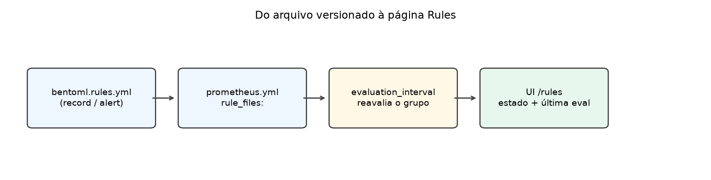
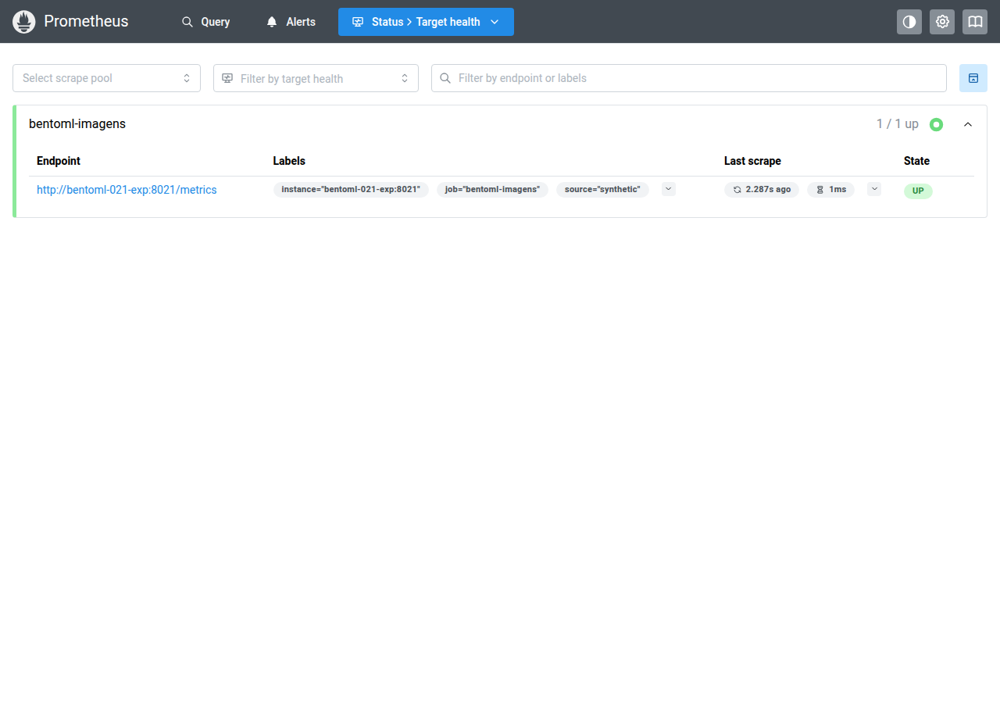
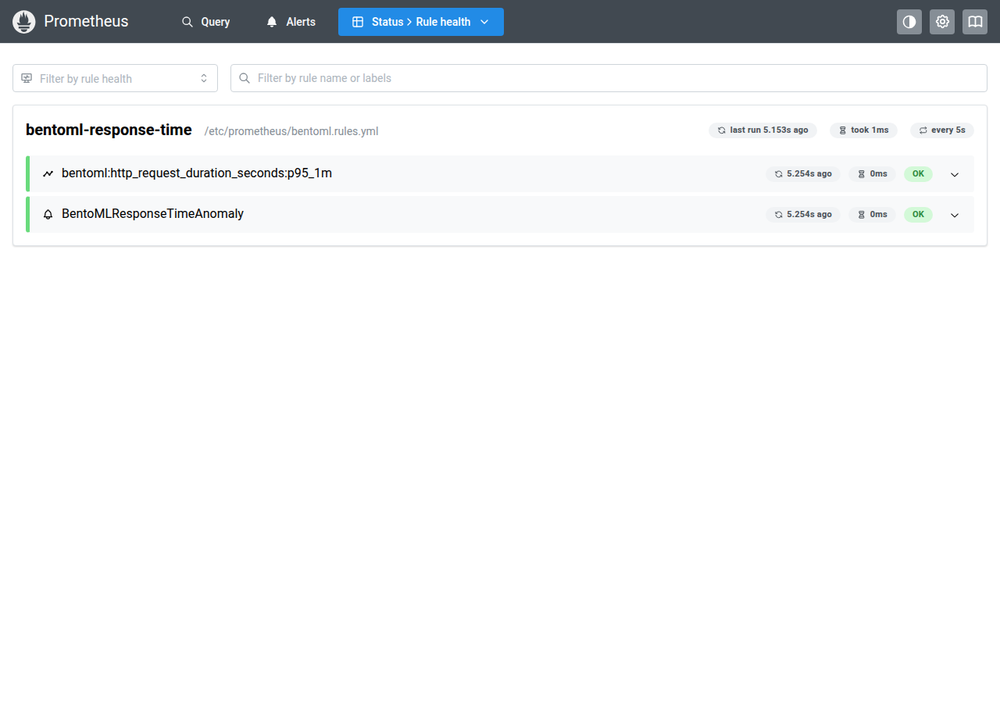
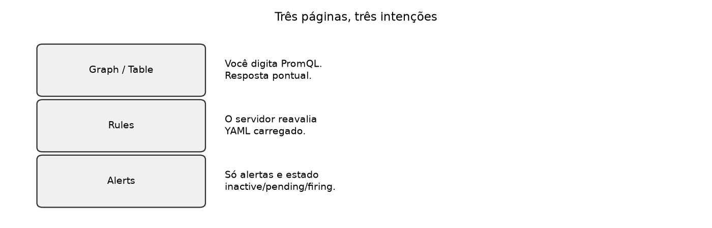
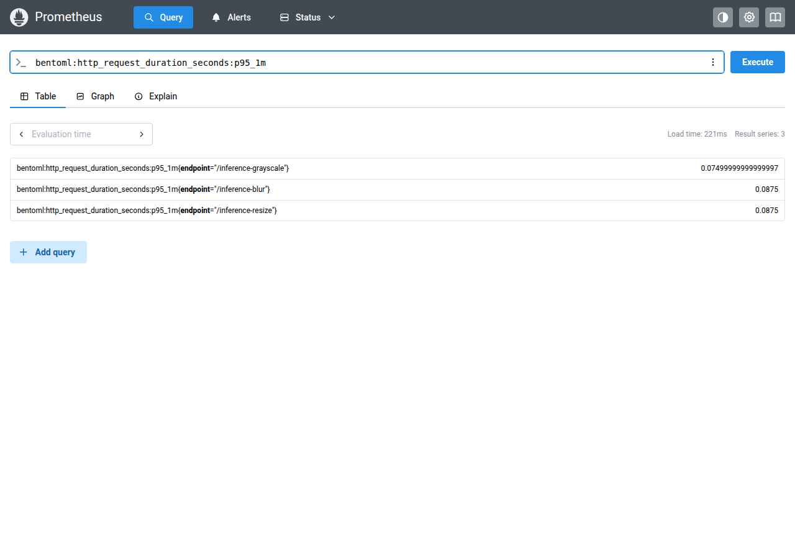
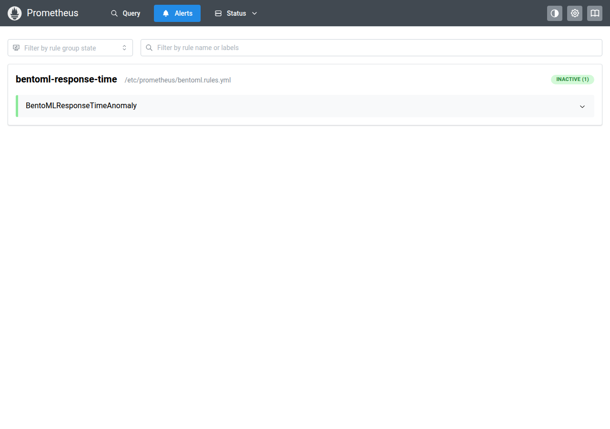
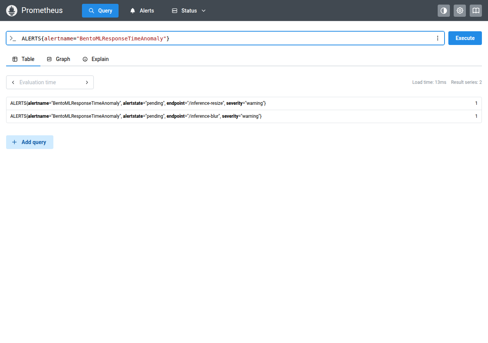

# Aula 022 — Página Rules do Prometheus

**Conceito desta aula:** ler a página **Rules** do Prometheus do curso —
localizar recording e alerting rules, relacionar cada linha com o YAML
versionado e interpretar o estado de avaliação — com checklist Sim/Não.

Graph/Table respondem a uma consulta que **você** digita. Rules mostra o
que o **servidor** reavalia sozinho a cada `evaluation_interval`, a partir
dos arquivos em `rule_files`.

## Objetivos

Pratique até conseguir:

- confirmar que a UI em `:9090` é a do curso (`job` `bentoml-imagens` em
  `/targets`);
- abrir `/rules` e apontar o grupo, o arquivo e as duas regras do repositório;
- distinguir recording rule de alerting rule na mesma página;
- dizer o que muda entre `/rules`, Graph/Table e `/alerts`;
- cruzar um trecho de
  [`monitoring/bentoml.rules.yml`](../monitoring/bentoml.rules.yml) com a
  linha correspondente na UI.

## Portas que esta aula espera no Host

Mapa completo: [`docs/ports.md`](../docs/ports.md).

| Processo | Porta | O que abrir |
| :--- | ---: | :--- |
| **BentoML** (`just serve` na raiz) | **3000** | <http://127.0.0.1:3000/metrics> |
| **Prometheus** do curso | **9090** | <http://127.0.0.1:9090/rules> |

Demo auxiliar (exporter + Prometheus só desta pasta): portas **8022** /
**9112** — ver [`SAMPLE_DATA.md`](SAMPLE_DATA.md). Não substitui o trio
canónico.

## Pré-requisitos

1. Binário `prometheus` (e, se possível, `promtool`) no `PATH`, ou o harness
   Docker desta pasta — instalação em [`docs/prometheus.md`](../docs/prometheus.md).
2. Arquivos
   [`monitoring/prometheus.yml`](../monitoring/prometheus.yml) e
   [`monitoring/bentoml.rules.yml`](../monitoring/bentoml.rules.yml).
3. BentoML a responder em `:3000/metrics` **ou** a demo em
   [`SAMPLE_DATA.md`](SAMPLE_DATA.md).

Se ainda não concluiu o tutorial de scrape e PromQL, faça-o antes de
continuar: [`docs/prometheus.md`](../docs/prometheus.md) e a pasta
[`010_prometheus_promql`](../010_prometheus_promql/README.md).

## 1. Confirme a instância certa

Abra <http://127.0.0.1:9090/targets>.

O job **`bentoml-imagens`** deve aparecer (idealmente `UP` contra
`127.0.0.1:3000`). Se a página listar cadvisor, flower, backends de outros
projetos e **não** `bentoml-imagens`, a porta 9090 é **outro** Prometheus —
não o do curso. Suba o deste repositório com
`--config.file=monitoring/prometheus.yml` (outra porta se 9090 estiver
ocupada) ou use a demo **9112** (`SAMPLE_DATA.md`).

Consulta de sanidade na Table:

~~~promql
up{job="bentoml-imagens"}
~~~

Valor `1` = scrape OK. Isso não diz se as Rules estão certas; só libera a
leitura seguinte.

## 2. Abra `/rules` e leia o grupo

Abra <http://127.0.0.1:9090/rules>.

O que a captura (e a sua UI) deve mostrar:

| Elemento na UI | Correspondência no repositório |
| :--- | :--- |
| Grupo `bentoml-response-time` | `groups[].name` em `bentoml.rules.yml` |
| Caminho do arquivo (ex.: `…/bentoml.rules.yml`) | entrada de `rule_files` em `prometheus.yml` |
| Intervalo («every 5s») | `evaluation_interval` global (aqui `5s`) |
| Badge **OK** na regra | saúde da **avaliação** (sintaxe/execução), não «alerta disparado» |

Há **duas** regras no mesmo grupo:

1. **Recording** — ícone de série; nome
   `bentoml:http_request_duration_seconds:p95_1m` (chave YAML `record:`).
2. **Alerting** — ícone de sino; nome `BentoMLResponseTimeAnomaly` (chave
   YAML `alert:`).

Expanda cada linha na UI e compare com o YAML:

~~~yaml
groups:
  - name: bentoml-response-time
    rules:
      - record: bentoml:http_request_duration_seconds:p95_1m
        expr: |
          histogram_quantile(…)
      - alert: BentoMLResponseTimeAnomaly
        expr: |
          bentoml:http_request_duration_seconds:p95_1m > …
        for: 1m
~~~

Cópia de referência nesta pasta:
[`fixtures/bentoml.rules.yml`](fixtures/bentoml.rules.yml) (igual à da
raiz `monitoring/`). Resposta da API HTTP (mesmo conteúdo estruturado):
[`fixtures/rules_api_response.json`](fixtures/rules_api_response.json).

### 2.1 Escopo Negativo

| Fora desta aula | O que isso evita misturar |
| :--- | :--- |
| Reescrever PromQL avançado / derivar o p95 no papel | Refazer a aula 010 |
| Painel Streamlit ou Dashboard Grafana | Operar UIs que esta pasta não sobe |
| Configurar Alertmanager / notificação externa | Tratar `/rules` como canal de página |
| Editar limiares «para produção» | Mudar o contrato didático do repositório |

| Dentro desta aula | Exemplos |
| :--- | :--- |
| Ritual YAML ↔ UI em `/rules` | Grupo, `record`/`alert`, estado de avaliação |
| Contraste com Graph/Table e `/alerts` | Três intenções, três páginas |

## 3. Três páginas, três intenções

| Página | Quem inicia | O que você vê |
| :--- | :--- | :--- |
| **Graph / Table** | Você (PromQL digitado) | Instantâneo ou série da consulta |
| **Rules** | O servidor (YAML carregado) | Grupos, recording + alerting, última avaliação |
| **Alerts** | O servidor (só alertas) | Estado inactive / pending / firing por alerta |

Recording rule **não** aparece como «alerta» em `/alerts`. Ela materializa
uma série; você a consulta no Graph/Table pelo nome gravado:

~~~promql
bentoml:http_request_duration_seconds:p95_1m
~~~

A página **Alerts** lista o alerta do grupo (sem a recording):

Para o estado do alerta via PromQL (útil quando a UI está vazia):

~~~promql
ALERTS{alertname="BentoMLResponseTimeAnomaly"}
~~~

| Estado do alerta | Leitura operacional |
| :--- | :--- |
| inactive (ou ausente em `ALERTS`) | Expressão falsa, ou ainda sem amostra positiva |
| pending | Expressão verdadeira; `for:` ainda não cumprido |
| firing | Expressão verdadeira pelo intervalo `for:` |

**OK** em `/rules` ≠ `firing` em `/alerts`. OK = a regra foi avaliada sem
erro de execução. O alerta pode permanecer inactive com health OK.

## 4. Ritual (cheque sozinho)

1. Confirme `bentoml-imagens` em `/targets` (ou use a demo 9112).
2. Abra `/rules`. Anote: nome do grupo, caminho do arquivo, intervalo.
3. Identifique a recording e a alerting na UI; abra o YAML e marque as
   chaves `record:` e `alert:`.
4. No Graph/Table, execute o nome da recording rule; anote se há séries.
5. Abra `/alerts` e diga se o alerta está inactive, pending ou firing —
   sem confundir com o badge OK de `/rules`.
6. Rode (opcional, se `promtool` estiver instalado):

~~~bash
promtool check rules monitoring/bentoml.rules.yml
~~~

## 5. Materiais

| Arquivo | Papel |
| :--- | :--- |
| [`fixtures/bentoml.rules.yml`](fixtures/bentoml.rules.yml) | Cópia do YAML do curso |
| [`fixtures/rules_api_response.json`](fixtures/rules_api_response.json) | `GET /api/v1/rules` do harness |
| [`fixtures/targets_api_response.json`](fixtures/targets_api_response.json) | `GET /api/v1/targets` do harness |
| [`SAMPLE_DATA.md`](SAMPLE_DATA.md) | Demo 8022/9112 |
| [`scripts/capture_screenshots.sh`](scripts/capture_screenshots.sh) | Regenera PNGs + fixtures |
| [`scripts/generate_schematic_figures.py`](scripts/generate_schematic_figures.py) | Figuras 00 e 06 |

~~~bash
cd 022_prometheus_rules_ui
bash scripts/capture_screenshots.sh
uv run --no-active --with matplotlib python scripts/generate_schematic_figures.py
~~~

## Conclusão (autoavaliação)

Marque **Sim** ou **Não** sozinho.

| Verificação | Sim / Não |
| :--- | :---: |
| Em `/targets`, o job `bentoml-imagens` aparece (curso `:9090` ou demo `:9112`) | |
| Em `/rules`, vejo o grupo `bentoml-response-time` e as duas regras (recording + alerting) | |
| Relacionei `record:` / `alert:` do YAML com as linhas da UI | |
| Expliquei a diferença entre `/rules`, Graph/Table e `/alerts` (OK ≠ firing) | |
| Consultei a série da recording rule na Table (ou registrei ausência com causa) | |

## Roteiro da trilha

| | Pasta |
| :--- | :--- |
| **Anterior** | [`010_prometheus_promql`](../010_prometheus_promql/README.md) |
| **Seguinte** | [`021_prometheus_alerts_ui`](../021_prometheus_alerts_ui/README.md) |
