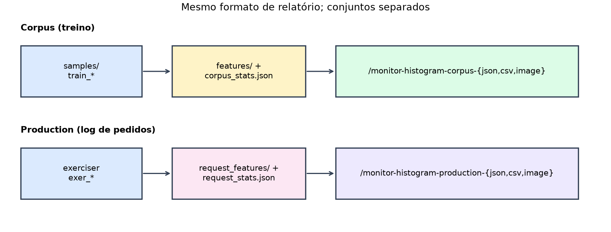
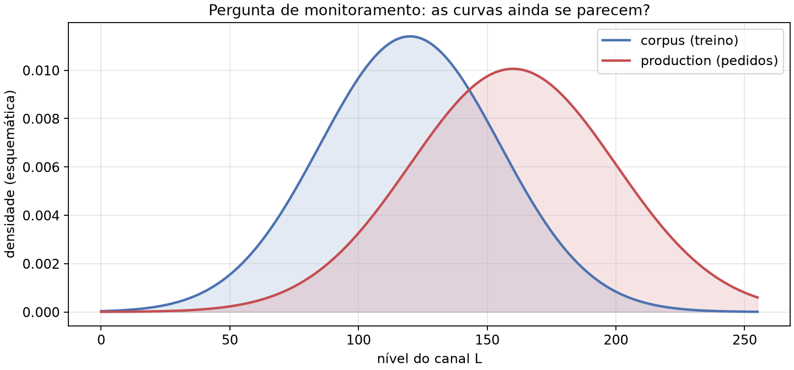
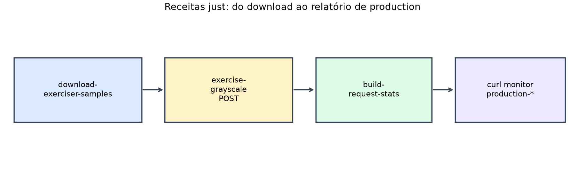

# Aula 030 — Histogramas do log de pedidos e exercitador

## Objetivo

- **Finalidade pedagógica (MLOps):** descobrir se as imagens que chegam em
  *production* (pedidos reais a `/inference-grayscale`) **diferem** das imagens
  usadas no *training* (corpus `samples/beaches/`), olhando para as mesmas estatísticas
  de canal — e compreender **por que** essa vigilância importa.
- Agregar `request_features/` em `request_stats.json` e **reportar** histogramas
  de production (`/monitor-histogram-production-*`), gêmeos dos do corpus, para
  que a comparação visual/numérica seja possível lado a lado.
- Separar **download offline** do exercitador (`bentoml-exer-*`) da **submissão
  cronometrada** a `/inference-grayscale`.
- Árvore **autocontida**: cópia independente do serviço base (raiz); **sem pesos neurais**.

As figuras abaixo vivem em `illustrations/` (regeneráveis com
`just generate-production-hist-illustrations`).



## Comparação com a base

O serviço base não registra pedidos nem expõe monitoramento. Esta aula acrescenta
o par corpus/production e o exercitador.

**AS-IS (base)** — só inferência:

```python
@bentoml.api(route="/inference-grayscale")
def inference_grayscale(self, image: ImageInput) -> PILImage:
    return image.convert("L")
# (sem monitor-*)
```

**TO-BE (esta aula)** — log + relatórios production:

```python
@bentoml.api(route="/inference-grayscale")
def inference_grayscale(self, image: ImageInput) -> PILImage:
    log_grayscale_submission(image)
    return self._grayscale_model(image)

@bentoml.api(route="/monitor-histogram-production-json")
def monitor_histogram_production_json(self, channel: str = "L", bins: Positive = 256) -> dict:
    return report_request_histogram_json(channel=channel, bins=bins)
# + csv / image; corpus permanece em /monitor-histogram-corpus-*
```

| Rotas | Base | Esta aula |
| :--- | :---: | :---: |
| `/inference-{blur,grayscale,resize}` | sim | sim |
| `/monitor-histogram-corpus-{json,csv,image}` | não | sim |
| `/monitor-histogram-production-{json,csv,image}` | não | sim |

## Entrada e saída

**Conjuntos (não misturar):**

```text
samples/beaches/*.jpg          Commons  praias   (corpus, raiz do repo)
samples/forests/*.jpg          Commons  florestas (produção / exercitador)
samples/balls/*.jpg            Commons  bolas    (contaminantes opcionais)
```

**Entrada de monitoramento:** `POST` com `channel` (padrão `L`) e `bins`
(padrão `256`) nas rotas gémeas.

**Saída esperada (forma):** JSON/CSV/PNG de histograma + CDF — o mesmo contrato
para corpus e production; só muda a origem dos dados
(`corpus_stats.json` versus `request_stats.json`).



Exemplo de chamada após exercitar o serviço:

```bash
just curl-monitor-histogram-production-json
just curl-monitor-histogram-corpus-json
```

Porta: **3333**.

## Como executar

A partir da raiz do repositório:

```bash
cd 030_request_log_histograms
just sync
just download-samples
just download-exerciser-samples
just extract-features
just build-corpus-stats
just save-grayscale-model
```



**Terminal 1 — servidor**

```bash
just serve
```

**Terminal 2 — cliente**

```bash
just exercise-grayscale
just build-request-stats
just curl-monitor-histogram-production-json
just curl-monitor-histogram-corpus-json
just curl-monitor-histogram-production-image
```

Swagger: `just swagger`. Testes: `just test`.

### Atividade assíncrona

Rode `just download-exerciser-samples` (se ainda não tiver), `just serve`,
`just exercise-grayscale`, `just build-request-stats`. Guarde lado a lado:

- a PNG de `just curl-monitor-histogram-corpus-image`
- a PNG de `just curl-monitor-histogram-production-image`

(canal L, 256 bins). Em meia página: as curvas coincidem? Onde divergem
(brilho, caudas, pico)? Por que isso importa para alguém que opera o serviço em
produção?

## O que acontece por dentro

### Fluxo

```text
download-exerciser-samples  →  samples/forests/   (já no git; raiz do repo)
exercise-grayscale          →  POST /inference-grayscale  (só submete; imprime tempos)
build-request-stats         →  request_stats.json
monitor-histogram-production-*  ←  lê request_stats.json
monitor-histogram-corpus-*      ←  lê corpus_stats.json
```

Em sistemas de visão (e, por analogia, em qualquer modelo servido), o
desempenho no laboratório só se mantém se os dados de **produção** se
parecerem com os de **treino**. Quando a distribuição muda — câmeras
diferentes, iluminação nocturna, compressão agressiva, outro domínio de
conteúdo — o serviço continua a responder HTTP 200, mas a qualidade da
transformação (ou, em outros projetos, da predição) **degrada em silêncio**.

Esta aula usa histogramas e CDF de L/R/G/B como **proxy observável** dessa
distribuição. O corpus é a referência do treino; o log agregado é o que a API
recebe agora. Ao colocar os dois relatórios no mesmo formato, o estudante pode:

1. Exercitar o serviço com imagens **outras** que as do corpus (`bentoml-exer-*`).
2. Reconstruir `request_stats.json` e comparar forma das curvas com
   `corpus_stats.json`.
3. Formular a pergunta de monitoramento: *a produção ainda se parece com o
   treino?* — base da detecção de *data drift* / *covariate shift*.

### Algoritmo

```text
# Variáveis:
# request_features/*.json — um arquivo por POST /inference-grayscale
# request_stats.json — agregado do log (espelho de corpus_stats.json)
# channel, bins — parâmetros das rotas /monitor-histogram-production-*

request_stats ← aggregate(request_features)
report_production ← same format as report_corpus(channel, bins)
```

Por que isto é importante na prática:

- **Falsos negativos de qualidade:** métricas de *uptime* e latência não
  detectam imagens “estranhas”; só métricas de **dados** o fazem.
- **Decisão de re-treino ou de alerta:** se production diverge de forma
  estável, há de se investigar a origem (cliente, pipeline, domínio) antes de
  culpar o modelo.
- **Separação de responsabilidades:** inferência continua a servir o cliente;
  monitoramento observa o tráfego sem misturar os conjuntos de arquivos
  (`samples/beaches/` versus `samples/forests/`).

### Por que o PNG do histograma usa Pillow

As rotas `/monitor-…-image` devolvem um `PIL.Image` — o mesmo tipo que a
inferência já usa para abrir e filtrar fotos. O desenho em
`histogram.draw_histogram` usa `ImageDraw`: retângulos para as barras e uma
polilinha para a CDF, a partir de contagens já calculadas. O endpoint HTTP
permanece no ecossistema Pillow do serviço: não carrega Matplotlib nem Seaborn
só para montar essa figura estática. Bibliotecas de gráfico estatístico
encaixam melhor em notebooks, CLIs ou apps interativos; aqui o contrato é
«receber/devolver imagem» de ponta a ponta.

[`040_ks_production_vs_corpus`](../040_ks_production_vs_corpus/README.md)
