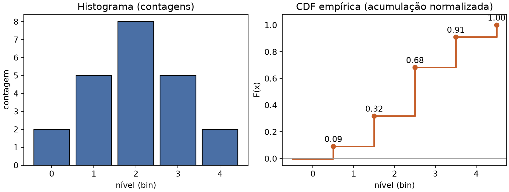
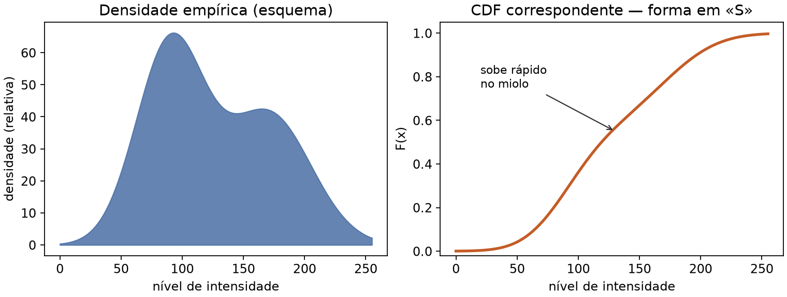
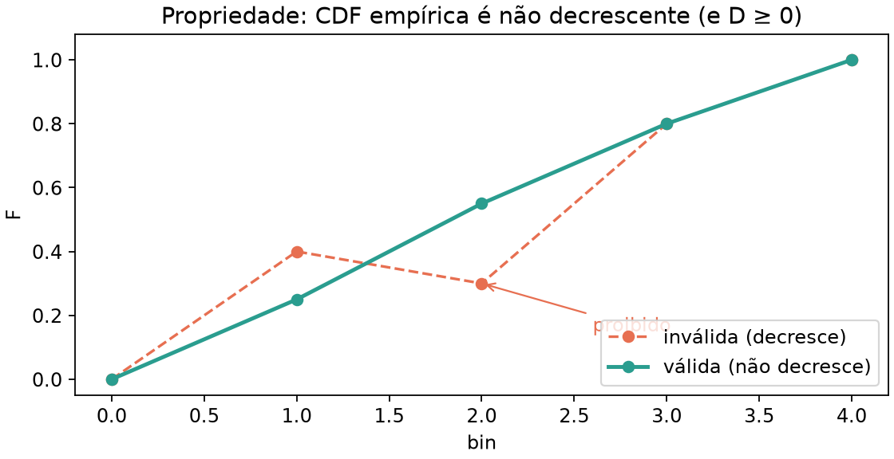
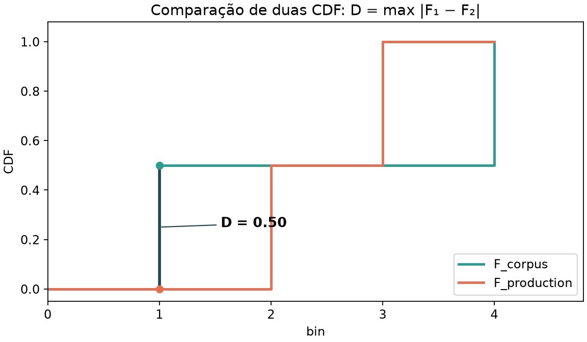
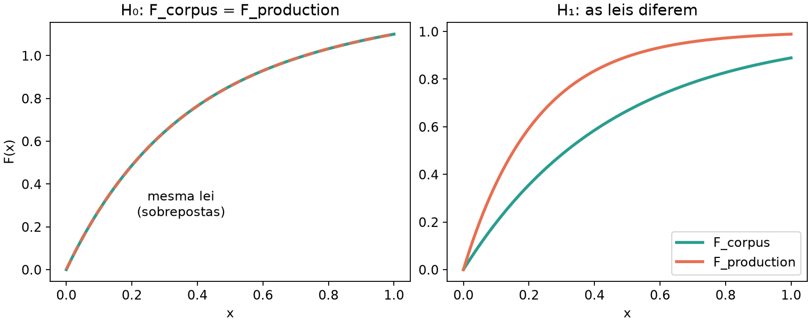
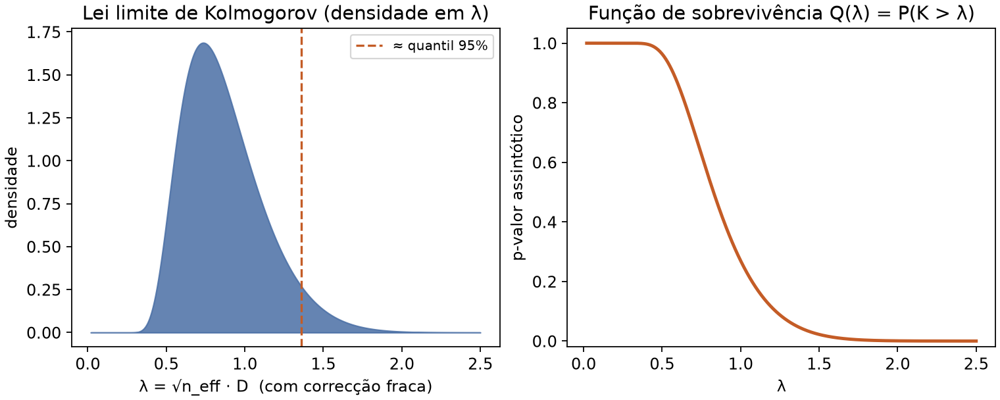

# Lição 040 — Kolmogorov–Smirnov: production contra corpus

## Objetivo

- Compreender a estatística de **Kolmogorov–Smirnov (KS)** desde a CDF
  construída a partir de um histograma até ao p-valor assintótico.
- Comparar a CDF agregada de **production** (log de `/inference-grayscale`) com a
  de **corpus** (treino) via `/monitor-ks-production-corpus-json`.
- Conservar inferência, histogramas corpus/production e o exercitador.
- Árvore **autocontida**: cópia independente do serviço base (raiz); **sem pesos neurais**.

## Comparação com a base

O serviço base não compara datasets. Esta lição introduz o pipeline `ks` sob o
prefixo `monitor-`.

**AS-IS (base)** — apenas filtros:

```python
@bentoml.api(route="/inference-grayscale")
def inference_grayscale(self, image: ImageInput) -> PILImage:
    return image.convert("L")
```

**TO-BE (esta lição)** — KS sobre CDFs já agregadas:

```python
@bentoml.api(route="/monitor-ks-production-corpus-json")
def monitor_ks_production_corpus_json(
    self, channel: str = "L", bins: Positive = 256
) -> dict:
    return compare_production_to_corpus(channel=channel, bins=bins)
```

`ks_compare`: **D** = max |F_corpus − F_production|; **n_eff** a partir do número
de **imagens**; **p_value** pela aproximação assintótica clássica de KS.

| Rotas | Base | Esta lição |
| :--- | :---: | :---: |
| `/inference-{blur,grayscale,resize}` | sim | sim |
| `/monitor-histogram-corpus-{json,csv,image}` | não | sim |
| `/monitor-histogram-production-{json,csv,image}` | não | sim |
| `/monitor-ks-production-corpus-json` | não | sim |

## Utilização

### Kolmogorov–Smirnov desde o princípio

As figuras abaixo vivem em `illustrations/` (regeneráveis com
`just generate-ks-illustrations`). O código de serviço correspondente está em
`ks_compare.py` e `histogram.cumulative_distribution`.

#### Do histograma à CDF

Um histograma de um canal (L, R, G ou B) é uma lista de **contagens**
`c[0], c[1], …, c[B−1]`: o bin `i` conta quantos píxeis caíram naquele nível
(ou grupo de níveis). A **função de distribuição acumulada empírica** normaliza
a soma parcial:

```text
F(i) = (c[0] + c[1] + … + c[i]) / (c[0] + … + c[B−1])
```

Assim `F(i)` ∈ [0, 1] e `F(B−1) = 1` (se houver pelo menos um píxel). No código:

```python
# histogram.py — cumulative_distribution(counts)
running = 0
for value in counts:
    running += int(value)
    cdf.append(running / total)
```



**Exemplo numérico (5 bins).** Contagens `[2, 5, 8, 5, 2]` (total = 22):

| bin | contagem | acumulado | F |
| ---: | ---: | ---: | ---: |
| 0 | 2 | 2 | 2/22 ≈ 0,09 |
| 1 | 5 | 7 | 7/22 ≈ 0,32 |
| 2 | 8 | 15 | 15/22 ≈ 0,68 |
| 3 | 5 | 20 | 20/22 ≈ 0,91 |
| 4 | 2 | 22 | 22/22 = 1,00 |

#### Propriedades da CDF e a forma em «S»

Para uma CDF (empírica ou teórica) cumprem-se, em particular:

1. **Valores em [0, 1]** — probabilidade acumulada.
2. **Não decrescente** — mais massa à direita nunca reduz F (ver seção de
   positividade / monotonicidade abaixo).
3. **Limites** — à esquerda F ≈ 0; à direita F = 1 (amostra finita completa).
4. **Forma em «S» (sigmoidal)** — em imagens naturais, a densidade de
   intensidade concentra-se num intervalo intermédio: a CDF sobe devagar nas
   caudas escuras/claras e **acelera no miolo**, desenhando um «S» suave.



Essa forma **não** é uma lei universal obrigatória; é o padrão visual que o
estudante verá muitas vezes ao plotar CDF de luminância de fotografias.

#### Positividade e monotonicidade (o que não pode acontecer)

«Positividade» aqui tem dois sentidos úteis:

- As **contagens** do histograma são ≥ 0; logo os incrementos de F são ≥ 0.
- A estatística KS **D** é definida com valor absoluto: **D ≥ 0** sempre.

Uma sequência que **desce** não pode ser CDF empírica de um histograma de
contagens:



#### Comparar duas CDF: a estatística D

Dados dois conjuntos (corpus e production) com o **mesmo** número de bins,
sejam F e G as respectivas CDF. A estatística de Kolmogorov–Smirnov a duas
amostras é

```text
D = max_i |F(i) − G(i)|
```

É a maior distância vertical entre as duas escadas. No serviço:

```python
# ks_compare.ks_statistic
return max(abs(a - b) for a, b in zip(cdf_a, cdf_b))
```



**Exemplo trabalhado (4 bins) — o das figuras.**

| bin | c_corpus | c_production | F | G | \|F−G\| |
| ---: | ---: | ---: | ---: | ---: | ---: |
| 1 | 10 | 0 | 0,50 | 0,00 | 0,50 |
| 2 | 0 | 10 | 0,50 | 0,50 | 0,00 |
| 3 | 0 | 10 | 0,50 | 1,00 | 0,50 |
| 4 | 10 | 0 | 1,00 | 1,00 | 0,00 |

Total de cada histograma = 20. **D = 0,50** (atingido nos bins 1 e 3).

Confirmação rápida em Python (na pasta desta lição):

```bash
uv run --no-active python -c "
from ks_compare import ks_statistic
from histogram import cumulative_distribution
F = cumulative_distribution([10, 0, 0, 10])
G = cumulative_distribution([0, 10, 10, 0])
print('F', F)
print('G', G)
print('D', ks_statistic(F, G))
"
```

#### Que hipótese o teste KS confronta?



- **H₀ (nula):** as duas amostras vêm da **mesma** lei de distribuição contínua
  (aqui: a mesma distribuição de intensidade do canal). Sob H₀, F e G flutuam
  em torno da mesma curva; D tende a ser **pequeno** quando n cresce.
- **H₁ (alternativa):** as leis **diferem**. D tende a ser **maior**.

O teste **não** diz *por que* diferem (câmeras, domínio, bug de pré-processamento);
só quantifica se o afastamento máximo das CDF é compatível com o acaso sob H₀.

Nesta lição, corpus = referência de treino e production = pedidos servidos: um
D grande (e p-valor pequeno) é o alarme didático de *data drift* nas
intensidades.

#### Distribuição assintótica e p-valor

Para duas amostras de tamanhos n e m, define-se o tamanho efectivo

```text
n_eff = n · m / (n + m)
```

No serviço, n e m são os **números de imagens** (`n_images_*`), ficção MLOps de
drift entre *datasets*; a forma de F/G continua a vir dos píxeis agregados.

Sob H₀, com n_eff → ∞,

```text
λ = (√n_eff + 0,12 + 0,11/√n_eff) · D
```

(a correcção 0,12 + 0,11/√n_eff é a forma clássica usada em `ks_p_value`)
aproxima-se da lei de **Kolmogorov**. O p-valor assintótico (sobrevivência) é

```text
p ≈ Q(λ) = 2 Σ_{k=1..∞} (−1)^{k−1} exp(−2 k² λ²)
```



**Leitura:** λ grande ⇒ cauda Q(λ) pequena ⇒ rejeita-se H₀ a níveis usuais
(0,05; 0,01). Se D = 0, p = 1 (código: early-return).

**Exemplo numérico com o D = 0,50 do quadro de 4 bins.** Suponha n = m = 20
imagens → n_eff = 10.

```text
λ ≈ (√10 + 0,12 + 0,11/√10) · 0,50 ≈ (3,162 + 0,12 + 0,035) · 0,50 ≈ 1,66
```

Q(1,66) é já pequeno (ordem de poucos por cento ou menos): com este afastamento
grosseiro de CDF, H₀ fica em dificuldades — como o desenho das duas escadas
sugere.

```bash
uv run --no-active python -c "
from ks_compare import ks_p_value
print('p', ks_p_value(0.50, 10.0))
"
```

#### Ligação ao endpoint

`/monitor-ks-production-corpus-json` devolve, entre outros:

| Campo | Significado |
| :--- | :--- |
| `statistic` | D |
| `p_value` | Q(λ) assintótico |
| `n_eff` | n·m/(n+m) com n, m = imagens |
| `n_pixels_*` | soma das contagens (auditoria da forma) |
| `channel` / `bins` | canal e resolução usados |

### Conceitos mínimos (rotas)

```text
/inference-{op}                         # grayscale | blur | resize
/monitor-{pipeline}-{dataset}-{repr}    # histogram | ks
```

```text
corpus_stats.json ──CDF──┐
                         ├── max |F_c − F_p| → statistic, p_value, n_eff
request_stats.json ─CDF──┘
```

Padrão: `channel="L"`, `bins=256`. Porta: **3333**.

Regenerar figuras: `just generate-ks-illustrations`.

### Por que o PNG do histograma usa Pillow

As rotas `/monitor-…-image` devolvem um `PIL.Image` — o mesmo tipo que a
inferência já usa para abrir e filtrar fotos. O desenho em
`histogram.draw_histogram` usa `ImageDraw`: retângulos para as barras e uma
polilinha para a CDF, a partir de contagens já calculadas. O endpoint HTTP
permanece no ecossistema Pillow do serviço: não carrega Matplotlib nem Seaborn
só para montar essa figura estática. (As ilustrações didácticas do KS em
`illustrations/` usam Matplotlib offline, fora do processo do servidor.)
Bibliotecas de gráfico estatístico encaixam melhor em notebooks, CLIs ou apps
interativos; no HTTP o contrato é «receber/devolver imagem» de ponta a ponta.

### Preparação

```bash
cd 040_ks_production_vs_corpus
just sync
just download-samples            # samples/beaches/ na raiz
just download-exerciser-samples  # samples/forests/ na raiz
just extract-features
just build-corpus-stats
just save-grayscale-model
```

### Terminal 1 — servidor

```bash
just serve
```

### Terminal 2 — cliente

```bash
just exercise-grayscale
just build-request-stats
just curl-monitor-ks-production-corpus-json
just curl-monitor-histogram-corpus-json
just curl-monitor-histogram-production-json
```

Swagger: `just swagger`. Testes: `just test`.

### Atividade assíncrona

Com corpus e production agregados, chame
`just curl-monitor-ks-production-corpus-json` e anote `statistic`, `p_value` e
`n_eff`. Depois, **substitua** mentalmente (ou num script) o exemplo de 4 bins
do capítulo KS (`[10,0,0,10]` vs `[0,10,10,0]`) e calcule D à mão; confira com
`ks_statistic` + `ks_p_value` para `n_eff = 10`. Entregue: (a) o JSON real do
endpoint; (b) D e p do exemplo de brinquedo; (c) uma frase dizendo se rejeitaria
H₀ a 5% em cada caso.
